# О документе

Руководство описывает администрирование «Дашбордов компании» версии 0.4.0: роли и уровни доступа, пользователей, профили доступа и личные настройки, полномочия администрирования, структуру компании и подразделения, импорт и экспорт структуры и сотрудников, показатели сквозного отчёта и то, как доступ сотрудников разных уровней определяет отчёт, вход по учётной записи домена (LDAP), синхронизацию с Active Directory, входящие данные и интеграции с системами компании — «По Делу», «Пульсом проекта», Jira, Confluence, Bitrix24, почтой Exchange и 1С, — настройку служб, журнал изменений, палитры, сведения о системе, демонстрационный стенд и типовые задачи обслуживания.

Документ предназначен для администраторов системы, сотрудников с полномочиями «Ведёт пользователей и доступ», «Ведёт структуру компании», «Ведёт сквозные отчёты», «Входящие данные» и «Интеграции», а также руководителей служб с уровнем доступа «Управление». Повседневная работа описана в «Руководстве пользователя», установка, переменные окружения и обновление — в «Руководстве по развёртыванию».

Руководство открывается в приложении: **Справка → Руководство администратора** — администратору и сотрудникам с любым полномочием администрирования (раздел «Полномочия»). Кнопка «?» в заголовке страницы администрирования открывает раздел руководства об этой странице. Остальным пункт не виден, а прямая ссылка показывает «Нет доступа»: «Руководство администратора доступно администратору и сотрудникам с полномочиями администрирования: структура компании, пользователи и доступ, сквозные отчёты, входящие данные, интеграции».

# Роли и уровни доступа

## Роли

| Роль | Права |
| --- | --- |
| **Администратор** | полный доступ ко всем службам на уровне «Управление», ко всем данным и ко всему администрированию: пользователи, профили доступа, подразделения, импорт и экспорт, показатели сквозного отчёта, входящие данные и интеграции, вход по домену, журнал изменений, палитры, сведения о системе |
| **Пользователь** | службы и данные по своему профилю доступа и личным настройкам; части администрирования — по полномочиям (раздел «Полномочия») |

## Уровни доступа к службе

| Уровень | Служба персонала | Техническая поддержка | Партнёрства |
| --- | --- | --- | --- |
| **Просмотр** | дашборд, реестр, сводка, цели, PDF и Excel, свои дашборды | дашборд, недельный отчёт, сравнение, Naumen, PDF, Excel и CSV | дашборд, реестр, сводка, хронология, правила светофора (чтение), PDF и Excel |
| **Ввод данных** | + месяцы, метрики, приёмы и увольнения, заметки; общие дашборды | + добавление и правка недель | + добавление, правка и удаление партнёрств |
| **Управление** | + светофор, цели, удаление месяцев | + светофор, загрузка отчёта и выгрузки Naumen | + правила светофора партнёрств |

Уровень службы — одно из измерений доступа. Реестры, персональные данные, выгрузка и область структуры дополнительно ограничиваются профилем доступа и личными настройками (раздел «Доступ и профили доступа»). Уровень **Нет доступа**, заданный лично, закрывает службу, даже если её даёт профиль.

Доступ можно выдать и к службам, у которых пока нет дашборда («Аппарат генерального директора», «Финансовая служба», «ИТ-служба» и другие): они появятся у пользователя, когда получат экраны. Уже сейчас уровень «Ввод данных» к такой службе даёт ввод показателей сквозного отчёта, которыми она владеет (раздел «Показатели и сквозной отчёт»).

> **Важно.** Права проверяет сервер на каждом запросе. Скрытые в интерфейсе кнопки — удобство, а не защита.

## Перенос прав при обновлении до 0.2.0

Обновление не меняет доступ существующих пользователей:

| Было в 0.1.0 | Стало в 0.2.0 |
| --- | --- |
| уровни служб пользователя | те же уровни, заданные лично; профиль не назначен — «Индивидуальная настройка» (вся компания, все классы данных, реестры и выгрузка, как в 0.1.0) |
| «Только свои подразделения» у службы персонала | своя область службы «Своя ветка структуры» |
| подразделения пользователя | первое по алфавиту — основное подразделение, остальные — дополнительные подразделения области доступа |
| плоский справочник подразделений | подразделения верхнего уровня дерева структуры; вложить их в нужные уровни можно в «Подразделениях» или загрузкой структуры |
| пароли | без изменений; вход по домену включается отдельно |

Профили доступа назначайте постепенно: пользователь с «Индивидуальной настройкой» работает как раньше.

## Перенос прав при обновлении до 0.1.0

| Было | Стало |
| --- | --- |
| роль «Администратор» | роль «Администратор» |
| роль «Начальник службы персонала» | «Пользователь» + служба персонала: «Управление» |
| роль «Просмотр» | «Пользователь» с прежним доступом к службам |
| роль «Просмотр отдела» | «Пользователь» + служба персонала: «Просмотр», только свои подразделения |
| уровни «чтение», «правка», «метрики», «админ» | «Просмотр», «Ввод данных», «Ввод данных», «Управление» |

# Первичная настройка

1. Войдите под учётной записью первого администратора (см. «Руководство по развёртыванию», «Первый вход») и смените временный пароль.
2. **Администрирование → Подразделения** — постройте структуру компании: верхний уровень (компания), дирекции, службы, отделы; назначьте руководителей. Большую структуру удобнее загрузить: **Импорт и экспорт** (структура из файла, список сотрудников или Active Directory).
3. **Администрирование → Профили доступа** — проверьте встроенные профили и при необходимости создайте свои (например, «Финансовый контролёр»).
4. **Администрирование → Пользователи** — создайте учётные записи (или выдайте доступ загруженным сотрудникам), укажите подразделение, профиль доступа и личные настройки.
5. При необходимости включите вход по учётной записи домена и проверьте его на странице **Вход по домену** (раздел «Вход по домену (LDAP)»).
6. Выдайте полномочия «Ведёт структуру компании», «Ведёт пользователей и доступ» и «Ведёт сквозные отчёты» тем, кто будет вести структуру, пользователей и сквозной отчёт без роли администратора.
7. Руководители служб с уровнем «Управление» проверяют пороги светофора и цели, загружают данные: недельный отчёт техподдержки и выгрузку Naumen — файлами, данные службы персонала — вводом по месяцам.
8. **Администрирование → Показатели** — заполните каталог показателей сквозного отчёта: вычисляемые из данных служб и вводимые по подразделениям; проверьте «Подразделения служб». Выдайте уровень «Ввод данных» к службам-владельцам тем, кто вводит значения (раздел «Показатели и сквозной отчёт»).
9. **Входящие данные** — проверьте вкладку «Папка» (папка «Входящие» доступна, планировщик «Работает»), выпустите ключи для систем, которые будут присылать файлы, подключите системы компании в **Администрирование → Интеграции** и включите «применять сразу» для проверенных источников (раздел «Интеграции и входящие данные»). Выдайте полномочия «Входящие данные» и «Интеграции» тем, кто будет вести их без роли администратора.
10. **Администрирование → Палитры** — при необходимости выберите палитру под фирменный стиль.

# Пользователи

## Список пользователей

**Администрирование → Пользователи** (администратор и полномочие «Ведёт пользователей и доступ»).


**Сводка** под заголовком: всего · активных · отключено · без доступа · по домену · администраторов. Щелчок по числу показывает этих пользователей.

**Фильтры** (сохраняются в адресе страницы):

- поиск по ФИО, логину, e-mail и должности;
- статус: **Все**, **Активные**, **Отключённые**, **Без доступа**;
- роль: **Все роли**, **Администраторы**, **Пользователи**;
- подразделение — любое из дерева или **Без подразделения**;
- профиль доступа — любой или **Индивидуальная настройка**;
- способ входа: **Пароль системы** или **Вход по домену**.

**Строка пользователя**: имя с метками, логин и e-mail; должность, подразделение с путём и руководитель (↑, «назначен явно» — если задан явно); профиль доступа («Полный доступ» у администратора) и личные уровни служб («лично: Техподдержка — управление»); статус — переключатель **Активен / Отключён** и время последнего входа; действия: **Изменить**, **Доступ** (карточка сразу на вкладке «Доступ»), **Выдать доступ** или **Сбросить пароль** / **Перевести на пароль системы**, **Удалить**. **Профили доступа** в заголовке страницы открывают одноимённый раздел.

## Статусы и метки

| Статус или метка | Значение |
| --- | --- |
| **Активен** | может входить в систему |
| **Отключён** | вход запрещён, сессии завершены; карточка, доступ и место в структуре сохраняются |
| **Без доступа** | учётная запись системы без пароля (например, загружена списком или из файла): видна в структуре, но войти не может, пока не выдан доступ |
| метка **домен** | входит по учётной записи домена; пароль хранит домен |
| метка **без пароля** | пароль не задан — нужен «Выдать доступ» |
| метка **временный пароль** | при входе пользователь задаст свой пароль |
| метка **администратор**, **Вы** | роль администратора; ваша учётная запись |

## Карточка пользователя

Щелчок по строке открывает карточку справа. В шапке — роль, статус, метки, профиль доступа, дата создания, последний вход и способ входа («Пароль системы» или «Учётная запись домена с …»).

| Вкладка | Что на ней |
| --- | --- |
| **Профиль** | ФИО, e-mail, телефон, должность, **Подразделение** (основное — вершина области доступа), руководитель (определяется по структуре, назначается в «Структуре компании»), роль (только администратор), статус |
| **Доступ** | профиль доступа, личные настройки измерений, уровни служб, дополнительные подразделения и «Действующий доступ» (раздел «Доступ и профили доступа») |
| **Полномочия** | «Ведёт структуру компании», «Ведёт пользователей и доступ», «Ведёт сквозные отчёты» (только администратор) |
| **Журнал** | изменения учётной записи и её входы со значениями «до» и «после»; **Весь журнал изменений** (только администратор) |

Точка у названия вкладки — есть несохранённые изменения. **Сохранить** сохраняет все вкладки, **Отмена** закрывает карточку. Внизу карточки — **Выдать доступ** или сброс пароля и **Удалить**.

## Создание пользователя

**Добавить пользователя** открывает окно «Новый пользователь».


- **Учётная запись**: логин (латиница, цифры и `. _ @ -`), ФИО, e-mail, телефон, должность, подразделение.
- **Доступ**: роль (только администратор), профиль доступа (с кратким описанием и фактами: область, данные, глубина, записи, выгрузка, службы) и уровни служб с дашбордом: «Как в профиле», «Нет доступа» или уровень лично. Остальные личные настройки задаются в карточке после создания.
- **Способ входа** — см. таблицу ниже.
- **Полномочия** (только администратор) — см. раздел «Полномочия».

| Способ входа | Что происходит |
| --- | --- |
| **Временный пароль** | система создаст пароль и покажет его один раз; флажок **Задать временный пароль самому** позволяет ввести свой (не короче 8 символов) |
| **Вход по домену** | логин и пароль домена; нужен e-mail — по нему учётная запись сопоставится с каталогом; вариант недоступен, если вход по домену не настроен на сервере |
| **Без доступа** | учётная запись без пароля: видна в структуре, доступ выдаётся позже |

**Создать пользователя** создаёт учётную запись. Временный пароль показывается один раз — **Копировать** или **Копировать логин и пароль**, затем **Готово**. При первом входе пользователь обязан сменить пароль.


## Выдать доступ

Пользователю со статусом «Без доступа» — кнопка **Выдать доступ** (ключ в строке или в карточке). В окне выберите:

- **Временный пароль** — пароль покажется один раз, при первом входе сотрудник задаст свой;
- **Вход по учётной записи домена** — пароль системы не нужен; вариант доступен, если вход по домену настроен и у сотрудника указан e-mail.

Отключённая учётная запись при выдаче доступа включается.

## Сброс пароля

- Локальная учётная запись: **Сбросить пароль** — текущий пароль перестаёт действовать, все сессии завершаются, система создаёт временный пароль.
- Доменная учётная запись: **Перевести на пароль системы** — создаётся временный пароль системы, сессии завершаются; вход с паролем домена снова привяжет учётную запись к домену. Используйте, если сотрудник временно не может войти в домен.

Свой пароль меняется в профиле, а не здесь.

## Отключение и удаление

- **Отключить** — переключатель статуса в строке или «Статус» в карточке: пользователь не сможет войти, его сессии завершатся; карточка, доступ, место в структуре и записи журнала сохраняются. Рекомендуется вместо удаления.
- **Удалить** — окно «Удалить пользователя?» предлагает **Отключить** вместо удаления; **Удалить** удаляет учётную запись без возможности восстановления, записи журнала остаются с её логином.

## Защита от ошибок

| Правило | Что увидите |
| --- | --- |
| Нельзя снять с себя роль администратора, отключить или удалить свою учётную запись | кнопки недоступны, «Свою учётную запись отключить нельзя» |
| В системе должен остаться хотя бы один активный администратор | «В системе должен остаться хотя бы один активный администратор» |
| Администратора изменяет, отключает и удаляет только администратор | «Изменять администратора может только администратор» |
| Роль администратора и полномочия назначает только администратор | поля скрыты у сотрудника с полномочием «Ведёт пользователей и доступ» |
| Логин и e-mail уникальны | «Логин занят», «Этот e-mail уже используется» |
| Для входа по домену нужен e-mail | «Для входа по домену нужен e-mail: по нему учётная запись сопоставляется с каталогом» |

# Доступ и профили доступа

## Из чего складывается доступ

Доступ пользователя = **профиль доступа** + **личные настройки**. Профиль — шаблон прав для группы сотрудников одного уровня. В карточке пользователя любое измерение доступа либо берётся из профиля («как в профиле»), либо задаётся лично — личное значение перекрывает профиль. Без профиля («Индивидуальная настройка») доступ работает как в версии 0.1.0: вся компания, все классы данных, реестры и выгрузка, а службы выдаются лично. Роль «Администратор» даёт полный доступ независимо от профиля.

## Измерения доступа

| Измерение | Значения | Что ограничивает |
| --- | --- | --- |
| Уровень доступа к службе | Нет доступа · Просмотр · Ввод данных · Управление | разделы службы и действия в них; «Нет доступа», заданное лично, закрывает службу, даже если её даёт профиль |
| Область структуры | Вся компания · Своя ветка структуры · Своё подразделение | вершины сквозного отчёта; данные, привязанные к подразделениям, — приёмы и увольнения службы персонала (реестр, счётчики и разрез по подразделениям на дашборде, сводка, PDF); можно задать отдельно для службы — тогда она ограничивает данные и ввод показателей этой службы |
| Дополнительные подразделения | список подразделений | расширяют область: куратор, заместитель, проектный руководитель |
| Классы данных | Операционные (всегда) · Персональные · Финансовые | персональные — ФИО, должности, причины увольнения в реестрах, ответственные в заявках Naumen; финансовые — денежные показатели сквозного отчёта (выручка, затраты, ФОТ, бюджеты) |
| Глубина детализации | 0 — только вершина области, 1…9 уровней вниз, без ограничения | на сколько уровней ниже вершины области раскрывается сквозной отчёт; глубже — только в итогах |
| Исходные записи | Реестры и списки · Только дашборды | реестр приёмов и увольнений, реестр и хронология партнёрств, выгрузка недельного отчёта, ссылки на реестры в сквозном отчёте; дашборды и сводки работают и без этого права |
| Выгрузка | Разрешена · Запрещена | все выгрузки Excel, CSV и PDF, в том числе PDF сквозного отчёта |

**Вершина области** — вся компания (область «Вся компания») или подразделения пользователя: основное, руководимые и дополнительные. «Своя ветка» — вместе со всеми вложенными, «Своё подразделение» — без вложенных. Глубина отсчитывается от вершины: у первого лица с глубиной 1 — компания и уровень под ней, у руководителя подразделения без ограничения — вся его ветка.

> **Важно.** С версии 0.3.0 глубина детализации и финансовые показатели действуют в сквозном отчёте; дашборды служб глубиной не ограничиваются, денежных показателей в них нет. При области «Своё подразделение» сквозной отчёт показывает только подразделения пользователя без вложенных, какой бы ни была глубина. Как каждое измерение меняет отчёт — раздел «Показатели и сквозной отчёт».

## Встроенные профили

Встроенные профили соответствуют уровням сотрудников. Их можно изменять, но нельзя удалить.

| Профиль (ключ) | Для кого | Область и классы данных | Глубина, записи, выгрузка | Службы |
| --- | --- | --- | --- | --- |
| **Высшее руководство** (`executive`) | первое лицо, члены правления | вся компания; все классы | глубина 1; записей нет; выгрузка есть | просмотр всех служб с дашбордом |
| **Руководитель направления** (`director`) | директора направлений и дирекций | своя ветка; все классы | глубина 2; записи и выгрузка есть | просмотр всех служб с дашбордом |
| **Руководитель подразделения** (`head`) | руководители служб, отделов, групп | своя ветка; операционные и персональные | без ограничения; записи и выгрузка есть | выдаются лично |
| **Специалист** (`specialist`) | аналитики, специалисты служб | своё подразделение; операционные | без ограничения; записи и выгрузка есть | выдаются лично |
| **Сотрудник** (`employee`) | рядовые сотрудники | своё подразделение; операционные | глубина 0; записей и выгрузки нет | нет (при необходимости — лично) |

## «Как в профиле» и «задано лично»

Вкладка **Доступ** карточки пользователя:


1. **Профиль доступа** — выберите профиль или «Индивидуальная настройка»; под списком — описание профиля, ссылка **Все профили**.
2. **Что видит** — по каждому измерению строка «Как в профиле: …» (без профиля — «По умолчанию: …»). **Задать лично** начинает личное значение с унаследованного — доступ пока не меняется, — и появляется переключатель: область, флажки классов данных (операционные отметить нельзя — они всегда), глубина, «Реестры и списки / Только дашборды», «Разрешена / Запрещена». Рядом видно, что было в профиле. **Вернуть** снимает личное значение; **Вернуть всё как в профиле** — все сразу. В заголовке — «Задано лично: N из 5».
3. **Службы** — уровень каждой службы: «Как в профиле: …», «Нет доступа» (только при профиле) или уровень лично; столбец **Область** — «Общая область» или своя область для данных службы. Своя область фиксирует уровень службы лично. **Просмотр всех дашбордов** выдаёт просмотр службам с дашбордом, к которым доступа нет; **Как в профиле** (**Снять все**) убирает личные уровни. Службы без дашборда раскрываются ссылкой «Службы без дашборда (N)».
4. **Дополнительные подразделения** — расширяют область; рядом — основное подразделение и руководимые.

Справа — **Действующий доступ**: «Так система работает для пользователя». Для каждой службы и измерения — итоговое значение и источник: «из профиля „…“», «задано лично», «по умолчанию» или «роль администратора»; для области — список подразделений, данные которых видит пользователь («Все подразделения компании» для всей компании). Если область ограничена своими подразделениями, а у пользователя нет ни основного, ни дополнительных, ни руководимых подразделений, карточка предупредит: данные подразделений ему не видны.

Изменения начинают действовать после **Сохранить**: сервер применяет их со следующего запроса пользователя, без повторного входа; меню и кнопки у пользователя обновятся после перезагрузки страницы. Пользователь видит итог в профиле, в блоке «Мой доступ».

## Профили доступа

**Администрирование → Профили доступа**: карточки профилей с описанием, фактами (область, данные, глубина, записи, выгрузка, службы) и числом пользователей — щелчок по нему открывает список этих пользователей.


- **Создать профиль** — название, ключ (латиница в нижнем регистре, цифры, `_` и `-`; предлагается по названию, после создания не меняется), описание, «Что видит» (те же измерения) и уровни служб. Службы без уровня в профиле выдаются пользователю лично.
- **Изменить** — изменения сразу действуют на всех пользователей с профилем (кроме их личных значений): в заголовке окна видно, на скольких.
- **Удалить** — только свой профиль и только если он никому не назначен; встроенный профиль удалить нельзя — его можно изменить.

**Сравнение профилей** внизу страницы — кто что видит: столбцы — профили и «Индивидуальная настройка» (пользователи без профиля), строки — область, классы данных, глубина, записи, выгрузка и уровни служб с дашбордом. Щелчок по названию профиля открывает его для изменения.


## Сценарии

**Руководство.** Первому лицу и членам правления — профиль «Высшее руководство», основное подразделение — компания (верхний уровень) или своя дирекция. Профиль показывает верхнеуровневую картину без исходных записей; конкретному руководителю расширьте лично глубину детализации (например, до 3) и, если нужно, откройте исходные записи — как на рисунке выше.

**Руководитель.** Директору направления — «Руководитель направления», руководителю службы или отдела — «Руководитель подразделения». Назначьте его руководителем подразделения (**Подразделения → Руководители**): руководимые подразделения автоматически входят в область вместе со всей веткой. Уровень своей службы выдайте лично — например, «Техническая поддержка — Управление».

**Сотрудник.** Профиль «Сотрудник» и основное подразделение. Сотрудник видит «Обзор», структуру компании и свой доступ; служб в профиле нет, выгрузки и реестры закрыты. Если сотруднику нужен дашборд службы, выдайте лично уровень «Просмотр» — записи и выгрузка останутся закрыты профилем.

**Куратор нескольких подразделений.** Профиль «Руководитель подразделения» или «Специалист», основное подразделение — своё; курируемые подразделения добавьте в **Дополнительные подразделения**. В «Действующем доступе» проверьте список подразделений области. Если куратору нужна вся ветка курируемых подразделений, а не только они сами, оставьте область «Своя ветка».

**Финансовый контролёр.** Создайте профиль «Финансовый контролёр» (например, ключ `fin-control`): область «Вся компания», классы данных — операционные и финансовые без персональных, глубина без ограничения, исходные записи и выгрузка — по решению, службы — «Просмотр» нужных. Персональные данные (ФИО, причины увольнения) такому пользователю закрыты, даже при доступе к службе персонала: реестр приёмов и увольнений ему не виден. Как такой сотрудник вводит финансовые показатели и что видит в сквозном отчёте — раздел «Сценарий: финансовый контролёр».

# Полномочия

Полномочия дают часть администрирования без роли администратора. Выдаёт их только администратор — на вкладке **Полномочия** карточки пользователя или при создании.


| Полномочие | Ключ | Что даёт |
| --- | --- | --- |
| **Ведёт структуру компании** | `org.manage` | разделы «Подразделения» и «Импорт и экспорт»; в «Структуре компании» — кнопки «Подразделения» и «Импорт и экспорт», в панели сотрудника — «Подчинение и должность» и «История в структуре»; видны отключённые сотрудники и e-mail |
| **Ведёт пользователей и доступ** | `users.manage` | разделы «Пользователи» и «Профили доступа»: учётные записи, профили, доступ — кроме администраторов; при загрузке сотрудников — роли, профили и активность |
| **Ведёт сквозные отчёты** | `reports.manage` | раздел «Показатели»: каталог показателей и подразделения служб; ввод значений любой службы во всех подразделениях; отметка «под контролем» у любого подразделения (раздел «Показатели и сквозной отчёт») |
| **Входящие данные** | `data.manage` | «Видит содержимое каждого входящего файла — в том числе персональные и финансовые данные; применяет любые наборы, ведёт правила «применять сразу» и папку «Входящие»»: раздел «Входящие данные» целиком — все элементы любых наборов и источников, применение, отклонение и повтор, правила, состояние папки и «Проверить сейчас» (раздел «Входящие данные») |
| **Интеграции** | `integrations.manage` | «Создаёт, настраивает, проверяет и запускает подключения к системам компании (данные пишутся от имени подключения), ведёт их расписание и журнал, выпускает и отзывает ключи для входящих вызовов; подключения, отдающие наружу полный отчёт (Confluence), — только администратор» (раздел «Интеграции») |

Сотрудник с полномочием «Ведёт пользователей и доступ» не может изменить, отключить или удалить администратора, назначить роль администратора и выдать полномочия. Разделы «Вход по домену», «Журнал изменений», «Палитры» и «О системе» — только для администратора. Администратору полномочия не нужны: ему доступно всё. Любое полномочие открывает «Руководство администратора» (**Справка** в меню и «?» на страницах администрирования).

«Входящие данные» без полномочия тоже видны — тем, кто применяет хотя бы один набор: редакторам служб, ведущим структуру компании и сквозные отчёты; им доступны элементы своих наборов и свои загрузки, но не правила и не папка. Оба полномочия дают доступ к данным, а не только к настройкам — об этом говорят и их описания на вкладке «Полномочия»: сотрудник с «Входящими данными» видит планы всех файлов — в том числе ФИО из реестра приёмов и увольнений и финансовые значения показателей — и применяет их от имени источника со всеми правами на данные; подключения, настроенные с «Интеграциями», пишут данные служб и показатели от своего имени. Подключение Confluence публикует полный сквозной отчёт, поэтому его создаёт, настраивает, проверяет и запускает только администратор; сотруднику с «Интеграциями» оно видно только для чтения (раздел «Confluence»). Выдавайте полномочия тем, кому доверяете данные компании; удобно — вместе, тому, кто ведёт обмен данными с другими системами.

# Структура компании и подразделения

## Правила структуры

- Подразделения образуют дерево: у каждого — «Входит в» (родитель) или верхний уровень, тип уровня, порядок среди соседних и необязательный код.
- Название уникально среди соседних подразделений; код — во всей структуре.
- Подразделение нельзя вложить в само себя или во вложенное; глубина ограничена пределом вложенности (по умолчанию 15 уровней, компания — первый).
- У подразделения может быть несколько руководителей; **основной** (★) определяет подчинение сотрудников.
- Удалить можно только подразделение без вложенных; сотрудники остаются без подразделения.
- Все изменения структуры записываются в журнал изменений и в историю структуры.

Непосредственный руководитель сотрудника: «первое лицо» никому не подчиняется; иначе — руководитель, назначенный явно (если он активен); иначе — по структуре: основной (или первый по алфавиту) активный руководитель подразделения сотрудника, а если сотрудник сам руководит им или руководителя нет — ближайшего вышестоящего подразделения, где сотрудник не руководитель. Сотрудник без подразделения, руководящий подразделением, подчиняется руководителю вышестоящего уровня. Система не даст создать цикл подчинения.

**Основное подразделение** сотрудника — указанное в карточке; без него — подразделение, которым он руководит (сначала то, где он основной руководитель). В остальных руководимых подразделениях человек показывается «руководитель, числится в …».

## Подразделения

**Администрирование → Подразделения** (администратор и полномочие «Ведёт структуру компании»).


Над деревом — число подразделений, используемая вложенность из предела, сколько подразделений без руководителя и сотрудников без подразделения, ссылки на оргсхему и импорт. Поиск по названию или коду, **Развернуть всё** и **Свернуть всё**.

Строка: название, тип, код; **Сотрудники** — числятся в подразделении (с руководителем) и «/ N в ветке»; **Руководители** (★ — основной, «Руководитель не назначен» — подчинение уходит к вышестоящему); действия: **+** (добавить вложенное, недоступно на пределе вложенности), **Руководители**, **Изменить**, **Удалить** (недоступно, пока есть вложенные).

## Добавление и изменение

**Добавить подразделение** (верхний уровень) или **+** в строке (вложенное) открывают окно «Новое подразделение», **Изменить** — окно «Подразделение»:


- **Название** — уникально среди соседних;
- **Входит в** — перенос в другую ветку или на **Верхний уровень**; недопустимые варианты (само подразделение, вложенные, слишком глубокие) скрыты;
- **Тип** — из настроенных типов уровней;
- **Код** — необязательно, латиница, уникален;
- **Порядок среди соседних** — меньшее число левее на оргсхеме и выше в списке, при равном — по алфавиту.

Перенос подразделения переносит всю его ветку вместе с сотрудниками.

## Руководители

**Руководители** в строке открывают окно с путём подразделения: отметьте сотрудников (поиск по имени, должности или e-mail) и, если их несколько, переключателем **основной** — основного. Руководителем можно назначить только активного сотрудника. Без руководителя сотрудники подразделения подчиняются руководителю вышестоящего уровня.


## Удаление

Подтверждение перечисляет, кто числится в подразделении и кто им руководит: они останутся без подразделения (руководители — без этого руководства). Подразделение с вложенными удалить нельзя — сначала перенесите или удалите их.

## Типы уровней и вложенность

Кнопка **Типы уровней и вложенность** — настройки структуры для всех пользователей:


- **Типы уровней** — название, цвет (карточка на оргсхеме), порядок; ключ типа используется при загрузке и в API. Встроенные типы: Компания, Дирекция, Направление, Служба, Отдел, Сектор, Группа, Позиция. Используемый тип удалить нельзя — сначала смените его у подразделений.
- **Вложенность** — **Предел уровней** от 2 до 30, но не меньше текущей глубины структуры; шкала показывает, сколько уровней занято.
- **Вид оргсхемы по умолчанию** — Оргсхема, Люди, Дерево или Таблица; каждый пользователь может переключить вид, его выбор запоминается.

## Сотрудник в структуре

Подразделение сотрудника, явного руководителя и должность назначают в **Структуре компании**: выберите сотрудника, в боковой панели — блок **Подчинение и должность**:

- **Должность**;
- **Подразделение** — основное подразделение или «Без подразделения»;
- **Руководитель**: **По структуре** (подсказка — кто руководитель сейчас), **Назначить** (явный руководитель важнее структуры — например, для сотрудника, работающего на другое подразделение) или **Первое лицо** (никому не подчиняется — даже внутри подразделения).

**Сохранить** проверяет циклы подчинения. Ниже — **История в структуре**: кто и когда менял подразделение, руководителя, должность и руководство подразделениями. Подразделение пользователя можно указать и в карточке пользователя (вкладка «Профиль»).

# Импорт и экспорт

**Администрирование → Импорт и экспорт** (администратор и полномочие «Ведёт структуру компании»): четыре вкладки — **Структура**, **Сотрудники**, **Быстрая загрузка списком**, **Active Directory**.

## Проверка, план, применение

Любая загрузка идёт в два шага:

1. **Проверить** — система разбирает файл и показывает план: что будет создано, изменено, что останется без изменений, ошибки и предупреждения. Проверка ничего не записывает. Фильтр плана: **Изменения и ошибки**, **Ошибки**, **Все**.
2. **Применить** — план записывается одной операцией и попадает в журнал изменений. Если в плане есть ошибки или неотвеченные вопросы, кнопка недоступна, а при ошибке на сервере ничего не записывается.

## Структура


- **Выгрузить структуру** — **Скачать JSON**: подразделения с типами, порядком, кодами и руководителями (по e-mail), типы уровней, предел вложенности и вид оргсхемы. Файл переносит структуру между стендами «Дашбордов компании».
- **Загрузить структуру** — файл JSON; флажок **Перенести и настройки структуры** (типы уровней, предел вложенности, вид по умолчанию). Подразделения сопоставляются по пути от верхнего уровня: новые создаются, у существующих меняются тип, порядок и код.

План показывает **Настройки структуры** («Сейчас» и «Из файла»), **Подразделения** (путь, действие, изменения), **Руководители** («Назначить», «Уже назначен», «Нет в системе» — назначится после загрузки сотрудника с этим e-mail) и «Есть в системе, нет в файле — останутся».

> **Важно.** Загрузка структуры ничего не удаляет: подразделения, которых нет в файле, остаются, руководители только добавляются.

## Сотрудники


- **Выгрузить сотрудников** — формат **Excel**, **CSV** (UTF-8 с BOM, разделитель «;») или **JSON**, флажок **Включая отключённых**. Столбцы: Email, Логин, ФИО, Должность, Телефон, Подразделение (путь через «/»), Руководитель (явно), Первое лицо, Руководит, Роль, Профиль доступа, Активен, Способ входа, Внешний ID. Пароли не выгружаются.
- **Загрузить сотрудников** — Excel, CSV или JSON со столбцами выгрузки; обязателен e-mail, по нему сотрудники сопоставляются. Профиль доступа указывается названием. Недостающие подразделения создаются по пути.
- **Новые сотрудники**: **Без доступа** (видны в структуре, войти не смогут, пока не выдан доступ), **Активные (вход по домену)** (нужно полномочие «Ведёт пользователей и доступ»), **Отключённые**.

**Разбор различий.** Если значение в файле отличается от значения в системе, в записи появляется таблица «Поле — В системе — В файле — Решение»:

| Решение | Что запишется |
| --- | --- |
| **Система** | значение остаётся как в системе (выбрано по умолчанию) |
| **Файл** | значение из файла |
| **Объединить** | для списков (например, «Руководит») — объединение значений системы и файла |
| **Своё** | значение, которое вы введёте (путь подразделения через «/», e-mail руководителя) |

Кнопки **оставить значения системы** и **взять из файла** применяют решение ко всем различиям сразу. Пустое значение в файле ничего не стирает.

**«Тот же человек?»** Если сотрудника с таким e-mail нет, но логин из файла занят, система спросит: **Тот же человек — обновить** (e-mail допишется к существующей учётной записи) или **Новый сотрудник**. Пока вопрос без ответа, запись помечена «Нужно решение» и применить план нельзя.

Роли, профили доступа и признак «Активен» из файла применяются только при полномочии «Ведёт пользователей и доступ», администраторов изменяет только администратор; иначе план покажет замечание в блоке «Обратите внимание».

## Быстрая загрузка списком

Подразделения и сотрудники одной таблицей — CSV (UTF-8) или Excel, или вставьте строки в поле (**Вставить пример** показывает формат). Первая строка — заголовки, разделитель «;» или «,».

| Столбец | Значение |
| --- | --- |
| `email` | обязательно (или логин); по нему или по логину сотрудник сопоставляется |
| `ФИО` | для новых сотрудников |
| `Подразделение` | путь через «/»; недостающие подразделения создаются |
| `Должность` | должность |
| `Руководитель` | e-mail руководителя; записывается явно, только если отличается от руководителя по структуре |
| `Руководит` | «да» — сотрудник руководит своим подразделением |
| `Логин`, `Внешний ID` | необязательно |

Флажок **Создавать новых сотрудников** — новые создаются без пароля и доступа (доступ выдаётся в «Пользователях»); без отметки строки с новыми сотрудниками — ошибки. План показывает создаваемые подразделения, сотрудников с подразделением, руководителем («явно» или «по структуре») и изменениями, а также циклы подчинения, если они получились бы.


# Показатели и сквозной отчёт

Сквозной отчёт показывает статус компании сверху вниз по показателям подразделений: каждый пользователь видит его в пределах своей области, глубины детализации и классов данных («Руководство пользователя», раздел «Сквозной отчёт»). Отчёт настраивают на странице **Администрирование → Показатели** — администратор и сотрудники с полномочием «Ведёт сквозные отчёты»: каталог показателей, правила светофора и свёртки, где значения обязательны, кто их вводит и к каким подразделениям относятся данные служб.

> **Важно.** При первом запуске версии 0.3.0 каталог получает восемь показателей, вычисляемых из данных служб (приём и увольнение, текучесть, время закрытия позиции, заявки в работе и решённые, решено/получено, доля партнёрств в норме) — отчёт сразу работает на данных служб. Вводимые показатели (выручка, затраты, ФОТ, выполнение плана и другие) добавьте сами; удалённые вычисляемые показатели повторно не создаются. На демонстрационном стенде каталог заполнен полностью (раздел «Демонстрационный стенд»).

## Каталог показателей

**Администрирование → Показатели** (администратор и полномочие «Ведёт сквозные отчёты»).

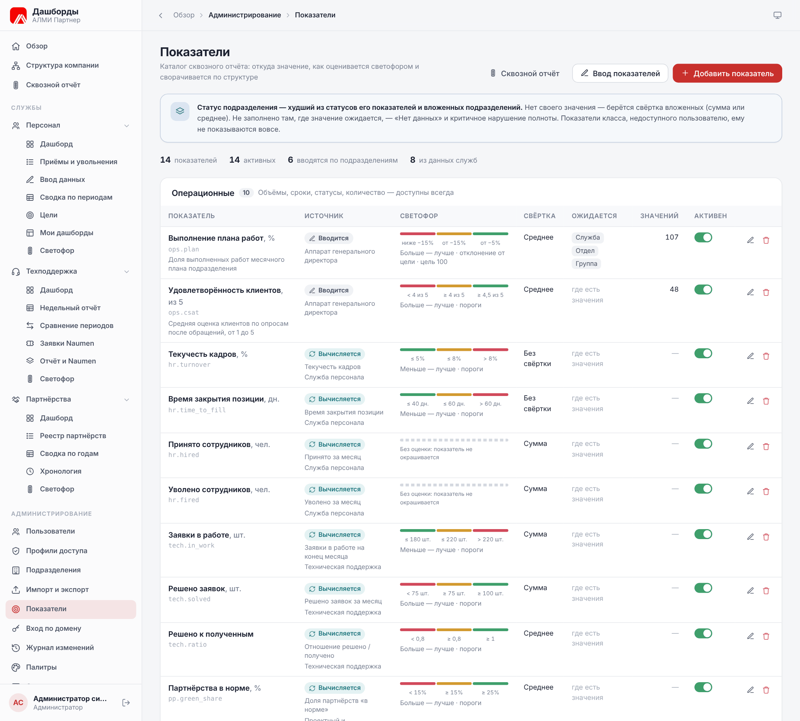

В заголовке — переходы к **Сквозному отчёту** и **Вводу показателей** и **Добавить показатель**. Под пояснением — сколько показателей всего, активных, вводимых по подразделениям и вычисляемых из данных служб. Показатели сгруппированы по классам данных: операционные, персональные, финансовые.

| Столбец | Что показывает |
| --- | --- |
| **Показатель** | название, единица, ключ и описание |
| **Источник** | «Вводится» и служба-владелец или «Вычисляется» и источник данных службы |
| **Светофор** | шкала зон с границами, направление, тип правила, цель по умолчанию |
| **Свёртка** | сумма, среднее или без свёртки |
| **Ожидается** | типы уровней структуры, где значение обязательно; «где есть значения» — пропуски не отмечаются |
| **Значений** | сколько значений сохранено; у вычисляемых — «—»: они не хранятся, а считаются |
| **Активен** | выключенный показатель не попадает в отчёты, его значения сохраняются |

**Изменить** открывает редактор, **Удалить** удаляет показатель. Если у показателя есть сохранённые значения, система спросит ещё раз — «Удалить вместе со значениями» (восстановить их будет нельзя). Чтобы просто убрать показатель из отчётов, выключите его.

## Вычисляемые и вводимые показатели

| | Вычисляемый | Вводимый |
| --- | --- | --- |
| Откуда значение | считается из данных службы при расчёте отчёта | вводится по подразделениям за месяц формой или загрузкой Excel |
| Что хранится | ничего: значение всегда соответствует данным службы | значение, цель и комментарий, кто и когда ввёл |
| Кто отвечает | служба, которая ведёт данные | служба-владелец: её сотрудники с уровнем «Ввод данных» |
| Цель | цель по умолчанию из каталога | цель подразделения и месяца, вводится вместе со значением; если пуста — по умолчанию |

Тип источника, источник данных службы и ключ после создания показателя не меняются.

**Источники данных служб** (вычисляемые показатели):

| Источник | Служба | Как считается | Чьё значение |
| --- | --- | --- | --- |
| Принято за месяц, Уволено за месяц | Служба персонала | записи реестра приёмов и увольнений за месяц | подразделения записи: сопоставляется с подразделением структуры по коду или названию (только однозначно); у вышестоящих — по всей ветке, у компании — все записи |
| Текучесть кадров, Время закрытия позиции | Служба персонала | метрики месяца «Текучесть кадров» и «Среднее время закрытия позиции» | компании (вершины структуры) |
| Заявки в работе на конец месяца | Техническая поддержка | «Итого в работе» последней недели месяца; неделя относится к месяцу своего понедельника | подразделения службы |
| Решено заявок за месяц, Отношение решено / получено | Техническая поддержка | сумма «Решено за неделю» по неделям месяца и её отношение к принятым новым заявкам | подразделения службы |
| Доля партнёрств «в норме» | Проектный и продуктовый офис | доля записей реестра со светофором «Норма» на конец месяца: срок сертификата — на конец месяца, статус, NDA и соглашение — текущие | подразделения службы |

Подразделение службы задаётся в блоке «Подразделения служб» (раздел ниже).

## Правило светофора

**Направление** — «Больше — лучше» (выручка, выполнение плана), «Меньше — лучше» (затраты, заявки в работе) или «Без оценки» (показатель не окрашивается и не влияет на статус, например «Принято сотрудников»). Правило — одного из двух типов:

- **Пороги** — граница нормы и граница внимания, как у светофора служб. При «Меньше — лучше» значение не больше границы нормы — «Норма», не больше границы внимания — «Внимание», иначе «Критично»; при «Больше — лучше» — наоборот. Пример: «Заявки в работе» (норма ≤ 180 шт., внимание ≤ 220 шт.): 274 шт. — «Критично»; «Удовлетворённость клиентов» (норма ≥ 4,5, внимание ≥ 4 из 5): 4,3 — «Внимание».
- **Отклонение от цели** — допустимое отклонение от цели в худшую сторону, в процентах: до X % — «Норма», до Y % — «Внимание», больше — «Критично». Отклонение в лучшую сторону — всегда норма.

| Показатель | Правило | Значение и цель | Отклонение | Статус |
| --- | --- | --- | --- | --- |
| Затраты, меньше — лучше | норма до 3 %, внимание до 8 % | 12,4 при цели 11,3 млн ₽ | 9,7 % | Критично |
| ФОТ, меньше — лучше | норма до 2 %, внимание до 5 % | 3,1 при цели 3 млн ₽ | 3,3 % | Внимание |
| Выручка, больше — лучше | норма до 5 %, внимание до 15 % | 53,5 при цели 60,1 млн ₽ | 11 % | Внимание |
| Выполнение плана работ, больше — лучше | норма до 5 %, внимание до 15 % | 78 % при цели 100 % | 22 % | Критично |

**Цель** значения — цель подразделения и месяца, введённая вместе со значением; если её нет — цель показателя по умолчанию; у свёрнутого значения — сумма или среднее целей вложенных подразделений, если цель задана у всех. Без цели правило «Отклонение от цели» не применяется — «Нет оценки».

Система не даст сохранить противоречивое правило: нужны обе границы или ни одной; при «Меньше — лучше» граница нормы не больше границы внимания, при «Больше — лучше» — не меньше; отклонения — от 0 до 1000 %, для нормы не больше, чем для внимания.

## Свёртка по структуре

Значение показателя у подразделения — собственное (введённое или вычисленное), а если своего нет — **свёртка** значений вложенных подразделений:

- **Сумма** — для объёмов и денег: затраты Технической дирекции на демонстрационном стенде — сумма затрат Технической службы и ИТ-службы («сумма по 2 подразделениям»);
- **Среднее** — для долей, оценок и процентов исполнения: выполнение плана работ Технической дирекции — среднее по Технической службе и ИТ-службе (простое, без весов);
- **Без свёртки** — только собственные значения уровня: текучесть кадров — показатель компании, у дирекций его нет.

Собственное значение важнее свёртки: например, исполнение бюджета вводится по дирекциям и не пересчитывается из служб. Свёртка учитывает все вложенные уровни, в том числе скрытые от пользователя глубиной детализации, поэтому итог по компании у всех одинаков. Светофор оценивает значение на каждом уровне по тому же правилу — свёрнутое значение сравнивается со свёрнутой целью.

## Где ожидается значение и пропуски

**Где ожидается значение** — типы уровней структуры (компания, дирекция, служба, отдел, группа…), у которых значение показателя обязательно. Если за месяц оно не введено, ячейка — «Нет данных», а пропуск — **критичное нарушение полноты**: красное предупреждение в отчёте со списком «Показатель — Подразделение», метки «не заполнено: N», таблица в PDF, выделение на странице ввода. Пропуск не ухудшает статус подразделения — цвет говорит только о значениях.

Пропуски отмечаются начиная с месяца создания показателя или месяца его первого значения (что раньше): прошлые месяцы без данных нарушением не считаются. Если типы уровней не выбраны, значение ожидается только там, где оно есть, и пропуски не отмечаются — так обычно настраивают вычисляемые показатели. На демонстрационном стенде «Выполнение плана работ» ожидается у служб, отделов и групп — и не заполнено у Службы маркетинга за июль 2026 года.

## Статус подразделения

Статус подразделения — **худший** из статусов его показателей и статусов вложенных подразделений. Показатели «без оценки» и незаполненные значения его не меняют; если оценённых показателей нет, статус — «Нет оценки». Объяснение статуса называет показатели и подразделения, которые его определили, на самом нижнем видимом пользователю уровне, где возникла причина: «Затраты в «Техническая служба» — 12,4 млн ₽ при цели 11,3 млн ₽ (отклонение 9,7%)». Веса показателей в статусе и закрытие месяца (фиксация значений) — следующий шаг развития отчёта.

## Добавление и изменение показателя

**Добавить показатель** или **Изменить** в строке каталога:

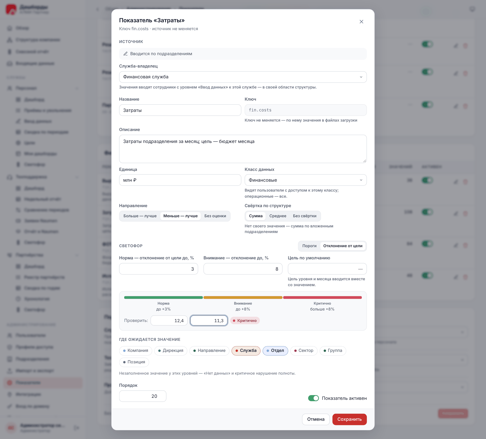

| Поле | Что задаёт |
| --- | --- |
| **Источник** | «Вводится по подразделениям» или «Из данных службы»; после создания не меняется |
| **Служба-владелец** | (вводимый) чьи сотрудники с уровнем «Ввод данных» вводят значения; подходит любая служба справочника, в том числе без дашборда — «Финансовая служба», «Аппарат генерального директора» |
| **Данные службы** | (вычисляемый) источник из таблицы выше; выбор подставляет единицу, направление, свёртку и класс данных |
| **Название**, **Ключ** | название уникально; ключ — латиница, цифры, «.», «_», «-», начинается с буквы (`fin.margin`), не меняется: по нему значения находятся в файлах загрузки |
| **Описание**, **Единица** | описание видно в подсказке заголовка матрицы и в панели подразделения; единица — «%», «шт.», «млн ₽» |
| **Класс данных** | операционные (видят все), персональные или финансовые (видят пользователи с доступом к этому классу) |
| **Направление**, **Свёртка** | разделы «Правило светофора» и «Свёртка по структуре» |
| **Светофор** | «Пороги» или «Отклонение от цели», границы и цель по умолчанию |
| **Где ожидается значение** | типы уровней структуры, где значение обязательно |
| **Порядок**, **Показатель активен** | порядок столбцов в матрице (меньшее — левее); выключенный показатель не попадает в отчёты |

**Предпросмотр** под правилом показывает шкалу зон с границами (для правила от цели — и в единицах, если задана цель по умолчанию) и предупреждает о противоречивых границах. В поле **Проверить** введите значение (и цель) — рядом появится статус, который получит такое значение.

## Кто вводит значения

- Вводимый показатель вводят пользователи с уровнем **«Ввод данных»** или «Управление» к его **службе-владельцу** — в подразделениях своей области для этой службы (общая область или своя область службы, раздел «Доступ и профили доступа»). Финансовый показатель может ввести только тот, кому доступны финансовые показатели.
- Полномочие **«Ведёт сквозные отчёты»** и роль администратора — во всех подразделениях.
- Права проверяет сервер для каждой ячейки: значение вне области ввода отклоняется вместе со всем сохранением, а в плане загрузки — строкой с ошибкой.

Пример демонстрационного стенда: у технического директора лично выдан уровень «Аппарат генерального директора — Ввод данных», поэтому он вводит «Выполнение плана работ» и «Удовлетворённость клиентов» Технической дирекции и вложенных подразделений, а строка Службы маркетинга в его файле — ошибка «вне вашей области структуры». Финансовые показатели демо-каталога вводит «Финансовая служба» — её сотрудникам выдайте «Финансовая служба — Ввод данных» (служба без дашборда: блок «Службы без дашборда» на вкладке «Доступ»).

## Полномочие «Ведёт сквозные отчёты»

Полномочие `reports.manage` выдаёт администратор на вкладке **Полномочия** карточки пользователя (раздел «Полномочия»). Оно даёт:

- раздел **Администрирование → Показатели**: каталог, редактор, подразделения служб;
- ввод значений любой службы во всех подразделениях (в пределах доступных классов данных);
- отметку «под контролем» у любого подразделения.

Полномочие не расширяет то, что пользователь видит в отчёте: вершины, глубина и классы данных — по его доступу. Тому, кто ведёт отчёт для всей компании, задайте и соответствующий доступ (например, профиль «Финансовый контролёр» — раздел «Сценарий: финансовый контролёр»).

## Подразделения служб

Блок внизу страницы «Показатели»: к какому подразделению структуры относятся показатели из данных службы.

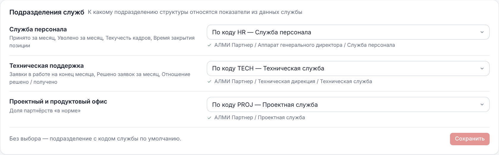

- **Техническая поддержка** — заявки в работе, решённые заявки и их отношение к полученным;
- **Проектный и продуктовый офис** — доля партнёрств «в норме»;
- **Служба персонала** — её подразделение определяет компанию (вершину структуры), к которой относятся текучесть и время закрытия позиции; приёмы и увольнения относятся к подразделениям своих записей.

Без выбора — подразделение с кодом службы по умолчанию (HR, TECH, PROJ); под списком видно, какое подразделение найдено. Если подразделения нет («Подразделение не найдено — показатели службы не попадут в отчёт»), выберите его и нажмите **Сохранить**.

## Как доступ определяет отчёт

Отчёт рассчитывается один раз для всей компании, а затем отбирается под пользователя по измерениям его действующего доступа (раздел «Доступ и профили доступа»):

| Измерение доступа | Что меняет в сквозном отчёте |
| --- | --- |
| Область структуры | вершины отчёта: «Вся компания» — верхний уровень структуры; «Своя ветка» и «Своё подразделение» — основное, руководимые и дополнительные подразделения пользователя |
| Глубина детализации | сколько уровней ниже вершин перечисляется: 0 — только вершины, 1…9 уровней, без ограничения — вся ветка; глубже — только в итогах, с отметкой «детализация недоступна». При области «Своё подразделение» — всегда только вершины |
| Классы данных | показатели недоступного класса не передаются вовсе — ни значения, ни статуса, ни упоминания в причинах; статус считается по доступным показателям, отчёт пишет «скрыты: финансовые» |
| Исходные записи | ссылка «Реестр» службы в панели подразделения (для службы персонала — ещё и персональные данные) |
| Выгрузка | PDF сквозного отчёта |
| Уровень службы | ссылка на дашборд службы в панели; «Ввод данных» к службе-владельцу — ввод показателей |

Своя область службы на вершины отчёта не влияет — только на подразделения, где пользователь вводит показатели этой службы. Отметку «под контролем» ставит руководитель подразделения (раздел «Руководители»). Скрытые данные не попадают ни в ответы сервера, ни в PDF.

## Настройка уровней сотрудников

| Уровень | Профиль и место в структуре | Что видит в отчёте | Что настроить ещё |
| --- | --- | --- | --- |
| **Первое лицо** | «Высшее руководство»; руководитель компании (верхнего уровня) | вся компания и один уровень под ней, все классы данных, PDF, без реестров | лично — бо́льшую глубину детализации (2–3 или без ограничения) |
| **Руководитель направления** | «Руководитель направления»; руководитель дирекции | своё направление на два уровня вниз, все классы, реестры, PDF | «Ввод данных» к службе-владельцу, если он вводит показатели |
| **Руководитель службы** | «Руководитель подразделения»; руководитель службы | своя служба со всеми вложенными, без финансовых показателей, PDF | уровень своей службы лично; финансовый класс — лично, если нужен |
| **Сотрудник** | «Сотрудник»; основное подразделение | только своё подразделение, операционные показатели, без выгрузки | ничего: отчёт доступен и без служб |

Проверить результат можно в карточке пользователя (**Действующий доступ**) и в самом отчёте — строка «Ваш доступ: …» под его заголовком у пользователя. Если у пользователя нет ни основного, ни руководимых, ни дополнительных подразделений, его отчёт пуст («Область отчёта пуста»), а при области «Вся компания» он видит всю компанию.

## Сценарий: финансовый контролёр

Сотрудник финансовой службы вводит финансовые показатели по всей компании и видит отчёт целиком, но без персональных данных.

1. **Профили доступа → Создать профиль**: «Финансовый контролёр» (ключ `fin-control`), область «Вся компания», классы данных — операционные и финансовые, глубина детализации — без ограничения, исходные записи — «Только дашборды», выгрузка — разрешена.
2. Карточка пользователя: профиль «Финансовый контролёр», основное подразделение — финансовая служба в структуре; на вкладке «Доступ» в «Службах без дашборда» — **Финансовая служба — Ввод данных**.
3. Результат: сквозной отчёт по всей компании на любую глубину с выручкой, затратами, ФОТ и исполнением бюджета; строка доступа — «вся компания · детализация без ограничения», метка «Персональные показатели скрыты»; «Ввод показателей» с финансовыми показателями во всех подразделениях, загрузка Excel и шаблон; PDF. Операционные показатели, которые вводит другая служба, контролёр видит, но не вводит; реестры и ФИО ему закрыты.
4. Если контролёр ещё и ведёт каталог показателей, выдайте ему полномочие «Ведёт сквозные отчёты».

## Журнал

В журнал изменений записываются: создание, изменение (значения «до» и «после») и удаление показателей; каждое сохранение значений — «Значения показателей за июль 2026: новых N, изменено N, удалено N»; загрузки файлов; заметки «под контролем» и их снятие; изменение подразделений служб.

# Вход по домену (LDAP)

Сотрудники могут входить с логином и паролем домена (Active Directory, FreeIPA, OpenLDAP). Вход по домену включает системный администратор переменными окружения `AUTH_LDAP_*` («Руководство по развёртыванию», раздел «Вход по домену и Active Directory»); пароли и секреты в интерфейс и API не попадают.

## Как проходит вход

1. Система подключается к каталогу служебной учётной записью (только чтение) и ищет сотрудника по введённому логину — имени учётной записи, `имя@домен` или e-mail. Найдена должна быть ровно одна запись.
2. Каталог проверяет пароль сотрудника. Отключённые в каталоге учётные записи не входят.
3. Запись каталога сопоставляется с учётной записью системы, и выполняется вход.

Если каталог пароль не подтвердил, проверяется пароль системы — так входят локальные учётные записи (например, первый администратор). Пароль доменной учётной записи в системе не хранится и не проверяется. Если каталог недоступен, доменные пользователи видят «Сервер домена не отвечает — попробуйте войти позже», а локальные входят как обычно.

## Сопоставление и привязка

Запись каталога сопоставляется с учётной записью системы по порядку:

1. по идентификатору каталога (`objectGUID`, во FreeIPA и OpenLDAP — `entryUUID`) — у уже привязанных;
2. по идентификатору синхронизации с Active Directory — у сотрудников, загруженных синхронизацией;
3. по e-mail (без учёта регистра), если он единственный.

Логин для сопоставления не используется: одинаковый логин в разных системах может принадлежать разным людям.

При первом входе по домену учётная запись **привязывается**: способ входа становится «Учётная запись домена», локальный пароль удаляется. Данные системы не меняются — из каталога заполняется только пустая должность. Привязка записывается в журнал («… привязан к каталогу по e-mail»).

> **Важно.** E-mail доменной учётной записи считается подтверждённым каталогом. Держите привилегированные локальные учётные записи (администраторов) на адресах вне каталога или без e-mail — иначе владелец доменной учётной записи с тем же адресом войдёт под ними.

## Создание при первом входе и профили по группам

Если каталог подтвердил пароль, а учётной записи в системе нет:

- по умолчанию вход отклоняется: «Учётной записи в системе нет — обратитесь к администратору»;
- при `AUTH_LDAP_CREATE_USERS=active` учётная запись создаётся и сразу активна, при `inactive` — создаётся отключённой, и администратор включает её сам (сотрудник видит «Учётная запись отключена»);
- нужен e-mail в каталоге, не занятый другой учётной записью;
- логин берётся из каталога (`sAMAccountName`, во FreeIPA — `uid`), ФИО, e-mail и должность — из атрибутов записи.

**Профиль доступа по группам каталога** (`AUTH_LDAP_GROUP_PROFILES`): пары «DN группы = ключ профиля»; выбирается первая группа из списка, в которой состоит сотрудник, иначе — профиль по умолчанию (`AUTH_LDAP_DEFAULT_PROFILE`), иначе «Индивидуальная настройка» без служб. Участники группы `AUTH_LDAP_ADMIN_GROUP` создаются администраторами. Профиль и роль из групп назначаются **только при создании** учётной записи — дальше доступ настраивается в системе.

## Страница «Вход по домену»

**Администрирование → Вход по домену** (только администратор). С версии 0.4.0 страница открывается по адресу `/admin/directory`; прежний адрес `/admin/integrations` теперь занят разделом «Интеграции» — обновите закладки.


- **Состояние**: **Включён**, **Настроен, но выключен** (задайте `AUTH_LDAP_ENABLED=true`) или **Не настроен**; версия пакета ldap3, сервер, база поиска, служебная учётная запись (пароль — «задан» или «не задан»), **Шифрование** (LDAPS, StartTLS или «Без шифрования — пароли идут по сети открыто, только для стенда»), что происходит с новыми сотрудниками, профиль по умолчанию, группа администраторов, фильтр поиска, атрибуты, подсказка на странице входа, ожидание ответа.
- **Профили по группам каталога** — таблица «Группа — Профиль доступа»; ключ несуществующего профиля отмечен «нет такого профиля».
- **Замечания** — ошибки настройки: не заданы адрес или база, неизвестный профиль, нет файла сертификата, пароль идёт без шифрования, фильтр без `{login}`.
- **Проверка** (пароль сотрудника не запрашивается и не проверяется): **Проверить подключение** — подключение и служебная привязка; **Найти учётную запись** — по логину, `userPrincipalName` или e-mail: найденные записи с DN, отметкой «отключена в каталоге», группами и ответом, что будет при входе: «сопоставлена по идентификатору каталога / по синхронизации с AD / по e-mail», «Будет создана при первом входе» (с профилем и ролью) или «Учётной записи нет — вход будет отклонён».
- **Переменные окружения** — справка по `AUTH_LDAP_*` с примерами.

## Безопасное включение

1. Задайте переменные с `AUTH_LDAP_ENABLED=false`, перезапустите приложение и проверьте страницу: состояние «Настроен, но выключен», замечаний нет, шифрование — LDAPS или StartTLS.
2. **Проверить подключение**, затем **Найти учётную запись** для нескольких сотрудников: каждый должен находиться ровно одной записью и сопоставляться с нужной учётной записью.
3. Укажите сотрудникам e-mail, совпадающий с каталогом (или загрузите их синхронизацией с AD), проверьте e-mail администраторов (см. «Важно» выше).
4. Включите `AUTH_LDAP_ENABLED=true` и проверьте вход тестовым сотрудником. Первый администратор сохраняет вход по паролю системы на случай недоступности каталога.

# Синхронизация с Active Directory

Синхронизация переносит из каталога подразделения, сотрудников, должности и руководителей. Настройки — переменные `AD_SYNC_*`; пустые адрес, база поиска, служебная учётная запись и сертификат берутся из настроек входа по домену. Включать вход по домену для синхронизации не обязательно.


## Что синхронизируется

- **Сотрудники** — записи каталога по фильтру `AD_SYNC_USER_FILTER` (по умолчанию — пользователи с e-mail); сопоставляются по `objectGUID`, затем по e-mail.
- **Подразделение** — путь из атрибутов `company`, `division`, `department` (`AD_SYNC_PATH_ATTRIBUTES`) или из организационных единиц (OU) в DN (`AD_SYNC_PATH_SOURCE=ou`); недостающие подразделения создаются. Если в каталоге подразделение не указано, оно у сотрудника не меняется.
- **Руководитель** — атрибут `manager`; **руководители подразделений** определяются по подчинённым (`AD_SYNC_DETECT_HEADS`): кто руководит сотрудниками своего подразделения, а сам подчиняется вне его.
- **Должность** — атрибут `title`; **ФИО** — `displayName`.

## Запуск из интерфейса

**Импорт и экспорт → Active Directory**: параметры подключения (каталог, база поиска, источник подразделений, руководители, шифрование, фильтр) и флажки:

- **Создавать сотрудников из AD** — новые сотрудники входят по учётной записи домена;
- **Отключать сотрудников, которых нет в AD** — только пришедших из AD, а также тех, чья учётная запись в каталоге отключена.

**Проверить** показывает план (будут созданы подразделения, будут отключены, сотрудники с изменениями), **Синхронизировать** применяет показанный план.

> **Важно.** Синхронизация никогда не включает отключённых, не отключает сотрудников, заведённых вручную или загруженных файлом, вашу учётную запись и последнего активного администратора.

## По расписанию

Для регулярной синхронизации системный администратор ставит в планировщик команду `python -m app.cli org-sync --ad --apply` (с флагами `--create-missing` и `--deactivate-missing` — как отметки в интерфейсе). Без `--apply` команда только показывает план. Код выхода: 0 — готово, 1 — в плане ошибки (ничего не записано), 2 — каталог недоступен. Примеры для cron и systemd — в «Руководстве по развёртыванию».

# Интеграции и входящие данные

С версии 0.4.0 данные попадают в систему не только ручным вводом и загрузкой на страницах служб. **Входящие данные** — единый путь для файлов из папки на сервере, загрузок, приёма по API и подключений: распознавание набора, план, применение сразу или после подтверждения. **Интеграции** — подключения к системам компании: «По Делу», «Пульс проекта», Jira, Confluence, Bitrix24, почтовому ящику Exchange и 1С — с проверкой, расписанием и журналом запусков. Работа сотрудников с входящими файлами описана в «Руководстве пользователя» (раздел «Входящие данные»), планировщик, папка, переменные окружения и сетевой доступ — в «Руководстве по развёртыванию» (раздел «Входящие данные и интеграции»).

| Что | Где | Кто |
| --- | --- | --- |
| Файлы, план и применение | **Входящие данные** (`/inbox`), вкладка «Элементы» | полномочие «Входящие данные» — все файлы; редакторы служб, ведущие структуру и сквозные отчёты — свои наборы |
| Правила «применять сразу», состояние папки | **Входящие данные**, вкладки «Правила» и «Папка» | полномочие «Входящие данные» |
| Подключения, расписание, журнал запусков, ключи для входящих вызовов | **Администрирование → Интеграции** (`/admin/integrations`) | полномочие «Интеграции»; подключение Confluence — только администратор |

Администратору доступно всё. Разбор папки и запуски по расписанию выполняет отдельный процесс — **планировщик** (сервис `worker`). Без него файлы из папки забираются только кнопкой «Проверить сейчас», а подключения запускаются только кнопкой «Запустить» или командой на сервере.

## Входящие данные

Любой файл с данными становится **элементом входящих** и проходит один путь: получение (размер, отпечаток SHA-256) → распознавание набора → план тем же движком, что у ручной загрузки этого набора → применение сразу или после подтверждения → итог: статус, план и результат хранятся, исходный файл — до срока хранения.

| Источник | Откуда | Подпись в журнале изменений |
| --- | --- | --- |
| Папка «Входящие» | файлы в папке `INBOX_DIR` на сервере | «Входящие · папка» |
| Загрузка в интерфейсе | **Загрузить файл** на странице «Входящие данные» | загрузивший пользователь |
| Приём по API | `POST /api/inbound/v1/files` с ключом для входящих вызовов | «Ключ «…»» |
| Подключение | «По Делу» — структура и вложения задач, «Почтовый ящик (Exchange)» — вложения писем | «Подключение «…»» |

Наборы и кто их применяет — «Руководство пользователя», раздел «Наборы данных». Ключ набора — `hr-months`, `hr-events`, `tp-weekly`, `naumen`, `partnerships`, `indicators`, `structure`, `employees` — это и имя подпапки папки «Входящие», и значение параметра `dataset` при приёме по API.

**От чьего имени применяются данные.** Файл из папки, по ключу или от подключения применяется от имени источника: со всеми службами и классами данных и правами «Ведёт структуру компании» и «Ведёт сквозные отчёты», но без роли администратора и без права «Ведёт пользователей и доступ» — роли, профили доступа и вход по домену из таких файлов не выдаются. Сотрудник с полномочием «Входящие данные» применяет любые наборы с теми же правами, а журнал записывается на него. Остальные применяют только свои наборы и в пределах своих прав: например, значения показателей — только в своей области ввода.

**Повтор.** Файл с тем же отпечатком SHA-256 для того же набора, если прежний не отклонён и не завершился ошибкой, получает статус «Повтор» и не применяется. Поэтому 1С и скрипты могут присылать выгрузку по расписанию, не заботясь о повторах.

## Правила «применять сразу»

**Входящие данные → Правила** (полномочие «Входящие данные»): для каждого источника — папки, приёма по API, подключений — и каждого набора задаётся, применять ли план без ошибок без подтверждения.

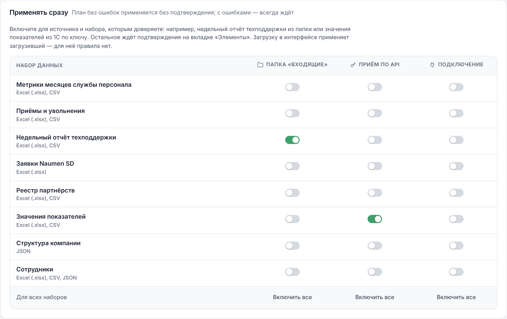

- Строки — наборы (под названием — форматы файлов), столбцы — «Папка «Входящие»», «Приём по API» и «Подключение»; переключатель в ячейке включает «применять сразу».
- Строка «Для всех наборов» — **Включить все** или **Выключить все** в столбце источника.
- Изменения копятся в панели «Изменено правил: N» внизу — **Отменить** или **Сохранить**. Сохранение записывается в журнал изменений («Изменены правила «применять сразу»: N»).

План с ошибками не применяется никогда — он ждёт на вкладке «Элементы». Для загрузки в интерфейсе правила нет: её применяет загрузивший — флажком «Применить сразу, если в плане нет ошибок» или кнопкой «Применить»; так же «Повторить» с этим флажком применяет план сразу, независимо от правила. Запрос API с `apply=false` только строит план, даже если правило включено. Правила «Подключение × Структура компании» и «Подключение × Сотрудники» управляют и синхронизацией «По Делу» (раздел «По Делу»).

После обновления до 0.4.0 все правила выключены. Включайте правило для источника и набора, которым доверяете: например, недельный отчёт техподдержки из папки или значения показателей из 1С по ключу — после нескольких файлов, применённых вручную без ошибок.

## Папка «Входящие»

Папка на сервере, заданная переменной `INBOX_DIR` (в Docker — том `/data/inbox`, общий для приложения и планировщика). Её удобно открыть как общую сетевую папку для 1С, скриптов и сотрудников, которые выгружают отчёты.

**Входящие данные → Папка** (полномочие «Входящие данные»):

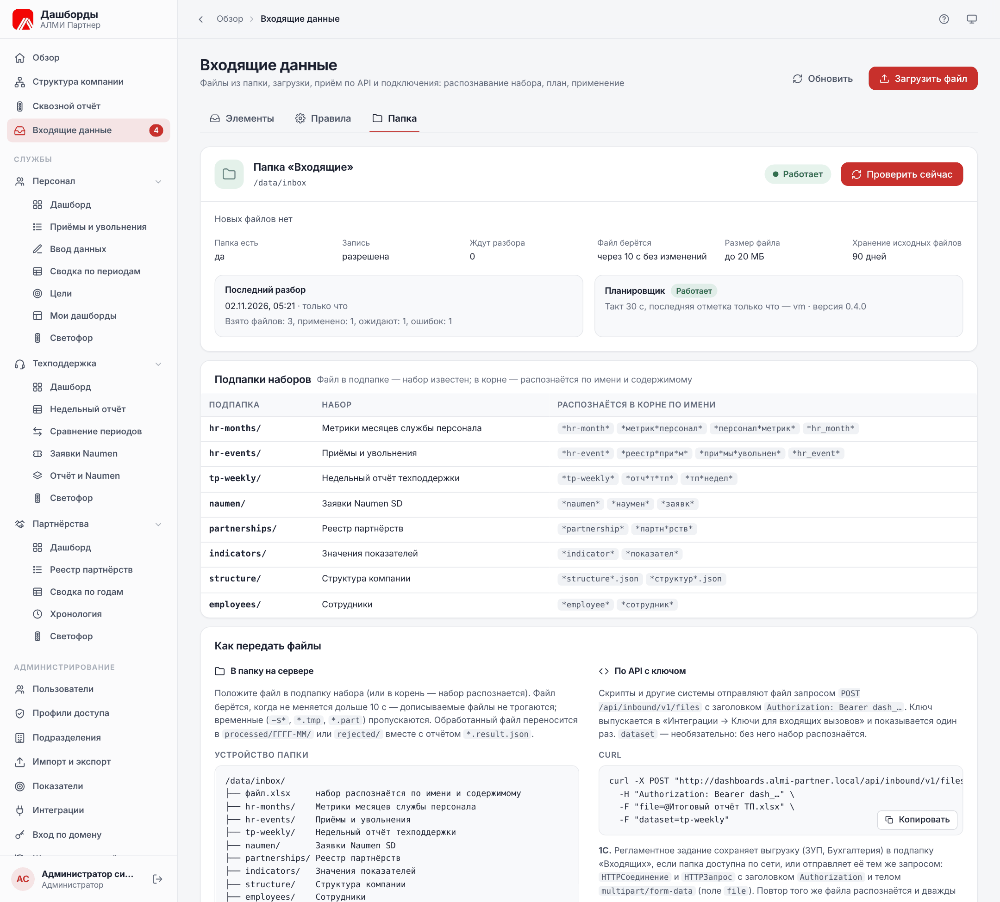

- **Состояние** — путь и метка: «Работает» (и сколько файлов ждут разбора), «Не настроена» (не задана `INBOX_DIR`), «Не найдена» (папки нет на сервере), «Только чтение» (нет прав на запись — обработанные файлы не перенести в `processed/` и `rejected/`). Ниже — есть ли папка, разрешена ли запись, сколько файлов ждут разбора, через сколько секунд без изменений файл берётся, предельный размер файла и срок хранения исходных файлов.
- **Проверить сейчас** — разобрать папку немедленно, не дожидаясь планировщика. Итог — «Папка разобрана» (взято файлов, применено, ожидают, повторов, ошибок) с кнопкой **Показать в списке** или «Новых файлов нет».
- **Последний разбор** — когда и с каким итогом папка разбиралась последний раз.
- **Планировщик** — «Работает» (такт, последняя отметка, сервер и версия), «Не отвечает» (отметки нет дольше трёх тактов, но не меньше двух минут) или «Не запущен» (планировщик ещё не отмечался: папку разбирает только «Проверить сейчас», расписания не выполняются).
- **Подпапки наборов** — подпапка, набор и столбец «Шаблоны имени: +20 к оценке в корне» (у набора без шаблонов — «нет — только по содержимому»). Подсказка над таблицей: «Файл в подпапке — набор известен. В корне набор распознаётся по содержимому (первые строки таблицы или JSON, оценка до 100); имя по шаблону добавляет 20, нужно не меньше 50 — по одному имени файл не распознаётся».
- **Как передать файлы** — устройство папки, пример запроса API и как отправлять файлы из 1С.

**Устройство папки:**

| Путь | Что там |
| --- | --- |
| `INBOX_DIR/` — корень | файлы, набор которых распознаётся по содержимому (имя по шаблону — подсказка) |
| `hr-months/`, `hr-events/`, `tp-weekly/`, `naumen/`, `partnerships/`, `indicators/`, `structure/`, `employees/` | файлы набора, заданного подпапкой; подпапки создаются при первом разборе |
| `processed/ГГГГ-ММ/` | принятые файлы по месяцам: применённые, ожидающие решения, нераспознанные |
| `rejected/` | непринятые: ошибка разбора, повтор, слишком большой файл |
| `.work/` | служебная: файлы в обработке |

Рядом с каждым перенесённым файлом — отчёт `<имя>.result.json`: номер элемента, статус, набор, сводка плана, ошибки и номер исходного элемента у повтора. Если имя в `processed/` или `rejected/` уже занято, к нему добавляется номер элемента.

**Правила разбора:**

- файл берётся, когда не меняется дольше `INBOX_SETTLE_SECONDS` (по умолчанию 10 с): дописываемый файл не трогается, а если он изменился, пока его читали, — возвращается на место до следующего такта;
- не берутся скрытые и временные файлы — `.*`, `~$*`, `*.part`, `*.tmp`, `*.crdownload`, `*.partial`, `*.swp`, `*~`, `*.result.json`, `Thumbs.db`, `desktop.ini` — и файлы в подпапках с другими именами;
- символьные ссылки на файлы не открываются; подпапка-ссылка читается, только если ведёт внутрь папки «Входящие»;
- файл «занимается» атомарным переносом в `.work/`, поэтому два планировщика один файл не возьмут; файл, застрявший в `.work/` дольше часа (например, процесс остановили посреди разбора), возвращается на место;
- файл больше `INBOX_MAX_MB` не читается: элемент «Ошибка» и перенос в `rejected/`.

**Как распознаётся файл в корне.** Каждый набор оценивает содержимое — первые строки таблицы или JSON — от 0 до 100: заголовки столбцов (например, «Подразделение», «Показатель», «Период» — значения показателей; «Дата регистрации» и «Номер» — заявки Naumen) и поле `format` у JSON (`dashboards.org-structure`, `dashboards.employees`, `podelu.org-structure`, `podelu.employees`). Имя файла по шаблону набора добавляет к оценке 20. Набор выбирается, если его оценка не меньше 50; если подходящего нет или у двух лучших оценка одинаковая, файл остаётся нераспознанным («Получен»). По одному имени файл не распознаётся. Надёжнее всего подпапка: тогда набор известен заранее.

| Набор | Подпапка | Шаблоны имени |
| --- | --- | --- |
| Метрики месяцев службы персонала | `hr-months/` | `*hr-month*`, `*метрик*персонал*`, `*персонал*метрик*`, `*hr_month*` |
| Приёмы и увольнения | `hr-events/` | `*hr-event*`, `*реестр*при*м*`, `*при*мы*увольнен*`, `*hr_event*` |
| Недельный отчёт техподдержки | `tp-weekly/` | `*tp-weekly*`, `*отч*т*тп*`, `*тп*недел*` |
| Заявки Naumen SD | `naumen/` | `*naumen*`, `*наумен*`, `*заявк*` |
| Реестр партнёрств | `partnerships/` | `*partnership*`, `*партн*рств*` |
| Значения показателей | `indicators/` | `*indicator*`, `*показател*` |
| Структура компании | `structure/` | `*structure*.json`, `*структур*.json` |
| Сотрудники | `employees/` | `*employee*`, `*сотрудник*` |

Шаблоны — без учёта регистра, `*` — любые символы.

**Срок хранения.** Исходные файлы обработанных элементов — применённых, отклонённых, повторов и ошибок — хранятся `INBOX_RETENTION_DAYS` дней после обработки (по умолчанию 90). Затем содержимое удаляется из базы (строка элемента, план и итог остаются, кнопки «Применить», «Повторить» и «Скачать исходный файл» пропадают), а старые файлы — из `processed/` и `rejected/`. Элементы, которые ждут решения, не очищаются. Очистку раз в час выполняет планировщик, вручную — команда `python -m app.cli inbox cleanup`.

## Ключи для входящих вызовов

Ключ даёт внешней системе — 1С, скрипту, другой системе компании — право положить файл во «Входящие» и узнать, что с ним стало. **Интеграции → Ключи для входящих вызовов** (полномочие «Интеграции»):

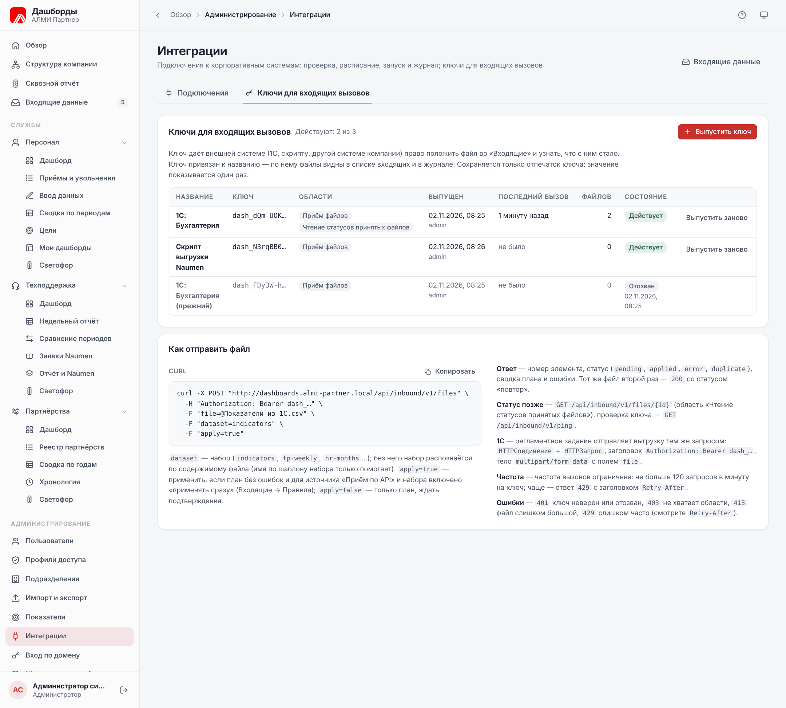

В таблице: **Название** — кто отправляет файлы (так ключ виден во «Входящих» и в журнале), **Ключ** — первые символы значения, **Области**, **Выпущен** — когда и кем, **Последний вызов**, **Файлов** — сколько файлов принято по ключу, **Состояние** — «Действует» или «Отозван». Ниже — «Как отправить файл»: пример запроса и что отвечает сервер.

**Выпуск.** **Выпустить ключ** → **Название** (например, «1С: ЗУП» или «Скрипт выгрузки Naumen») и «Что разрешено»:

| Область | Что даёт |
| --- | --- |
| «Приём файлов» | `POST /api/inbound/v1/files` — файлы во входящие |
| «Чтение статусов принятых файлов» | `GET /api/inbound/v1/files/{id}` — статус файлов, принятых этим ключом |

Проверка ключа `GET /api/inbound/v1/ping` работает с любой областью. Выпускайте отдельный ключ для каждой системы-отправителя: так их легче различать и отзывать по одному.

**Значение ключа показывается один раз** — в окне «Ключ выпущен» с кнопкой **Копировать** и примерами «Отправить файл» и «Проверить ключ». После **Готово, ключ сохранён** посмотреть его снова нельзя: система хранит только отпечаток SHA-256 и первые 12 символов. Ключ выглядит как `dash_` и ещё 43 символа.

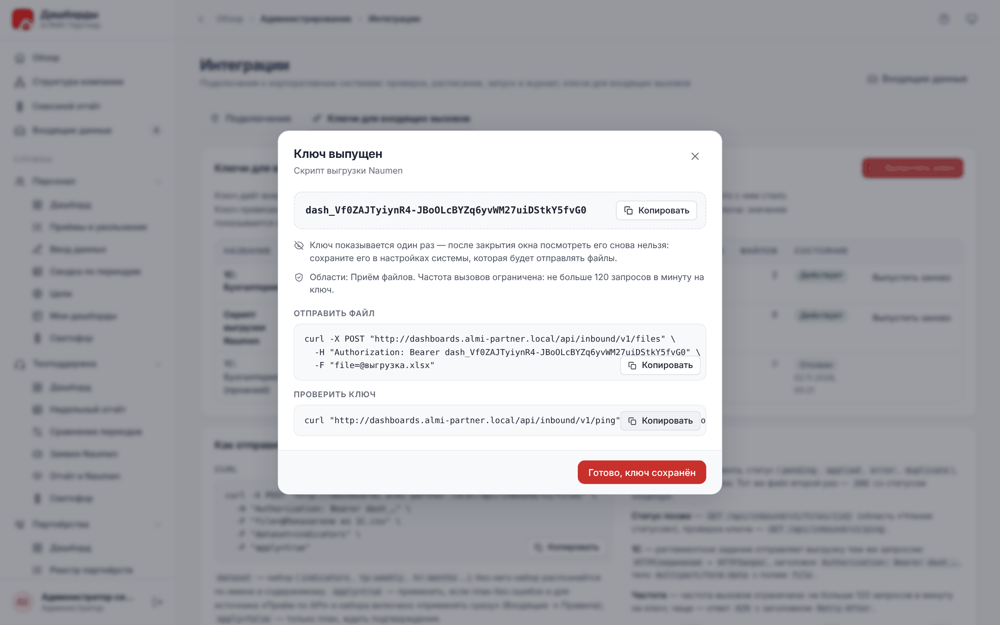

- **Выпустить заново** — новое значение того же ключа: название, области и история остаются, прежнее значение перестаёт работать сразу — обновите его в системе-отправителе.
- **Отозвать** — ключ перестаёт работать сразу, запросы с ним получают «Ключ недействителен или отозван». Запись остаётся для журнала и элементов входящих; отменить отзыв нельзя — понадобится новый ключ.

Частота вызовов ограничена: не больше `INBOUND_RATE_LIMIT` запросов в минуту на ключ (по умолчанию 120; окно ключа и «Как отправить файл» показывают действующее значение — «Частота вызовов ограничена: не больше 120 запросов в минуту на ключ»). Предел общий для всех процессов сервера: счётчик минутного окна хранится в базе у ключа. Сверх предела — ответ 429 с заголовком `Retry-After` — сколько секунд осталось до конца окна. Выпуск, выпуск заново и отзыв записываются в журнал изменений.

## Приём файлов по API

Запрос — `multipart/form-data` с заголовком `Authorization: Bearer dash_…`; сессия и CSRF-токен не нужны.

| Поле | Что указать |
| --- | --- |
| `file` | файл — обязательно |
| `dataset` | ключ набора: `indicators`, `tp-weekly`, `hr-months`…; без него набор распознаётся по содержимому, имя по шаблону — подсказка (раздел «Папка «Входящие»») |
| `apply` | `false` — только план, ждать подтверждения; без поля или `true` — применить, если план без ошибок и для источника «Приём по API» и набора включено «применять сразу» |
| `options` | JSON с параметрами набора, например `{"mode": "merge"}` |

```bash
curl -X POST "https://dashboards.company.ru/api/inbound/v1/files" \
  -H "Authorization: Bearer dash_…" \
  -F "file=@Показатели из 1С.csv" \
  -F "dataset=indicators" \
  -F "apply=true"
```

Ответ — `201`, если файл принят, или `200`, если это повтор уже полученного файла:

```json
{
  "ok": true,
  "id": 3,
  "status": "applied",
  "status_label": "Применён",
  "dataset": "indicators",
  "dataset_label": "Значения показателей",
  "filename": "Показатели из 1С.csv",
  "duplicate_of": null,
  "message": "Применён",
  "error": "",
  "summary": {"rows": 4, "create": 4, "update": 0, "unchanged": 0, "errors": 0},
  "errors": [],
  "received_at": "2026-11-02T01:10:02",
  "processed_at": "2026-11-02T01:10:02",
  "applied_at": "2026-11-02T01:10:02"
}
```

`status`: `applied` — применён; `pending` — ждёт подтверждения (`message` объясняет почему; если в плане ошибки — `summary.errors` больше нуля, а список `errors` перечисляет их по строкам); `received` — набор не распознан; `error` — файл не принят, причина в `error`; `duplicate` — повтор, `duplicate_of` — номер исходного элемента. Узнать статус позже — `GET /api/inbound/v1/files/{id}` (область «Чтение статусов принятых файлов», только файлы этого ключа); проверить ключ — `GET /api/inbound/v1/ping`: ответ содержит название ключа, его области, версию системы и список наборов.

Ошибки — JSON с полями `detail`, `code` и теми же значениями в `message` и `error`:

| Ответ | `code` | Причина |
| --- | --- | --- |
| 401 | `auth_required` | нет заголовка: «Нужен заголовок Authorization: Bearer dash_…» |
| 401 | `invalid_key` | «Ключ недействителен или отозван» |
| 403 | `scope_forbidden` | у ключа нет нужной области: «Области ключа «…» не хватает: status» |
| 413 | `payload_too_large` | файл больше `INBOX_MAX_MB` |
| 422 | `validation_error` | неизвестный набор, пустой файл, неверный `options` |
| 429 | `rate_limited` | больше `INBOUND_RATE_LIMIT` запросов в минуту на ключ (счёт общий для всех процессов сервера) — повторите через `Retry-After` секунд |

**Отправка из 1С.** Регламентное задание 1С сохраняет выгрузку (ЗУП, Бухгалтерия) в подпапку «Входящих», если папка доступна по сети, или отправляет её тем же запросом. Пример функции на встроенном языке ниже: подставьте адрес «Дашбордов» и ключ с областью «Приём файлов»; набор по умолчанию — значения показателей (столбцы Подразделение, Показатель, Период, Значение).

```bsl
Функция ОтправитьВДашборды(ПутьКФайлу, ИмяФайла, Набор = "indicators") Экспорт
    // Ключ «Дашбордов» с областью «Приём файлов»: Интеграции → Ключи
    Ключ = "dash_…";
    Ид = Строка(Новый УникальныйИдентификатор);
    Граница = "dash" + СтрЗаменить(Ид, "-", "");
    ПС = Символы.ВК + Символы.ПС;
    Кодировка = КодировкаТекста.UTF8;
    Начало = "--" + Граница + ПС
        + "Content-Disposition: form-data; name=""dataset""" + ПС
        + ПС + Набор + ПС
        + "--" + Граница + ПС
        + "Content-Disposition: form-data; name=""file""; filename="""
        + ИмяФайла + """" + ПС
        + "Content-Type: application/octet-stream" + ПС + ПС;
    Конец = ПС + "--" + Граница + "--" + ПС;
    Части = Новый Массив;
    Части.Добавить(ПолучитьДвоичныеДанныеИзСтроки(Начало, Кодировка, Ложь));
    Части.Добавить(Новый ДвоичныеДанные(ПутьКФайлу));
    Части.Добавить(ПолучитьДвоичныеДанныеИзСтроки(Конец, Кодировка, Ложь));
    Запрос = Новый HTTPЗапрос("/api/inbound/v1/files");
    Запрос.Заголовки.Вставить("Authorization", "Bearer " + Ключ);
    Запрос.Заголовки.Вставить("Content-Type",
        "multipart/form-data; boundary=" + Граница);
    Запрос.УстановитьТелоИзДвоичныхДанных(СоединитьДвоичныеДанные(Части));
    Соединение = Новый HTTPСоединение("dashboards.company.ru", 443, , , , 60,
        Новый ЗащищенноеСоединениеOpenSSL);
    Ответ = Соединение.ОтправитьДляОбработки(Запрос);
    Если Ответ.КодСостояния <> 200 И Ответ.КодСостояния <> 201 Тогда
        ВызватьИсключение "Дашборды: " + Ответ.КодСостояния + " "
            + Ответ.ПолучитьТелоКакСтроку();
    КонецЕсли;
    // {"ok": true, "status": "applied" | "pending", …}
    Возврат Ответ.ПолучитьТелоКакСтроку();
КонецФункции
```

Храните ключ в константе или защищённом хранилище 1С, а не в тексте модуля. Повторная отправка того же файла безопасна — второй ответ будет `200` со статусом `duplicate`.

## Интеграции

**Администрирование → Интеграции** (администратор и полномочие «Интеграции»): подключения к системам компании карточками, кнопка **Подключить систему** и вкладка «Ключи для входящих вызовов». **Входящие данные** в заголовке ведёт к файлам, которые принесли подключения.

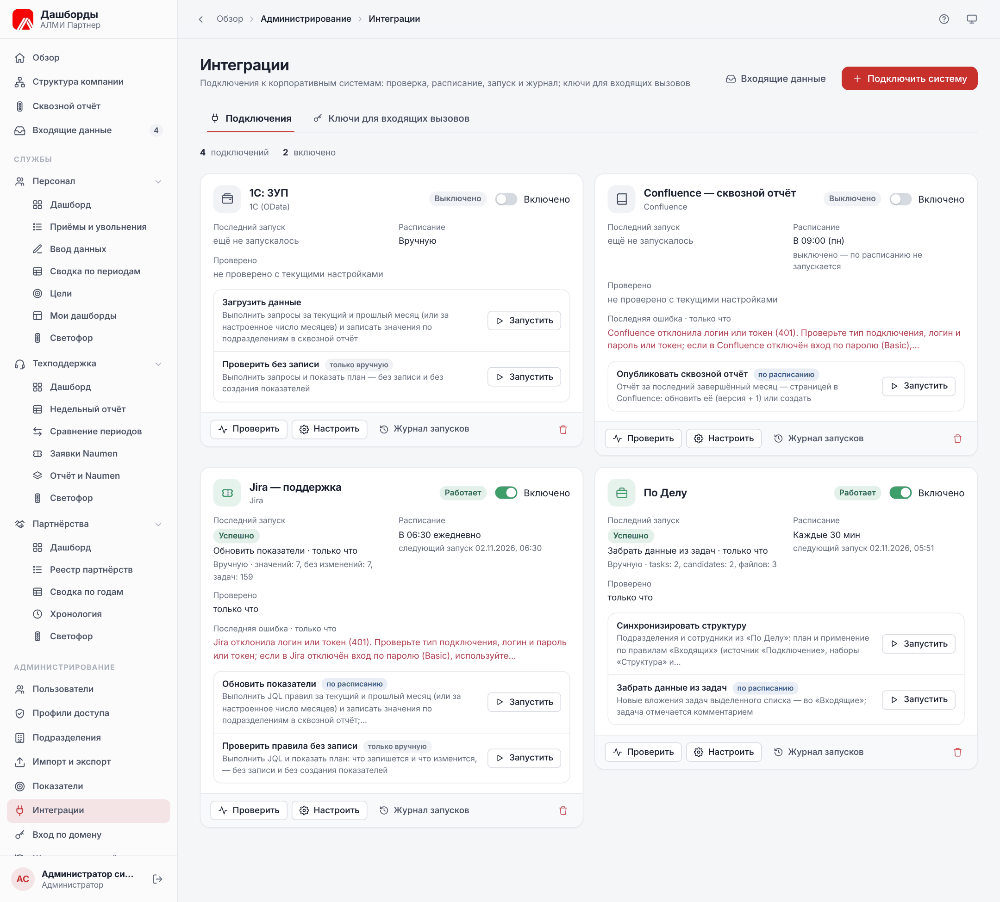

Над карточками — сколько подключений, сколько включено и сколько с ошибкой. **Карточка подключения**:

- название, вид системы и состояние: «Работает» — последняя проверка или запуск прошли успешно, «Ошибка» — последней была ошибка, «Не проверено», «Выключено»; переключатель **Включено**;
- **Последний запуск** — итог («Успешно», «Частично», «Ошибка», «Запуск прерван»), действие, когда, повод и главные счётчики; у прерванного — «Процесс остановился до окончания запуска (перезапуск или сбой) — подключение можно запустить снова.»;
- **Расписание** — «Вручную» или каждая запись расписания: когда, какие действия и «следующий …» (у выключенного подключения — «выключено — по расписанию не запускается»); **Проверено** — когда подключение последний раз прошло проверку с текущими настройками;
- **Последняя ошибка** — её первая строка и когда она была, только если ошибка новее последнего успешного запуска или проверки: после успеха старая ошибка остаётся только в журнале запусков;
- **действия** подключения — у каждого описание, метка «по расписанию» или «только вручную» и кнопка **Запустить**; итог запуска появляется под действием;
- внизу — **Проверить**, **Настроить**, **Журнал запусков** и удаление (подключение удаляется вместе с журналом запусков и секретами, элементы входящих, которые оно принесло, остаются; чтобы остановить запуски, достаточно его выключить).

Карточки идут в порядке видов — «По Делу», «Пульс проекта», Jira, Confluence, Bitrix24, почтовый ящик, 1С, папка «Входящие», — внутри вида по названию. Подключение Confluence сотрудник с полномочием «Интеграции», но без роли администратора, видит только для чтения: «Только администратор: публикует полный сквозной отчёт — подключение настраивает и запускает администратор; вам видны состояние, расписание и журнал запусков.» Переключатель недоступен, кнопок «Проверить», «Настроить», «Запустить» и удаления нет, журнал запусков открывается.

| Вид | Что делает | Действия |
| --- | --- | --- |
| «По Делу» | структура и сотрудники; вложения задач списков с данными → «Входящие»; ключ интеграции «По Делу» 1.4.5 и новее или служебная учётная запись | «Синхронизировать структуру», «Забрать данные из задач» |
| «Пульс проекта» | проекты → показатели сквозного отчёта по подразделениям; ключ интеграции «Пульса» 0.6.0 и новее или служебная учётная запись | «Обновить показатели проектов» |
| Jira | показатели сквозного отчёта по JQL | «Обновить показатели», «Проверить правила без записи» |
| Confluence | публикация сквозного отчёта страницей; только администратор | «Опубликовать сквозной отчёт» |
| Bitrix24 | сделки CRM → показатели продаж | «Обновить показатели продаж», «Проверить без записи» |
| «Почтовый ящик (Exchange)» | вложения писем → «Входящие» | «Забрать вложения» |
| «1С (OData)» | запросы OData → значения показателей | «Загрузить данные», «Проверить без записи» |
| «Папка «Входящие»» | разбор папки кнопкой и журнал запусков (подключение может быть только одно) | «Разобрать папку» |

Подключений одного вида может быть несколько — например, две Jira или два почтовых ящика; названия подключений не повторяются. Подключения Jira, Bitrix24, 1С и «Пульса» пишут значения показателей прямо в сквозной отчёт тем же движком, что загрузка значений из файла: сначала план, запись — только если есть новые или изменённые значения, при ошибке в плане не записывается ничего; показатель, которого нет в каталоге, подключение создаёт само, когда получит для него значения.

## Подключение и проверка

1. **Подключить систему** → выберите вид. Окно показывает описание и действия каждого вида в том же порядке, что карточки; «Уже подключено — такое подключение может быть только одно» — у «Папки «Входящие»», если она уже подключена; «Только администратор: публикует полный сквозной отчёт» — у Confluence для сотрудника без роли администратора (вид недоступен).

   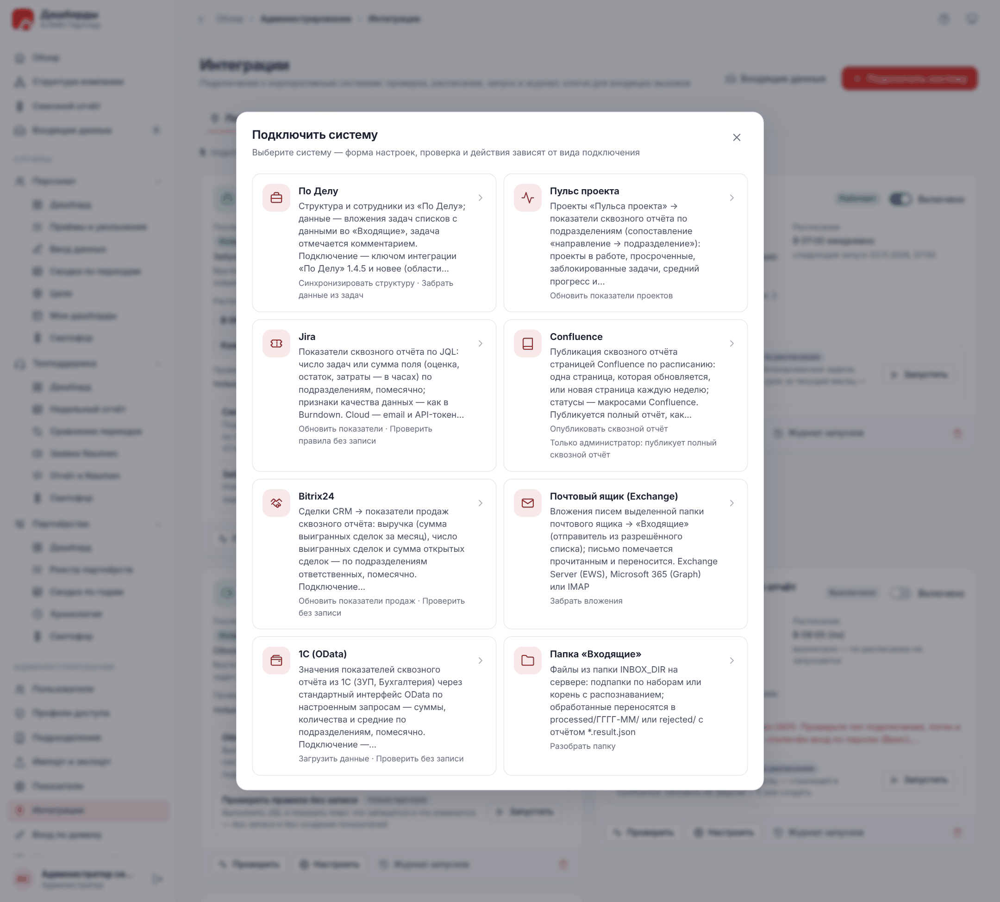

2. Справа откроются настройки «Новое подключение»: описание вида, **Название** (например, «Jira — поддержка»), блок **Подключение** с полями вида (разделы о системах ниже) и **Расписание**. Обязательные поля отмечены «*»; выбор из двух–четырёх вариантов (режим и тип подключения, способ сопоставления) — переключателями, из большего числа — списком; часть полей появляется в зависимости от других — например, ключ интеграции или логин и пароль — по выбранному режиму подключения. Под полем адреса — какой переменной окружения сервер разрешает узлы. Поле JSON (правила Jira, запросы 1С) проверяется при вводе: «JSON без ошибок» или «Ошибка JSON: строка 3, столбец 7 — …»; **Выровнять** расставляет отступы.

   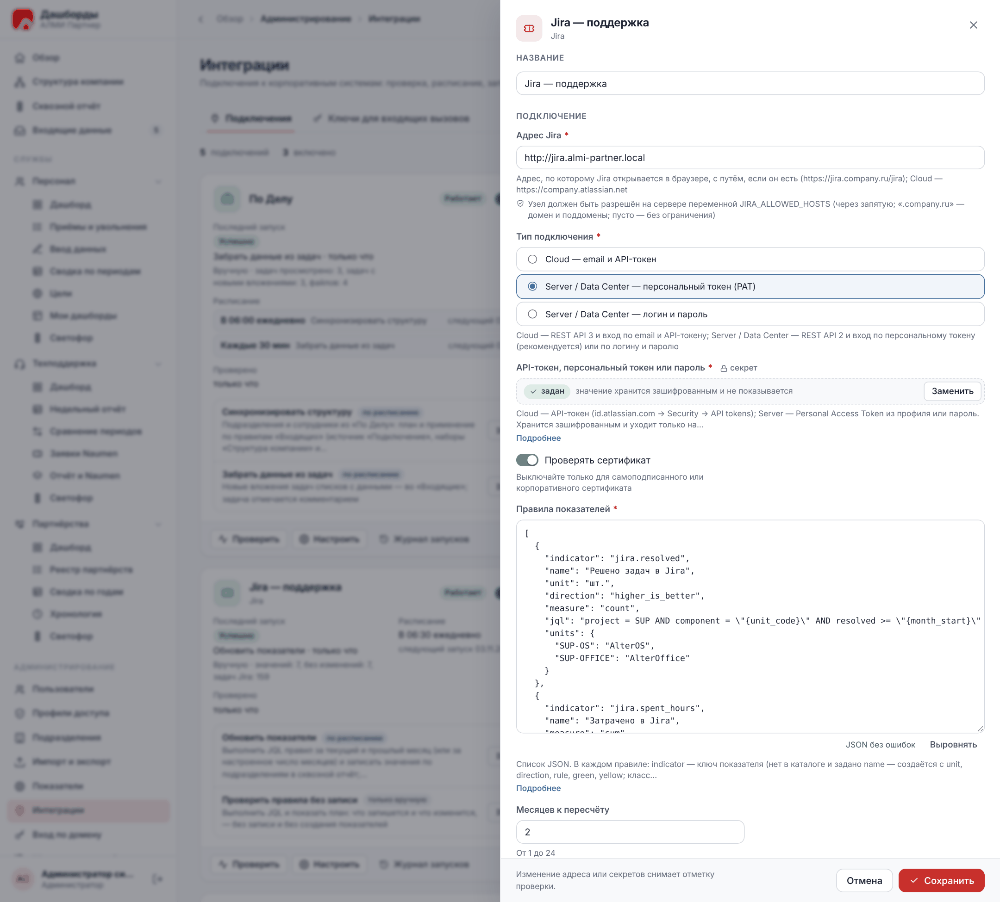

3. **Проверить** — проверка введённых значений до сохранения, ничего не записывается: подключение к системе, вход, права, версия, нужные объекты (пространство Confluence, список «По Делу», наборы 1С). Итог — блок одного из трёх видов:
   - зелёный — что проверено: «Подключено к …»;
   - жёлтый **«Подключено с замечаниями»** — подключение работает, но не всё: под сообщением — список замечаний, по фразе на каждое (у ключа нет области для одного из действий, показатель будет создан при первом запуске, строка сопоставления не сработает). Такое подключение можно включить, а замечания — исправить позже;
   - красный — проверка не прошла: текст ошибки и подсказка («Проверьте адрес подключения», «Введите токен или пароль заново и проверьте снова», какой переменной разрешить узел).

   Ниже — **Подробности · N** с русскими подписями (версия, учётная запись или ключ и его области, списки задач, направления), служебные значения — в свёрнутых **Технических подробностях · N**; внизу — «Проверены несохранённые значения» и время.
4. **Создать**. Подключение создаётся **выключенным**. Если перед созданием проверка прошла с теми же значениями, подключение сразу отмечается проверенным: «Подключение «…» создано и проверено — его можно включить»; иначе — «создано выключенным: проверьте его и включите».
5. Включите переключатель **Включено** на карточке. Включить можно только после успешной проверки текущих настроек — иначе карточка покажет «Сначала проверьте подключение» с кнопкой **Проверить**, а после успешной проверки — **Включить**. Так запуски по расписанию не будут падать из-за неверного адреса или токена.

**Проверить** на карточке проверяет сохранённые настройки и записывает итог в состояние подключения («Проверено», «Последняя ошибка»); проверка с замечаниями считается успешной. Изменение настроек или секретов снимает отметку проверки: включённое подключение продолжает работать, а после сохранения система напомнит «Сохранено. Настройки изменились — проверьте подключение «…» снова».

## Секреты

Пароли, токены, вебхуки и секреты приложений — поля с отметкой «секрет»:

- хранятся **зашифрованными** ключом, производным от `SECRET_KEY` сервера; в ответах сервера и в интерфейсе их нет — только метка «задан» («значение хранится зашифрованным и не показывается»), в журнал изменений записывается лишь факт изменения: «Изменено подключение «…» (секреты)»;
- **привязаны к адресу**, для которого их ввели, и к этому подключению: сохранённый токен никогда не уходит на другой адрес. Если изменить адрес, форма ещё до сохранения покажет «Секреты нужно ввести заново» — «Изменено: «…». Сохранённые секреты («…») привязаны к прежнему адресу и на новый не уйдут — введите их заново, иначе сохранить не получится», — а у поля секрета — «Адрес изменён — секрет привязан к прежнему адресу, введите его заново». У «По Делу» секрет привязан к обоим адресам — «Адрес «По Делу»» и «Адрес для запросов сервера», у почтового ящика — к адресу выбранного способа подключения (адрес EWS; тенант и адреса Microsoft; сервер, порт и SSL IMAP): изменили любой из них или способ подключения — пароль вводится заново;
- **Заменить** — ввести новое значение (**Оставить прежнее** — передумать), **Очистить** — стереть необязательный секрет; пустое поле при сохранении оставляет прежнее значение, если адрес не менялся;
- в тексты ошибок, журнал запусков и журнал сервера секреты не попадают: значения секретов, пароль Basic, токен из заголовка Authorization, логин и пароль в адресе и код доступа в адресе вебхука Bitrix24 заменяются на «…».

**Ввести секрет заново** нужно, если сменился `SECRET_KEY` сервера (сохранённые секреты больше не расшифровываются) или адрес подключения. Карточка такого подключения показывает «Секрет нужно ввести заново» с причиной — например, «Сохранённый секрет не удаётся расшифровать (сменился SECRET_KEY сервера) — введите его заново» — и кнопкой **Настроить**, а настройки — «Сохранённый секрет не подходит». До ввода проверка и запуски завершаются ошибкой. Перешифрование секретов при смене `SECRET_KEY` в 0.4.0 не поддерживается: меняя ключ, приготовьте пароли и токены всех подключений.

## Расписание и запуск

Блок **Расписание** в настройках подключения — до пяти записей, у каждой свои время и действия. Пока записей нет — «Расписания нет — подключение запускается только кнопками действий на карточке.» **Добавить расписание** добавляет запись «Через интервал» каждые 60 минут с действием, которого ещё нет в других записях (подпись рядом: «У каждого расписания — свои время и действия»; после пятой — «Не больше 5 расписаний у подключения»). Запись «Расписание N» с подписью справа:

- **Через интервал** — «Интервал, минут» от 5 до 10 080 (неделя) или готовые: каждые 15 и 30 минут, каждый час, каждые 3 и 12 часов, раз в сутки;
- **В заданное время** — «Время запуска» (ЧЧ:ММ по часовому поясу компании, `TIMEZONE`) и «Дни недели»: не выбраны — каждый день;
- **Что выполнять** — действия, которые можно выполнять по расписанию; выбранные выполняются вместе, одно за другим. Действия с меткой «только вручную» («Проверить без записи», «Проверить правила без записи») запускаются только кнопкой;
- корзина — **Удалить расписание N**.

Под записями — подпись расписания, как её покажет карточка: «Вручную», «Каждые 60 мин», «В 06:30 ежедневно», «В 09:00 (пн)»; у нескольких записей — через «;» с действиями.

**Пример: «По Делу» одним подключением.** Структуру достаточно синхронизировать раз в сутки, а файлы из задач забирать часто:

| Запись | Как запускать | Что выполнять |
| --- | --- | --- |
| Расписание 1 | **В заданное время** — 06:00, дни не выбраны | «Синхронизировать структуру» |
| Расписание 2 | **Через интервал** — 30 минут | «Забрать данные из задач» |

Подпись расписания — «В 06:00 ежедневно — Синхронизировать структуру; Каждые 30 мин — Забрать данные из задач», карточка показывает обе записи со следующим запуском каждой.

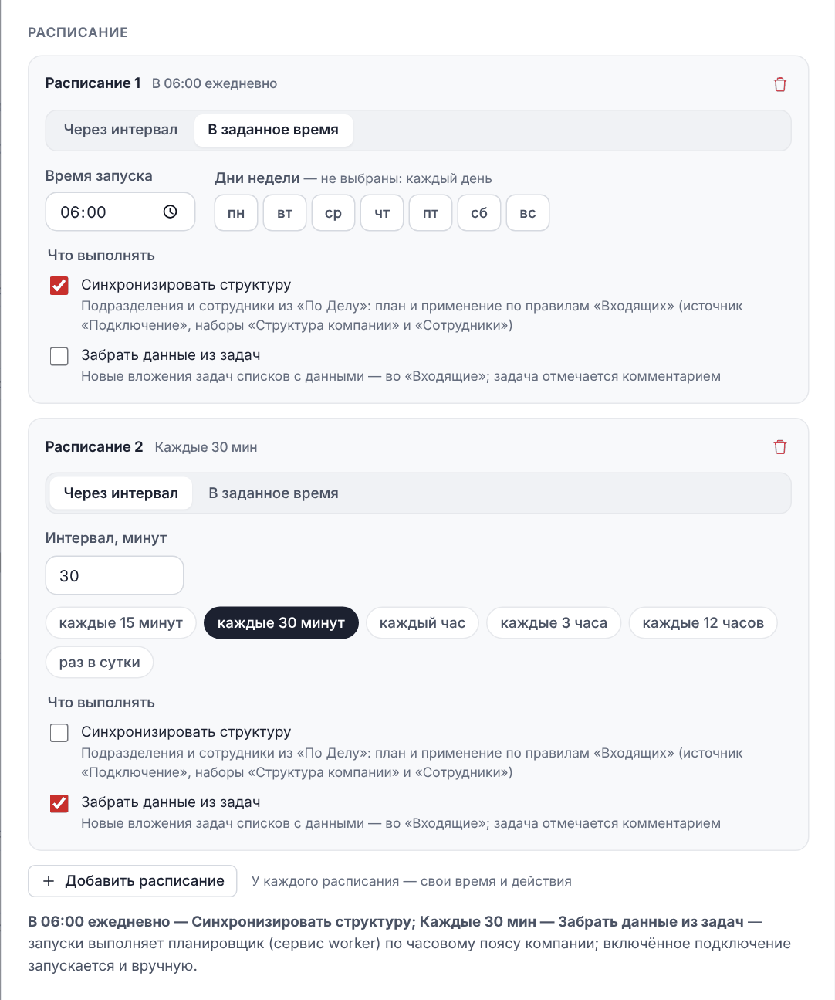

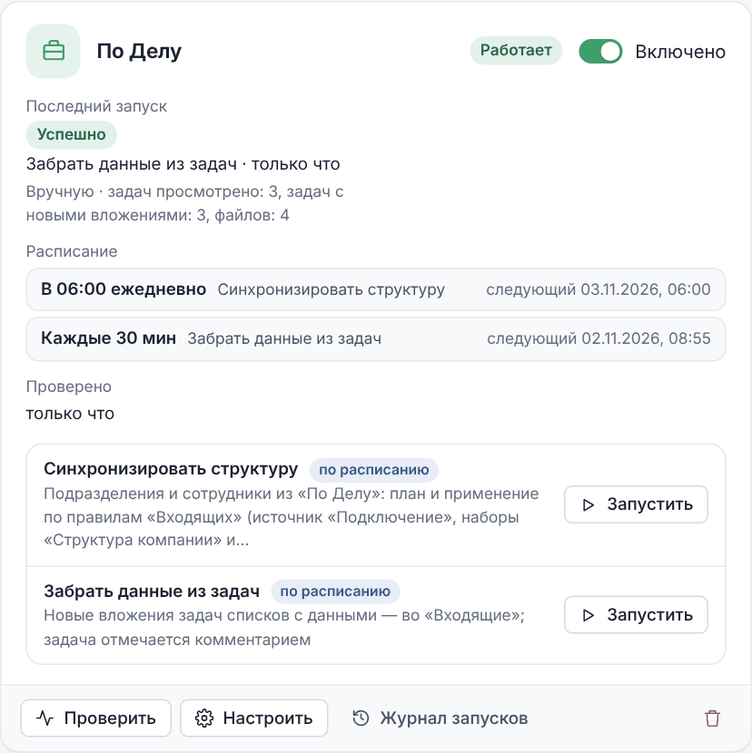

Запуски по расписанию выполняет планировщик и только у **включённых** подключений. У каждой записи свой следующий запуск; если сроки нескольких записей наступили одновременно, их действия выполняются одним запуском. Срок «занимается» в базе атомарно: несколько планировщиков не выполнят одну запись дважды. Пока предыдущий запуск подключения идёт, следующий не начинается (на карточке — «Выполняется запуск с … — дождитесь окончания»).

**Запуск прерван.** Запуск, который идёт дольше двух часов, считается прерванным: процесс приложения или планировщика остановился посреди запуска (перезапуск, сбой). Карточка сразу снова разрешает запуск, а планировщик отмечает такую запись журнала итогом «Запуск прерван» — «Запуск прерван: процесс приложения или планировщика остановился до окончания запуска (перезапуск, сбой) — подключение можно запустить снова». Данные, которые запуск успел записать, остаются; запустите действие снова — уже забранные файлы повторно не скачиваются.

**Запустить** на карточке выполняет действие сразу от вашего имени — у выключенного подключения тоже, поэтому действие можно проверить до включения расписания. Итог — под действием и во всплывающем сообщении, подробности — в журнале запусков. Если ответ не пришёл (например, прокси прервал долгий запрос), запуск всё равно доводится до конца — его итог появится в журнале.

Действие можно запустить и командой на сервере — для расписания через cron вместо планировщика («Руководство по развёртыванию»):

- `python -m app.cli integrations run <номер или вид> [--action <действие>]` — без `--action` выполняются действия всех записей расписания (или первое действие, если расписания нет);
- выключенное подключение командой не запускается — так cron не запустит то, что выключили в интерфейсе: «Подключение «…» выключено — по расписанию и из cron оно не запускается. Запустить выключенное: python -m app.cli integrations run <номер> --force»;
- `--force` запускает выключенное подключение по номеру — как кнопка «Запустить»; по виду (`integrations run podelu`) выбираются только включённые подключения.

## Журнал запусков

**Журнал запусков** на карточке — последние 100 запусков подключения; сервер хранит по 200 запусков на подключение (`INTEGRATION_RUNS_KEEP`), более старые удаляются.

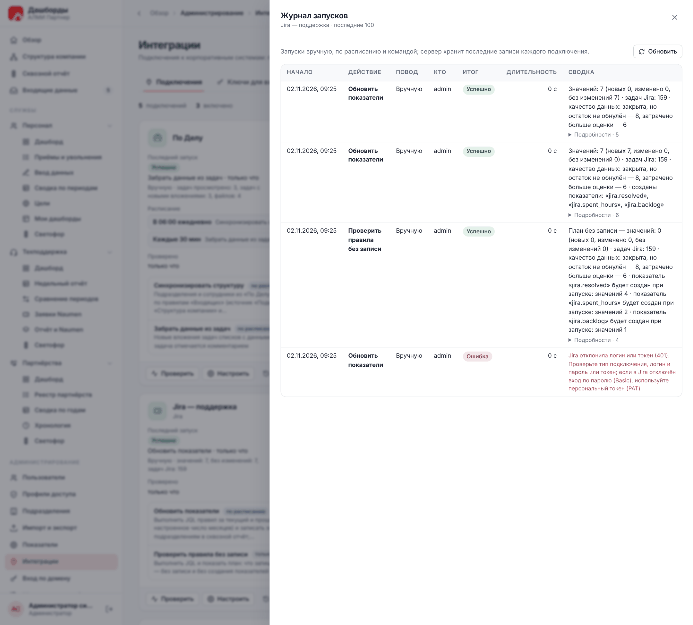

| Столбец | Что показывает |
| --- | --- |
| **Начало** | дата и время запуска |
| **Действие** | например, «Обновить показатели» |
| **Повод** | «Вручную», «По расписанию» или «Команда» — запуск командой на сервере |
| **Кто** | пользователь; по расписанию и командой — `system` |
| **Итог** | «Успешно»; «Частично» — часть данных не обработана, например одно правило Jira с ошибкой, задачу «По Делу» не удалось отметить комментарием или «По Делу» остановила запуск пределом частоты (следующий запуск продолжит); «Ошибка»; «Выполняется»; «Запуск прерван» — процесс остановился посреди запуска (раздел «Расписание и запуск») |
| **Длительность** | «12 с», «3 мин 5 с» |
| **Сводка** | сообщение запуска и текст ошибки; счётчики с подписями вида подключения — например, «значений», «новых», «изменено», «без изменений», «задач просмотрено», «во «Входящие»», «уже забраны», «писем от разрешённых отправителей», «создано показателей» — в свёрнутых **Подробностях · N** строки (те же числа уже есть в сообщении); служебные числа без подписи не показываются |

Ручные запуски и запуски командой записываются и в журнал изменений («Запуск «…»: …»), проверки — тоже («Проверка подключения «…»: успешно», «…: успешно, с замечаниями» или «…: ошибка»; замечания — в подробностях записи).

## Ошибки подключений

Сетевые правила общие для всех подключений:

- адрес — только `http(s)://узел[:порт][/путь]`, без логина в адресе, «?» и «#»;
- если на сервере задана переменная `<ВИД>_ALLOWED_HOSTS` (`JIRA_ALLOWED_HOSTS`, `PODELU_ALLOWED_HOSTS`…), узел должен быть в ней: `jira.company.ru` — один узел, `.company.ru` — домен и все поддомены;
- перенаправления не выполняются — токен уходит только на адрес, для которого его ввели;
- ожидание — 5 с на соединение и 30 с на ответ; ответ — не больше 20 МБ (при скачивании вложений — не меньше предела файла входящих);
- при ответах 429 и 503 запросы чтения повторяются до трёх раз с паузой из `Retry-After` (не больше 10 с); запросы, которые что-то меняют у партнёра (вход, комментарий, публикация страницы), не повторяются;
- прокси — `HTTPS_PROXY` (для адресов `https://`) и `HTTP_PROXY` (для `http://`) сервера, узлы из `NO_PROXY` — напрямую; почтовый ящик по IMAP ходит напрямую, без прокси («Руководство по развёртыванию», раздел «Сетевой доступ к системам»);
- «Проверять сертификат» выключайте только для самоподписанного или корпоративного сертификата.

| Сообщение | Причина и решение |
| --- | --- |
| «Не удалось подключиться к …: проверьте адрес и доступность сети» | неверный адрес, межсетевой экран или нет маршрута с сервера — проверьте доступ с сервера («Руководство по развёртыванию», раздел «Сетевой доступ к системам») |
| «Не удалось подключиться к … через прокси http://proxy…:3128 (HTTPS_PROXY / HTTP_PROXY; если узел доступен напрямую, добавьте его в NO_PROXY)…» | запрос ушёл через прокси сервера, а прокси не пускает к узлу или узел внутренний — добавьте узел или домен в `NO_PROXY` (это делает администратор сервера) |
| «Превышено время ожидания подключения к …», «… не ответил за 30 с» | система недоступна или перегружена — повторите позже |
| «Ошибка TLS-сертификата …» | самоподписанный или корпоративный сертификат: выключите «Проверять сертификат» |
| «Подключение к … запрещено настройками сервера (JIRA_ALLOWED_HOSTS)» | узел не разрешён — добавьте его в переменную или исправьте адрес |
| «Адрес … — только https://узел[:порт][/путь], без логина, параметров «?» и «#»» | уберите из адреса логин, параметры и якорь |
| «… перенаправляет запрос (302) на … — укажите в подключении итоговый адрес (например, с https:// или с путём)» | укажите адрес, на который система перенаправляет |
| «… вернул неожиданный ответ — проверьте адрес; возможно, отвечает страница входа или прокси» | адрес ведёт не на API системы: страница входа SSO, прокси, другая система |
| «… отклонила учётные данные подключения (401)», «Недостаточно прав в … (403)» | проверьте логин, токен и права учётной записи (разделы о системах ниже) |
| «… ограничила частоту запросов (429) — повторите позже» | лимит запросов системы — увеличьте интервал расписания |
| «Сохранённый секрет не удаётся расшифровать (сменился SECRET_KEY сервера) — введите его заново», «Секрет введён для адреса …, а подключение настроено на … — введите токен или пароль заново» | **Настроить** → введите пароль или токен заново |
| «Подключение уже выполняет запуск — дождитесь его окончания» | предыдущий запуск ещё идёт |
| «Запуск прерван: процесс приложения или планировщика остановился до окончания запуска (перезапуск, сбой) — подключение можно запустить снова» | сервер или планировщик перезапускали посреди запуска — запустите действие снова |
| «Только администратор: публикует полный сквозной отчёт — подключение «Confluence» настраивает и запускает только администратор» | подключение Confluence меняет и запускает администратор |
| «Сначала проверьте подключение: включить можно после успешной проверки» | **Проверить**, затем включите |
| «Внутренняя ошибка коннектора — подробности в журнале сервера» | сбой программы: передайте разработчикам время запуска из журнала запусков и журнал сервера |

Регламент диагностики — `docs/runbooks/integrations-troubleshooting.md`.

## «По Делу»

**Что делает.**

- **«Синхронизировать структуру»** — забирает из «По Делу» структуру компании и сотрудников. Структура (выгрузка «По Делу» `podelu.org-structure`) переводится в формат структуры «Дашбордов» и становится элементом входящих набора «Структура компании»: план — на экране «Входящие», применение — по правилу «Подключение × Структура компании». Подразделения сопоставляются по пути, внешний ID подразделения — его ключ в «По Делу»; типы уровней, которых нет в настройках структуры, заменяются типом по умолчанию (запуск об этом предупредит); настройки структуры «По Делу» не применяются. Сотрудники сопоставляются по ID «По Делу», затем по email; руководитель, уже пришедший из «По Делу», находится по ID, даже если его email сменился. Новые сотрудники создаются «Без доступа», без пароля — доступ выдаёт администратор; роли, полномочия и активность из «По Делу» не переносятся. Сотрудники применяются, только когда структура уже совпадает с «По Делу» (иначе — «сначала примените структуру») и включено правило «Подключение × Сотрудники»; иначе запуск показывает план сотрудников без записи. Строки с ошибками пропускаются, остальные применяются, пропущенные перечислены в журнале запуска.
- **«Забрать данные из задач»** — новые вложения Excel, CSV и JSON задач списков с данными → «Входящие»; уже забранные файлы не скачиваются повторно (по SHA-256). Набор распознаётся по файлу. У элемента входящих — пояснение «Задача «…» · автор вложения», в задаче — комментарий «Файл «…» принят в «Дашборды»: <статус>» и, если на сервере задан `PUBLIC_URL`, ссылка «Входящие данные: …/inbox». По ключу комментарий подписан названием системы ключа («Дашборды») с пометкой «интеграция», служебная учётная запись пишет его от своего имени. Картинки, PDF и архивы не забираются, файлы больше `INBOX_MAX_MB` пропускаются. Несколько меток в настройке — «одна из меток».

По ключу «Забрать данные из задач» читает задачи всех списков, открытых ключу (или одного выбранного), в порядке последних изменений и запоминает, докуда дошёл: если «По Делу» остановила запуск пределом частоты, итог — «Частично» («…; остановлено: Ключ «…» превысил лимит частоты запросов «По Делу» (429) — повторите позже — следующий запуск продолжит с места остановки»). Файлы результатов поручений по ключу «По Делу» не отдаёт — их забирает только служебная учётная запись. Имя автора вложения подставляется, если у ключа есть область «Сотрудники». Если владелец списка отключил в нём комментарии, задачи этого списка не отмечаются — в подробностях «в списке «…» владелец отключил комментарии — задачи не отмечаются», счётчик «не отмечено: комментарии выключены», итог остаётся «Успешно».

**Режим подключения.**

| Режим | Версия «По Делу» | Как подключается |
| --- | --- | --- |
| «Ключ интеграции (По Делу 1.4.5 и новее)» — по умолчанию, рекомендуется | 1.4.5 и новее | у «Дашбордов» свой ключ `podelu_…` только с нужными областями доступа; запросы — к `/api/integrations/v1` с заголовком `Authorization: Bearer`, без входа учётной записью; не больше 120 запросов в минуту на ключ (предел задаёт «По Делу») |
| «Служебная учётная запись (для версий до 1.4.5)» | до 1.4.5, где ключей для других систем нет | вход логином и паролем на каждый запуск и каждую проверку (абзац «Служебная учётная запись» ниже) |

**Ключ в «По Делу».** Ключ выпускает администратор «По Делу» (роль «Администратор»):

1. «Настройки → Интеграции» → карточка **Ключи интеграций** → **Выпустить ключ для системы**.
2. **Название системы** — «Дашборды»: под этим названием «Дашборды» видны в журнале ключей и в комментариях задач. **Код системы** — `dashboards`.
3. **Области доступа**:

   | Область в «По Делу» | Для чего «Дашбордам» |
   | --- | --- |
   | «Структура компании» (`org.read`) | «Синхронизировать структуру»: подразделения и руководители |
   | «Сотрудники» (`users.read`) | «Синхронизировать структуру»: сотрудники; имена авторов вложений во «Входящих» |
   | «Задачи и вложения» (`tasks.attachments.read`) | «Забрать данные из задач»: задачи выбранных списков и их файлы |
   | «Комментарии к задачам» (`tasks.comment`) | «Отмечать задачу комментарием» |

4. **Списки задач** — списки, в задачи которых кладут выгрузки (до 50). Задачи других списков «Дашбордам» не видны.
5. **Выпустить ключ** → **Скопировать**: ключ показывается один раз. Введите его в поле «Ключ интеграции» подключения.

Ключ может быть и без части областей — например, только «Задачи и вложения» и «Комментарии к задачам» для подключения, которое лишь забирает файлы. Области и списки администратор «По Делу» меняет без нового ключа — новые права действуют со следующего запроса; **Перевыпустить** выдаёт новый ключ (прежний перестаёт работать сразу — введите новый в подключении), **Отозвать** закрывает «Дашбордам» доступ.

| Поле | Что задаёт |
| --- | --- |
| **Адрес «По Делу»** | адрес, по которому сотрудники открывают «По Делу»: `https://podelu.company.ru` |
| **Адрес для запросов сервера** | необязательно: если сервер «Дашбордов» видит «По Делу» по другому адресу (например, оба в Docker на одной машине — `http://host.docker.internal:5000`); запросы идут на него, ключ и пароль привязаны к обоим адресам |
| **Режим подключения** | «Ключ интеграции (По Делу 1.4.5 и новее)» или «Служебная учётная запись (для версий до 1.4.5)» |
| **Ключ интеграции** | режим ключа: секрет, начинается с `podelu_` |
| **Служебная учётная запись**, **Пароль** | режим учётной записи: логин или email в «По Делу» и пароль (секрет) |
| **Проверять TLS-сертификат** | выключите только для самоподписанного или корпоративного сертификата |
| **Список задач с данными** | по ключу — необязательно (подсказка в поле — «пусто — все списки ключа»): id или название одного из списков ключа, пусто — все списки ключа; служебной учётной записью — id или название списка, в задачи которого кладут выгрузки (учётная запись — его участник). Списки — в подробностях проверки |
| **Метки задач** | необязательно: только задачи с одной из этих меток |
| **Создавать недостающие подразделения** | включено (по умолчанию) — подразделения «По Делу», которых нет в структуре, создаются; выключено — обновляются только существующие, сотрудники новых подразделений не переводятся и не создаются |
| **Отключать отсутствующих сотрудников** | сотрудники, пришедшие из «По Делу», которых там больше нет среди активных, отключаются (в журнале — «Отключён сотрудник …: нет среди активных в «По Делу»»); сотрудники других источников (заведённые вручную, из файла, из AD), служебная учётная запись, тот, кто запустил синхронизацию, и последний активный администратор не отключаются. Сотрудники применяются только при включённом правиле «Подключение × Сотрудники» |
| **Отмечать задачу комментарием** | комментарий в задаче о каждом принятом файле (по умолчанию включено); в списке должны быть разрешены комментарии, ключу нужна область «Комментарии к задачам» |

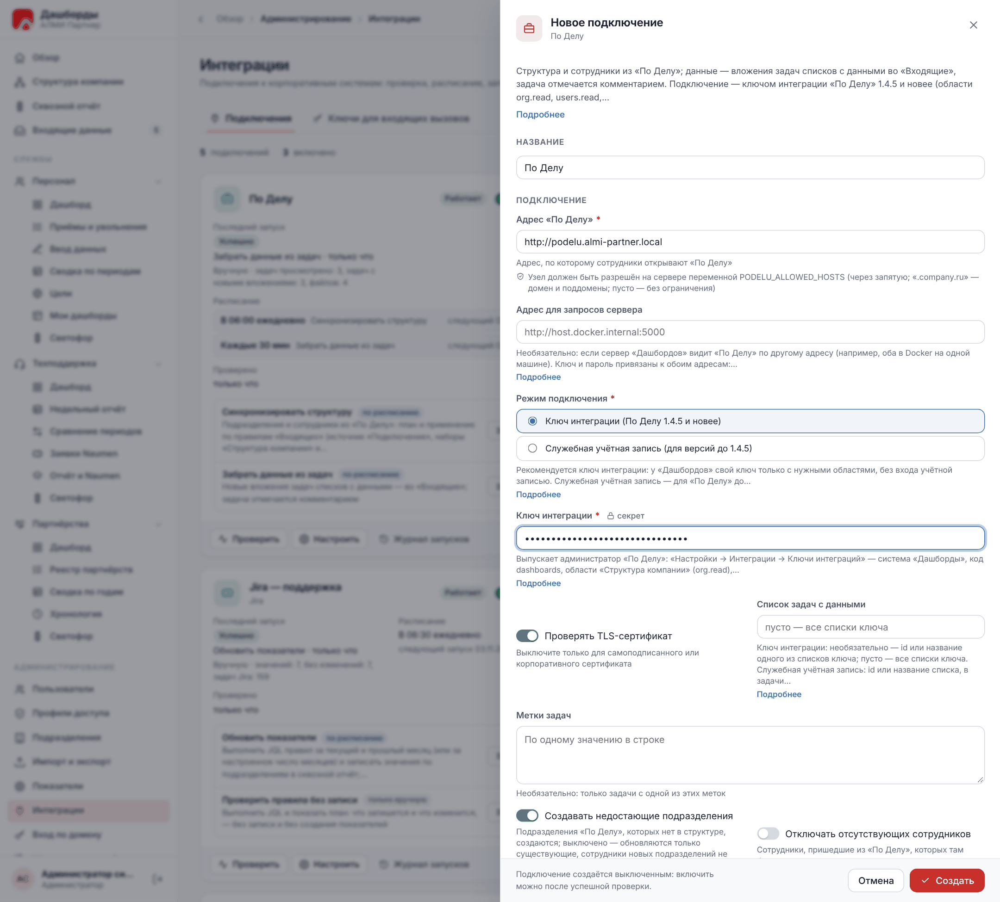

**Проверка по ключу** читает версию «По Делу», название, области и списки ключа и выгрузку структуры: «Подключено к «По Делу» 1.4.5 по ключу «Дашборды», подразделений: N, списки ключа: «Данные для дашбордов», «Отчёты руководителей»» (с выбранным списком — «список «…»»). Проверка проходит, если работает хотя бы одно действие: «Синхронизировать структуру» (области «Структура компании» и «Сотрудники») или «Забрать данные из задач» («Задачи и вложения» со списками). Если ключу не хватает областей для остальных возможностей, итог — «Подключено с замечаниями» с сообщением «Подключено к «По Делу» 1.4.5 по ключу «…», списки ключа: «…»» и списком: «Не хватает области «Структура компании» (org.read) — для «Синхронизировать структуру»», «Не хватает области «Сотрудники» (users.read) — для сотрудников в «Синхронизировать структуру»», «Не хватает области «Задачи и вложения» (tasks.attachments.read) со списками задач — для «Забрать данные из задач»», «Не хватает области «Комментарии к задачам» (tasks.comment) — для «Отмечать задачу комментарием»» — какие из них нужны — и последней строкой «Добавьте области ключу: «По Делу» → «Настройки → Интеграции → Ключи интеграций»». Если не работает ни одно действие — проверка не проходит: «Ключ «…» принят в «По Делу» 1.4.5, но не хватает: …». В подробностях — режим подключения, версия, ключ, области ключа, число подразделений и доступные списки задач.

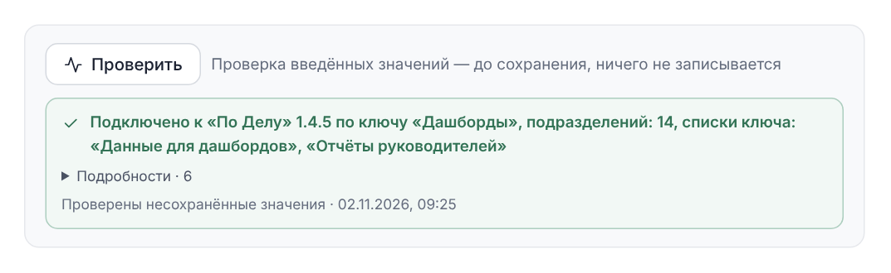

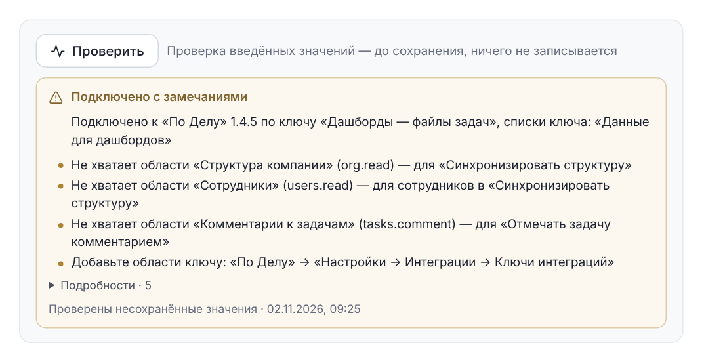

**Служебная учётная запись** (для «По Делу» до 1.4.5). Отдельная учётная запись, не администратор: полномочия «Ведёт структуру компании» (`org.manage`) и «Ведёт учётные записи» (`users.manage`), участник (просмотр) только выделенного списка задач; в списке должны быть разрешены комментарии. Подключение получает CSRF-токен, входит, выполняет запросы и всегда выходит, в том числе после ошибки. Каждый запуск действия и каждая проверка — отдельный вход; «По Делу» допускает с одного адреса 10 входов в минуту и 50 в час. Проверка входит учётной записью и проверяет полномочия, выгрузку структуры и список задач: «Подключено к «По Делу» … как …, подразделений: N, список «Данные для дашбордов»». Если чего-то не хватает — «Вход в «По Делу» как … выполнен, но не хватает: …» (полномочие или «доступ к списку «…» (служебная учётная запись должна быть его участником)»). Замечания («Подключено с замечаниями»): «Список задач с данными не выбран — «Забрать данные из задач» недоступно», «В списке «…» выключены комментарии — задачи не будут отмечаться», «Учётная запись — администратор «По Делу»: достаточно полномочий org.manage и users.manage». Обновив «По Делу» до 1.4.5, переведите подключение на ключ: выпустите ключ, выберите режим «Ключ интеграции» и введите его.

**Расписание.** Обычно «Забрать данные из задач» запускают каждые 15–30 минут, а структуру синхронизируют раз в сутки — двумя записями расписания одного подключения (пример — в разделе «Расписание и запуск»).

| Сообщение | Решение |
| --- | --- |
| ««По Делу» не приняла ключ интеграции (401): Неверный ключ «По Делу» — проверьте ключ или выпустите новый в «По Делу»» | ключ введён с ошибкой или перевыпущен — введите действующий ключ или выпустите новый |
| «Ключ интеграции отозван администратором «По Делу» — выпустите ключ заново: «По Делу» → «Настройки → Интеграции → Ключи интеграций» и введите его в подключении» | ключ отозван — выпустите новый и введите его в подключении |
| «У ключа нет доступа «…» (область …) — добавьте её ключу: …», «У ключа «…» нет областей: … — добавьте их ключу: …» | добавьте ключу область в «По Делу» — ключ вводить заново не нужно |
| «У ключа «…» нет области «Задачи и вложения» (tasks.attachments.read) со списками задач — добавьте её и списки с данными: …» | выберите ключу область и списки задач с данными |
| «Список «…» не открыт ключу «…» — выберите его для ключа (…) или оставьте «Список задач с данными» пустым: тогда берутся все списки ключа» | откройте список ключу или очистите поле |
| «Ключ «…» превысил лимит частоты запросов «По Делу» (429) — повторите позже» | предел — 120 запросов в минуту на ключ; запуск «Забрать данные из задач» продолжит с места остановки, частые запуски разнесите по времени |
| «Ключ интеграции «По Делу» начинается с podelu_ — проверьте ключ» | в поле введён не ключ «По Делу» — например, ключ «Пульса» или «Дашбордов» |
| «По адресу подключения нет API ключей интеграций «По Делу» (/api/integrations/v1/ping, 404): «По Делу» старше 1.4.5 или адрес указан неверно. Обновите «По Делу» до 1.4.5 или выберите режим «Служебная учётная запись (для версий до 1.4.5)»» | проверьте адрес; для «По Делу» до 1.4.5 — режим служебной учётной записи |
| «Ключ принят, но по адресу подключения отвечает не «По Делу» (app: …) — проверьте адрес» | адрес ведёт в другую систему — например, в «Пульс» |
| «… отклонила вход: неверный логин или пароль служебной учётной записи» | проверьте логин и пароль |
| «Служебная учётная запись отключена в «По Делу»» | включите учётную запись в «По Делу» |
| «… ограничила число запросов (429): много попыток входа — подождите несколько минут и повторите» | исчерпан лимит входов служебной учётной записи: не повторяйте проверку подряд, увеличьте интервал расписания или перейдите на ключ |
| «… отклонила запрос защитой от подделки (CSRF)… Укажите в подключении адрес, по которому открывается «По Делу» (та же схема http/https и тот же узел)…» | адрес должен совпадать с адресом, по которому открывается «По Делу»; прокси не должен убирать cookie и заголовок Referer |
| «… выдаёт cookie сессии только для HTTPS: укажите адрес https://…» | укажите адрес с https:// |
| «У служебной учётной записи нет права выгружать структуру в «По Делу» — нужно полномочие «Ведёт структуру компании» (org.manage)», то же для сотрудников и «Ведёт учётные записи» (users.manage) | выдайте полномочие в «По Делу» |
| «Список «…» в «По Делу» не найден или недоступен — служебная учётная запись должна быть участником списка» | добавьте учётную запись в участники списка |
| «Не выбран список задач с данными — укажите его в настройках подключения…» | служебной учётной записью: заполните «Список задач с данными» |
| «Структура: … — уже ожидает решения на экране «Входящие» (элемент №N)» | примените или отклоните этот элемент; следующий запуск продолжит |
| «Сотрудники: план — …; не применено: сначала примените структуру» или «… не включено «применять сразу»…» | примените структуру на экране «Входящие» или включите правило «Подключение × Сотрудники» |

## «Пульс проекта»

**Что делает.** «Обновить показатели проектов» читает проекты «Пульса» и записывает за **текущий месяц** (по часовому поясу компании) пять показателей сквозного отчёта по подразделениям:

| Показатель | Ключ | Как считается | Светофор |
| --- | --- | --- | --- |
| Проекты в работе | `puls.projects` | проекты с незавершёнными задачами | без оценки |
| Просроченные проекты | `puls.overdue` | проекты в работе с просроченными задачами или прошедшим сроком окончания при прогрессе меньше 100 % | норма — 0, внимание — 1, критично — 2 и больше |
| Проекты в срок | `puls.on_time_share` | доля проектов в работе без просрочки, % | норма — от 90 %, внимание — от 70 % |
| Средний прогресс проектов | `puls.progress` | средний прогресс проектов в работе, % | без оценки |
| Заблокированные задачи проектов | `puls.blocked` | задачи в статусе «Заблокирована» | норма — 0, внимание — до 5 |

Показатели создаются в каталоге при первом запуске: вводимые, класс «Операционные», служба-владелец — «Проектный и продуктовый офис»; если название занято, к нему добавляется «(«Пульс»)». Правила светофора и другие свойства потом меняются в разделе «Показатели» — подключение их не перезаписывает. Значения пишутся с комментарием «из «Пульса проекта»». У подразделения без проектов в работе средний прогресс и доля в срок не определены — значение прошлого запуска очищается, а не остаётся старым.

Проект относится к подразделению по сопоставлению «направление → подразделение», проект несопоставленного направления — к корню структуры. Каждое сопоставленное подразделение, его вышестоящие и корень получают значения по проектам своей ветки, корень — по всем проектам. **Светофор проекта** выводится в «Дашбордах»: красный — просрочен; жёлтый — есть заблокированные задачи или до окончания не больше 14 дней при прогрессе меньше 80 %; зелёный — остальные в работе и завершённые; серый — без задач. Красные и жёлтые проекты с причиной перечислены в подробностях запуска, число проектов каждого цвета — в счётчиках.

**Режим подключения.** «Ключ интеграции (Пульс 0.6.0 и новее)» — по умолчанию, рекомендуется: у «Дашбордов» свой ключ `puls_…` только для чтения проектов, запросы — к `/api/integration/v1` с заголовком `Authorization: Bearer`, не больше 120 запросов в минуту на ключ. «Служебная учётная запись (для версий до 0.6.0)» — для «Пульса», где ключей для других систем нет: учётная запись только для чтения — роль «Наблюдатель» с правами на нужные направления (или администратор); подключение входит и всегда выходит.

**Ключ в «Пульсе».** Ключ выпускает администратор «Пульса»: «Интеграции → Ключи доступа» → **Выпустить ключ** — система «Дашборды компании», права:

| Право в «Пульсе» | Что даёт «Дашбордам» |
| --- | --- |
| «Проекты и планы» (`projects.read`) | проекты и направления — обязательно |
| «Показатели проектов» (`projects.stats`) | у проектов — задачи «в работе» и «заблокировано» и id направления |

Ключ показывается один раз — введите его в поле «Ключ интеграции» подключения.

**Без права «Показатели проектов»** подключение работает, но с ограничениями: «Пульс» не отдаёт заблокированные задачи — `puls.blocked` не обновляется; «в работе» определяется по числу задач и прогрессу; направления сопоставляются только по названию — строка сопоставления с id направления не сработает. Проверка показывает «Подключено с замечаниями»: «У ключа нет права «Показатели проектов» (projects.stats): «Пульс» не отдаёт задачи «в работе» и «заблокировано» и id направлений — puls.blocked не обновляется, направления сопоставляются только по названию», а для строки с id — «Сопоставление, строка N («7»): без права projects.stats направление сопоставляется только по названию — укажите «…»». Запуск пишет то же в подробностях; запуск со строкой по id завершается «Частично».

**Не больше 200 проектов.** API ключей «Пульса» отдаёт не больше 200 проектов за запрос и не листается. Если проектов больше, проверка показывает замечание «Проектов в «Пульсе» N, а API отдаёт не больше 200 — показатели будут посчитаны по первым 200», запуск — «возможно, проектов больше 200 — показатели посчитаны по первым 200». Служебная учётная запись получает все проекты.

| Поле | Что задаёт |
| --- | --- |
| **Адрес «Пульса проекта»** | `https://puls.company.ru` |
| **Режим подключения** | «Ключ интеграции (Пульс 0.6.0 и новее)» или «Служебная учётная запись (для версий до 0.6.0)» |
| **Ключ интеграции** | режим ключа: секрет, начинается с `puls_` |
| **Служебная учётная запись**, **Пароль** | режим учётной записи |
| **Проверять TLS-сертификат** | выключите только для самоподписанного или корпоративного сертификата |
| **Направление → подразделение** | по строке на направление: «направление = подразделение»; направление — название или id в «Пульсе» (id — по ключу с правом «Показатели проектов» или служебной учётной записью), подразделение — код или путь через «/» |

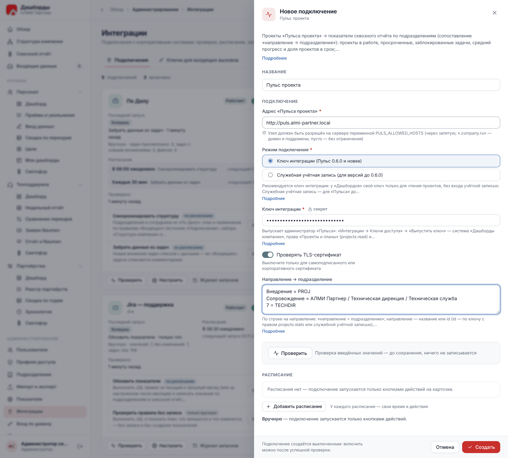

Пример сопоставления для демонстрационной структуры:

```text
Внедрение = PROJ
Сопровождение = АЛМИ Партнер / Техническая дирекция / Техническая служба
7 = TECHDIR
# Маркетинговые проекты пока относятся к компании в целом
```

Разделитель — «=», «→», «->» или табуляция; пустые строки и строки с «#» в начале пропускаются; направление указывается один раз. Здесь проекты направления «Внедрение» относятся к Проектной службе, «Сопровождение» — к Технической службе, направление с id 7 — к Технической дирекции; Техническая дирекция получит значения по своим проектам и проектам Технической службы, «АЛМИ Партнер» — по всем.

**Проверка** перечисляет направления «Пульса» с числом проектов и подразделением сопоставления: «Подключено к «Пульс проекта» 0.6.0 (ключ интеграции «Дашборды компании», права: projects.read, projects.stats): проектов N, направлений N, сопоставлено N; без подразделения (в корень структуры): …» (служебной учётной записью — «(служебная учётная запись …)»). Замечания — «Подключено с замечаниями» со списком: сначала ограничения ключа (нет права «Показатели проектов», больше 200 проектов), затем сопоставление — «Сопоставление, строка 2 («Сопровождение»): подразделение «…» не найдено», «Направления «…» нет в «Пульсе»».

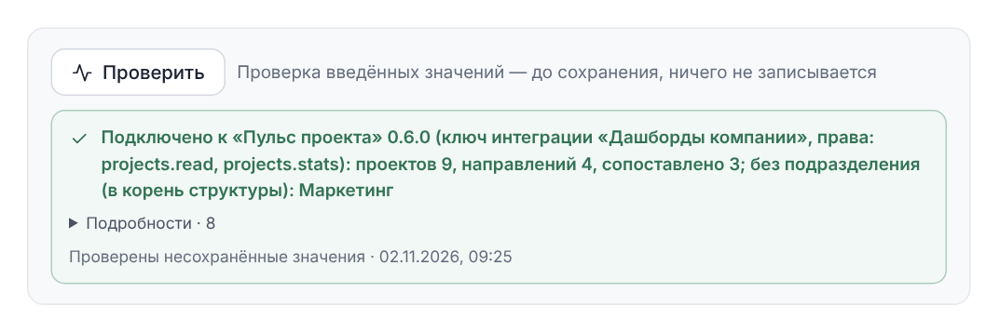

| Сообщение | Решение |
| --- | --- |
| ««Пульс проекта» не приняла ключ интеграции (401): …» | введите действующий ключ или выпустите новый |
| «У ключа «…» нет права «Проекты и планы» (projects.read) — добавьте его ключу: «Пульс» → «Интеграции → Ключи доступа»» | добавьте ключу право в «Пульсе» |
| «Ключ «…» превысил лимит частоты запросов «Пульс проекта» (429) — повторите позже» | не запускайте проверку и действие подряд; увеличьте интервал расписания |
| «Ключ интеграции «Пульса» начинается с puls_ — проверьте ключ» | в поле введён не ключ «Пульса» |
| «По адресу подключения нет API ключей интеграций «Пульса» (/api/integration/v1/ping, 404): «Пульс» старше 0.6.0 или адрес указан неверно. Обновите «Пульс» до 0.6.0 или выберите режим «Служебная учётная запись (для версий до 0.6.0)»» | проверьте адрес; для «Пульса» до 0.6.0 — режим служебной учётной записи |
| ««Пульс проекта» 0.5.… не сообщает права ключа — это версия до 0.6.0, где ключ интеграции один и выдан «По Делу»…» | обновите «Пульс» до 0.6.0 или выберите служебную учётную запись |
| «Сопоставление, строка N: нужно «направление = код или путь подразделения»», «… направление «…» уже указано в строке N» | исправьте строку сопоставления |
| «подразделений «…» несколько — укажите код или путь через «/»» | укажите код подразделения |
| «… отклонила вход: неверный логин или пароль служебной учётной записи» | проверьте логин и пароль |
| «В структуре компании нет подразделений — показатели некуда записать» | постройте структуру компании |
| «показатель puls.… выключен — не обновляется» | включите показатель в разделе «Показатели» |

## Jira

**Что делает.** «Обновить показатели» выполняет JQL правил за текущий и прошлый месяц (настройка «Месяцев к пересчёту») и записывает значения показателей по подразделениям: число задач или сумму поля — оценки, остатка, затраченного времени в часах или числового поля. «Проверить правила без записи» выполняет те же запросы и показывает план — что запишется и что изменится — без записи и без создания показателей. Значения показателя, которого ещё нет в каталоге, считаются отдельно: «показатель «jira.resolved» будет создан при запуске: значений N» (счётчик «значений новых показателей») или «показатель «…»: значений нет — при запуске он не будет создан». Признаки качества данных, как в Burndown, — в сводке запуска: «закрыта, но остаток не обнулён», «не закрыта, нет оценки и остатка», «затрачено больше оценки» (примеры задач — в подробностях). Значения пишутся с комментарием «из Jira (JQL …)».

**Права в Jira.** Учётная запись — лучше служебная — с правом просмотра проектов из JQL (Browse projects). Cloud — email и API-токен (id.atlassian.com → Security → API tokens), REST API 3; Server / Data Center — персональный токен (Personal Access Token, рекомендуется) или логин и пароль, REST API 2.

| Поле | Что задаёт |
| --- | --- |
| **Адрес Jira** | адрес, по которому Jira открывается в браузере, с путём, если он есть: `https://jira.company.ru/jira`; Cloud — `https://company.atlassian.net` |
| **Тип подключения** | «Cloud — email и API-токен», «Server / Data Center — персональный токен (PAT)» (по умолчанию), «Server / Data Center — логин и пароль» |
| **Email или логин** | для Cloud и входа по логину и паролю |
| **API-токен, персональный токен или пароль** | секрет |
| **Проверять сертификат** | выключайте только для самоподписанного или корпоративного сертификата |
| **Правила показателей** | список правил JSON (ниже) |
| **Месяцев к пересчёту** | 1 — только текущий, 2 — текущий и прошлый (по умолчанию: поздние правки прошлого месяца тоже попадут в отчёт), до 24 |
| **Служба-владелец новых показателей** | с какой службой-владельцем подключение создаёт новый показатель (по умолчанию «ИТ-служба»): её сотрудники с уровнем «Ввод данных» смогут поправить значение вручную |

**Правило показателя** — объект JSON, правил — до 50:

| Поле | Что задаёт |
| --- | --- |
| `indicator` | ключ показателя каталога: латиница в нижнем регистре, цифры, «.», «_», «-» — `jira.resolved` |
| `name`, `unit`, `direction`, `rule`, `green`, `yellow`, `rollup`, `description` | описание для создания показателя, если его нет в каталоге: название (без него показатель не создаётся), единица, направление (`higher_is_better`, `lower_is_better`, `neutral`), правило (`threshold` — пороги, `target` — отклонение от цели), границы, свёртка (`sum` — по умолчанию, `avg`, `none`); класс — всегда «Операционные» |
| `measure` | `count` — число задач (по умолчанию) или `sum` — сумма поля |
| `field`, `field_unit` | для `sum`: `timeestimate` (оставшаяся оценка), `timespent` (затраченное время), `timeoriginalestimate` (первоначальная оценка) — секунды переводятся в часы; или числовое поле `customfield_NNNNN` с `field_unit`: `number` — как есть, `hours`, `minutes`, `seconds`, `days` (по 8 часов) |
| `jql` и `units` | шаблон JQL и подразделения: список кодов (`["TECH", "IT"]`) или объект «код подразделения → значение `{unit_code}`» — компонент, метка, проект |
| `unit_jql` | вместо `jql` и `units`: свой JQL на подразделение — `{"TECH": "…", "IT": "…"}` |

Подстановки в JQL: `{month_start}` и `{month_end}` — первый и последний день месяца, `{next_month_start}` — первый день следующего, `{month}` — `2026-10`, `{unit_code}` — значение из `units`. Даты сравнивайте так: `resolved >= "{month_start}" AND resolved < "{next_month_start}"` — условие `<= "{month_end}"` в Jira не включает последний день. JQL без подстановки месяца — снимок «на сейчас» (например, открытый бэклог): значение пишется только в текущий месяц. Один JQL находит не больше 5000 задач, иначе значение не пишется.

Пример: решённые задачи поддержки по компонентам двух групп поддержки, затраченные часы ИТ-службы и открытые задачи Технической службы.

```json
[
  {
    "indicator": "jira.resolved",
    "name": "Решено задач в Jira",
    "unit": "шт.",
    "direction": "higher_is_better",
    "measure": "count",
    "jql": "project = SUP AND component = \"{unit_code}\" AND resolved >= \"{month_start}\" AND resolved < \"{next_month_start}\"",
    "units": {"SUP-OS": "AlterOS", "SUP-OFFICE": "AlterOffice"}
  },
  {
    "indicator": "jira.spent_hours",
    "name": "Затрачено в Jira",
    "measure": "sum",
    "field": "timespent",
    "unit_jql": {
      "IT": "project = IT AND worklogDate >= \"{month_start}\" AND worklogDate < \"{next_month_start}\""
    }
  },
  {
    "indicator": "jira.backlog",
    "name": "Открытые задачи поддержки",
    "unit": "шт.",
    "direction": "lower_is_better",
    "green": 40,
    "yellow": 60,
    "jql": "project = SUP AND statusCategory != Done",
    "units": ["TECH"]
  }
]
```

Первое правило выполнит на каждый месяц два запроса — с `component = "AlterOS"` для группы `SUP-OS` и с `component = "AlterOffice"` для `SUP-OFFICE`; второе — один запрос для ИТ-службы, единица — «ч»; третье — снимок открытых задач на момент запуска, только в текущий месяц, со светофором «норма — до 40, внимание — до 60». Кавычки внутри JQL экранируются: `\"`. Если ячейку считают два правила, сохранить настройки не получится: «Правило 2: «jira.resolved» для «SUP-OS» уже считает правило 1».

**Проверка**: «Подключено как … · Jira 9.12 (Server) · REST API 2»; замечания («Подключено с замечаниями») — «Это Jira Cloud — выберите тип подключения «Cloud»», «Показателя «…» нет в каталоге — он будет создан при первом запуске (если задано name)», «Подразделение «…» не найдено в структуре — укажите код или путь через «/»».

| Сообщение | Решение |
| --- | --- |
| «Jira отклонила логин или токен (401). Проверьте тип подключения, логин и пароль или токен; если в Jira отключён вход по паролю (Basic), используйте персональный токен (PAT)» | проверьте тип подключения и токен |
| «Jira требует ввести CAPTCHA для этой учётной записи (было несколько неудачных входов)…» | войдите в Jira браузером под этой учётной записью, пройдите проверку и повторите |
| «В Jira нет REST API 2 (api/myself не найден, 404) — проверьте адрес (с путём, если он есть) и тип подключения…» | адрес без пути или не тот тип подключения |
| «Jira отклонила JQL: …» | ошибка в JQL правила: значение этой ячейки не записано, остальные записаны — итог «Частично» |
| «JQL находит больше 5000 задач — значение не записано: уточните запрос» | сузьте JQL |
| «Правила показателей: ошибка JSON в строке N, позиция M — проверьте кавычки (только двойные), запятые и скобки», «Правило N: неизвестное поле «…»», «… неизвестная подстановка {…}» | исправьте правила |
| «Показатель «…» не найден в каталоге — создайте его в разделе «Показатели» или задайте name…», ««…» вычисляется из данных службы — значения подключения в него не записываются» | задайте `name` или выберите вводимый показатель |

## Confluence

**Что делает.** «Опубликовать сквозной отчёт» — страница Confluence с отчётом за последний завершённый месяц: вступление («Страница обновляется автоматически — правки на ней будут заменены при следующей публикации»), панель статуса с «почему такой статус» и числом подразделений по статусам, таблицы «Подразделения и показатели» (статус — макросом Confluence, по 8 показателей на таблицу), «Нарушения полноты данных», «Заметки руководителей» и ссылка «Открыть сквозной отчёт в «Дашбордах компании»» — если на сервере задан `PUBLIC_URL`. В режиме «Одна страница» страница обновляется при каждой публикации (версия + 1): она находится по сохранённому id, затем по названию в пространстве, иначе создаётся под родительской. В режиме «Новая страница каждую неделю» к названию добавляется «— неделя N (дд.мм–дд.мм.гггг)», повтор в ту же неделю обновляет её страницу.

> **Важно.** Публикуется полный сквозной отчёт, как его видит администратор: вся компания или выбранная ветка, все уровни и все классы данных, кроме финансовых при включённом «Скрыть финансовые показатели» (по умолчанию). Кто увидит страницу, решают права пространства и страницы в Confluence — выберите пространство с нужным кругом читателей.

**Только администратор.** Поскольку страница содержит полный отчёт, подключение Confluence создаёт, настраивает, проверяет, запускает, включает и удаляет только администратор. Сотрудник с полномочием «Интеграции» видит его карточку только для чтения — состояние, расписание и журнал запусков — с пометкой «Только администратор: публикует полный сквозной отчёт», а в окне «Подключить систему» вид Confluence для него недоступен.

**Права в Confluence.** Учётная запись с правом просмотра пространства и добавления страниц в нём (Add Page) и доступом к родительской странице. Cloud — email и API-токен, адрес с `/wiki`; Server / Data Center — персональный токен или логин и пароль.

| Поле | Что задаёт |
| --- | --- |
| **Адрес Confluence** | Server — адрес, по которому Confluence открывается в браузере (с путём, если он есть); Cloud — с `/wiki`: `https://company.atlassian.net/wiki` |
| **Тип подключения**, **Email или логин**, токен, **Проверять сертификат** | как у Jira |
| **Пространство (ключ)** | латиница, цифры, «_» или «~»: `REPORTS` |
| **Родительская страница (id)** | числовой id из адреса страницы (`…pageId=123456` или `/pages/123456/`); пусто — в корне пространства |
| **Название страницы** | по умолчанию «Сквозной отчёт компании»; подстановки `{period}` — «Октябрь 2026», `{period_key}` — `2026-10`, `{root}` — вершина отчёта |
| **Режим** | «Одна страница — обновляется при каждой публикации» (по умолчанию) или «Новая страница каждую неделю» |
| **Вершина отчёта** | код или путь подразделения, с которого начинается отчёт; пусто — вся компания |
| **Сдвиг периода** | 0 — последний завершённый месяц (по умолчанию), 1 — месяцем раньше и т. д. |
| **Скрыть финансовые показатели** | выручка, затраты, ФОТ и другие показатели класса «Финансовые» не попадут на страницу (по умолчанию включено) |

Расписание — обычно «В заданное время», например по понедельникам в 09:00: «В 09:00 (пн)».

**Проверка**: «Подключено как … · пространство «Отчёты» (REPORTS) · родительская страница «…»»; замечания («Подключено с замечаниями») — «Родительская страница … не найдена или недоступна», «Родительская страница … — в другом пространстве».

| Сообщение | Решение |
| --- | --- |
| «Пространство … не найдено или нет прав на него» | проверьте ключ пространства и права учётной записи |
| «Confluence приняла запрос как анонимный — проверьте email (логин) и токен» | неверный email или токен Cloud |
| «Адрес Confluence Cloud — с /wiki: https://company.atlassian.net/wiki» | добавьте `/wiki` |
| «Страницу «…» одновременно изменили в Confluence (версия устарела, 409) — опубликуйте отчёт ещё раз» | страницу правили во время публикации; подключение один раз перечитывает страницу и повторяет — если и это не помогло, запустите публикацию снова |
| «Страница «…» уже есть в пространстве …, но не найдена поиском (возможно, она в корзине) — восстановите или удалите её либо измените шаблон названия» | очистите корзину пространства или измените «Название страницы» |
| «Вершина отчёта: подразделение «…» не найдено…» | укажите код или путь подразделения |

## Bitrix24

**Что делает.** «Обновить показатели продаж» читает сделки CRM (постранично по 50, с паузой между страницами) и записывает по подразделениям ответственных за текущий и прошлый месяц:

| Показатель | Ключ по умолчанию | Что | Класс |
| --- | --- | --- | --- |
| Выручка по сделкам (Bitrix24) | `crm.revenue` | сумма выигранных сделок, закрытых в месяце | Финансовые |
| Выиграно сделок (Bitrix24) | `crm.deals_won` | число выигранных сделок, закрытых в месяце | Операционные |
| Открытые сделки (Bitrix24) | `crm.pipeline` | сумма открытых сделок — снимок на момент запуска, только в текущий месяц | Финансовые |

Выигранные — сделки на стадиях из «Стадии «успешно»», а если поле пусто — все со смыслом «успешно». Ответственный → подразделение: по email (сотрудник с тем же email в «Структуре компании») или по отделу Bitrix24; «Соответствие ответственных» сильнее обоих правил. Сделки ответственных без подразделения не учитываются — запуск перечисляет их. Если сделки есть и у подразделения, и у вложенных (директор и его отделы), подразделение получает итог ветки. Если у подразделения в месяце сделок больше нет (сделку перенесли), значение обнуляется. Суммы в разных валютах складываются без пересчёта — запуск об этом предупредит. «Проверить без записи» — план без записи и без создания показателей; значения показателей, которых ещё нет в каталоге, считаются отдельно, как у Jira («показатель «…» будет создан при запуске: значений N»).

**Права в Bitrix24.** Входящий вебхук (Bitrix24 → Разработчикам → Другое → Входящий вебхук) с правами «CRM» и «Пользователи», для сопоставления по отделам — и «Структура компании». Код доступа — часть адреса вебхука, поэтому вебхук хранится секретом и в сообщениях заменяется на «…».

| Поле | Что задаёт |
| --- | --- |
| **Адрес портала** | `https://company.bitrix24.ru`, без пути; к нему привязан вебхук |
| **Входящий вебхук** | адрес вебхука целиком: `https://company.bitrix24.ru/rest/1/<код>/`; секрет |
| **Проверять сертификат** | выключайте только для коробочного портала с самоподписанным сертификатом |
| **Воронки (CATEGORY_ID)** | номера направлений сделок через запятую, основная — 0; пусто — все |
| **Стадии «успешно»** | STAGE_ID выигранных стадий через запятую (у воронки N — с префиксом `CN:`): `WON, C3:WON`; пусто — все стадии со смыслом «успешно» |
| **Подразделение сделки** | «По email ответственного — подразделение нашего сотрудника» (по умолчанию) или «По отделу ответственного в Bitrix24» |
| **Соответствие отделов Bitrix24** | для сопоставления по отделу: строки «ID или название отдела = код или путь подразделения у нас»: `12 = SALES-1`, `Отдел продаж Москва = SALES-MSK`; отдел без строки сопоставляется по названию или коду, если оно однозначно |
| **Соответствие ответственных** | строки «email или ID пользователя Bitrix24 = код подразделения»: `ivanov@company.ru = SALES-1`, `15 = COMM` |
| **Показатель выручки**, **Показатель числа сделок**, **Показатель воронки** | ключи показателей; пусто — не писать; нет в каталоге — создаётся при первой записи |
| **Единица сумм** | ₽, тыс. ₽ или млн ₽ (по умолчанию) — как у финансовых показателей каталога |
| **Месяцев к пересчёту**, **Служба-владелец новых показателей** | как у Jira; служба по умолчанию — «Коммерческая служба» |

**Проверка**: «Подключено к порталу company.bitrix24.ru как … (ID 1), администратор портала · права вебхука: crm, user»; замечания («Подключено с замечаниями») — «У вебхука нет прав «CRM» — сделки не прочитать», «У вебхука нет прав «Пользователи» — ответственных не сопоставить с подразделениями», «У вебхука нет прав «Структура компании» — отделы сопоставляются только по ID».

| Сообщение | Решение |
| --- | --- |
| «Bitrix24 отклонил вебхук (…) — вебхук удалили, выпустили заново или он выдан другим порталом: введите адрес вебхука заново» | выпустите вебхук и введите его заново |
| «У вебхука нет прав на … — добавьте права «CRM» и «Пользователи» в настройках входящего вебхука» | добавьте права вебхуку |
| «Вебхук выдан другим порталом (…), а в подключении — …: адрес портала и вебхука должны совпадать» | исправьте адрес портала или вебхук |
| «Вебхук — адрес вида https://портал/rest/1/код/ (скопируйте его целиком из настроек входящего вебхука)» | скопируйте адрес вебхука целиком |
| «Bitrix24 ограничил частоту запросов (QUERY_LIMIT_EXCEEDED) — запуск прерван, повторите позже» | лимит портала: перед этим подключение уже повторило запрос четыре раза — запустите позже или реже |
| «crm.deal.list: больше 50000 записей — сузьте фильтр (воронки)» | выберите нужные воронки |

## Почтовый ящик (Exchange)

**Что делает.** «Забрать вложения» — письма выделенной папки ящика от разрешённых отправителей: вложения Excel, CSV и JSON → «Входящие» с пояснением «Письмо «…» от …»; набор — по правилу «Тема → набор» или распознаётся по файлу. Обработанное письмо помечается прочитанным и/или переносится в папку; письма других отправителей не трогаются. За запуск обрабатывается до 100 писем, остальные — в следующий раз. Письмо, которое не удалось обработать, не отмечается и будет взято снова.

| Способ | Для чего | Что нужно |
| --- | --- | --- |
| **Exchange Server (EWS)** | свой Exchange | адрес EWS (`https://mail.company.ru/EWS/Exchange.asmx`), учётная запись с доступом к ящику (NTLM или Basic), пакет `exchangelib` на сервере (входит в образ) |
| **Microsoft 365 (Graph)** | Microsoft 365 | приложение в Microsoft Entra ID: тенант, идентификатор приложения, секрет; права приложения `Mail.ReadWrite`, доступ лучше ограничить этим ящиком (ApplicationAccessPolicy) |
| **IMAP** | любой почтовый сервер | сервер, порт (993), SSL/TLS или STARTTLS, логин и пароль |

| Поле | Что задаёт |
| --- | --- |
| **Подключение** | «Exchange Server (EWS)», «Microsoft 365 (Graph)» или «IMAP» (по умолчанию) |
| **Адрес EWS**, **Проверка подлинности** | EWS: адрес и NTLM или Basic |
| **Тенант (Directory ID)**, **Идентификатор приложения (Client ID)**, **Секрет приложения** | Microsoft Graph; **Адрес Microsoft Graph** и **Адрес входа Microsoft** — только для национальных облаков Microsoft |
| **Сервер IMAP**, **Порт**, **SSL/TLS** | IMAP; без SSL/TLS — обычное соединение с переходом на STARTTLS, если сервер его поддерживает. Подсказка поля: «Соединение с почтовым сервером — напрямую: прокси HTTPS_PROXY / HTTP_PROXY к IMAP не применяется (он только для EWS и Microsoft Graph), серверу «Дашбордов» нужен прямой доступ к порту IMAP» |
| **Учётная запись**, **Пароль** | EWS и IMAP: `DOMAIN\dashboards` или `data@company.ru` |
| **Почтовый ящик** | EWS — пусто, если ящик принадлежит учётной записи; Microsoft Graph — обязательно |
| **Проверять TLS-сертификат** | выключите только для самоподписанного или корпоративного сертификата |
| **Папка** | папка с письмами, по умолчанию «Входящие»; вложенная — через «/»: `Входящие/Выгрузки` |
| **Разрешённые отправители** | email или домен вместе с поддоменами: `1c@company.ru, company.ru` |
| **Помечать прочитанными** | включено — забираются непрочитанные письма и помечаются прочитанными; выключено — новые письма после прошлого запуска |
| **Перенести в папку** | необязательно: папка для обработанных писем, например `Входящие/Обработано` |
| **Тема → набор** | необязательно: по строке «шаблон темы = набор» |

Отправитель берётся из заголовка From — на почтовом сервере должны работать SPF, DKIM и DMARC, иначе письмо от «разрешённого» адреса может подделать кто угодно. Пример «Тема → набор»:

```text
Недельный отчёт* = tp-weekly
*ЗУП* = hr-months
Показатели 1С* = indicators
```

`*` — любые символы, регистр не важен; шаблон без `*` ищется в любом месте темы.

**Проверка**: «Ящик доступен (IMAP): в папке «Входящие» писем N, непрочитанных N». Если папки для обработанных писем нет — «Ящик доступен, но папки «…» для обработанных писем нет — создайте её или исправьте настройку».

| Сообщение | Решение |
| --- | --- |
| «Почтовый сервер … отклонил вход: неверный логин или пароль» | проверьте учётную запись и пароль |
| «Папка «…» не найдена в ящике …» | проверьте название папки и разделитель «/» |
| «Для режима Exchange Server (EWS) на сервере нужен пакет exchangelib…» | установите пакет или выберите IMAP или Microsoft Graph |
| «Exchange отклонил учётную запись … : неверный логин или пароль либо нет доступа к ящику» | проверьте учётную запись и её доступ к ящику |
| «Microsoft 365 отклонил секрет приложения (AADSTS7000215): введите значение секрета (не его идентификатор) и проверьте срок его действия» | введите значение секрета клиента |
| «Приложение … не найдено в тенанте «…»», «Тенант «…» не найден…: укажите Directory ID (GUID) или домен *.onmicrosoft.com» | проверьте тенант и идентификатор приложения |
| «У приложения нет доступа к ящику «…» (403…): нужны права приложения Mail.ReadWrite (и разрешение ApplicationAccessPolicy на этот ящик)» | выдайте права приложению |
| «Тема → набор, строка N: набора «…» нет (наборы: …)», «Разрешённые отправители: «…» — нужен email или домен» | исправьте настройку |

## 1С (OData)

**Что делает.** «Загрузить данные» выполняет запросы к стандартному интерфейсу OData базы 1С (ЗУП, Бухгалтерия) за текущий и прошлый месяц и записывает значения показателей по подразделениям: сумму, число строк или среднее поля. «Проверить без записи» — план без записи и без создания показателей; значения показателей, которых ещё нет в каталоге, считаются отдельно, как у Jira («показатель «…» будет создан при запуске: значений N»). Подразделение 1С → наше: по «Соответствию подразделений» (сильнее всего), иначе по коду или наименованию в справочнике подразделений 1С. Строки без соответствия не учитываются — запуск перечисляет их. Если у подразделения в месяце строк больше нет, сумма и число обнуляются; если данные есть и у подразделения, и у вложенных, подразделение получает итог ветки.

Другой путь — 1С сама отправляет готовый файл во «Входящие» (раздел «Приём файлов по API», «Отправка из 1С»): удобно, когда отчёт уже собирается в 1С.

**Права в 1С.** Публикация базы на веб-сервере со стандартным интерфейсом OData (конфигуратор, «Администрирование → Публикация на веб-сервере»), нужные объекты — в его составе (обработка «Настройка автоматического REST-сервиса» или метод `УстановитьСоставСтандартногоИнтерфейсаOData`); отдельный пользователь 1С с правами только на чтение этих объектов. Вход — Basic, логин и пароль в UTF-8, кириллица допустима.

| Поле | Что задаёт |
| --- | --- |
| **Адрес OData** | адрес публикации с `/odata/standard.odata` в конце: `https://1c.company.ru/zup/odata/standard.odata` |
| **Пользователь 1С**, **Пароль** | пользователь только для чтения; пароль — секрет |
| **Проверять сертификат** | выключайте только для самоподписанного или корпоративного сертификата |
| **Запросы** | список запросов JSON (ниже) |
| **Справочник подразделений 1С** | набор, по Ref_Key которого находятся код (Code) и наименование (Description) подразделения; по умолчанию `Catalog_ПодразделенияОрганизаций` |
| **Сопоставление подразделений** | «По коду: код подразделения 1С = код у нас» (по умолчанию), «По наименованию: наименование 1С = название у нас», «Только по списку соответствий» |
| **Соответствие подразделений** | строки «Ref_Key, код или наименование подразделения 1С = код или путь подразделения у нас»: `000000012 = SALES`, `Бухгалтерия = FIN` |
| **Строк на страницу** | `$top` одного запроса: 1000 (от 50 до 5000); следующие страницы — `$skip` или `odata.nextLink` |
| **Месяцев к пересчёту**, **Служба-владелец новых показателей** | как у Jira; служба по умолчанию — «Финансовая служба» |

**Запрос** — объект JSON, запросов — до 30:

| Поле | Что задаёт |
| --- | --- |
| `name` | название запроса — для журнала и комментария значения |
| `entity` | набор из `$metadata` (`Document_…`, `Catalog_…`, `AccumulationRegister_…`) или виртуальная таблица: `AccumulationRegister_Имя/Turnovers(StartPeriod=datetime'{month_start}', EndPeriod=datetime'{month_end}')` |
| `filter` | `$filter` с подстановками |
| `select`, `expand` | `$select` (поля значения и подразделения добавятся сами) и `$expand` |
| `value_field`, `aggregate` | поле значения и `sum` (по умолчанию), `count` или `avg` |
| `department_field` | поле подразделения: `Подразделение_Key` (Ref_Key) или `Подразделение/Code`; либо вместо него `unit_code` — одно наше подразделение для всех строк |
| `scale` | множитель: `0.000001` — рубли в млн ₽ |
| `indicator`, `indicator_name`, `unit`, `direction`, `rule`, `green`, `yellow`, `rollup`, `description`, `data_class` | ключ показателя и описание для его создания (класс по умолчанию — «Финансовые», `operational` — «Операционные») |

Подстановки: `{month_start}` и `{month_end}` — `2026-10-01T00:00:00` и `2026-10-31T23:59:59` (для `datetime'…'`), `{month}` — `2026-10`, `{next_month_start}` — первый день следующего месяца. В `entity` или `filter` обязательно есть `{month_start}` или `{month_end}` — иначе значения нельзя разнести по месяцам.

Пример для ЗУП: ФОТ по подразделениям из документов начисления зарплаты и число больничных листов.

```json
[
  {
    "name": "ФОТ",
    "entity": "Document_НачислениеЗарплаты",
    "filter": "Date ge datetime'{month_start}' and Date le datetime'{month_end}' and Posted eq true",
    "select": "Подразделение_Key,ВсегоНачислено",
    "value_field": "ВсегоНачислено",
    "aggregate": "sum",
    "department_field": "Подразделение_Key",
    "scale": 0.000001,
    "indicator": "fin.payroll"
  },
  {
    "name": "Больничные",
    "entity": "Document_БольничныйЛист",
    "filter": "Date ge datetime'{month_start}' and Date le datetime'{month_end}' and Posted eq true",
    "aggregate": "count",
    "department_field": "Подразделение_Key",
    "indicator": "hr.sick_leaves",
    "indicator_name": "Больничные листы (1С)",
    "unit": "шт.",
    "direction": "lower_is_better",
    "data_class": "operational"
  }
]
```

Первый запрос складывает начисления проведённых документов месяца по подразделениям и переводит рубли в миллионы — в существующий показатель «ФОТ» (`fin.payroll`); второй считает документы и создаёт при первой записи показатель «Больничные листы (1С)» класса «Операционные». Подразделение документа (`Подразделение_Key`) находится в справочнике подразделений и сопоставляется с нашим по коду.

**Проверка** читает `$metadata` и сверяет наборы запросов: «Подключено, опубликовано наборов: N; запросов: N, наборы на месте». Замечания («Подключено с замечаниями») — как у Jira: показателя нет в каталоге (будет создан при первом запуске), подразделение не найдено в структуре. Если набора нет — «…; в запросах ошибки: Запрос «ФОТ»: набора «…» нет в $metadata — добавьте объект в состав стандартного интерфейса OData (есть, например: …)» или «справочника подразделений «…» нет в $metadata — без него подразделения 1С сопоставляются только по списку соответствий».

| Сообщение | Решение |
| --- | --- |
| «Адрес OData заканчивается на /odata/standard.odata (https://1c.company.ru/zup/odata/standard.odata)» | исправьте адрес |
| «Ответ на $metadata — не XML: проверьте адрес (он заканчивается на /odata/standard.odata), возможно, отвечает страница входа или прокси» | адрес ведёт не на публикацию OData |
| «1С отклонила запрос «…» за октябрь 2026 (400): …» | ошибка в `entity` или `filter`; при 404 — объект не в составе стандартного интерфейса OData |
| «Запрос 1 «ФОТ»: в entity или filter нет {month_start} / {month_end} — значения нельзя разнести по месяцам» | добавьте условие на дату |
| «…: больше 200000 строк — сузьте $filter» | уточните условие |
| «строки подразделений 1С без соответствия не учтены: …» | добавьте строки в «Соответствие подразделений» или коды подразделениям |

# Настройка служб

## Светофор службы персонала и техподдержки

Меню службы → **Светофор** (уровень «Управление»). Для каждой метрики — включение, направление («Меньше — лучше» или «Больше — лучше»), границы зелёного и жёлтого и шкала зон.

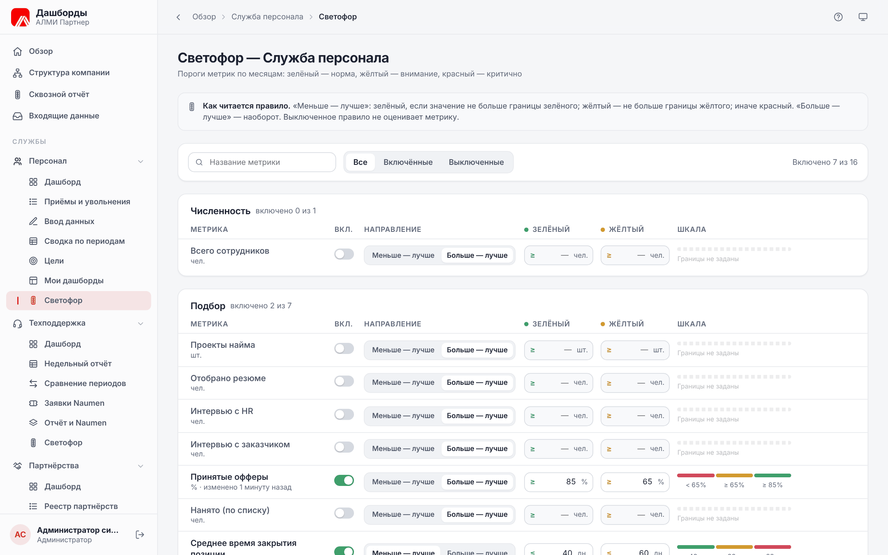

Правила проверки: при включённом правиле нужны обе границы; при «Меньше — лучше» зелёная граница не больше жёлтой, при «Больше — лучше» — не меньше. Для техподдержки пороги недельные. Каждое изменение записывается в журнал.

Включённое правило делает показатель обязательным: если он не заполнен за заведённый месяц, светофор показателя — «Нет данных», а пропуск отмечается как критичное нарушение полноты данных на дашборде, на «Обзоре», на странице ввода данных и в PDF («Руководство пользователя», раздел «Незаполненные показатели»).

Пороги по умолчанию задаются при установке; изменённые значения при обновлениях не перезаписываются.

## Светофор партнёрств

**Партнёрства → Светофор**: цвет каждой категории статуса, NDA и соглашения, сроки сертификата «актуален» и «устаревает» в годах. Светофор записи — худший из цветов её статуса, NDA, соглашения и срока сертификата; его считает сервер, поэтому дашборд партнёрств работает и без права на исходные записи.


## Цели службы персонала

**Служба персонала → Цели**: цель метрики на год, справочное значение (например, факт прошлого года), подпись, описание и источник. Цель года оценивается по данным этого года: цель достигнута — «норма», отклонение до 10% — «внимание», больше — «критично»; цель года без данных — без оценки.

## Загрузка данных

| Данные | Где | Формат | Режимы |
| --- | --- | --- | --- |
| Недельный отчёт ТП | Техподдержка → Недельный отчёт → **Загрузить файл** | xlsx «Итоговый отчёт ТП по неделям» (4 строки шапки, данные с 5-й, лист «Лист1») или CSV из выгрузки | «Дополнить» — по году и неделе; «Заменить» |
| Заявки Naumen | Техподдержка → Заявки Naumen → **Загрузить выгрузку** | xlsx из Naumen SD: «Номер», «Название», «Дата регистрации», «Дата решения», «Регламентное время закрытия заявки», «Статус», «Наименование организации», «Ответственный (сотрудник)», «Ответственный (команда)», «Сотрудник первая линия», «Способ обращения», «Просрочен», «Возобновлялась», «Время обработки заявки» | «Дополнить» — по номеру заявки; «Заменить» |

Размер файла — до 20 МБ (настраивается). Результат загрузки — число добавленных, обновлённых и пропущенных строк; загрузка попадает в журнал загрузок (видно на «Обзоре» и в заголовке страницы) и в журнал изменений.

Те же файлы, а также метрики месяцев и реестр службы персонала и реестр партнёрств, принимают **Входящие данные** — с планом до применения, из папки на сервере, по API и от подключений (раздел «Интеграции и входящие данные»).

> **Важно.** «Заменить» удаляет все данные раздела перед загрузкой. Для регулярного обновления используйте «Дополнить».

# Журнал изменений

**Администрирование → Журнал изменений** — кто, когда и что изменил: входы (в том числе по домену), смена и сброс паролей, пользователи, доступ и полномочия, профили доступа, подразделения и руководители, загрузки структуры и сотрудников, синхронизация с AD, данные служб, загрузки файлов, настройки светофора, показатели сквозного отчёта, их значения и загрузки, заметки «под контролем», палитры, а с версии 0.4.0 — элементы входящих (получение, повтор, применение, отклонение, повторная обработка), правила «применять сразу», подключения (создание, изменение, проверка, запуск, удаление) и ключи для входящих вызовов (выпуск, выпуск заново, отзыв). Изменения, применённые из папки, по ключу или подключением, записываются от имени источника: «Входящие · папка», «Ключ «…»», «Подключение «…»».


Фильтры: период, пользователь, служба, объект, действие и поиск по описанию. Границы дней в фильтре периода — по местному времени компании (`TIMEZONE`). Строка раскрывается — видно значения «до» и «после» изменённых полей. **Выгрузить CSV** — с текущими фильтрами (до 50 000 строк). Пароли, токены, секреты подключений и значения ключей в журнал не записываются.

# Палитры

**Администрирование → Палитры** — цвета светофора, серий графиков и фирменный цвет (кнопки, активный пункт меню). Встроенные палитры: «Сдержанная» (по умолчанию), «Мягкая», «Классическая», «Холодная», «Контрастная».


**Сделать активной** применяет палитру для всех пользователей и в PDF-отчётах. **Создать** — своя палитра: при выборе цветов интерфейс сразу показывает предпросмотр. Встроенные и активную палитру удалить нельзя.

> **Совет.** Проверяйте палитру в светлой и тёмной теме: цвета светофора должны хорошо различаться.

# О системе

**Администрирование → О системе**: версия, окружение, СУБД и её версия, ревизия схемы базы и признак «схема актуальна», объёмы данных (пользователи, активные сессии, месяцы, недели отчёта, заявки, партнёрства, записи журнала), последняя загрузка файла и основные параметры безопасности. Ссылка на документацию API.


# Демонстрационный стенд

При `DEMO_DATA=true` система загружает в пустые разделы демонстрационные данные: структуру компании «АЛМИ Партнер» из 13 подразделений (Аппарат генерального директора, Коммерческая, Техническая дирекции, службы и группы поддержки) и девять учётных записей разных уровней:

| Логин | Пароль | Профиль и доступ |
| --- | --- | --- |
| `admin` | `admin123` | Администратор |
| `ceo` | `ceo12345` | Громов Андрей Викторович, генеральный директор — «Высшее руководство»; первое лицо, руководит компанией и Аппаратом генерального директора |
| `tech_dir` | `td123456` | Соколова Мария Игоревна, технический директор — «Руководитель направления» + лично «Аппарат генерального директора» — «Ввод данных» (вводит операционные показатели своего направления); руководит Технической дирекцией |
| `engineer` | `en123456` | Петров Илья Сергеевич, инженер группы поддержки AlterOS — «Сотрудник»; без служб, подчиняется руководителю Технической службы по структуре |
| `hr_head` | `hr123456` | Индивидуальная настройка: персонал — «Управление»; техподдержка и партнёрства — «Просмотр»; руководит Службой персонала |
| `tp_lead` | `tp123456` | «Руководитель подразделения» + лично техподдержка — «Управление»; руководит Технической службой |
| `product` | `pp123456` | Индивидуальная настройка: партнёрства — «Управление»; руководит Проектной службой |
| `viewer` | `view1234` | Индивидуальная настройка: персонал, техподдержка, партнёрства — «Просмотр» |
| `it_viewer` | `it123456` | «Руководитель подразделения» + лично персонал — «Просмотр» с областью «Своя ветка» и ИТ-служба — «Просмотр»; руководит ИТ-службой |

На стенде удобно показать модель доступа: `ceo` видит дашборды без реестров, `tech_dir` — всё по своей ветке, `engineer` — только «Обзор» без служб, структуру компании, сквозной отчёт своей группы и «Мой доступ», а на попытку открыть дашборд службы — «Нет доступа».

**Сквозной отчёт.** Демонстрационный каталог — 14 показателей: 6 вводимых (финансовые «Выручка», «Затраты», «ФОТ», «Исполнение бюджета» — служба-владелец «Финансовая служба»; операционные «Выполнение плана работ» и «Удовлетворённость клиентов» — «Аппарат генерального директора») и 8 вычисляемых из данных служб (приём и увольнение, текучесть, время закрытия позиции, заявки в работе, решённые заявки и их отношение к полученным, доля партнёрств «в норме»). Значения введены за 12 месяцев — по последний месяц данных службы персонала (июль 2026 года) — с сезонностью и разбросом; в последнем месяце есть красные и жёлтые случаи с комментариями:

- затраты Технической службы и группы AlterOS сверх бюджета, 274 заявки в работе, выполнение плана группы AlterOffice — 78 % («Критично»);
- выручка и выполнение плана работ Коммерческой службы ниже плана, исполнение бюджета Коммерческой дирекции, ФОТ Службы маркетинга, удовлетворённость клиентов группы AlterOS, доля партнёрств «в норме» («Внимание»);
- **пропуск**: «Выполнение плана работ» Службы маркетинга за июль не заполнено — «Нет данных» и критичное нарушение полноты;
- **заметка** руководителя техподдержки (`tp_lead`) «под контролем» у Технической службы.

Отчёт за июль 2026 года для уровней сотрудников: `ceo` — компания и четыре подразделения под ней, у дирекций «детализация недоступна», пропуск Службы маркетинга — «1 пропуск во вложенных подразделениях»; `tech_dir` — Техническая дирекция целиком, все классы, ввод операционных показателей; `tp_lead` — Техническая служба без финансовых показателей; `engineer` — только группа AlterOS: «Внимание» по двум доступным показателям, без выгрузки; `admin`, `viewer`, `hr_head`, `product` («Индивидуальная настройка») — вся компания без ограничений.

**Входящие данные и интеграции.** Подключений и элементов входящих демонстрационный стенд не создаёт. Чтобы показать конвейер, загрузите на странице «Входящие данные» файл метрик месяцев службы персонала («Руководство пользователя», раздел «Ежемесячный файл службы»), положите выгрузку в папку «Входящие» (в Docker — том `/data/inbox`) или выпустите ключ и отправьте файл значений показателей запросом API. Пункт «Входящие данные» видят `admin` и все, у кого есть уровень «Ввод данных» хотя бы к одной службе: `tech_dir`, `hr_head`, `tp_lead`, `product`.

> **Важно.** Демонстрационные пароли общеизвестны — не используйте демо-стенд с реальными данными.

# Данные и хранение

| Таблицы | Содержимое |
| --- | --- |
| `users`, `user_sessions` | учётные записи (основное подразделение, явный руководитель, «первое лицо», способ входа и связь с каталогом, профиль доступа, личные настройки, полномочия), сессии входа |
| `departments`, `department_heads`, `org_revision` | дерево подразделений, руководители с основным, ревизия структуры |
| `access_profiles`, `user_access_units`, `service_access` | профили доступа, дополнительные подразделения области, уровни служб (в том числе «нет доступа») со своей областью |
| `services`, `service_settings`, `data_revisions`, `app_settings` | справочник служб, настройки служб, ревизии данных, настройки приложения (типы уровней, предел вложенности, вид оргсхемы, подразделения служб сквозного отчёта) |
| `hr_months`, `hr_metric_definitions`, `hr_metric_values`, `hr_employee_events`, `hr_month_notes`, `hr_targets` | служба персонала |
| `tp_weekly_reports`, `naumen_tickets` | техподдержка |
| `partnerships`, `partnership_light_rules` | партнёрства |
| `traffic_light_rules` | пороги светофора персонала и техподдержки |
| `indicators`, `indicator_values`, `unit_status_notes`, `report_revision` | сквозной отчёт: каталог показателей, введённые значения, цели и комментарии по подразделениям за месяц, заметки «под контролем», ревизия отчётов |
| `audit_log`, `data_imports` | журнал изменений и загрузок |
| `inbox_items`, `inbox_rules` | входящие данные: элементы (источник, файл до срока хранения, SHA-256, набор, статус, план и итог) и правила «применять сразу» |
| `integrations`, `integration_runs`, `inbound_keys` | подключения (настройки, зашифрованные секреты и адрес их привязки, расписание, состояние), журнал запусков, ключи для входящих вызовов (отпечаток SHA-256 и первые символы, области, отзыв) |
| `color_palettes`, `dashboard_layouts`, `custom_dashboards`, `custom_dashboard_widgets` | оформление и личные настройки |

Описания метрик службы персонала, справочник служб, правила светофора, палитры и встроенные профили доступа по умолчанию поставляются с системой; изменённые администратором пороги, цели, палитры и профили не перезаписываются. Каталог показателей сквозного отчёта с системой не поставляется — его заполняет администратор или ведущий отчёты (на демо-стенде — демонстрационный каталог); вычисляемые показатели не хранятся, а считаются из данных служб. Отметки о работе планировщика и последнем разборе папки «Входящие» хранятся в `app_settings`; исходные файлы входящих — в базе, в `inbox_items`, до срока хранения, копии файлов из папки — в `processed/` и `rejected/` папки «Входящие».

# Типовые задачи

| Задача | Как |
| --- | --- |
| Новый сотрудник | «Пользователи» → **Добавить пользователя**: подразделение, профиль доступа, способ входа (временный пароль или вход по домену) |
| Сотрудник загружен списком и не может войти | Статус «Без доступа» → **Выдать доступ** |
| Сотрудник забыл пароль | Карточка пользователя → **Сбросить пароль**, передайте временный пароль сотруднику; доменная учётная запись — пароль меняется в домене |
| Сотрудник уволился | Отключите его — сессии завершатся, история и место в структуре сохранятся |
| Руководитель отдела должен видеть только своих | Назначьте его руководителем подразделения, профиль «Руководитель подразделения» (область «Своя ветка») и уровень службы |
| Руководителю нужна бо́льшая детализация в сквозном отчёте | Вкладка «Доступ» → «Глубина детализации» → **Задать лично** |
| Добавить показатель в сквозной отчёт | «Показатели» → **Добавить показатель**: источник, класс данных, правило светофора, свёртка, где ожидается значение |
| Сотрудник должен вводить показатели | Уровень «Ввод данных» к службе-владельцу показателя (в том числе к службе без дашборда) и подходящая область |
| Сотрудник не должен видеть денежные показатели | Классы данных без «Финансовых» — в профиле или **Задать лично**; статус он увидит по доступным показателям |
| Показатели службы не попадают в отчёт | «Показатели» → **Подразделения служб**: выберите подразделение службы |
| В отчёте «Нет данных» у подразделения | Значение ожидается, но не введено: сообщите службе-владельцу или уберите тип уровня из «Где ожидается значение» |
| Куратор нескольких отделов | Вкладка «Доступ» → **Дополнительные подразделения** |
| Закрыть службу одному сотруднику при профиле, который её даёт | Уровень службы лично — «Нет доступа» |
| Не тот руководитель у сотрудника | «Структура компании» → сотрудник → **Подчинение и должность**: «По структуре», «Назначить» или «Первое лицо»; либо поправьте руководителей подразделения |
| Перенести структуру на другой стенд | «Импорт и экспорт» → «Структура» → **Скачать JSON**, на другом стенде — загрузка с проверкой |
| Сотрудник не может войти по домену | «Вход по домену» → **Найти учётную запись**: найдена ли одна запись, с кем сопоставлена; проверьте e-mail в карточке |
| Нужно понять, кто изменил данные | Журнал изменений → фильтр по службе и периоду, раскройте строку |
| Данные не обновляются на «Обзоре» | Проверьте журнал загрузок и права пользователя, загружавшего файл; файл из папки, по API или от подключения может ждать подтверждения на странице «Входящие данные» |
| Выгрузка из 1С должна применяться без подтверждения | «Входящие данные» → «Правила»: включите «Приём по API» (или «Папка «Входящие»») для её набора |
| Новой системе нужно присылать файлы | «Интеграции» → «Ключи для входящих вызовов» → **Выпустить ключ** с областью «Приём файлов»; значение передайте владельцу системы |
| Ключ скомпрометирован | «Ключи для входящих вызовов» → **Выпустить заново** (или **Отозвать**) и обновите значение в системе-отправителе |
| Подключить систему компании | «Интеграции» → **Подключить систему** → настройки → **Проверить** → **Создать** → **Включено** и расписание |
| Подключить «По Делу» или «Пульс проекта» | в «По Делу» («Настройки → Интеграции → Ключи интеграций») или «Пульсе» («Интеграции → Ключи доступа») выпустите ключ для «Дашбордов», затем «Интеграции» → **Подключить систему** → режим «Ключ интеграции» → ключ → **Проверить** |
| Структура из «По Делу» раз в сутки, файлы из задач — чаще | одно подключение «По Делу» с двумя записями расписания: «В заданное время» — «Синхронизировать структуру», «Через интервал» — «Забрать данные из задач» |
| В журнале запусков «Запуск прерван» | сервер или планировщик перезапускали посреди запуска — запустите действие снова |
| На карточке подключения «Секрет нужно ввести заново» | **Настроить** → введите пароль или токен заново (сменился `SECRET_KEY` сервера или адрес) |
| Файлы в папке «Входящие» не забираются | «Входящие данные» → «Папка»: состояние папки и «Планировщик»; **Проверить сейчас** — разобрать вручную |
| Заблокирован вход администратора | `docker compose exec -w /app/backend app python -m app.cli reset-password admin` (см. «Руководство по развёртыванию») |
