# О документе

Руководство описывает администрирование «Дашбордов компании» версии 0.2.0: роли и уровни доступа, пользователей, профили доступа и личные настройки, полномочия администрирования, структуру компании и подразделения, импорт и экспорт структуры и сотрудников, вход по учётной записи домена (LDAP), синхронизацию с Active Directory, настройку служб, журнал изменений, палитры, сведения о системе, демонстрационный стенд и типовые задачи обслуживания.

Документ предназначен для администраторов системы, сотрудников с полномочиями «Ведёт пользователей и доступ» и «Ведёт структуру компании», а также руководителей служб с уровнем доступа «Управление». Повседневная работа описана в «Руководстве пользователя», установка, переменные окружения и обновление — в «Руководстве по развёртыванию».

Руководство открывается в приложении: **Справка → Руководство администратора** (видно только администраторам).

# Роли и уровни доступа

## Роли

| Роль | Права |
| --- | --- |
| **Администратор** | полный доступ ко всем службам на уровне «Управление», ко всем данным и ко всему администрированию: пользователи, профили доступа, подразделения, импорт и экспорт, вход по домену, журнал изменений, палитры, сведения о системе |
| **Пользователь** | службы и данные по своему профилю доступа и личным настройкам; части администрирования — по полномочиям (раздел «Полномочия») |

## Уровни доступа к службе

| Уровень | Служба персонала | Техническая поддержка | Партнёрства |
| --- | --- | --- | --- |
| **Просмотр** | дашборд, реестр, сводка, цели, PDF и Excel, свои дашборды | дашборд, недельный отчёт, сравнение, Naumen, PDF, Excel и CSV | дашборд, реестр, сводка, хронология, правила светофора (чтение), PDF и Excel |
| **Ввод данных** | + месяцы, метрики, приёмы и увольнения, заметки; общие дашборды | + добавление и правка недель | + добавление, правка и удаление партнёрств |
| **Управление** | + светофор, цели, удаление месяцев | + светофор, загрузка отчёта и выгрузки Naumen | + правила светофора партнёрств |

Уровень службы — одно из измерений доступа. Реестры, персональные данные, выгрузка и область структуры дополнительно ограничиваются профилем доступа и личными настройками (раздел «Доступ и профили доступа»). Уровень **Нет доступа**, заданный лично, закрывает службу, даже если её даёт профиль.

Доступ можно выдать и к службам, у которых пока нет дашборда («Аппарат генерального директора», «ИТ-служба» и другие): они появятся у пользователя, когда получат экраны.

> **Важно.** Права проверяет сервер на каждом запросе. Скрытые в интерфейсе кнопки — удобство, а не защита.

## Перенос прав при обновлении до 0.2.0

Обновление не меняет доступ существующих пользователей:

| Было в 0.1.0 | Стало в 0.2.0 |
| --- | --- |
| уровни служб пользователя | те же уровни, заданные лично; профиль не назначен — «Индивидуальная настройка» (вся компания, все классы данных, реестры и выгрузка, как в 0.1.0) |
| «Только свои подразделения» у службы персонала | своя область службы «Своя ветка структуры» |
| подразделения пользователя | первое по алфавиту — основное подразделение, остальные — дополнительные подразделения области доступа |
| плоский справочник подразделений | подразделения верхнего уровня дерева структуры; вложить их в нужные уровни можно в «Подразделениях» или загрузкой структуры |
| пароли | без изменений; вход по домену включается отдельно |

Профили доступа назначайте постепенно: пользователь с «Индивидуальной настройкой» работает как раньше.

## Перенос прав при обновлении до 0.1.0

| Было | Стало |
| --- | --- |
| роль «Администратор» | роль «Администратор» |
| роль «Начальник службы персонала» | «Пользователь» + служба персонала: «Управление» |
| роль «Просмотр» | «Пользователь» с прежним доступом к службам |
| роль «Просмотр отдела» | «Пользователь» + служба персонала: «Просмотр», только свои подразделения |
| уровни «чтение», «правка», «метрики», «админ» | «Просмотр», «Ввод данных», «Ввод данных», «Управление» |

# Первичная настройка

1. Войдите под учётной записью первого администратора (см. «Руководство по развёртыванию», «Первый вход») и смените временный пароль.
2. **Администрирование → Подразделения** — постройте структуру компании: верхний уровень (компания), дирекции, службы, отделы; назначьте руководителей. Большую структуру удобнее загрузить: **Импорт и экспорт** (структура из файла, список сотрудников или Active Directory).
3. **Администрирование → Профили доступа** — проверьте встроенные профили и при необходимости создайте свои (например, «Финансовый контролёр»).
4. **Администрирование → Пользователи** — создайте учётные записи (или выдайте доступ загруженным сотрудникам), укажите подразделение, профиль доступа и личные настройки.
5. При необходимости включите вход по учётной записи домена и проверьте его на странице **Вход по домену** (раздел «Вход по домену (LDAP)»).
6. Выдайте полномочия «Ведёт структуру компании» и «Ведёт пользователей и доступ» тем, кто будет вести структуру и пользователей без роли администратора.
7. Руководители служб с уровнем «Управление» проверяют пороги светофора и цели, загружают данные: недельный отчёт техподдержки и выгрузку Naumen — файлами, данные службы персонала — вводом по месяцам.
8. **Администрирование → Палитры** — при необходимости выберите палитру под фирменный стиль.

# Пользователи

## Список пользователей

**Администрирование → Пользователи** (администратор и полномочие «Ведёт пользователей и доступ»).

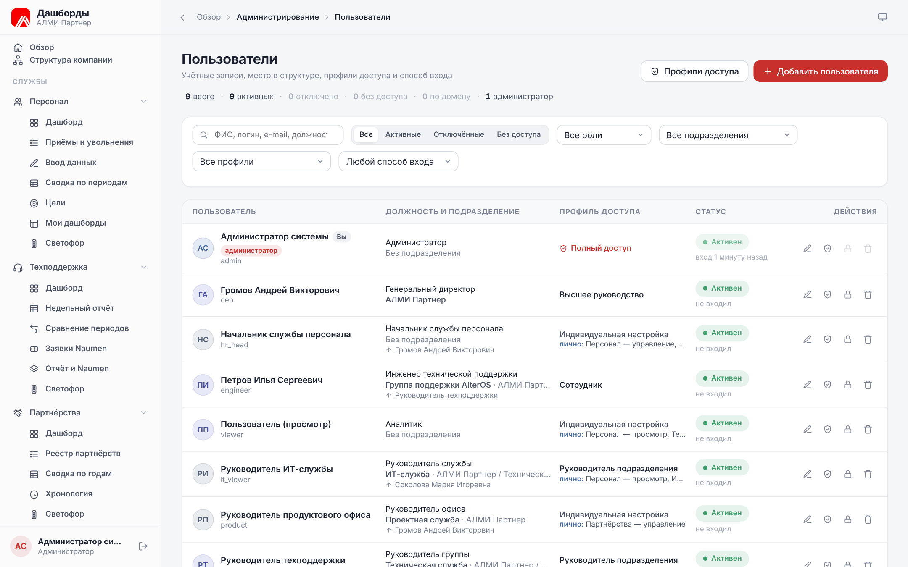

**Сводка** под заголовком: всего · активных · отключено · без доступа · по домену · администраторов. Щелчок по числу показывает этих пользователей.

**Фильтры** (сохраняются в адресе страницы):

- поиск по ФИО, логину, e-mail и должности;
- статус: **Все**, **Активные**, **Отключённые**, **Без доступа**;
- роль: **Все роли**, **Администраторы**, **Пользователи**;
- подразделение — любое из дерева или **Без подразделения**;
- профиль доступа — любой или **Индивидуальная настройка**;
- способ входа: **Пароль системы** или **Вход по домену**.

**Строка пользователя**: имя с метками, логин и e-mail; должность, подразделение с путём и руководитель (↑, «назначен явно» — если задан явно); профиль доступа («Полный доступ» у администратора) и личные уровни служб («лично: Техподдержка — управление»); статус — переключатель **Активен / Отключён** и время последнего входа; действия: **Изменить**, **Доступ** (карточка сразу на вкладке «Доступ»), **Выдать доступ** или **Сбросить пароль** / **Перевести на пароль системы**, **Удалить**. **Профили доступа** в заголовке страницы открывают одноимённый раздел.

## Статусы и метки

| Статус или метка | Значение |
| --- | --- |
| **Активен** | может входить в систему |
| **Отключён** | вход запрещён, сессии завершены; карточка, доступ и место в структуре сохраняются |
| **Без доступа** | учётная запись системы без пароля (например, загружена списком или из файла): видна в структуре, но войти не может, пока не выдан доступ |
| метка **домен** | входит по учётной записи домена; пароль хранит домен |
| метка **без пароля** | пароль не задан — нужен «Выдать доступ» |
| метка **временный пароль** | при входе пользователь задаст свой пароль |
| метка **администратор**, **Вы** | роль администратора; ваша учётная запись |

## Карточка пользователя

Щелчок по строке открывает карточку справа. В шапке — роль, статус, метки, профиль доступа, дата создания, последний вход и способ входа («Пароль системы» или «Учётная запись домена с …»).

| Вкладка | Что на ней |
| --- | --- |
| **Профиль** | ФИО, e-mail, телефон, должность, **Подразделение** (основное — вершина области доступа), руководитель (определяется по структуре, назначается в «Структуре компании»), роль (только администратор), статус |
| **Доступ** | профиль доступа, личные настройки измерений, уровни служб, дополнительные подразделения и «Действующий доступ» (раздел «Доступ и профили доступа») |
| **Полномочия** | «Ведёт структуру компании», «Ведёт пользователей и доступ» (только администратор) |
| **Журнал** | изменения учётной записи и её входы со значениями «до» и «после»; **Весь журнал изменений** (только администратор) |

Точка у названия вкладки — есть несохранённые изменения. **Сохранить** сохраняет все вкладки, **Отмена** закрывает карточку. Внизу карточки — **Выдать доступ** или сброс пароля и **Удалить**.

## Создание пользователя

**Добавить пользователя** открывает окно «Новый пользователь».

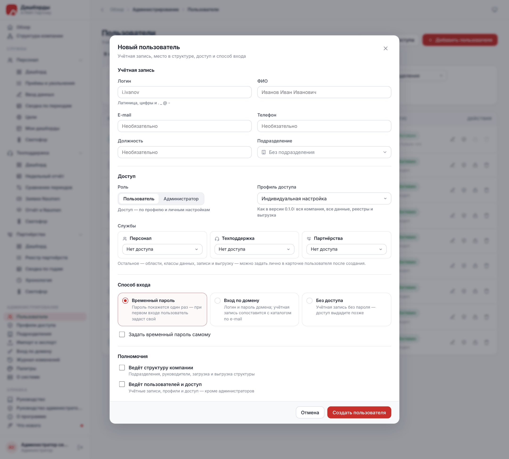

- **Учётная запись**: логин (латиница, цифры и `. _ @ -`), ФИО, e-mail, телефон, должность, подразделение.
- **Доступ**: роль (только администратор), профиль доступа (с кратким описанием и фактами: область, данные, глубина, записи, выгрузка, службы) и уровни служб с дашбордом: «Как в профиле», «Нет доступа» или уровень лично. Остальные личные настройки задаются в карточке после создания.
- **Способ входа** — см. таблицу ниже.
- **Полномочия** (только администратор) — см. раздел «Полномочия».

| Способ входа | Что происходит |
| --- | --- |
| **Временный пароль** | система создаст пароль и покажет его один раз; флажок **Задать временный пароль самому** позволяет ввести свой (не короче 8 символов) |
| **Вход по домену** | логин и пароль домена; нужен e-mail — по нему учётная запись сопоставится с каталогом; вариант недоступен, если вход по домену не настроен на сервере |
| **Без доступа** | учётная запись без пароля: видна в структуре, доступ выдаётся позже |

**Создать пользователя** создаёт учётную запись. Временный пароль показывается один раз — **Копировать** или **Копировать логин и пароль**, затем **Готово**. При первом входе пользователь обязан сменить пароль.

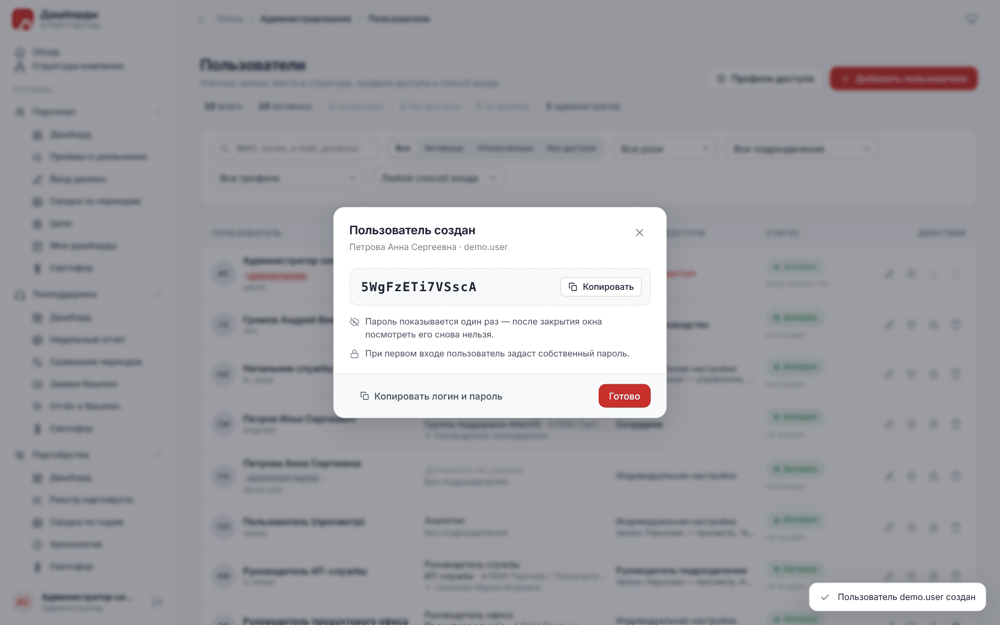

## Выдать доступ

Пользователю со статусом «Без доступа» — кнопка **Выдать доступ** (ключ в строке или в карточке). В окне выберите:

- **Временный пароль** — пароль покажется один раз, при первом входе сотрудник задаст свой;
- **Вход по учётной записи домена** — пароль системы не нужен; вариант доступен, если вход по домену настроен и у сотрудника указан e-mail.

Отключённая учётная запись при выдаче доступа включается.

## Сброс пароля

- Локальная учётная запись: **Сбросить пароль** — текущий пароль перестаёт действовать, все сессии завершаются, система создаёт временный пароль.
- Доменная учётная запись: **Перевести на пароль системы** — создаётся временный пароль системы, сессии завершаются; вход с паролем домена снова привяжет учётную запись к домену. Используйте, если сотрудник временно не может войти в домен.

Свой пароль меняется в профиле, а не здесь.

## Отключение и удаление

- **Отключить** — переключатель статуса в строке или «Статус» в карточке: пользователь не сможет войти, его сессии завершатся; карточка, доступ, место в структуре и записи журнала сохраняются. Рекомендуется вместо удаления.
- **Удалить** — окно «Удалить пользователя?» предлагает **Отключить** вместо удаления; **Удалить** удаляет учётную запись без возможности восстановления, записи журнала остаются с её логином.

## Защита от ошибок

| Правило | Что увидите |
| --- | --- |
| Нельзя снять с себя роль администратора, отключить или удалить свою учётную запись | кнопки недоступны, «Свою учётную запись отключить нельзя» |
| В системе должен остаться хотя бы один активный администратор | «В системе должен остаться хотя бы один активный администратор» |
| Администратора изменяет, отключает и удаляет только администратор | «Изменять администратора может только администратор» |
| Роль администратора и полномочия назначает только администратор | поля скрыты у сотрудника с полномочием «Ведёт пользователей и доступ» |
| Логин и e-mail уникальны | «Логин занят», «Этот e-mail уже используется» |
| Для входа по домену нужен e-mail | «Для входа по домену нужен e-mail: по нему учётная запись сопоставляется с каталогом» |

# Доступ и профили доступа

## Из чего складывается доступ

Доступ пользователя = **профиль доступа** + **личные настройки**. Профиль — шаблон прав для группы сотрудников одного уровня. В карточке пользователя любое измерение доступа либо берётся из профиля («как в профиле»), либо задаётся лично — личное значение перекрывает профиль. Без профиля («Индивидуальная настройка») доступ работает как в версии 0.1.0: вся компания, все классы данных, реестры и выгрузка, а службы выдаются лично. Роль «Администратор» даёт полный доступ независимо от профиля.

## Измерения доступа

| Измерение | Значения | Что ограничивает |
| --- | --- | --- |
| Уровень доступа к службе | Нет доступа · Просмотр · Ввод данных · Управление | разделы службы и действия в них; «Нет доступа», заданное лично, закрывает службу, даже если её даёт профиль |
| Область структуры | Вся компания · Своя ветка структуры · Своё подразделение | данные, привязанные к подразделениям: в 0.2.0 — приёмы и увольнения службы персонала (реестр, счётчики и разрез по подразделениям на дашборде, сводка, PDF); можно задать отдельно для службы |
| Дополнительные подразделения | список подразделений | расширяют область: куратор, заместитель, проектный руководитель |
| Классы данных | Операционные (всегда) · Персональные · Финансовые | персональные — ФИО, должности, причины увольнения в реестрах, ответственные в заявках Naumen; финансовые — денежные показатели (выручка, затраты, ФОТ, бюджеты) |
| Глубина детализации | 0 — только вершина области, 1…9 уровней вниз, без ограничения | на сколько уровней ниже вершины области раскрываются сквозные отчёты |
| Исходные записи | Реестры и списки · Только дашборды | реестр приёмов и увольнений, реестр и хронология партнёрств, выгрузка недельного отчёта; дашборды и сводки работают и без этого права |
| Выгрузка | Разрешена · Запрещена | все выгрузки Excel, CSV и PDF |

**Вершина области** — вся компания (область «Вся компания») или подразделения пользователя: основное, руководимые и дополнительные. «Своя ветка» — вместе со всеми вложенными, «Своё подразделение» — без вложенных. Глубина отсчитывается от вершины: у первого лица с глубиной 1 — компания и уровень под ней, у руководителя подразделения без ограничения — вся его ветка.

> **Важно.** Глубина детализации и финансовые показатели заработают в сквозных отчётах версии 0.3.0 (ADR-0010): в службах 0.2.0 денежных показателей нет, а дашборды служб глубиной не ограничиваются. Задайте их сейчас — модель доступа не изменится.

## Встроенные профили

Встроенные профили соответствуют уровням сотрудников. Их можно изменять, но нельзя удалить.

| Профиль (ключ) | Для кого | Область и классы данных | Глубина, записи, выгрузка | Службы |
| --- | --- | --- | --- | --- |
| **Высшее руководство** (`executive`) | первое лицо, члены правления | вся компания; все классы | глубина 1; записей нет; выгрузка есть | просмотр всех служб с дашбордом |
| **Руководитель направления** (`director`) | директора направлений и дирекций | своя ветка; все классы | глубина 2; записи и выгрузка есть | просмотр всех служб с дашбордом |
| **Руководитель подразделения** (`head`) | руководители служб, отделов, групп | своя ветка; операционные и персональные | без ограничения; записи и выгрузка есть | выдаются лично |
| **Специалист** (`specialist`) | аналитики, специалисты служб | своё подразделение; операционные | без ограничения; записи и выгрузка есть | выдаются лично |
| **Сотрудник** (`employee`) | рядовые сотрудники | своё подразделение; операционные | глубина 0; записей и выгрузки нет | нет (при необходимости — лично) |

## «Как в профиле» и «задано лично»

Вкладка **Доступ** карточки пользователя:

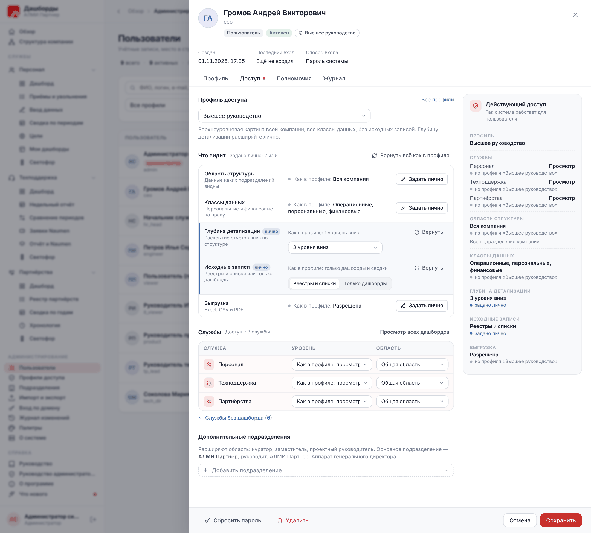

1. **Профиль доступа** — выберите профиль или «Индивидуальная настройка»; под списком — описание профиля, ссылка **Все профили**.
2. **Что видит** — по каждому измерению строка «Как в профиле: …» (без профиля — «По умолчанию: …»). **Задать лично** начинает личное значение с унаследованного — доступ пока не меняется, — и появляется переключатель: область, флажки классов данных (операционные отметить нельзя — они всегда), глубина, «Реестры и списки / Только дашборды», «Разрешена / Запрещена». Рядом видно, что было в профиле. **Вернуть** снимает личное значение; **Вернуть всё как в профиле** — все сразу. В заголовке — «Задано лично: N из 5».
3. **Службы** — уровень каждой службы: «Как в профиле: …», «Нет доступа» (только при профиле) или уровень лично; столбец **Область** — «Общая область» или своя область для данных службы. Своя область фиксирует уровень службы лично. **Просмотр всех дашбордов** выдаёт просмотр службам с дашбордом, к которым доступа нет; **Как в профиле** (**Снять все**) убирает личные уровни. Службы без дашборда раскрываются ссылкой «Службы без дашборда (N)».
4. **Дополнительные подразделения** — расширяют область; рядом — основное подразделение и руководимые.

Справа — **Действующий доступ**: «Так система работает для пользователя». Для каждой службы и измерения — итоговое значение и источник: «из профиля „…“», «задано лично», «по умолчанию» или «роль администратора»; для области — список подразделений, данные которых видит пользователь («Все подразделения компании» для всей компании). Если область ограничена своими подразделениями, а у пользователя нет ни основного, ни дополнительных, ни руководимых подразделений, карточка предупредит: данные подразделений ему не видны.

Изменения начинают действовать после **Сохранить**: сервер применяет их со следующего запроса пользователя, без повторного входа; меню и кнопки у пользователя обновятся после перезагрузки страницы. Пользователь видит итог в профиле, в блоке «Мой доступ».

## Профили доступа

**Администрирование → Профили доступа**: карточки профилей с описанием, фактами (область, данные, глубина, записи, выгрузка, службы) и числом пользователей — щелчок по нему открывает список этих пользователей.

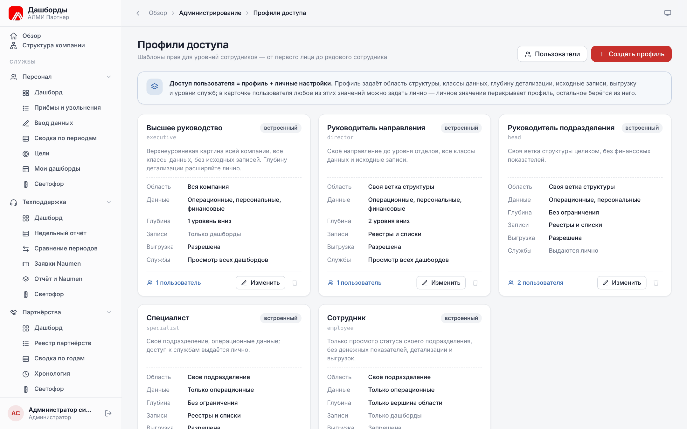

- **Создать профиль** — название, ключ (латиница в нижнем регистре, цифры, `_` и `-`; предлагается по названию, после создания не меняется), описание, «Что видит» (те же измерения) и уровни служб. Службы без уровня в профиле выдаются пользователю лично.
- **Изменить** — изменения сразу действуют на всех пользователей с профилем (кроме их личных значений): в заголовке окна видно, на скольких.
- **Удалить** — только свой профиль и только если он никому не назначен; встроенный профиль удалить нельзя — его можно изменить.

**Сравнение профилей** внизу страницы — кто что видит: столбцы — профили и «Индивидуальная настройка» (пользователи без профиля), строки — область, классы данных, глубина, записи, выгрузка и уровни служб с дашбордом. Щелчок по названию профиля открывает его для изменения.

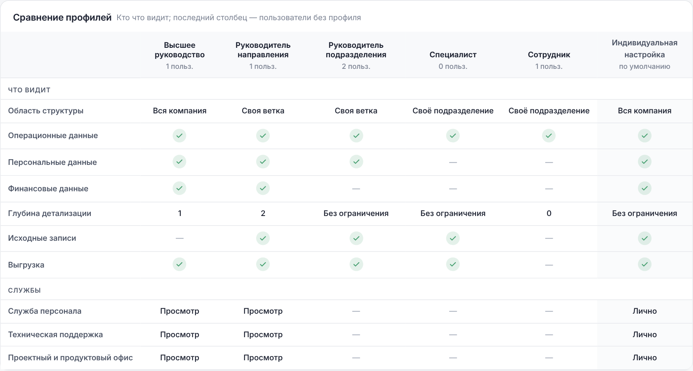

## Сценарии

**Руководство.** Первому лицу и членам правления — профиль «Высшее руководство», основное подразделение — компания (верхний уровень) или своя дирекция. Профиль показывает верхнеуровневую картину без исходных записей; конкретному руководителю расширьте лично глубину детализации (например, до 3) и, если нужно, откройте исходные записи — как на рисунке выше.

**Руководитель.** Директору направления — «Руководитель направления», руководителю службы или отдела — «Руководитель подразделения». Назначьте его руководителем подразделения (**Подразделения → Руководители**): руководимые подразделения автоматически входят в область вместе со всей веткой. Уровень своей службы выдайте лично — например, «Техническая поддержка — Управление».

**Сотрудник.** Профиль «Сотрудник» и основное подразделение. Сотрудник видит «Обзор», структуру компании и свой доступ; служб в профиле нет, выгрузки и реестры закрыты. Если сотруднику нужен дашборд службы, выдайте лично уровень «Просмотр» — записи и выгрузка останутся закрыты профилем.

**Куратор нескольких подразделений.** Профиль «Руководитель подразделения» или «Специалист», основное подразделение — своё; курируемые подразделения добавьте в **Дополнительные подразделения**. В «Действующем доступе» проверьте список подразделений области. Если куратору нужна вся ветка курируемых подразделений, а не только они сами, оставьте область «Своя ветка».

**Финансовый контролёр.** Создайте профиль «Финансовый контролёр» (например, ключ `fin-control`): область «Вся компания», классы данных — операционные и финансовые без персональных, глубина без ограничения, исходные записи и выгрузка — по решению, службы — «Просмотр» нужных. Персональные данные (ФИО, причины увольнения) такому пользователю закрыты, даже при доступе к службе персонала: реестр приёмов и увольнений ему не виден.

# Полномочия

Полномочия дают часть администрирования без роли администратора. Выдаёт их только администратор — на вкладке **Полномочия** карточки пользователя или при создании.

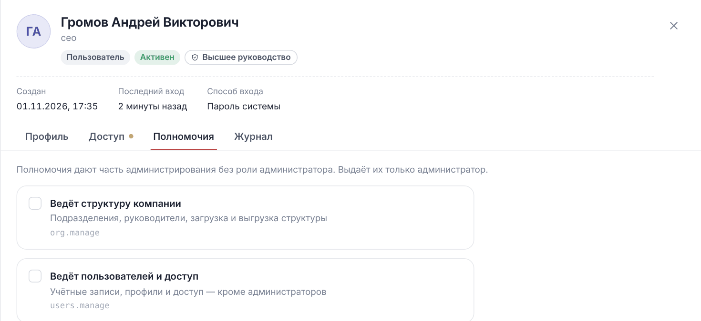

| Полномочие | Ключ | Что даёт |
| --- | --- | --- |
| **Ведёт структуру компании** | `org.manage` | разделы «Подразделения» и «Импорт и экспорт»; в «Структуре компании» — кнопки «Подразделения» и «Импорт и экспорт», в панели сотрудника — «Подчинение и должность» и «История в структуре»; видны отключённые сотрудники и e-mail |
| **Ведёт пользователей и доступ** | `users.manage` | разделы «Пользователи» и «Профили доступа»: учётные записи, профили, доступ — кроме администраторов; при загрузке сотрудников — роли, профили и активность |

Сотрудник с полномочием «Ведёт пользователей и доступ» не может изменить, отключить или удалить администратора, назначить роль администратора и выдать полномочия. Разделы «Вход по домену», «Журнал изменений», «Палитры» и «О системе» — только для администратора. Администратору полномочия не нужны: ему доступно всё.

# Структура компании и подразделения

## Правила структуры

- Подразделения образуют дерево: у каждого — «Входит в» (родитель) или верхний уровень, тип уровня, порядок среди соседних и необязательный код.
- Название уникально среди соседних подразделений; код — во всей структуре.
- Подразделение нельзя вложить в само себя или во вложенное; глубина ограничена пределом вложенности (по умолчанию 15 уровней, компания — первый).
- У подразделения может быть несколько руководителей; **основной** (★) определяет подчинение сотрудников.
- Удалить можно только подразделение без вложенных; сотрудники остаются без подразделения.
- Все изменения структуры записываются в журнал изменений и в историю структуры.

Непосредственный руководитель сотрудника: «первое лицо» никому не подчиняется; иначе — руководитель, назначенный явно (если он активен); иначе — по структуре: основной (или первый по алфавиту) активный руководитель подразделения сотрудника, а если сотрудник сам руководит им или руководителя нет — ближайшего вышестоящего подразделения, где сотрудник не руководитель. Сотрудник без подразделения, руководящий подразделением, подчиняется руководителю вышестоящего уровня. Система не даст создать цикл подчинения.

**Основное подразделение** сотрудника — указанное в карточке; без него — подразделение, которым он руководит (сначала то, где он основной руководитель). В остальных руководимых подразделениях человек показывается «руководитель, числится в …».

## Подразделения

**Администрирование → Подразделения** (администратор и полномочие «Ведёт структуру компании»).

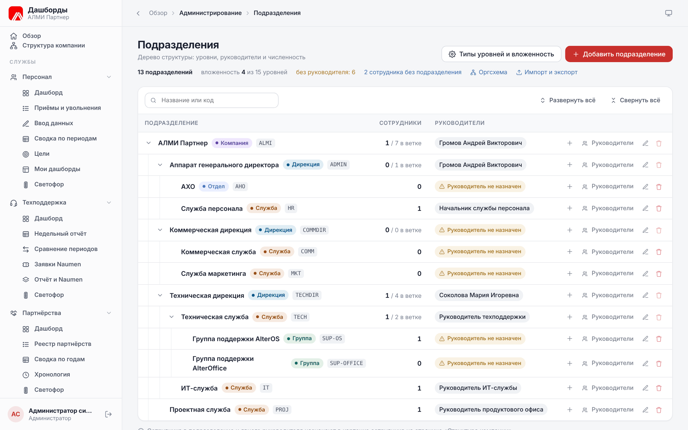

Над деревом — число подразделений, используемая вложенность из предела, сколько подразделений без руководителя и сотрудников без подразделения, ссылки на оргсхему и импорт. Поиск по названию или коду, **Развернуть всё** и **Свернуть всё**.

Строка: название, тип, код; **Сотрудники** — числятся в подразделении (с руководителем) и «/ N в ветке»; **Руководители** (★ — основной, «Руководитель не назначен» — подчинение уходит к вышестоящему); действия: **+** (добавить вложенное, недоступно на пределе вложенности), **Руководители**, **Изменить**, **Удалить** (недоступно, пока есть вложенные).

## Добавление и изменение

**Добавить подразделение** (верхний уровень) или **+** в строке (вложенное) открывают окно «Новое подразделение», **Изменить** — окно «Подразделение»:

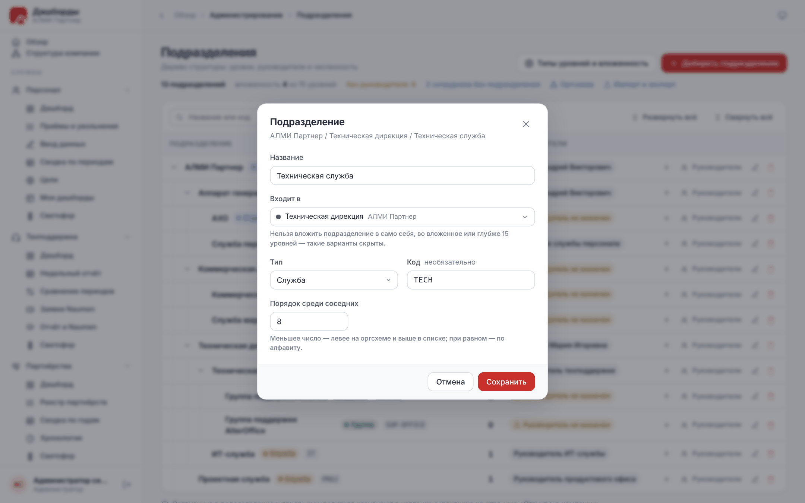

- **Название** — уникально среди соседних;
- **Входит в** — перенос в другую ветку или на **Верхний уровень**; недопустимые варианты (само подразделение, вложенные, слишком глубокие) скрыты;
- **Тип** — из настроенных типов уровней;
- **Код** — необязательно, латиница, уникален;
- **Порядок среди соседних** — меньшее число левее на оргсхеме и выше в списке, при равном — по алфавиту.

Перенос подразделения переносит всю его ветку вместе с сотрудниками.

## Руководители

**Руководители** в строке открывают окно с путём подразделения: отметьте сотрудников (поиск по имени, должности или e-mail) и, если их несколько, переключателем **основной** — основного. Руководителем можно назначить только активного сотрудника. Без руководителя сотрудники подразделения подчиняются руководителю вышестоящего уровня.

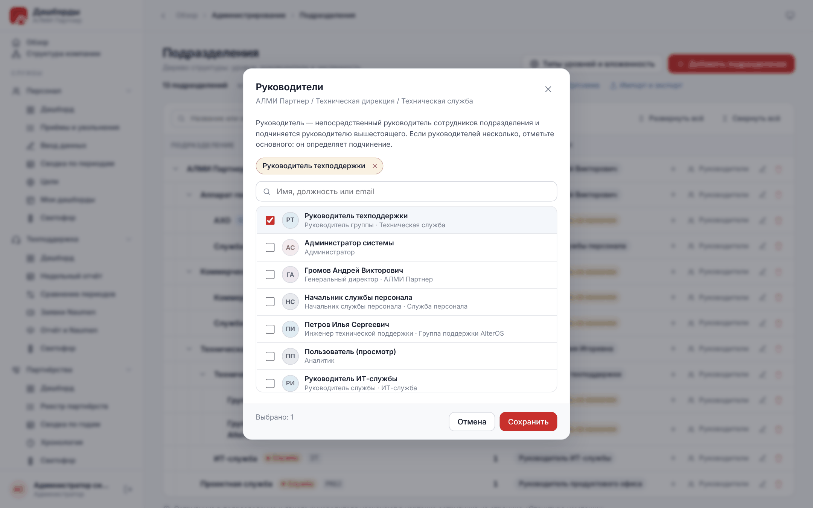

## Удаление

Подтверждение перечисляет, кто числится в подразделении и кто им руководит: они останутся без подразделения (руководители — без этого руководства). Подразделение с вложенными удалить нельзя — сначала перенесите или удалите их.

## Типы уровней и вложенность

Кнопка **Типы уровней и вложенность** — настройки структуры для всех пользователей:

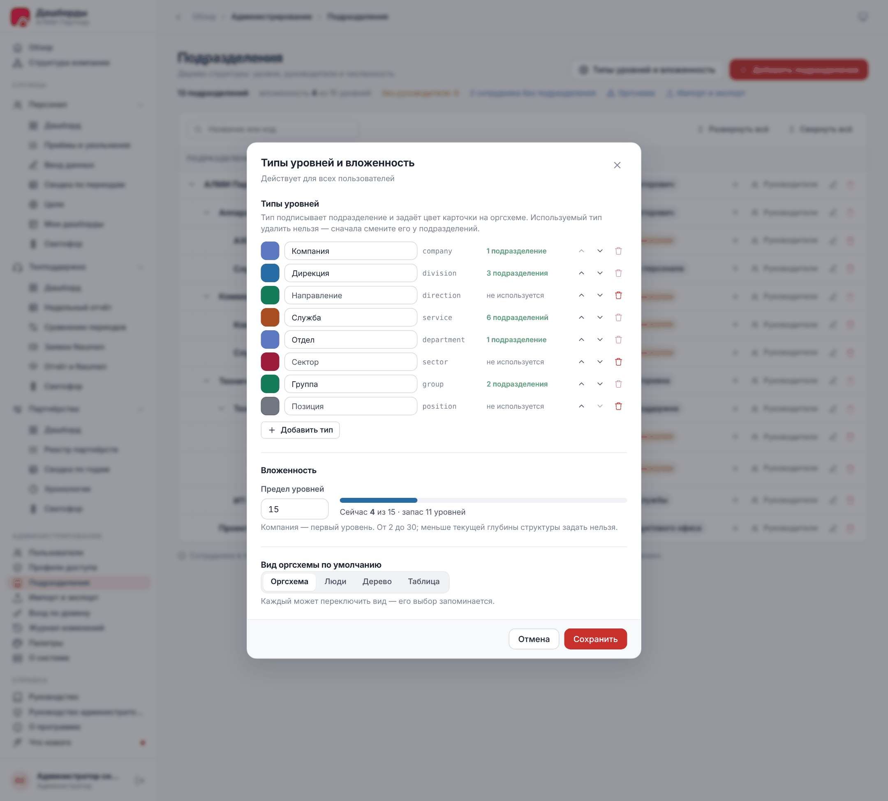

- **Типы уровней** — название, цвет (карточка на оргсхеме), порядок; ключ типа используется при загрузке и в API. Встроенные типы: Компания, Дирекция, Направление, Служба, Отдел, Сектор, Группа, Позиция. Используемый тип удалить нельзя — сначала смените его у подразделений.
- **Вложенность** — **Предел уровней** от 2 до 30, но не меньше текущей глубины структуры; шкала показывает, сколько уровней занято.
- **Вид оргсхемы по умолчанию** — Оргсхема, Люди, Дерево или Таблица; каждый пользователь может переключить вид, его выбор запоминается.

## Сотрудник в структуре

Подразделение сотрудника, явного руководителя и должность назначают в **Структуре компании**: выберите сотрудника, в боковой панели — блок **Подчинение и должность**:

- **Должность**;
- **Подразделение** — основное подразделение или «Без подразделения»;
- **Руководитель**: **По структуре** (подсказка — кто руководитель сейчас), **Назначить** (явный руководитель важнее структуры — например, для сотрудника, работающего на другое подразделение) или **Первое лицо** (никому не подчиняется — даже внутри подразделения).

**Сохранить** проверяет циклы подчинения. Ниже — **История в структуре**: кто и когда менял подразделение, руководителя, должность и руководство подразделениями. Подразделение пользователя можно указать и в карточке пользователя (вкладка «Профиль»).

# Импорт и экспорт

**Администрирование → Импорт и экспорт** (администратор и полномочие «Ведёт структуру компании»): четыре вкладки — **Структура**, **Сотрудники**, **Быстрая загрузка списком**, **Active Directory**.

## Проверка, план, применение

Любая загрузка идёт в два шага:

1. **Проверить** — система разбирает файл и показывает план: что будет создано, изменено, что останется без изменений, ошибки и предупреждения. Проверка ничего не записывает. Фильтр плана: **Изменения и ошибки**, **Ошибки**, **Все**.
2. **Применить** — план записывается одной операцией и попадает в журнал изменений. Если в плане есть ошибки или неотвеченные вопросы, кнопка недоступна, а при ошибке на сервере ничего не записывается.

## Структура

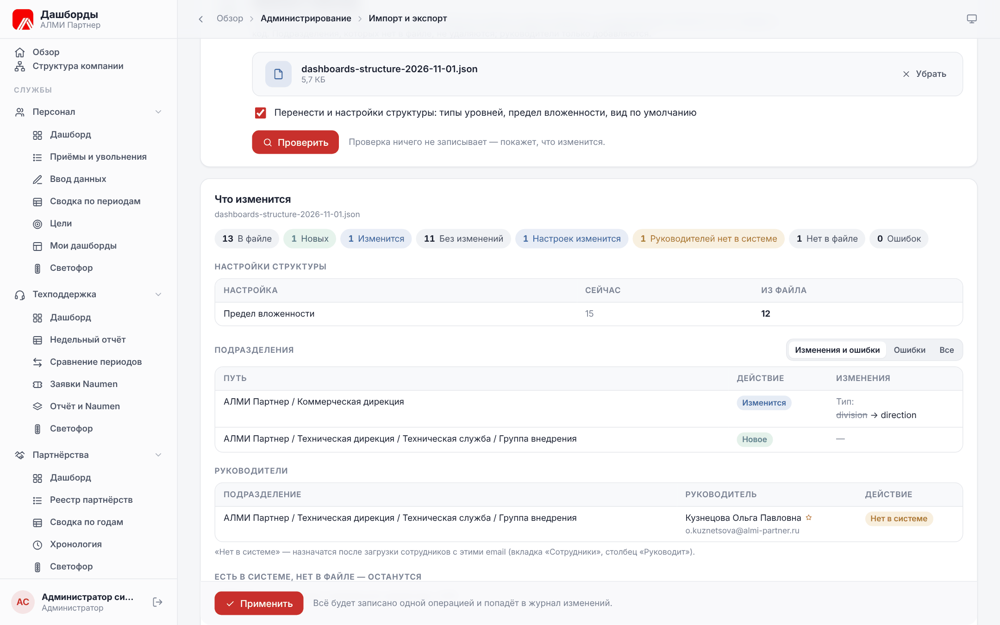

- **Выгрузить структуру** — **Скачать JSON**: подразделения с типами, порядком, кодами и руководителями (по e-mail), типы уровней, предел вложенности и вид оргсхемы. Файл переносит структуру между стендами «Дашбордов компании».
- **Загрузить структуру** — файл JSON; флажок **Перенести и настройки структуры** (типы уровней, предел вложенности, вид по умолчанию). Подразделения сопоставляются по пути от верхнего уровня: новые создаются, у существующих меняются тип, порядок и код.

План показывает **Настройки структуры** («Сейчас» и «Из файла»), **Подразделения** (путь, действие, изменения), **Руководители** («Назначить», «Уже назначен», «Нет в системе» — назначится после загрузки сотрудника с этим e-mail) и «Есть в системе, нет в файле — останутся».

> **Важно.** Загрузка структуры ничего не удаляет: подразделения, которых нет в файле, остаются, руководители только добавляются.

## Сотрудники

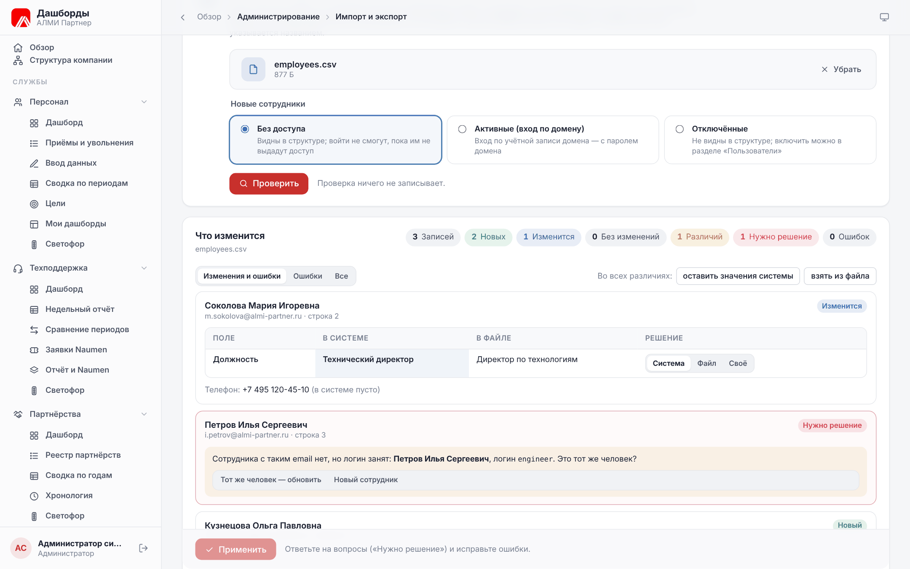

- **Выгрузить сотрудников** — формат **Excel**, **CSV** (UTF-8 с BOM, разделитель «;») или **JSON**, флажок **Включая отключённых**. Столбцы: Email, Логин, ФИО, Должность, Телефон, Подразделение (путь через «/»), Руководитель (явно), Первое лицо, Руководит, Роль, Профиль доступа, Активен, Способ входа, Внешний ID. Пароли не выгружаются.
- **Загрузить сотрудников** — Excel, CSV или JSON со столбцами выгрузки; обязателен e-mail, по нему сотрудники сопоставляются. Профиль доступа указывается названием. Недостающие подразделения создаются по пути.
- **Новые сотрудники**: **Без доступа** (видны в структуре, войти не смогут, пока не выдан доступ), **Активные (вход по домену)** (нужно полномочие «Ведёт пользователей и доступ»), **Отключённые**.

**Разбор различий.** Если значение в файле отличается от значения в системе, в записи появляется таблица «Поле — В системе — В файле — Решение»:

| Решение | Что запишется |
| --- | --- |
| **Система** | значение остаётся как в системе (выбрано по умолчанию) |
| **Файл** | значение из файла |
| **Объединить** | для списков (например, «Руководит») — объединение значений системы и файла |
| **Своё** | значение, которое вы введёте (путь подразделения через «/», e-mail руководителя) |

Кнопки **оставить значения системы** и **взять из файла** применяют решение ко всем различиям сразу. Пустое значение в файле ничего не стирает.

**«Тот же человек?»** Если сотрудника с таким e-mail нет, но логин из файла занят, система спросит: **Тот же человек — обновить** (e-mail допишется к существующей учётной записи) или **Новый сотрудник**. Пока вопрос без ответа, запись помечена «Нужно решение» и применить план нельзя.

Роли, профили доступа и признак «Активен» из файла применяются только при полномочии «Ведёт пользователей и доступ», администраторов изменяет только администратор; иначе план покажет замечание в блоке «Обратите внимание».

## Быстрая загрузка списком

Подразделения и сотрудники одной таблицей — CSV (UTF-8) или Excel, или вставьте строки в поле (**Вставить пример** показывает формат). Первая строка — заголовки, разделитель «;» или «,».

| Столбец | Значение |
| --- | --- |
| `email` | обязательно (или логин); по нему или по логину сотрудник сопоставляется |
| `ФИО` | для новых сотрудников |
| `Подразделение` | путь через «/»; недостающие подразделения создаются |
| `Должность` | должность |
| `Руководитель` | e-mail руководителя; записывается явно, только если отличается от руководителя по структуре |
| `Руководит` | «да» — сотрудник руководит своим подразделением |
| `Логин`, `Внешний ID` | необязательно |

Флажок **Создавать новых сотрудников** — новые создаются без пароля и доступа (доступ выдаётся в «Пользователях»); без отметки строки с новыми сотрудниками — ошибки. План показывает создаваемые подразделения, сотрудников с подразделением, руководителем («явно» или «по структуре») и изменениями, а также циклы подчинения, если они получились бы.

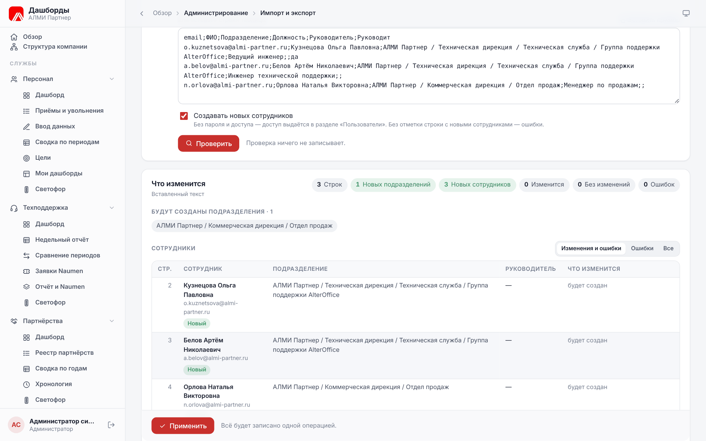

# Вход по домену (LDAP)

Сотрудники могут входить с логином и паролем домена (Active Directory, FreeIPA, OpenLDAP). Вход по домену включает системный администратор переменными окружения `AUTH_LDAP_*` («Руководство по развёртыванию», раздел «Вход по домену и Active Directory»); пароли и секреты в интерфейс и API не попадают.

## Как проходит вход

1. Система подключается к каталогу служебной учётной записью (только чтение) и ищет сотрудника по введённому логину — имени учётной записи, `имя@домен` или e-mail. Найдена должна быть ровно одна запись.
2. Каталог проверяет пароль сотрудника. Отключённые в каталоге учётные записи не входят.
3. Запись каталога сопоставляется с учётной записью системы, и выполняется вход.

Если каталог пароль не подтвердил, проверяется пароль системы — так входят локальные учётные записи (например, первый администратор). Пароль доменной учётной записи в системе не хранится и не проверяется. Если каталог недоступен, доменные пользователи видят «Сервер домена не отвечает — попробуйте войти позже», а локальные входят как обычно.

## Сопоставление и привязка

Запись каталога сопоставляется с учётной записью системы по порядку:

1. по идентификатору каталога (`objectGUID`, во FreeIPA и OpenLDAP — `entryUUID`) — у уже привязанных;
2. по идентификатору синхронизации с Active Directory — у сотрудников, загруженных синхронизацией;
3. по e-mail (без учёта регистра), если он единственный.

Логин для сопоставления не используется: одинаковый логин в разных системах может принадлежать разным людям.

При первом входе по домену учётная запись **привязывается**: способ входа становится «Учётная запись домена», локальный пароль удаляется. Данные системы не меняются — из каталога заполняется только пустая должность. Привязка записывается в журнал («… привязан к каталогу по e-mail»).

> **Важно.** E-mail доменной учётной записи считается подтверждённым каталогом. Держите привилегированные локальные учётные записи (администраторов) на адресах вне каталога или без e-mail — иначе владелец доменной учётной записи с тем же адресом войдёт под ними.

## Создание при первом входе и профили по группам

Если каталог подтвердил пароль, а учётной записи в системе нет:

- по умолчанию вход отклоняется: «Учётной записи в системе нет — обратитесь к администратору»;
- при `AUTH_LDAP_CREATE_USERS=active` учётная запись создаётся и сразу активна, при `inactive` — создаётся отключённой, и администратор включает её сам (сотрудник видит «Учётная запись отключена»);
- нужен e-mail в каталоге, не занятый другой учётной записью;
- логин берётся из каталога (`sAMAccountName`, во FreeIPA — `uid`), ФИО, e-mail и должность — из атрибутов записи.

**Профиль доступа по группам каталога** (`AUTH_LDAP_GROUP_PROFILES`): пары «DN группы = ключ профиля»; выбирается первая группа из списка, в которой состоит сотрудник, иначе — профиль по умолчанию (`AUTH_LDAP_DEFAULT_PROFILE`), иначе «Индивидуальная настройка» без служб. Участники группы `AUTH_LDAP_ADMIN_GROUP` создаются администраторами. Профиль и роль из групп назначаются **только при создании** учётной записи — дальше доступ настраивается в системе.

## Страница «Вход по домену»

**Администрирование → Вход по домену** (только администратор):

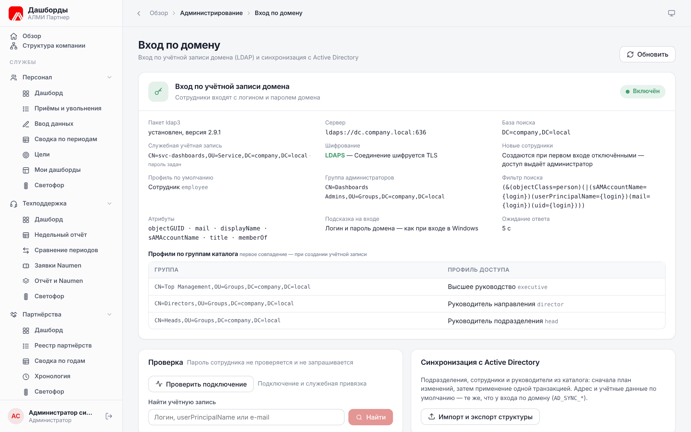

- **Состояние**: **Включён**, **Настроен, но выключен** (задайте `AUTH_LDAP_ENABLED=true`) или **Не настроен**; версия пакета ldap3, сервер, база поиска, служебная учётная запись (пароль — «задан» или «не задан»), **Шифрование** (LDAPS, StartTLS или «Без шифрования — пароли идут по сети открыто, только для стенда»), что происходит с новыми сотрудниками, профиль по умолчанию, группа администраторов, фильтр поиска, атрибуты, подсказка на странице входа, ожидание ответа.
- **Профили по группам каталога** — таблица «Группа — Профиль доступа»; ключ несуществующего профиля отмечен «нет такого профиля».
- **Замечания** — ошибки настройки: не заданы адрес или база, неизвестный профиль, нет файла сертификата, пароль идёт без шифрования, фильтр без `{login}`.
- **Проверка** (пароль сотрудника не запрашивается и не проверяется): **Проверить подключение** — подключение и служебная привязка; **Найти учётную запись** — по логину, `userPrincipalName` или e-mail: найденные записи с DN, отметкой «отключена в каталоге», группами и ответом, что будет при входе: «сопоставлена по идентификатору каталога / по синхронизации с AD / по e-mail», «Будет создана при первом входе» (с профилем и ролью) или «Учётной записи нет — вход будет отклонён».
- **Переменные окружения** — справка по `AUTH_LDAP_*` с примерами.

## Безопасное включение

1. Задайте переменные с `AUTH_LDAP_ENABLED=false`, перезапустите приложение и проверьте страницу: состояние «Настроен, но выключен», замечаний нет, шифрование — LDAPS или StartTLS.
2. **Проверить подключение**, затем **Найти учётную запись** для нескольких сотрудников: каждый должен находиться ровно одной записью и сопоставляться с нужной учётной записью.
3. Укажите сотрудникам e-mail, совпадающий с каталогом (или загрузите их синхронизацией с AD), проверьте e-mail администраторов (см. «Важно» выше).
4. Включите `AUTH_LDAP_ENABLED=true` и проверьте вход тестовым сотрудником. Первый администратор сохраняет вход по паролю системы на случай недоступности каталога.

# Синхронизация с Active Directory

Синхронизация переносит из каталога подразделения, сотрудников, должности и руководителей. Настройки — переменные `AD_SYNC_*`; пустые адрес, база поиска, служебная учётная запись и сертификат берутся из настроек входа по домену. Включать вход по домену для синхронизации не обязательно.

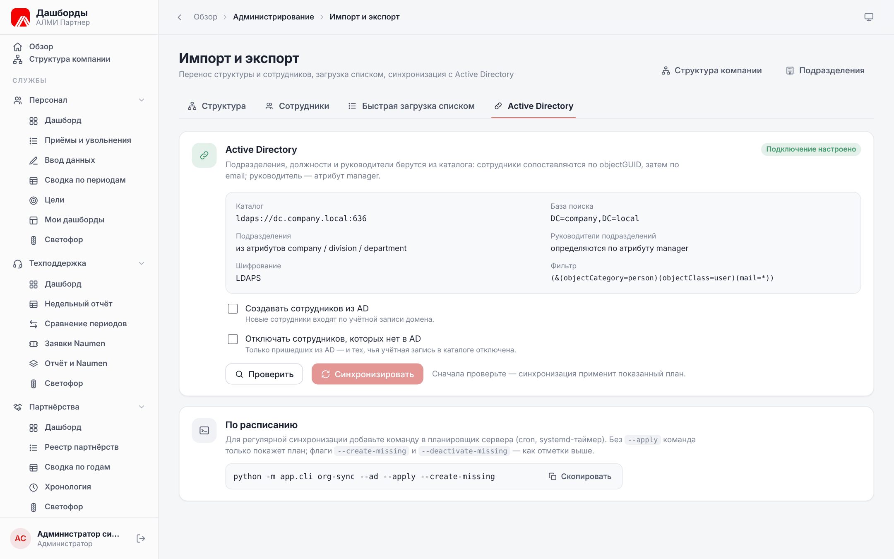

## Что синхронизируется

- **Сотрудники** — записи каталога по фильтру `AD_SYNC_USER_FILTER` (по умолчанию — пользователи с e-mail); сопоставляются по `objectGUID`, затем по e-mail.
- **Подразделение** — путь из атрибутов `company`, `division`, `department` (`AD_SYNC_PATH_ATTRIBUTES`) или из организационных единиц (OU) в DN (`AD_SYNC_PATH_SOURCE=ou`); недостающие подразделения создаются. Если в каталоге подразделение не указано, оно у сотрудника не меняется.
- **Руководитель** — атрибут `manager`; **руководители подразделений** определяются по подчинённым (`AD_SYNC_DETECT_HEADS`): кто руководит сотрудниками своего подразделения, а сам подчиняется вне его.
- **Должность** — атрибут `title`; **ФИО** — `displayName`.

## Запуск из интерфейса

**Импорт и экспорт → Active Directory**: параметры подключения (каталог, база поиска, источник подразделений, руководители, шифрование, фильтр) и флажки:

- **Создавать сотрудников из AD** — новые сотрудники входят по учётной записи домена;
- **Отключать сотрудников, которых нет в AD** — только пришедших из AD, а также тех, чья учётная запись в каталоге отключена.

**Проверить** показывает план (будут созданы подразделения, будут отключены, сотрудники с изменениями), **Синхронизировать** применяет показанный план.

> **Важно.** Синхронизация никогда не включает отключённых, не отключает сотрудников, заведённых вручную или загруженных файлом, вашу учётную запись и последнего активного администратора.

## По расписанию

Для регулярной синхронизации системный администратор ставит в планировщик команду `python -m app.cli org-sync --ad --apply` (с флагами `--create-missing` и `--deactivate-missing` — как отметки в интерфейсе). Без `--apply` команда только показывает план. Код выхода: 0 — готово, 1 — в плане ошибки (ничего не записано), 2 — каталог недоступен. Примеры для cron и systemd — в «Руководстве по развёртыванию».

# Настройка служб

## Светофор службы персонала и техподдержки

Меню службы → **Светофор** (уровень «Управление»). Для каждой метрики — включение, направление («Меньше — лучше» или «Больше — лучше»), границы зелёного и жёлтого и шкала зон.

Правила проверки: при включённом правиле нужны обе границы; при «Меньше — лучше» зелёная граница не больше жёлтой, при «Больше — лучше» — не меньше. Для техподдержки пороги недельные. Каждое изменение записывается в журнал.

Включённое правило делает показатель обязательным: если он не заполнен за заведённый месяц, светофор показателя — «Нет данных», а пропуск отмечается как критичное нарушение полноты данных на дашборде, на «Обзоре», на странице ввода данных и в PDF («Руководство пользователя», раздел «Незаполненные показатели»).

Пороги по умолчанию задаются при установке; изменённые значения при обновлениях не перезаписываются.

## Светофор партнёрств

**Партнёрства → Светофор**: цвет каждой категории статуса, NDA и соглашения, сроки сертификата «актуален» и «устаревает» в годах. Светофор записи — худший из цветов её статуса, NDA, соглашения и срока сертификата; его считает сервер, поэтому дашборд партнёрств работает и без права на исходные записи.

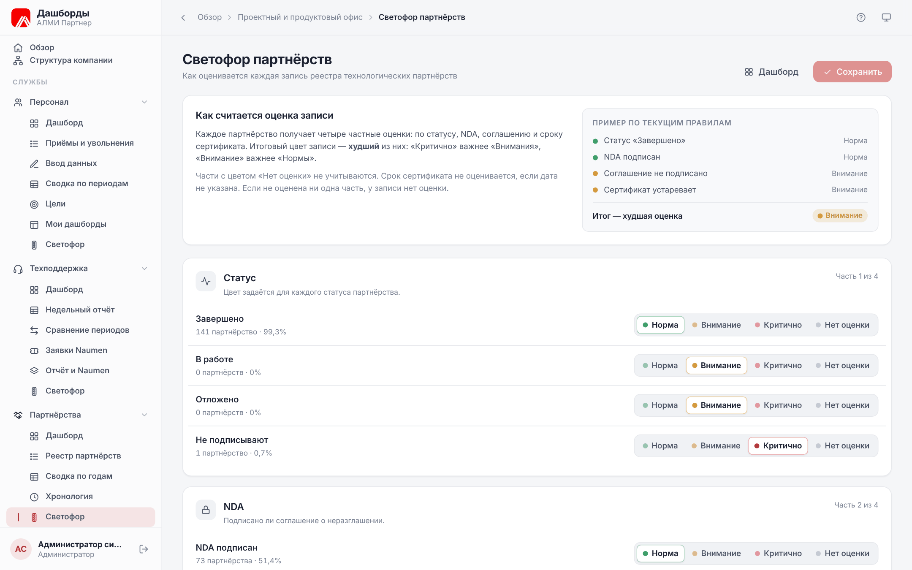

## Цели службы персонала

**Служба персонала → Цели**: цель метрики на год, справочное значение (например, факт прошлого года), подпись, описание и источник. Цель года оценивается по данным этого года: цель достигнута — «норма», отклонение до 10% — «внимание», больше — «критично»; цель года без данных — без оценки.

## Загрузка данных

| Данные | Где | Формат | Режимы |
| --- | --- | --- | --- |
| Недельный отчёт ТП | Техподдержка → Недельный отчёт → **Загрузить файл** | xlsx «Итоговый отчёт ТП по неделям» (4 строки шапки, данные с 5-й, лист «Лист1») или CSV из выгрузки | «Дополнить» — по году и неделе; «Заменить» |
| Заявки Naumen | Техподдержка → Заявки Naumen → **Загрузить выгрузку** | xlsx из Naumen SD: «Номер», «Название», «Дата регистрации», «Дата решения», «Регламентное время закрытия заявки», «Статус», «Наименование организации», «Ответственный (сотрудник)», «Ответственный (команда)», «Сотрудник первая линия», «Способ обращения», «Просрочен», «Возобновлялась», «Время обработки заявки» | «Дополнить» — по номеру заявки; «Заменить» |

Размер файла — до 20 МБ (настраивается). Результат загрузки — число добавленных, обновлённых и пропущенных строк; загрузка попадает в журнал загрузок (видно на «Обзоре» и в заголовке страницы) и в журнал изменений.

> **Важно.** «Заменить» удаляет все данные раздела перед загрузкой. Для регулярного обновления используйте «Дополнить».

# Журнал изменений

**Администрирование → Журнал изменений** — кто, когда и что изменил: входы (в том числе по домену), смена и сброс паролей, пользователи, доступ и полномочия, профили доступа, подразделения и руководители, загрузки структуры и сотрудников, синхронизация с AD, данные служб, загрузки файлов, настройки светофора, палитры.

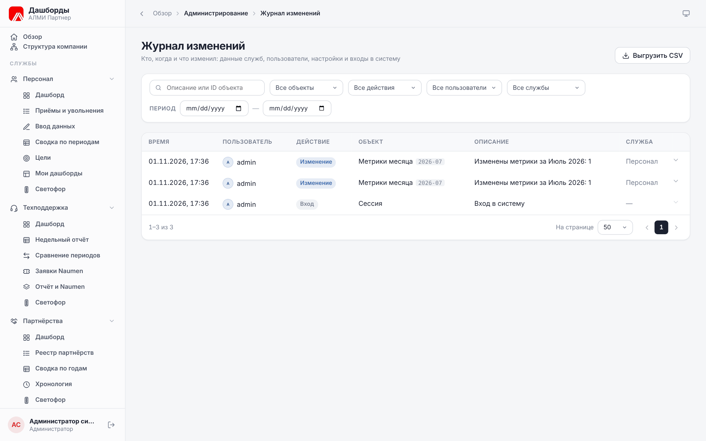

Фильтры: период, пользователь, служба, объект, действие и поиск по описанию. Границы дней в фильтре периода — по местному времени компании (`TIMEZONE`). Строка раскрывается — видно значения «до» и «после» изменённых полей. **Выгрузить CSV** — с текущими фильтрами (до 50 000 строк). Пароли и токены в журнал не записываются.

# Палитры

**Администрирование → Палитры** — цвета светофора, серий графиков и фирменный цвет (кнопки, активный пункт меню). Встроенные палитры: «Сдержанная» (по умолчанию), «Мягкая», «Классическая», «Холодная», «Контрастная».

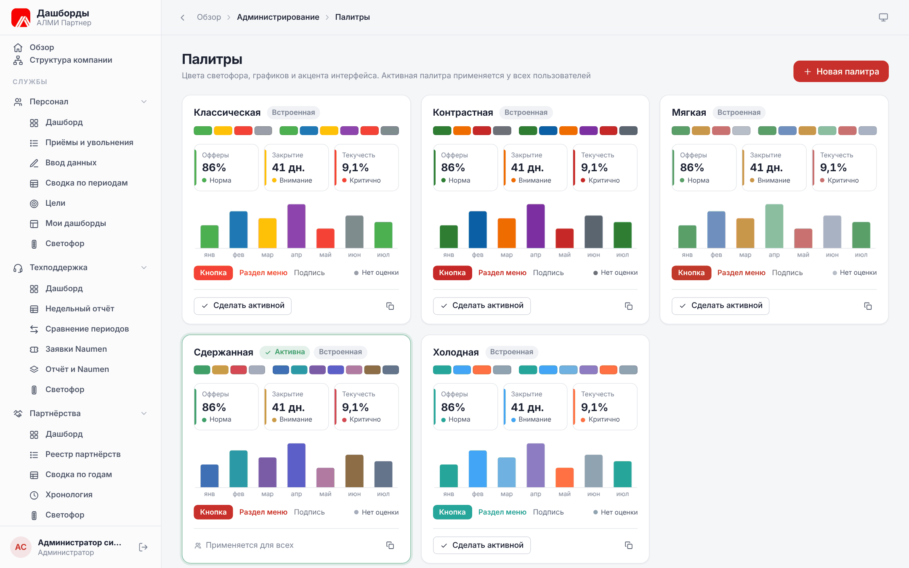

**Сделать активной** применяет палитру для всех пользователей и в PDF-отчётах. **Создать** — своя палитра: при выборе цветов интерфейс сразу показывает предпросмотр. Встроенные и активную палитру удалить нельзя.

> **Совет.** Проверяйте палитру в светлой и тёмной теме: цвета светофора должны хорошо различаться.

# О системе

**Администрирование → О системе**: версия, окружение, СУБД и её версия, ревизия схемы базы и признак «схема актуальна», объёмы данных (пользователи, активные сессии, месяцы, недели отчёта, заявки, партнёрства, записи журнала), последняя загрузка файла и основные параметры безопасности. Ссылка на документацию API.

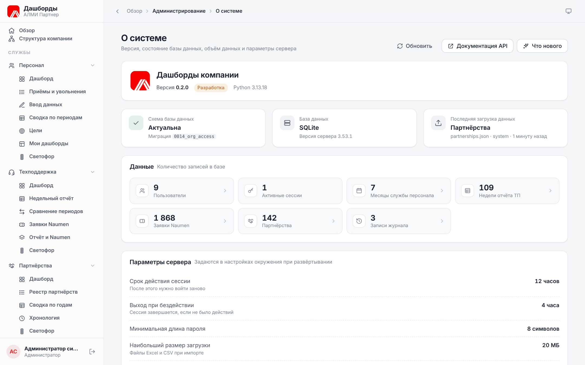

# Демонстрационный стенд

При `DEMO_DATA=true` система загружает в пустые разделы демонстрационные данные: структуру компании «АЛМИ Партнер» из 13 подразделений (Аппарат генерального директора, Коммерческая, Техническая дирекции, службы и группы поддержки) и девять учётных записей разных уровней:

| Логин | Пароль | Профиль и доступ |
| --- | --- | --- |
| `admin` | `admin123` | Администратор |
| `ceo` | `ceo12345` | Громов Андрей Викторович, генеральный директор — «Высшее руководство»; первое лицо, руководит компанией и Аппаратом генерального директора |
| `tech_dir` | `td123456` | Соколова Мария Игоревна, технический директор — «Руководитель направления»; руководит Технической дирекцией |
| `engineer` | `en123456` | Петров Илья Сергеевич, инженер группы поддержки AlterOS — «Сотрудник»; без служб, подчиняется руководителю Технической службы по структуре |
| `hr_head` | `hr123456` | Индивидуальная настройка: персонал — «Управление»; техподдержка и партнёрства — «Просмотр»; руководит Службой персонала |
| `tp_lead` | `tp123456` | «Руководитель подразделения» + лично техподдержка — «Управление»; руководит Технической службой |
| `product` | `pp123456` | Индивидуальная настройка: партнёрства — «Управление»; руководит Проектной службой |
| `viewer` | `view1234` | Индивидуальная настройка: персонал, техподдержка, партнёрства — «Просмотр» |
| `it_viewer` | `it123456` | «Руководитель подразделения» + лично персонал — «Просмотр» с областью «Своя ветка» и ИТ-служба — «Просмотр»; руководит ИТ-службой |

На стенде удобно показать модель доступа: `ceo` видит дашборды без реестров, `tech_dir` — всё по своей ветке, `engineer` — только «Обзор» без служб, структуру компании и «Мой доступ», а на попытку открыть дашборд службы — «Нет доступа».

> **Важно.** Демонстрационные пароли общеизвестны — не используйте демо-стенд с реальными данными.

# Данные и хранение

| Таблицы | Содержимое |
| --- | --- |
| `users`, `user_sessions` | учётные записи (основное подразделение, явный руководитель, «первое лицо», способ входа и связь с каталогом, профиль доступа, личные настройки, полномочия), сессии входа |
| `departments`, `department_heads`, `org_revision` | дерево подразделений, руководители с основным, ревизия структуры |
| `access_profiles`, `user_access_units`, `service_access` | профили доступа, дополнительные подразделения области, уровни служб (в том числе «нет доступа») со своей областью |
| `services`, `service_settings`, `data_revisions`, `app_settings` | справочник служб, настройки служб, ревизии данных, настройки приложения (типы уровней, предел вложенности, вид оргсхемы) |
| `hr_months`, `hr_metric_definitions`, `hr_metric_values`, `hr_employee_events`, `hr_month_notes`, `hr_targets` | служба персонала |
| `tp_weekly_reports`, `naumen_tickets` | техподдержка |
| `partnerships`, `partnership_light_rules` | партнёрства |
| `traffic_light_rules` | пороги светофора персонала и техподдержки |
| `audit_log`, `data_imports` | журнал изменений и загрузок |
| `color_palettes`, `dashboard_layouts`, `custom_dashboards`, `custom_dashboard_widgets` | оформление и личные настройки |

Описания метрик службы персонала, справочник служб, правила светофора, палитры и встроенные профили доступа по умолчанию поставляются с системой; изменённые администратором пороги, цели, палитры и профили не перезаписываются.

# Типовые задачи

| Задача | Как |
| --- | --- |
| Новый сотрудник | «Пользователи» → **Добавить пользователя**: подразделение, профиль доступа, способ входа (временный пароль или вход по домену) |
| Сотрудник загружен списком и не может войти | Статус «Без доступа» → **Выдать доступ** |
| Сотрудник забыл пароль | Карточка пользователя → **Сбросить пароль**, передайте временный пароль сотруднику; доменная учётная запись — пароль меняется в домене |
| Сотрудник уволился | Отключите его — сессии завершатся, история и место в структуре сохранятся |
| Руководитель отдела должен видеть только своих | Назначьте его руководителем подразделения, профиль «Руководитель подразделения» (область «Своя ветка») и уровень службы |
| Руководителю нужна бо́льшая детализация | Вкладка «Доступ» → «Глубина детализации» → **Задать лично** |
| Куратор нескольких отделов | Вкладка «Доступ» → **Дополнительные подразделения** |
| Закрыть службу одному сотруднику при профиле, который её даёт | Уровень службы лично — «Нет доступа» |
| Не тот руководитель у сотрудника | «Структура компании» → сотрудник → **Подчинение и должность**: «По структуре», «Назначить» или «Первое лицо»; либо поправьте руководителей подразделения |
| Перенести структуру на другой стенд | «Импорт и экспорт» → «Структура» → **Скачать JSON**, на другом стенде — загрузка с проверкой |
| Сотрудник не может войти по домену | «Вход по домену» → **Найти учётную запись**: найдена ли одна запись, с кем сопоставлена; проверьте e-mail в карточке |
| Нужно понять, кто изменил данные | Журнал изменений → фильтр по службе и периоду, раскройте строку |
| Данные не обновляются на «Обзоре» | Проверьте журнал загрузок и права пользователя, загружавшего файл |
| Заблокирован вход администратора | `docker compose exec -w /app/backend app python -m app.cli reset-password admin` (см. «Руководство по развёртыванию») |
