# О документе

Руководство описывает работу в системе «Дашборды компании» версии 0.2.0: стартовую страницу «Обзор», структуру компании, дашборды и реестры службы персонала, технической поддержки и проектного и продуктового офиса, ввод и загрузку данных, отчёты и выгрузки, светофор и незаполненные показатели, ваш доступ, профиль и встроенную справку.

Документ предназначен для сотрудников и руководителей служб. Управление пользователями, доступом, структурой компании, палитрами и обслуживание системы описаны в «Руководстве администратора», установка — в «Руководстве по развёртыванию».

Руководство открывается и внутри приложения — пункт **Руководство** в боковом меню: с оглавлением, поиском по тексту и кнопкой **Скачать PDF**. Значок **?** в верхней панели открывает раздел о текущей странице.

Снимки экрана сделаны на демонстрационном стенде. Набор разделов и кнопок зависит от вашего доступа: если описанной кнопки нет, у вас нет права на это действие. Что вам доступно и почему, показывает блок «Мой доступ» в профиле (раздел «Мой доступ» этого руководства).

**Условные обозначения**

| Обозначение | Значение |
| --- | --- |
| **Кнопка** | Название кнопки, пункта меню или поля на экране |
| «Раздел» | Название страницы или окна |
| > **Совет.** | Полезный приём |
| > **Важно.** | Ограничение или правило, которое стоит знать заранее |

# Знакомство с системой

## Назначение

«Дашборды компании» собирают показатели служб в одном месте и помогают быстро увидеть, где всё в порядке, а где нужно внимание:

- **светофор** — каждая важная метрика окрашивается: зелёный — норма, жёлтый — внимание, красный — критично, серый — нет оценки (правило светофора для метрики выключено); пороги задаёт руководитель службы;
- **незаполненные показатели** — если показатель со светофором не заполнен, он отмечается «Нет данных», а сам пропуск — красной меткой «Не заполнено» как критичное нарушение полноты данных (раздел «Незаполненные показатели»);
- **динамика** — изменение к прошлому месяцу или к предыдущему такому же периоду со стрелкой и цветом: зелёным, если изменение к лучшему, красным — если к худшему (для текучести рост — плохо, для доли принятых офферов — хорошо);
- **цели** — плановые значения метрик на год и их выполнение;
- **реестры** — исходные записи: приёмы и увольнения, недели отчёта техподдержки, партнёрства;
- **структура компании** — подразделения, руководители и сотрудники: оргсхема, схема подчинения, дерево и таблица;
- **отчёты** — PDF и выгрузки в Excel с текущими фильтрами.

## Уровни доступа

Доступ выдаёт администратор отдельно к каждой службе:

| Уровень | Что можно |
| --- | --- |
| **Просмотр** | смотреть дашборды, реестры и сводки, формировать PDF и выгрузки, настраивать свой вид дашбордов |
| **Ввод данных** | всё, что «Просмотр», а также добавлять и изменять данные: месяцы и метрики, приёмы и увольнения, недели отчёта, партнёрства; создавать общие пользовательские дашборды |
| **Управление** | всё, что «Ввод данных», а также настраивать службу: пороги светофора, цели, загрузку файлов, удаление месяцев |

Начиная с версии 0.2.0 доступ складывается из **профиля доступа** — шаблона для вашего уровня в компании («Высшее руководство», «Руководитель подразделения», «Сотрудник» и другие) — и **личных настроек** поверх него. Кроме уровня служб профиль определяет, данные каких подразделений вы видите, доступны ли персональные данные, реестры и выгрузка. Подробности — в разделе «Мой доступ».

Уровень показан в боковом меню рядом с названием службы, профиль доступа — под вашим именем внизу меню.

## Вход в систему

Откройте адрес системы, введите логин и пароль и нажмите **Войти**. Значок глаза в поле пароля показывает введённый пароль.

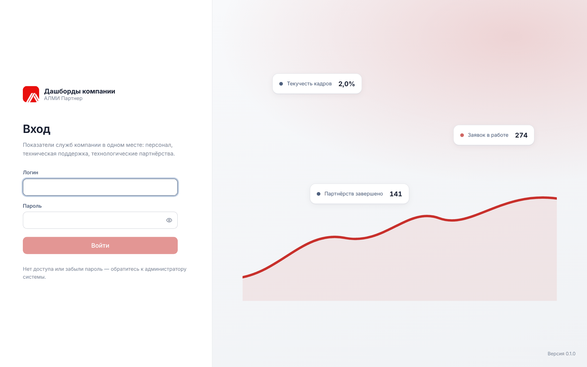

**Вход по учётной записи домена.** Если в компании включён вход по домену, под полями видна подсказка со значком ключа: войдите с теми же логином и паролем, что при входе в Windows. Логином может быть имя учётной записи, адрес вида `имя@домен` или e-mail — как настроил администратор. Пароль доменной учётной записи хранит домен: система его не запоминает и не меняет.

Сообщения при входе:

| Сообщение | Что делать |
| --- | --- |
| «Неверный логин или пароль» | Проверьте раскладку и Caps Lock; для доменной учётной записи — пароль домена |
| «Сервер домена не отвечает — попробуйте войти позже» | Каталог домена временно недоступен; введённый пароль не стирается — повторите вход через минуту |
| «Учётной записи в системе нет — обратитесь к администратору» | Домен подтвердил пароль, но в системе нет вашей учётной записи: попросите администратора её создать |
| «Учётная запись отключена. Обратитесь к администратору» | Вход запрещён администратором |
| «Слишком много неудачных попыток» | Подождите несколько минут |

Если администратор выдал временный пароль, после входа система откроет профиль и попросит придумать свой пароль — до этого другие страницы недоступны.

Сессия длится до 12 часов и завершается после 4 часов бездействия; после этого система попросит войти снова и вернёт на ту же страницу.

## Интерфейс

- **Боковое меню** — «Обзор», «Структура компании», службы с их разделами, «Администрирование» (администратору и сотрудникам с полномочиями администрирования) и «Справка». Группу службы можно свернуть щелчком по её названию, всё меню — кнопкой со стрелкой в верхней панели. На телефоне меню открывается кнопкой с тремя полосками.
- **Верхняя панель** — путь к странице (щелчок по службе возвращает к её дашборду), значок **?** — раздел руководства о текущей странице, переключатель темы: светлая, тёмная или как в системе.
- **Заголовок страницы** — название, пояснение, отметка **Данные обновлены …** и кнопки действий: PDF, Excel, загрузка, добавление.
- **Внизу меню** — ваше имя и профиль доступа (щелчок открывает профиль) и кнопка выхода.

Если данные не загрузились (например, пропала сеть), страница показывает «Не удалось загрузить» и кнопку **Повторить** — это не то же самое, что отсутствие данных.

> **Совет.** Фильтры страниц сохраняются в адресной строке. Скопируйте адрес — коллега откроет страницу с теми же фильтрами. Кнопка «Назад» браузера возвращает предыдущие фильтры.

## Карточки показателей

Карточка показывает название, значение с единицей, цветную метку светофора слева и точку в углу, изменение к прошлому периоду и цель. Наведите указатель на название — появится полное описание метрики. Если показатель со светофором не заполнен, вместо значения — «—», точка светофора серая (подсказка «Нет данных»), метка слева пунктирная красная, а внизу — **Не заполнено**.

# Обзор

«Обзор» — стартовая страница. Для каждой доступной службы — карточка с периодом (например, «Июль 2026» или «31-я неделя 2026»), полосой светофора (сколько метрик в норме, требуют внимания, критично), главными показателями с изменением и временем последнего обновления данных. **Открыть дашборд** переходит к службе.

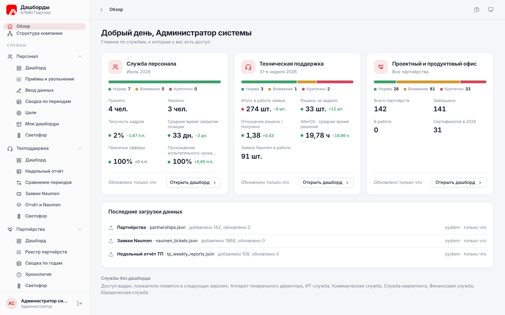

Если за последний период не заполнены показатели со светофором, в карточке службы появляется красная строка «Не заполнено со светофором: N — критичное нарушение»; наведите на неё указатель, чтобы увидеть названия показателей. Значение такого показателя в карточке — «—».

Ниже — **Последние загрузки данных**: какие файлы загружены, кем и когда, сколько записей добавлено и обновлено. Если у вас есть доступ к службам без дашборда, они перечислены внизу страницы. Если доступа нет ни к одной службе, «Обзор» покажет «Нет доступа к службам» — при этом «Структура компании», профиль и справка доступны.

# Структура компании

«Структура компании» (пункт меню под «Обзором») показывает подразделения, руководителей и сотрудников компании. Структуру видят все сотрудники: она не содержит данных служб. В заголовке — сколько в компании подразделений, сотрудников и уровней вложенности.

## Виды структуры

Переключатель в заголовке страницы:

| Вид | Что показывает |
| --- | --- |
| **Оргсхема** | Подразделения карточками с линиями подчинения: тип уровня цветом, основной руководитель с фото, численность |
| **Люди** | Кто кому подчиняется: руководители и их команды, прямые подчинённые и вся ветка |
| **Дерево** | Список подразделений с сотрудниками: сначала руководители, затем сотрудники |
| **Таблица** | Подразделения с численностью: сортировка, фильтр по типу и выгрузка |

Выбранный вид запоминается для вас; вид, выбранное подразделение или сотрудник сохраняются и в адресе страницы — ссылкой можно поделиться.

## Поиск, уровни и «Где я»

Панель инструментов над схемой общая для всех видов:

- **Поиск по структуре** — подразделения (с типом и путём) и сотрудники (с должностью); стрелки выбирают результат, Enter открывает его. Клавиша `/` переводит курсор в поиск. Найденное раскрывается на схеме, путь к нему подсвечивается, подробности открываются в боковой панели.
- **Уровней** — сколько уровней структуры раскрыть сразу: 1, 2, 3… или «все». **Развернуть всё** раскрывает все уровни, **Свернуть** оставляет только верхний.
- **Где я** — показывает ваше подразделение (в виде «Люди» — вашу карточку). Если вы не входите ни в одно подразделение, кнопка недоступна с подсказкой «Вас нет в структуре».

## Оргсхема

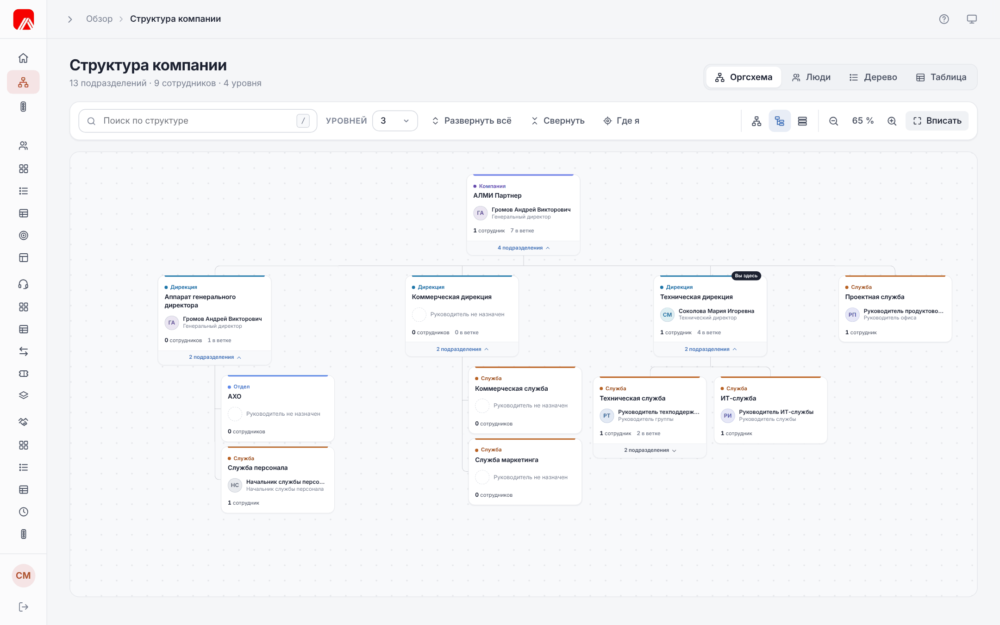

Карточка подразделения: тип уровня (цветная точка и полоса сверху), название, основной руководитель с фото и должностью («+N» — ещё руководители), число сотрудников уровня (вместе с руководителем) и всей ветки. Кнопка внизу карточки «N подразделений» раскрывает или сворачивает вложенные. Метка **Вы здесь** отмечает ваше подразделение. Если руководитель не назначен, в карточке — «Руководитель не назначен».

Щелчок по карточке открывает боковую панель подразделения, щелчок по руководителю — панель сотрудника. Путь от верхнего уровня до выбранного подсвечивается.

Инструменты справа:

- **Расположить слева направо / сверху вниз** — ориентация схемы;
- **Нижний уровень столбиком** — нижние подразделения ветки ставятся друг под другом, схема становится уже;
- **Компактные карточки** — меньше подробностей, больше подразделений на экране;
- масштаб: **−**, **+**, значение (щелчок — 100 %) и **Вписать** — вся схема в окне. Схему можно перетаскивать мышью; Ctrl + колесо мыши меняет масштаб, клавиши `+`, `−` и `0` работают, когда схема в фокусе.

## Люди

Схема подчинения по непосредственным руководителям: карточка сотрудника с фото, должностью и подразделением, число прямых подчинённых и всей ветки; кнопка **Подчинённые: N** раскрывает команду. Метка **Вы** отмечает вашу карточку. Сотрудники без руководителя и без подчинённых собраны в группу «Вне подчинения».

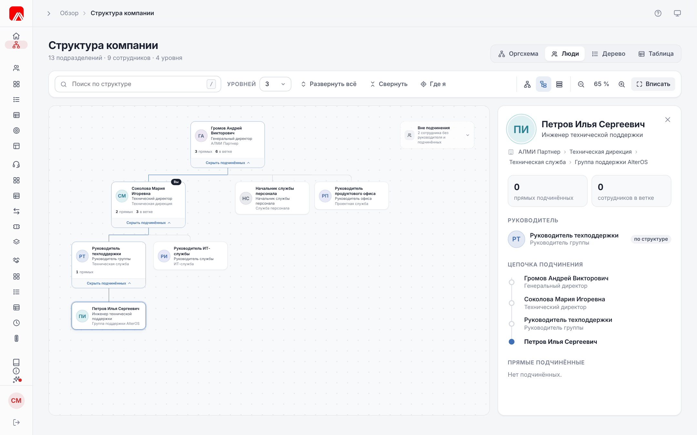

## Дерево

Список подразделений по уровням: у каждого — численность уровня и всей ветки, внутри — сначала руководители, затем сотрудники. Сотрудники, не входящие ни в одно подразделение, — в группе «Вне структуры» в конце списка. Список быстро прокручивается даже для тысяч сотрудников.

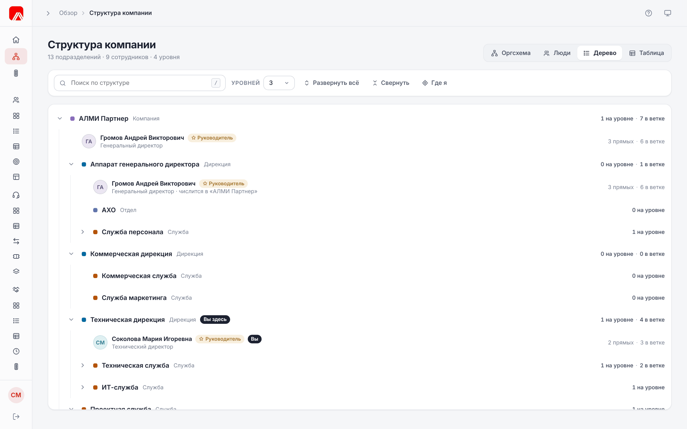

## Таблица

Таблица подразделений: **Подразделение** (с отступом по уровню), **Тип**, **Уровень**, **Руководитель**, **Штат** (сотрудники уровня без руководителей), **В ветке** (вместе с вложенными), **Вложенных**. Щелчок по заголовку столбца сортирует, фильтр **Все типы** оставляет подразделения одного типа, строка итогов внизу. **Выгрузить в Excel** сохраняет таблицу в файл CSV (открывается в Excel) с путём, кодом, руководителем и численностью.

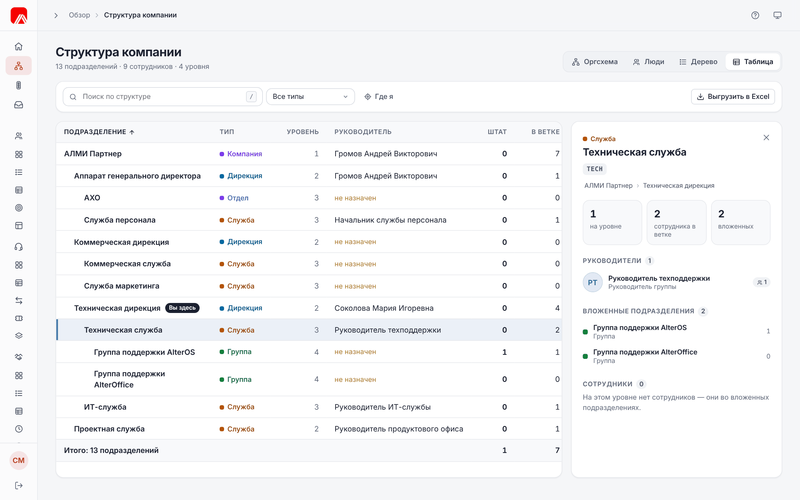

## Боковая панель

Панель открывается справа (на телефоне — снизу) и закрывается крестиком или клавишей Esc.

**Подразделение**: тип, название, код, путь от верхнего уровня (щелчок по звену открывает его), численность на уровне и в ветке, число вложенных; **Руководители** (★ «основной» — если руководителей несколько: он определяет подчинение сотрудников), **Вложенные подразделения**, **Сотрудники** с поиском по имени и должности.

**Сотрудник**: фото, должность, подразделение с путём, число прямых подчинённых и всей ветки; **Руководитель** с отметкой, откуда он взялся («назначен явно», «по структуре», «первое лицо»), **Цепочка подчинения** до первого лица, **Прямые подчинённые** и подразделения, которыми сотрудник **Руководит**.

> **Совет.** Сотрудникам, которые ведут структуру (полномочие «Ведёт структуру компании»), в панели доступны кнопки **Изменить подразделение**, блок **Подчинение и должность** и **История в структуре** — см. «Руководство администратора».

## Как определяется руководитель

Непосредственный руководитель сотрудника определяется по правилам — так же для всех видов, карточек и отчётов:

1. **Первое лицо** (например, генеральный директор) никому не подчиняется.
2. Если руководитель **назначен явно** — это он. Так оформляют, например, сотрудника, работающего на другое подразделение.
3. Иначе руководитель — **по структуре**: основной руководитель подразделения сотрудника. Если у подразделения нет руководителя или сотрудник сам им руководит, берётся руководитель ближайшего вышестоящего подразделения.

Пример на демонстрационном стенде: у группы поддержки AlterOS нет руководителя, поэтому инженер группы подчиняется руководителю Технической службы, а тот — техническому директору. Если явно назначенный руководитель отличается от структурного, в панели сотрудника видно: «По структуре руководителем был бы …».

# Служба персонала

## Дашборд службы персонала

Дашборд показывает найм, адаптацию и текучесть за выбранный период.

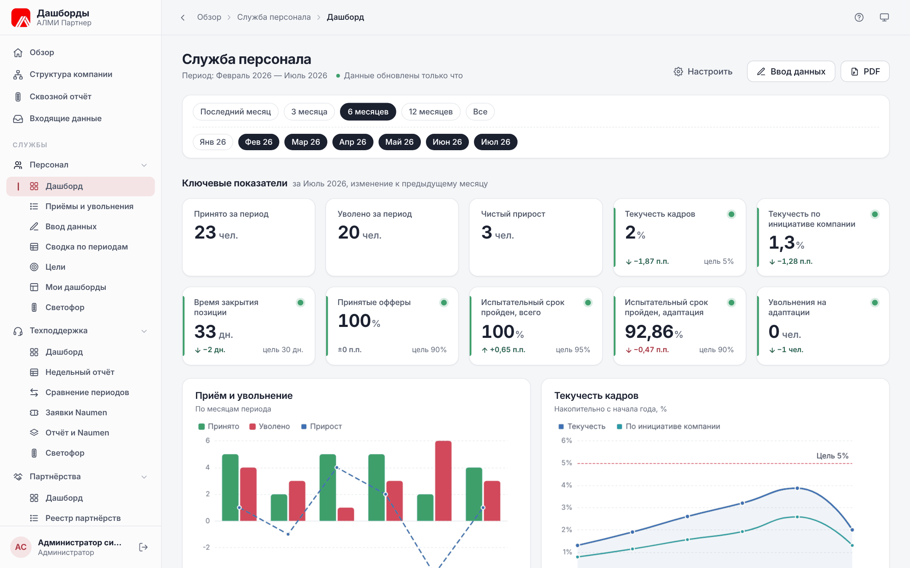

**Период.** Быстрые кнопки — **Последний месяц**, **3 месяца**, **6 месяцев**, **12 месяцев**, **Все**. Под ними — месяцы: щелчок включает или исключает месяц из периода. **Сбросить** возвращает быстрый период.

**Ключевые показатели**: приняты, уволены и чистый прирост за период, затем главные метрики последнего месяца с данными — текучесть, текучесть по инициативе компании, время закрытия позиции, принятые офферы, прохождение испытательного срока, увольнения на адаптации — с изменением к предыдущему месяцу и целью года. Если какие-то показатели со светофором за последний месяц не заполнены, над карточками — красное предупреждение (раздел «Незаполненные показатели»).

**Графики**:

- **Приём и увольнение** — по месяцам, пунктиром — прирост;
- **Текучесть кадров** — накопительно с начала года, пунктир — цель;
- **Воронка найма** — отобрано резюме, интервью с HR и с заказчиком, нанято; в подсказке — доля от первого шага;
- **Светофор по месяцам** — сколько метрик было в норме, требовало внимания и было критичным;
- **По подразделениям** — приёмы и увольнения за период.

**Все метрики** последнего месяца — таблица по разделам «Численность», «Подбор», «Адаптация», «Текучесть» со значением, прошлым месяцем, изменением, целью и оценкой; под названием — примечание к источнику, если оно есть.

Если ваша область доступа ограничена своими подразделениями, счётчики «Принято» и «Уволено», график по подразделениям и реестр учитывают только записи подразделений вашей области; метрики месяца относятся ко всей компании.

**Настроить** — выберите, какие блоки показывать и в каком порядке; настройка сохраняется для вашей учётной записи на всех устройствах, **По умолчанию** возвращает исходный вид.

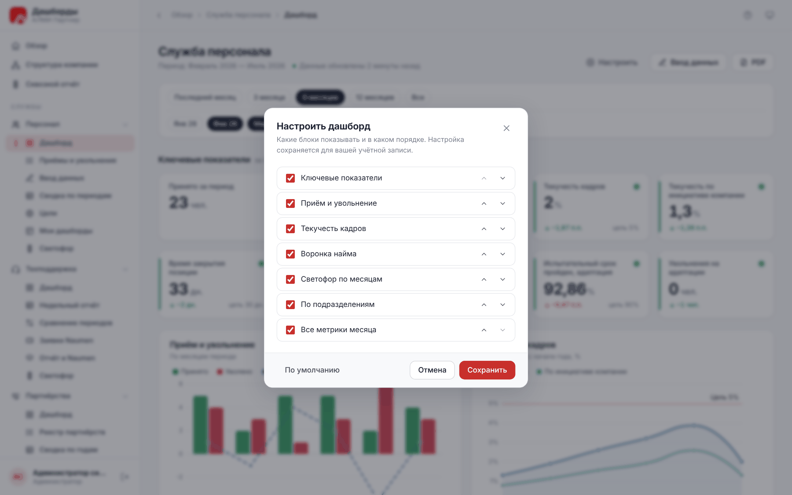

**PDF** формирует отчёт по выбранному периоду: показатели, графики, таблица метрик и строка о незаполненных показателях, если они есть.

## Приёмы и увольнения

Реестр кадровых событий по месяцам. Раздел виден, если у вас есть право на исходные записи и на персональные данные (ФИО, должности, причины увольнения).

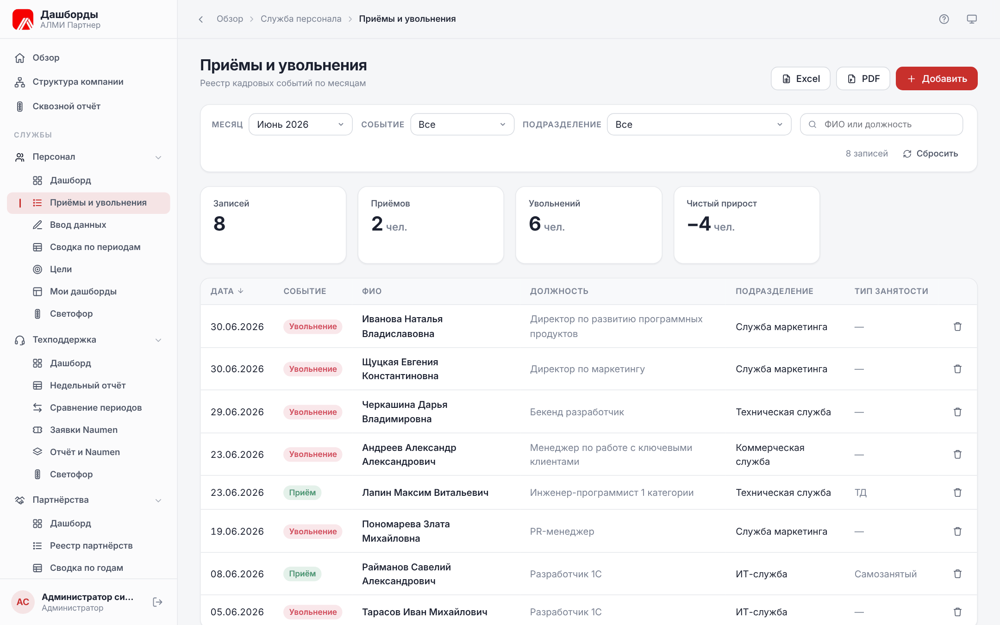

- Фильтры: **Месяц**, **Событие** (приёмы или увольнения), **Подразделение** и поиск по ФИО или должности (без учёта регистра).
- Щелчок по заголовку столбца сортирует таблицу, повторный — в обратном порядке; строку можно открыть и с клавиатуры (Enter).
- Карточки сверху считают записи, приёмы, увольнения и прирост по текущим фильтрам.
- **Excel** и **PDF** выгружают записи с текущими фильтрами (при праве на выгрузку).
- Если область доступа ограничена, под фильтрами — «Показаны только записи подразделений вашей области».

С уровнем «Ввод данных» доступны **Добавить**, правка (щелчок по строке) и удаление (значок корзины). В форме выберите месяц, тип события, ФИО, дату (она должна относиться к выбранному месяцу), должность, подразделение, тип занятости и — для увольнения — причину.

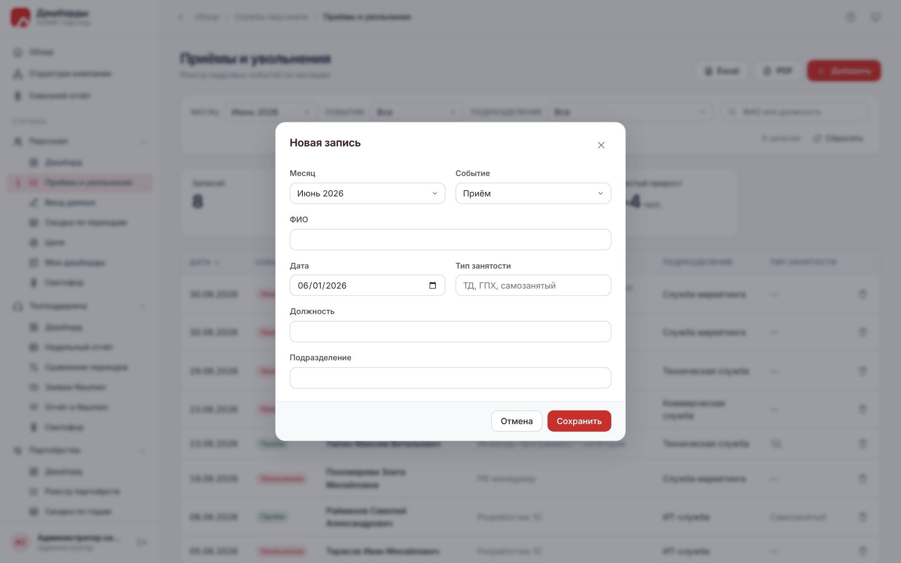

> **Важно.** Запись можно добавить только в существующий месяц. Новый месяц создаётся на странице «Ввод данных».

## Ввод данных месяца

Страница для уровня «Ввод данных»: значения метрик месяца, заметки и комментарий.

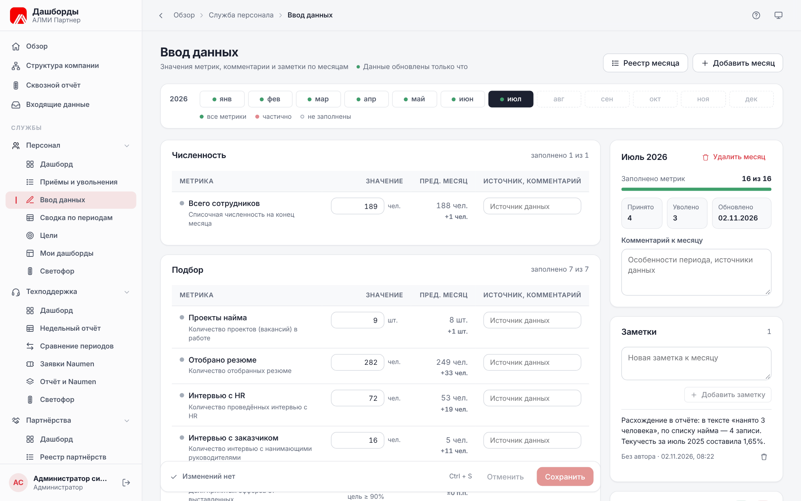

1. Выберите месяц в списке или нажмите **Добавить месяц** (год, месяц и комментарий).
2. Заполните метрики по разделам. Рядом с полем — значение прошлого месяца и текущая оценка светофора. В поле **Источник** можно указать, откуда взято значение или почему оно отличается.
3. Нажмите **Сохранить**. Сохраняются только изменённые значения; каждое изменение попадает в журнал.

Если уйти со страницы с несохранёнными изменениями, система предупредит. Пустое значение означает «не заполнено». Показатель, для которого включено правило светофора, обязателен: незаполненная строка выделена красной полосой с подписью «Обязательно: показатель на светофоре», а в карточке месяца справа, под строкой «Заполнено метрик», — итог «Не заполнено со светофором: N — критичное нарушение» (раздел «Незаполненные показатели»).

**Заметки** к месяцу видны всем, кто смотрит месяц; автор и время сохраняются. Удалить месяц целиком (вместе с метриками, событиями и заметками) может уровень «Управление». Записи реестра месяца на этой странице видны только при праве на исходные записи и персональные данные.

## Сводка по периодам

Таблица метрик по месяцам, кварталам, полугодиям или годам: переключатель вверху страницы, рядом — диапазон периодов «с … по …».

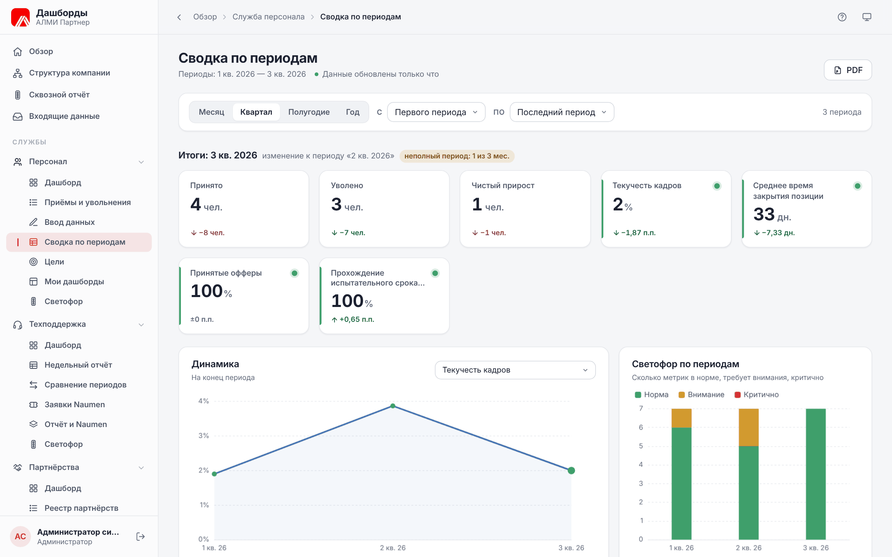

Значение за период считается по правилу метрики: численность и доли — на конец периода, количества — суммой, время закрытия позиции — средним. Цветная точка — оценка светофора. График **Динамика** показывает выбранную метрику по периодам, второй график — распределение светофора. **PDF** выгружает сводку за выбранный на странице диапазон периодов.

## Цели и бенчмарки

Цели службы на год и справочные значения прошлых лет (например, фактическая текучесть за 2025 год).

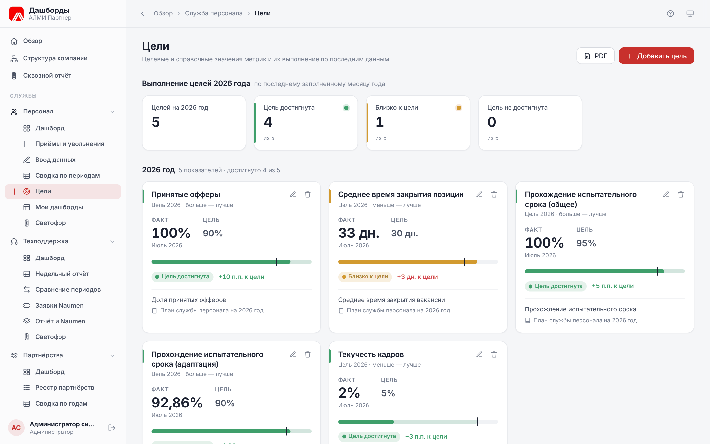

Для каждой цели — последнее фактическое значение того же года, месяц, разница с целью и оценка: «норма» — цель достигнута, «внимание» — отклонение до 10%, «критично» — больше. Цель года, за который ещё нет данных, — без оценки. Уровень «Управление» добавляет, изменяет и удаляет цели.

## Мои дашборды

Собственные подборки метрик службы персонала.

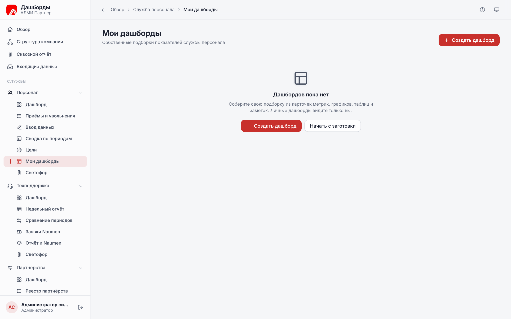

**Создать дашборд** — задайте название и добавьте виджеты: карточку метрики, линейный или столбчатый график, таблицу нескольких метрик по месяцам или текстовую заметку; порядок меняется стрелками. Личные дашборды видите только вы; общие (флажок **Общий**, нужен уровень «Ввод данных») видят все с доступом к службе. Изменять и удалять дашборд может его автор и администратор.

# Техническая поддержка

## Дашборд недельного отчёта

Нагрузка, трудозатраты и решение заявок по неделям.

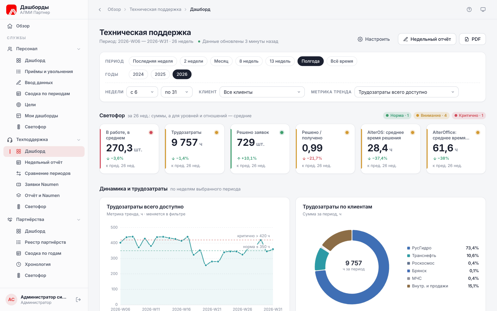

**Период**: быстрые кнопки (последняя неделя, 2 недели, месяц, 8 и 13 недель, полгода, всё время), годы и диапазон недель. **Клиент** ограничивает графики и таблицу неделями с трудозатратами по выбранному клиенту; **Метрика динамики** выбирает показатель графика динамики.

**Светофор** оценивает показатели за выбранный период: для количеств (заявки, часы) сумма за N недель сравнивается с порогом, умноженным на N; для средних (в работе, отношение решённых к полученным, среднее время решения) — среднее за период с порогом недели. Под значением — изменение к предыдущему периоду той же длины; для «Всего времени» — вторая половина периода к первой.

Блоки: динамика и структура заявок, трудозатраты по клиентам, AlterOS, AlterOffice, каналы обращений, Project Server и подробная таблица по неделям с итогами. **Настроить** скрывает и переставляет блоки. **PDF** формирует отчёт за выбранное число недель или за выбранные годы (можно отметить несколько).

## Недельный отчёт

Таблица недель с показателями по группам: нагрузка, поток заявок, трудозатраты по клиентам, каналы и решение по продуктам, доступность.

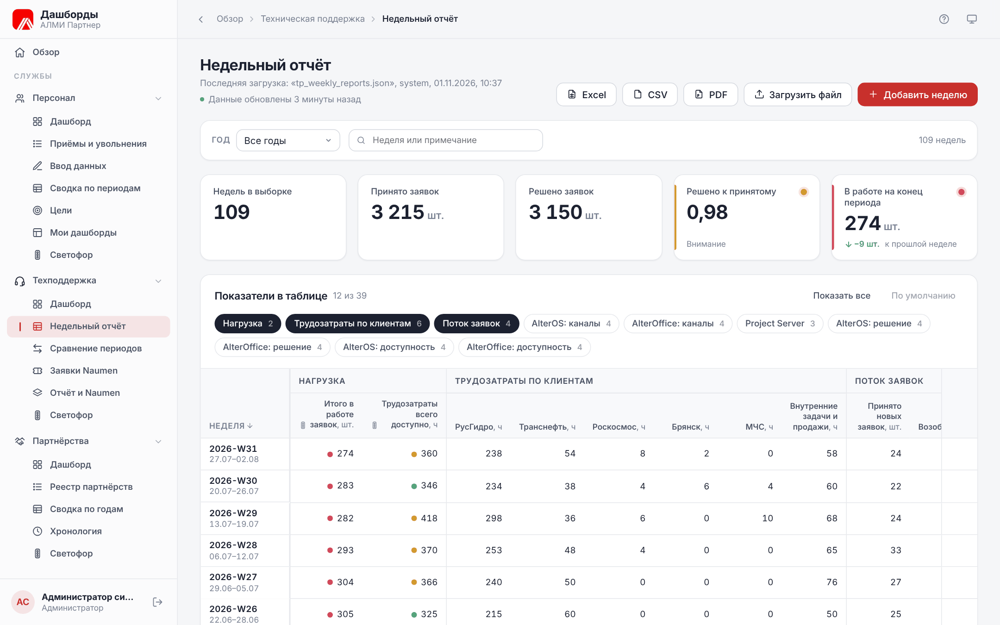

- Выберите год, найдите неделю по периоду (например, `2026-W12`), включите нужные группы столбцов.
- Цветные точки — оценка светофора для недели.
- **Excel** выгружает отчёт в формате исходного файла «Итоговый отчёт ТП по неделям», **CSV** — для обработки в других программах (при праве на исходные записи и выгрузку).

С уровнем «Ввод данных» можно добавить неделю и изменить её значения (поля сгруппированы как в отчёте). Неделя года может быть в отчёте только один раз.

**Загрузить файл** (уровень «Управление») принимает исходный xlsx (четыре строки шапки, данные с пятой) или CSV из выгрузки:

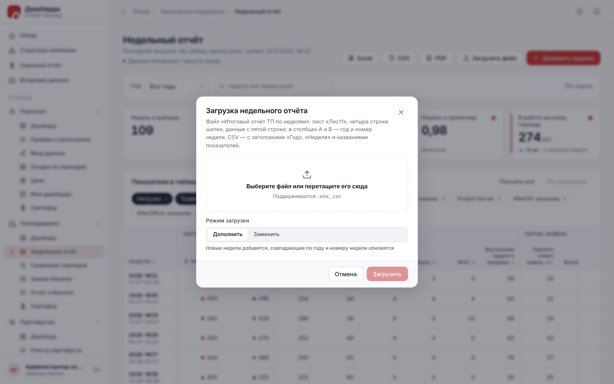

- **Дополнить** — новые недели добавляются, недели с тем же годом и номером обновляются;
- **Заменить** — отчёт заменяется содержимым файла целиком.

После загрузки показывается, сколько недель добавлено, обновлено и пропущено (строки без года или недели). Загрузка записывается в журнал загрузок и журнал изменений.

## Сравнение периодов

Ключевые показатели за последние N недель рядом с предыдущими N неделями: значения, абсолютное и относительное изменение с оценкой по направлению показателя. Сравниваются только интервалы равной длины: если недель в отчёте не хватает на два одинаковых интервала, страница предложит выбрать период короче.

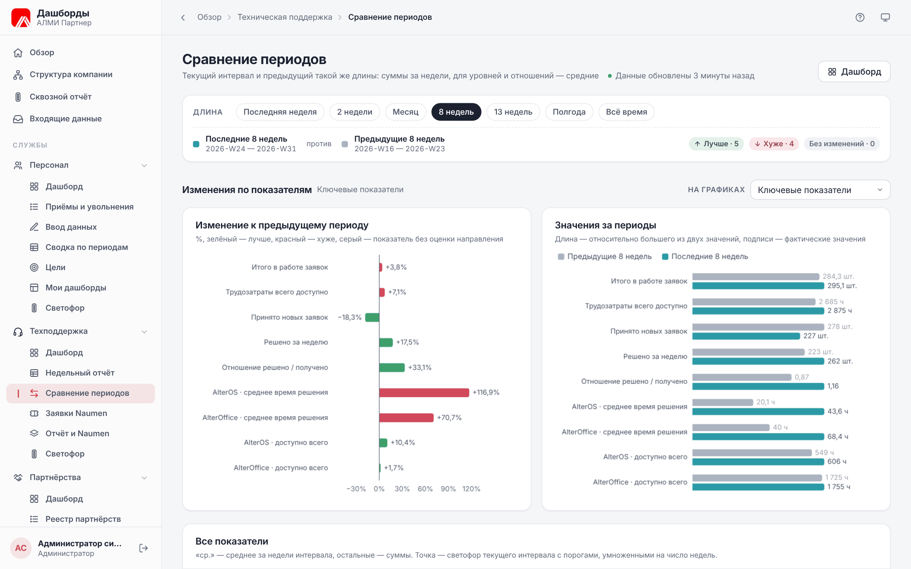

## Заявки Naumen

Аналитика выгрузки заявок Naumen Service Desk.

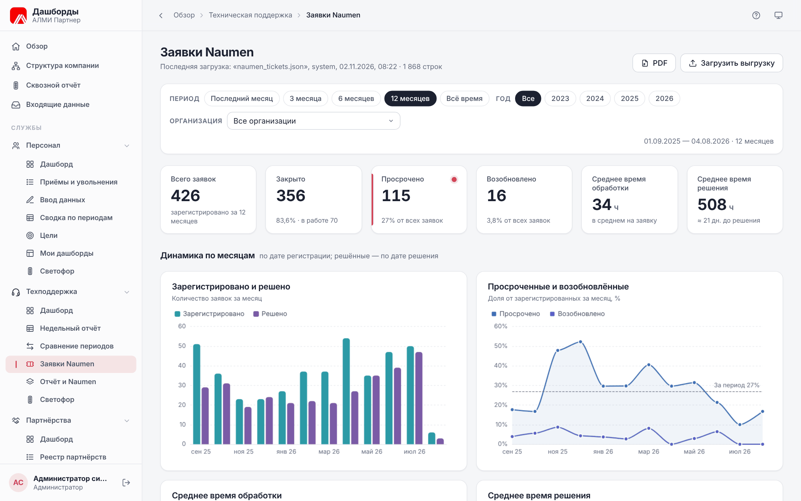

- Фильтры: последние месяцы (1, 3, 6, 12, все), год регистрации, организация. Помесячные графики строятся по месяцам регистрации заявок.
- Показатели: всего заявок, закрыто, в работе, просрочено, возобновлено, среднее время обработки и решения.
- Графики: принятые и решённые по месяцам, доли просроченных и возобновлённых, среднее время, каналы обращений, статусы.
- Таблица организаций (щелчок по строке — фильтр по организации) и ответственных. Без доступа к персональным данным таблица ответственных скрыта: «Ответственные скрыты: нет доступа к персональным данным».

**Загрузить выгрузку** (уровень «Управление») — xlsx из Naumen со столбцами «Номер», «Дата регистрации», «Дата решения», «Статус», «Наименование организации» и другими. В режиме **Дополнить** заявки сопоставляются по номеру: новые добавляются, известные обновляются. **PDF** — отчёт с текущими фильтрами.

## Отчёт и Naumen

Сопоставление недельного отчёта с заявками Naumen по неделям или месяцам: полученные заявки в отчёте и зарегистрированные в Naumen, решённые, трудозатраты по РусГидро и заявки организаций группы РусГидро, среднее время решения. Таблица расхождений подсвечивает периоды, где данные заметно различаются, — повод проверить учёт.

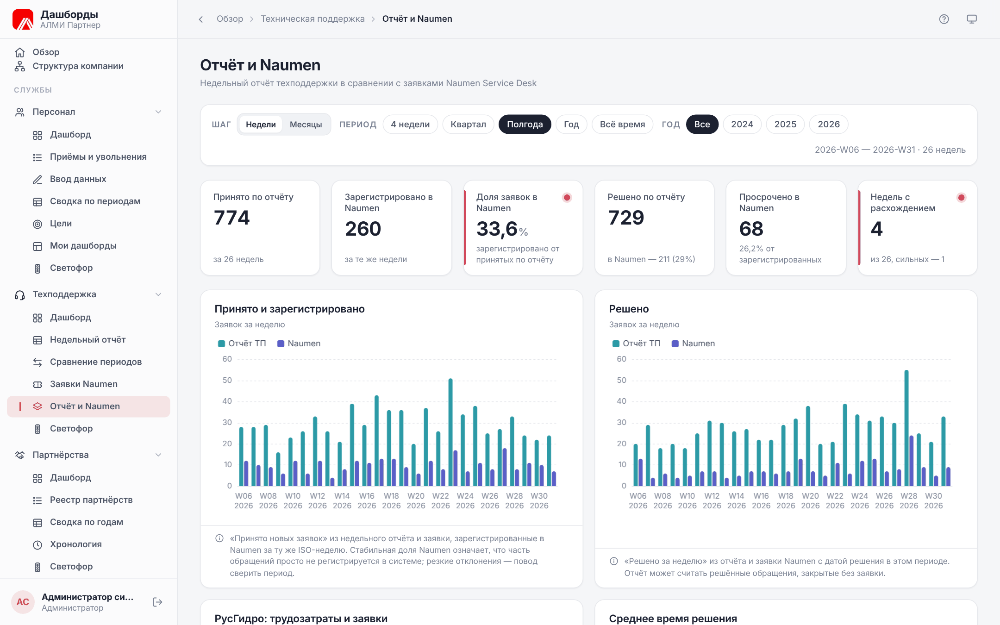

# Технологические партнёрства

## Дашборд партнёрств

Сертификации совместимости продуктов партнёров с продуктами АЛМИ.

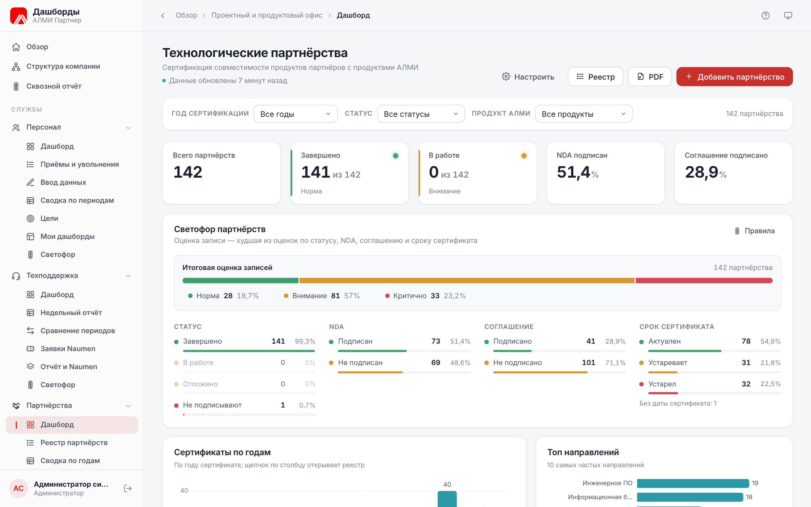

Фильтры: год сертификации, статус, продукт АЛМИ. Показатели: всего, завершено, в работе, доли подписанных NDA и соглашений. **Светофор партнёрств** раскладывает записи по статусу, NDA, соглашению и сроку сертификата — дашборд работает и без права на исходные записи. Графики: сертификаты по годам, продукты АЛМИ, статусы, направления. **PDF** — сводка с фильтрами дашборда (они перечислены в подзаголовке отчёта).

## Реестр партнёрств

Реестр и хронология — исходные записи: они видны при праве на исходные записи.

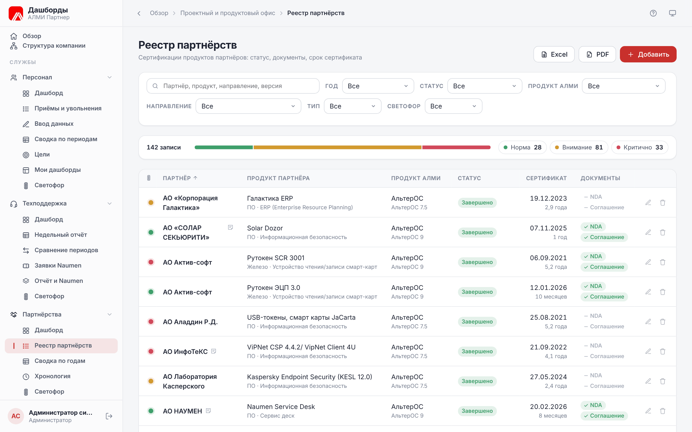

У каждой записи — светофор: худший из цветов статуса, NDA, соглашения и срока сертификата (наведите указатель на точку — увидите, из чего он сложился). Фильтры: год, статус, продукт АЛМИ, направление, тип, светофор и поиск по партнёру, продукту, направлению, версии и комментарию. **Excel** и **PDF** — с текущими фильтрами.

С уровнем «Ввод данных» — **Добавить партнёрство**, правка (щелчок по строке) и удаление:

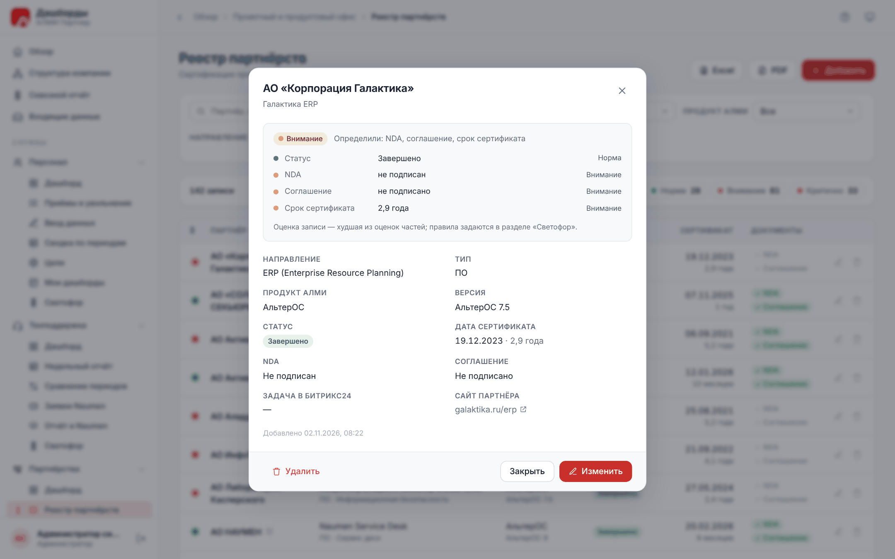

## Сводка и хронология

**Сводка по годам** — число сертификаций по годам с распределением светофора, NDA и соглашений. **Хронология** — лента сертификаций и изменений по датам с поиском и фильтром по продукту АЛМИ.

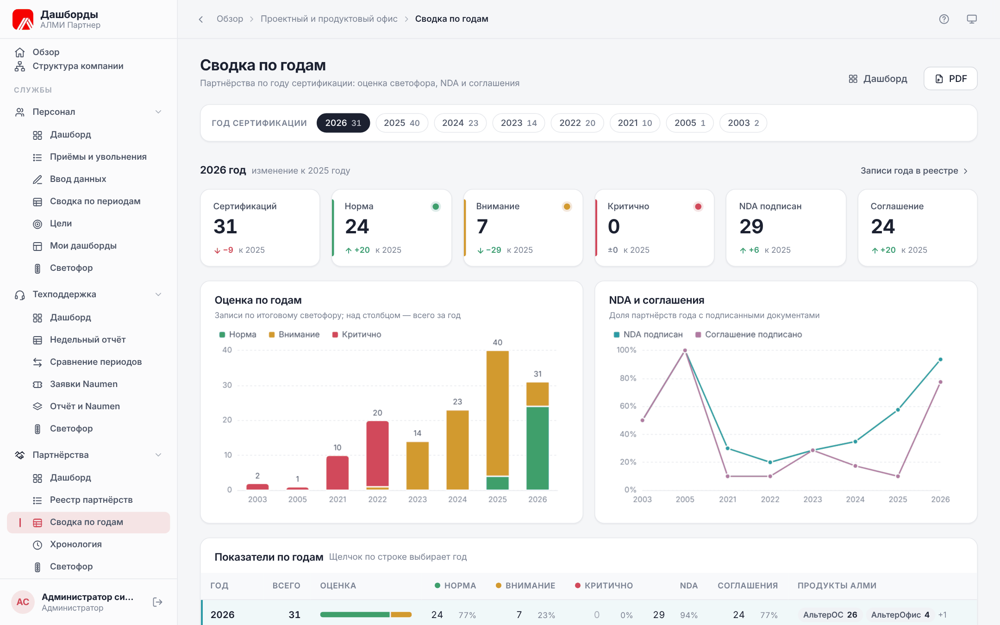

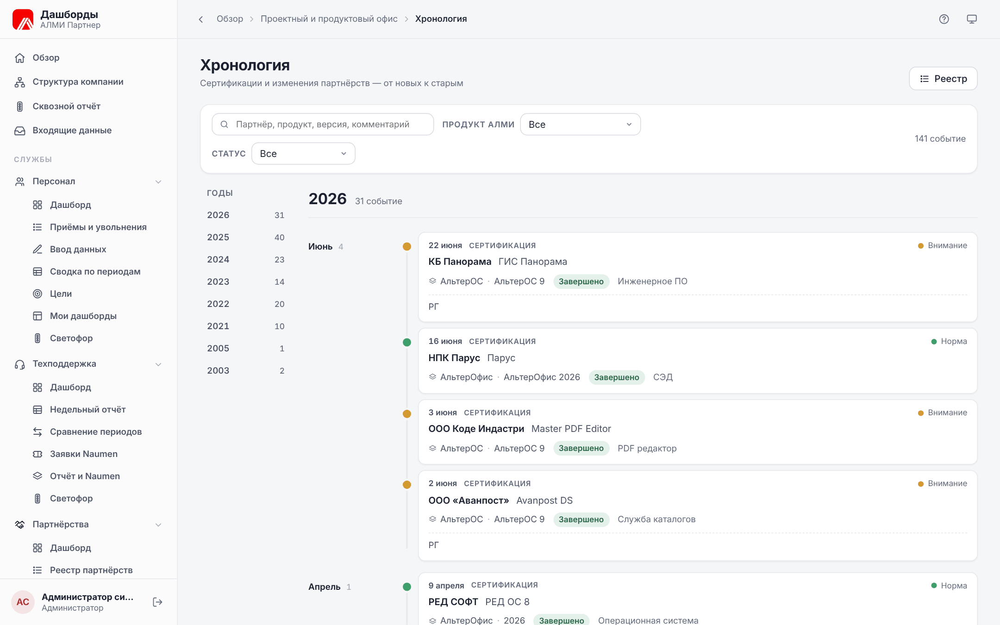

# Незаполненные показатели

Цвет светофора говорит о **значении** показателя. Поэтому, если месяц заведён, а показатель с включённым правилом светофора не заполнен, его светофор — серый «Нет данных», а не «Критично». Но сам пропуск — **критичное нарушение полноты данных**, и система отмечает его отдельно, красным:

| Где | Как отмечено |
| --- | --- |
| Дашборд службы персонала | Красное предупреждение над карточками «Не заполнены показатели со светофором за …» со списком показателей и кнопкой **Заполнить** (для уровня «Ввод данных»); у карточки показателя — «—» вместо значения, серая точка («Нет данных»), пунктирная красная метка и **Не заполнено**; в таблице «Все метрики» — «Нет данных» и «не заполнено» |
| «Обзор» | В карточке службы — «Не заполнено со светофором: N — критичное нарушение» (и для последней недели техподдержки) |
| Ввод данных месяца | Незаполненные строки выделены красной полосой, подпись «Обязательно: показатель на светофоре»; в карточке месяца — итог «Не заполнено со светофором: N» |
| PDF дашборда персонала | Строка «Не заполнены показатели со светофором за …» со списком |

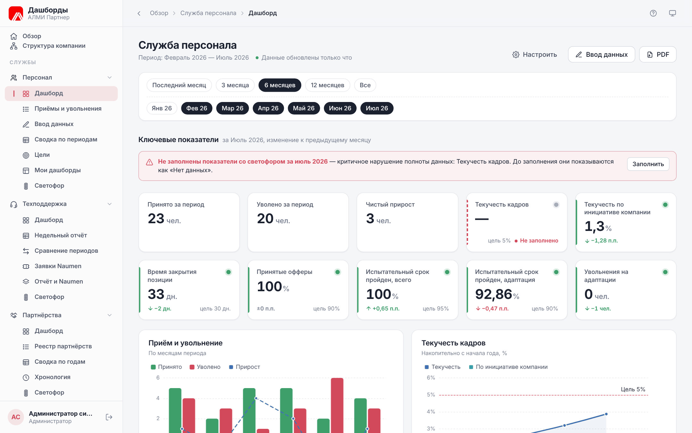

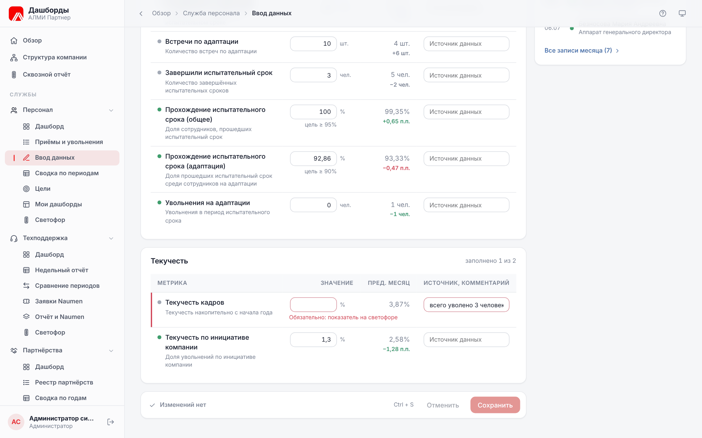

Незаполненный показатель не ухудшает полосу светофора и график «Светофор по месяцам»: он не считается ни нормой, ни критичным значением. Как только показатель заполнен и сохранён, отметки исчезают.

> **Важно.** Серый цвет без отметки «Не заполнено» означает другое: правило светофора для показателя выключено, и он просто не оценивается.

# Настройка светофора

Пороги светофора службы персонала и техподдержки настраивает уровень «Управление»: пункт **Светофор** в меню службы.

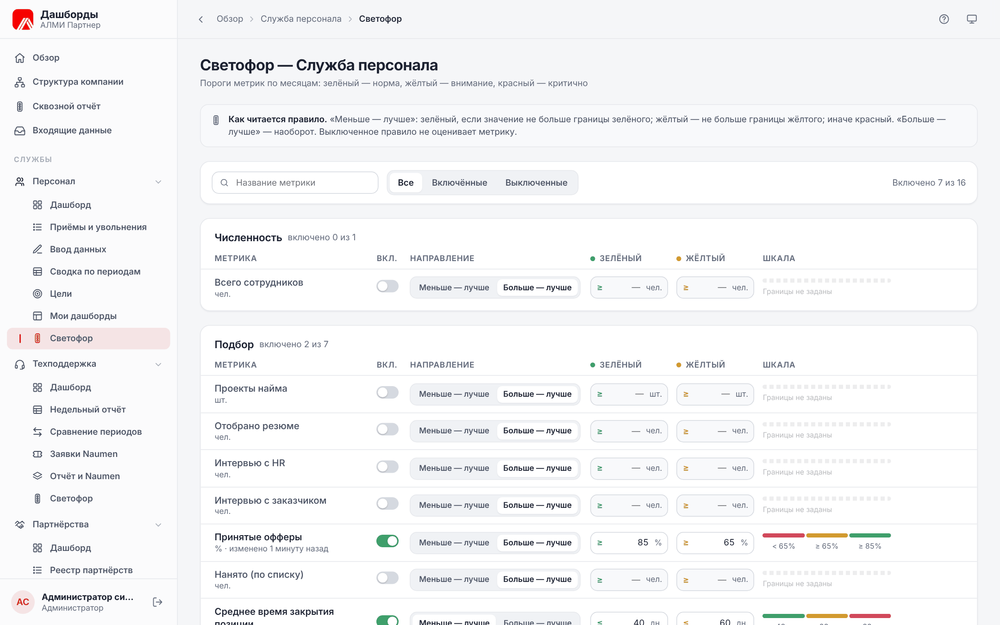

Для каждой метрики:

- **включено** — участвует ли метрика в светофоре; выключенная метрика серая и не влияет на итоги; незаполненная метрика с включённым правилом отмечается «Не заполнено»;
- **направление** — «Меньше — лучше» (текучесть, время закрытия) или «Больше — лучше» (принятые офферы, прохождение испытательного срока);
- **граница зелёного** и **граница жёлтого**: при «Меньше — лучше» значение не больше зелёной границы — норма, не больше жёлтой — внимание, иначе — критично; при «Больше — лучше» — наоборот.

Шкала рядом показывает три зоны. Система не даст сохранить границы в неправильном порядке; несохранённые пороги не теряются при переключении между службами. Для техподдержки пороги задаются на неделю; на дашборде суммы за N недель сравниваются с порогом, умноженным на N.

Светофор партнёрств задаётся иначе — цветом каждой категории (статус, NDA, соглашение) и сроками сертификата в годах: «актуален» — не старше первого срока, «устаревает» — не старше второго, иначе «устарел». Правила видят все с доступом к службе, изменяет уровень «Управление».

# Отчёты и выгрузки

| Страница | PDF | Excel / CSV |
| --- | --- | --- |
| Дашборд службы персонала | показатели, графики, метрики месяца, незаполненные показатели | — |
| Приёмы и увольнения | реестр с фильтрами | Excel |
| Сводка по периодам | таблица и светофор за выбранный диапазон периодов | — |
| Цели | цели и выполнение | — |
| Дашборд и недельный отчёт ТП | светофор, графики, недели; за число недель или выбранные годы | Excel (формат исходного отчёта), CSV |
| Заявки Naumen | показатели, графики, организации | — |
| Дашборд, сводка и реестр партнёрств | сводка с фильтрами дашборда, реестр со светофором | Excel |
| Структура компании, вид «Таблица» | — | CSV |

Отчёты формируются с текущими фильтрами страницы, в цветах активной палитры, с датой и временем формирования по местному времени компании и версией системы в колонтитуле.

Кнопки PDF, Excel и CSV видны только при праве на выгрузку; выгрузки реестров — ещё и при праве на исходные записи (раздел «Мой доступ»).

# Профиль и безопасность

Профиль открывается щелчком по своему имени внизу меню.

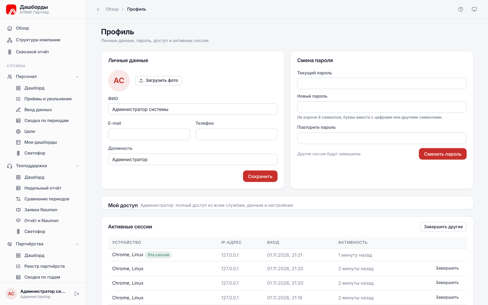

- **Личные данные** — ФИО, e-mail, телефон, должность и фото (до 1,5 МБ).
- **Смена пароля** — текущий пароль и новый дважды; индикатор подсказывает надёжность. Пароль — не короче 8 символов, буквы вместе с цифрами или другими символами, не совпадает с логином. После смены пароля остальные сессии завершаются.
- Если вы входите по учётной записи домена, вместо смены пароля — блок **Пароль**: «Вы входите по учётной записи домена». Пароль меняется в домене — так же, как пароль для входа в Windows; забыли пароль — обратитесь в ИТ-службу.
- **Мой доступ** — ваш профиль доступа и что он означает (следующий раздел).
- **Активные сессии** — браузер и устройство, IP-адрес, время входа и последней активности. **Завершить** закрывает чужую сессию, **Завершить другие** — все, кроме текущей.

> **Совет.** Если увидели незнакомую сессию — завершите её и смените пароль.

# Мой доступ

Блок **Мой доступ** в профиле объясняет простыми словами, что вам доступно. В заголовке — ваш профиль доступа («Профиль доступа: Высшее руководство») или «Индивидуальная настройка», у администратора — «полный доступ ко всем службам, данным и настройкам».

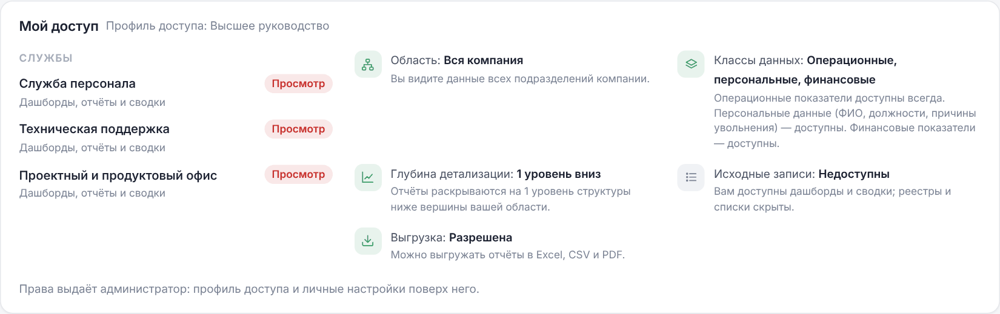

## Профиль доступа и личные настройки

**Профиль доступа** — шаблон прав для группы сотрудников одного уровня: высшее руководство, руководитель направления, руководитель подразделения, специалист, сотрудник. **Личные настройки** — то, что администратор задал именно вам поверх профиля: например, руководителю — бо́льшую глубину детализации, куратору — дополнительные подразделения, специалисту — доступ к нужной службе. Личное значение перекрывает значение профиля, остальное берётся из профиля. «Индивидуальная настройка» означает, что профиль не назначен: как в версии 0.1.0, ограничивают только уровни служб.

## Что означает каждая строка

| Строка | Что означает |
| --- | --- |
| **Службы** | Службы и ваш уровень в каждой: «Просмотр», «Ввод данных», «Управление»; «область — своя ветка», если для службы задана своя область |
| **Область** | Данные каких подразделений вы видите: «Вся компания»; «Своя ветка структуры» — свои подразделения со всеми вложенными; «Своё подразделение» — только свои, без вложенных. Свои — основное подразделение, подразделения, которыми вы руководите, и дополнительные, выданные администратором |
| **Классы данных** | Операционные показатели доступны всегда; персональные данные (ФИО, должности, причины увольнения) и финансовые показатели — по праву |
| **Глубина детализации** | На сколько уровней структуры ниже вершины вашей области раскрываются отчёты |
| **Исходные записи** | Доступны ли реестры и списки служб или только дашборды и сводки |
| **Выгрузка** | Можно ли выгружать отчёты в Excel, CSV и PDF |

В версии 0.2.0 область ограничивает данные, привязанные к подразделениям, — приёмы и увольнения службы персонала. Глубина детализации и финансовые показатели начнут действовать в сквозных отчётах по структуре компании (следующая версия): в службах 0.2.0 денежных показателей нет.

## Почему недоступен реестр или выгрузка

| Что не видно | Причина |
| --- | --- |
| Служба в меню | Нет доступа к службе — ни в профиле, ни лично (или служба явно закрыта лично) |
| «Приёмы и увольнения», «Реестр партнёрств», «Хронология» | Нет права на исходные записи; для приёмов и увольнений нужны ещё и персональные данные |
| Кнопки PDF, Excel, CSV | Выгрузка запрещена; выгрузка реестров требует и права на исходные записи |
| Таблица ответственных Naumen, записи месяца на странице ввода | Нет доступа к персональным данным |
| Часть записей реестра, меньше приёмов и увольнений на дашборде | Область ограничена своими подразделениями |
| «Ввод данных», «Светофор», загрузка файлов | Уровень службы ниже «Ввод данных» или «Управление» |

## Страница «Нет доступа»

Если открыть страницу, на которую нет права (например, по ссылке коллеги), система покажет «Нет доступа» с причиной. На рисунке ниже руководитель с профилем «Высшее руководство» открыл реестр приёмов и увольнений: профиль даёт дашборды и сводки, но не исходные записи. Возможные причины:

- «У вас нет нужного уровня доступа к службе …» — нет доступа к службе или уровень ниже нужного;
- «Раздел … — исходные записи службы …» — нет права на реестры и списки;
- «Раздел … содержит персональные данные» или «… финансовые показатели» — нет нужного класса данных;
- «Раздел доступен администратору и сотрудникам с полномочием …» — страница администрирования.

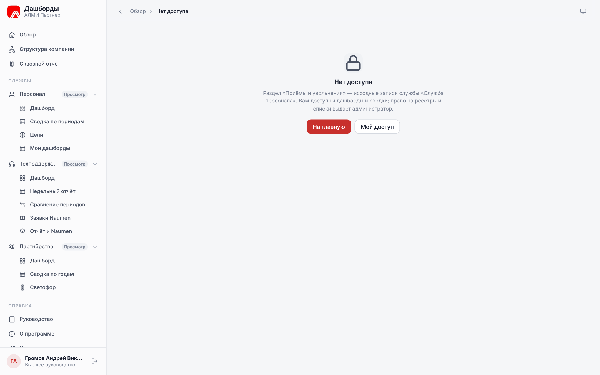

Кнопка **На главную** возвращает на «Обзор», **Мой доступ** — к блоку «Мой доступ» в профиле. Права выдаёт администратор: обратитесь к нему, назвав страницу и причину из сообщения.

# Справка в приложении

- **Руководство** — этот документ с оглавлением, поиском по тексту разделов и кнопками **Открыть PDF** / **Скачать PDF**; щелчок по рисунку увеличивает его.
- Значок **?** в верхней панели открывает раздел руководства о текущей странице.
- **Что нового** — история версий; точка у пункта меню означает, что вышла версия, которую вы ещё не смотрели.
- **О программе** — возможности, документация и номер версии.

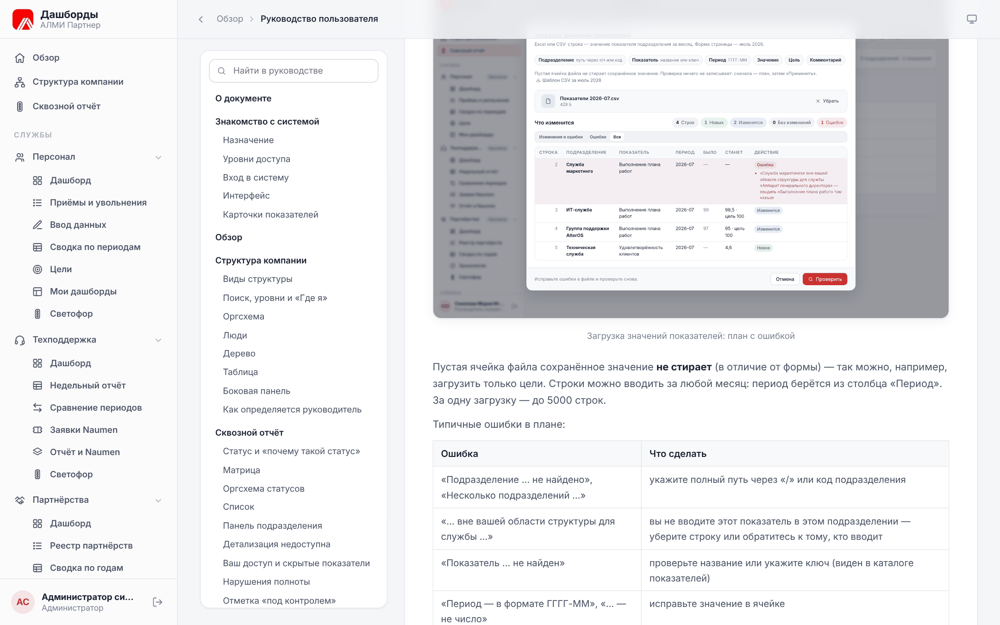

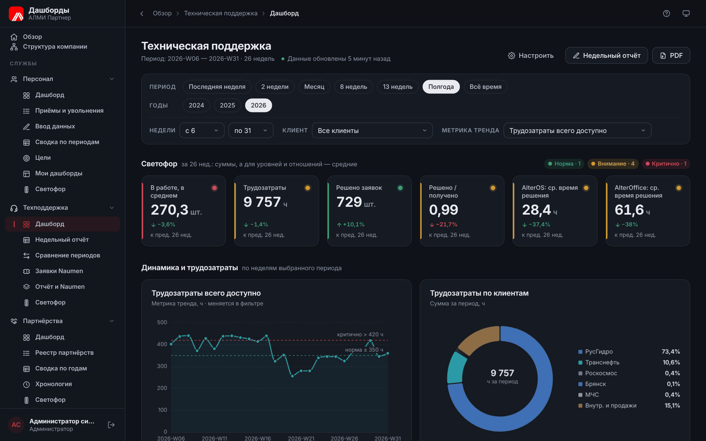

# Вопросы и ответы

| Вопрос | Ответ |
| --- | --- |
| Нет нужной службы в меню | У вас нет к ней доступа — посмотрите «Мой доступ» в профиле и обратитесь к администратору |
| Нет кнопок «Добавить», «Сохранить», «Загрузить» | Нужен уровень «Ввод данных» или «Управление» |
| Нет кнопок PDF и Excel | Выгрузка запрещена вашим профилем доступа |
| Не открывается реестр — «Нет доступа» | Нет права на исходные записи (или на персональные данные) — дашборды и сводки при этом доступны |
| Вместо значения «—», точка серая и красная метка «Не заполнено» | Показатель со светофором не заполнен за месяц — заполните его на странице «Ввод данных» или сообщите ответственному |
| Показатель серый без метки | Правило светофора для него выключено |
| Не тот руководитель в структуре | Руководитель определяется по структуре или назначается явно — сообщите тому, кто ведёт структуру |
| Кнопка «Где я» недоступна | Вы не входите ни в одно подразделение — попросите администратора указать ваше подразделение |
| «Сервер домена не отвечает» при входе | Каталог домена недоступен — повторите вход позже |
| «Сессия устарела: обновите страницу» | Обновите страницу (F5): сессия была завершена в другой вкладке или устарела |
| Не тот период на дашборде | Проверьте быстрый период и выбранные месяцы; адрес страницы хранит фильтры |
| PDF долго формируется | Отчёт с графиками формируется несколько секунд; не нажимайте кнопку повторно |
