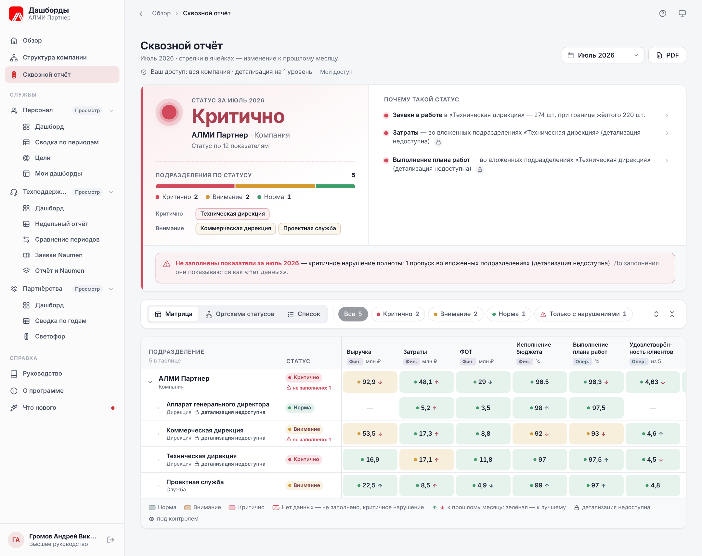
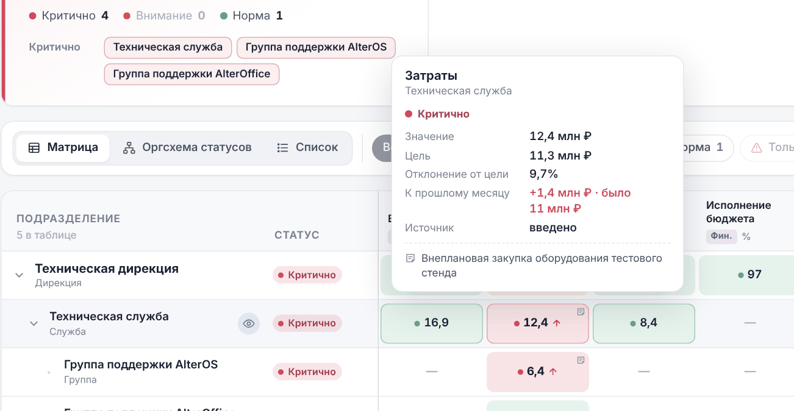
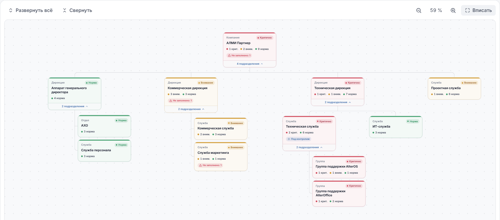
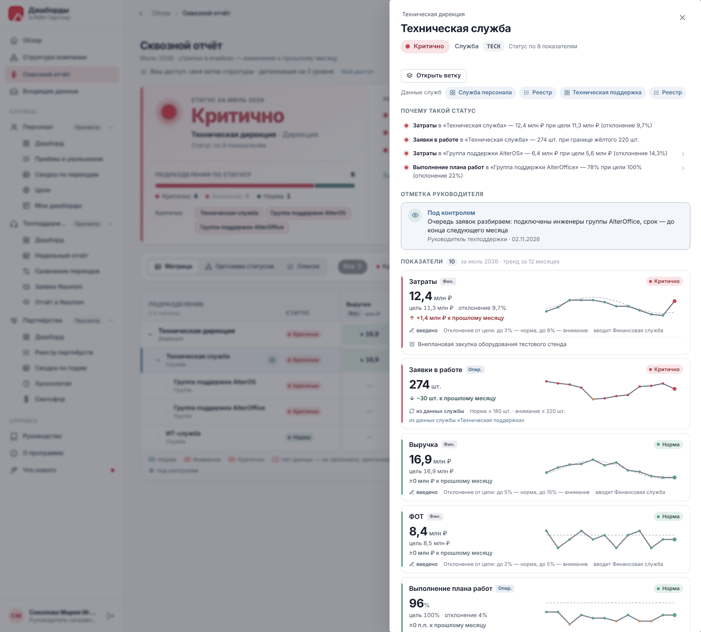
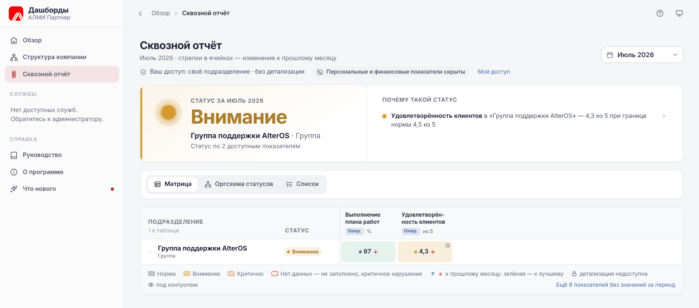
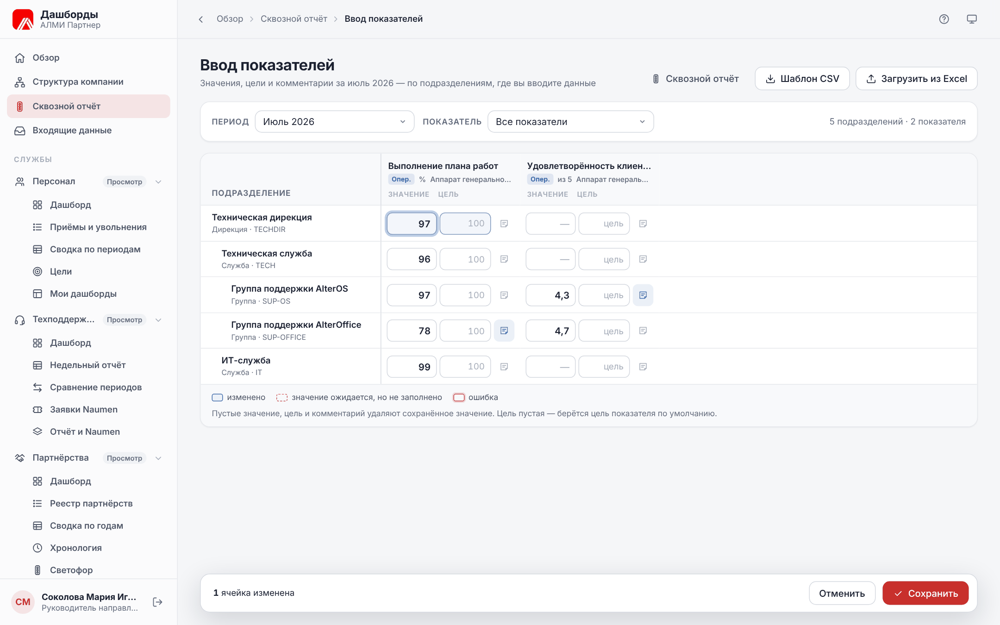
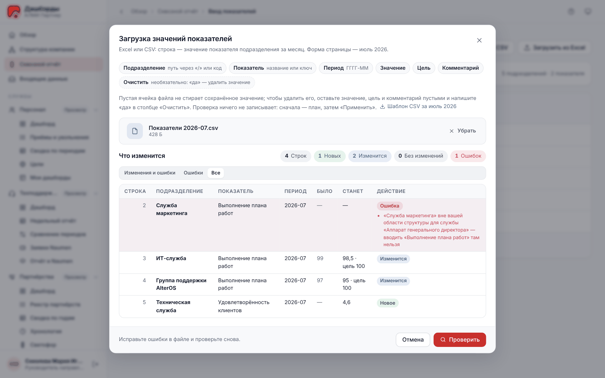
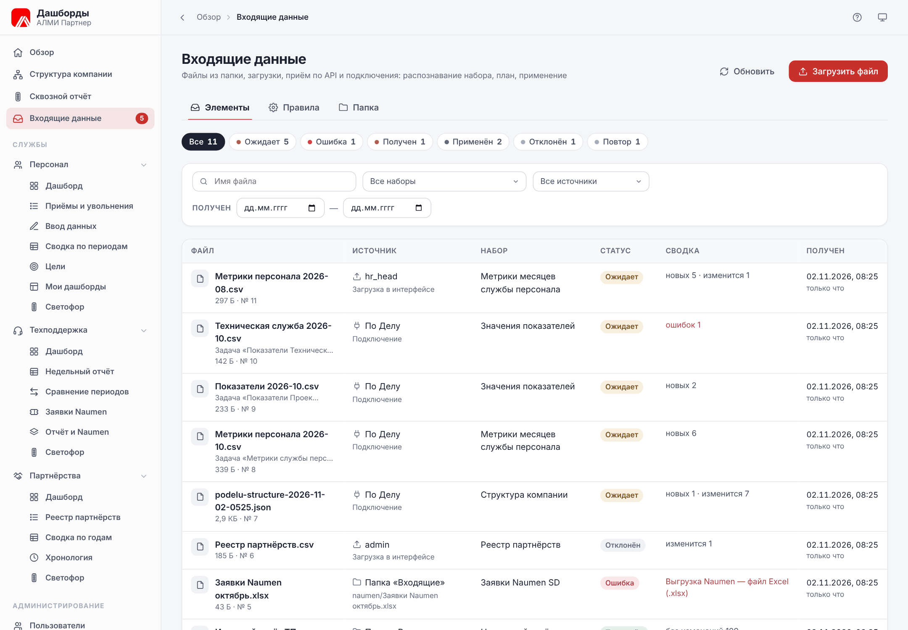
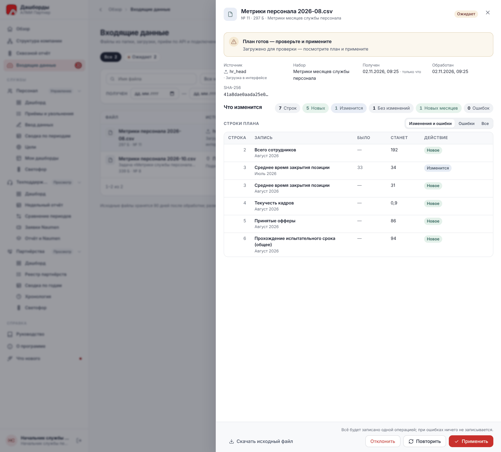
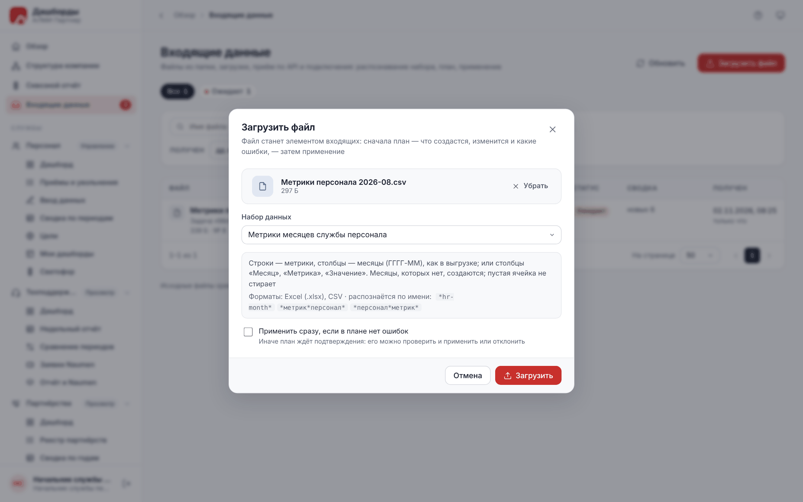

# О документе

Руководство описывает работу в системе «Дашборды компании» версии 0.4.0: стартовую страницу «Обзор», структуру компании, сквозной отчёт о статусе подразделений и ввод его показателей, «Входящие данные» — файлы из папки на сервере, загрузки, других систем и подключений с планом и применением, — дашборды и реестры службы персонала, технической поддержки и проектного и продуктового офиса, ввод и загрузку данных, отчёты и выгрузки, светофор и незаполненные показатели, ваш доступ, профиль и встроенную справку.

Документ предназначен для сотрудников и руководителей служб. Управление пользователями, доступом, структурой компании, каталогом показателей сквозного отчёта, интеграциями с системами компании, правилами входящих данных, палитрами и обслуживание системы описаны в «Руководстве администратора», установка — в «Руководстве по развёртыванию».

Руководство открывается и внутри приложения — пункт **Руководство** в боковом меню: с оглавлением, поиском по тексту и кнопкой **Скачать PDF**. Значок **?** в верхней панели открывает раздел о текущей странице.

Снимки экрана сделаны на демонстрационном стенде. Набор разделов и кнопок зависит от вашего доступа: если описанной кнопки нет, у вас нет права на это действие. Что вам доступно и почему, показывает блок «Мой доступ» в профиле (раздел «Мой доступ» этого руководства).

**Условные обозначения**

| Обозначение | Значение |
| --- | --- |
| **Кнопка** | Название кнопки, пункта меню или поля на экране |
| «Раздел» | Название страницы или окна |
| > **Совет.** | Полезный приём |
| > **Важно.** | Ограничение или правило, которое стоит знать заранее |

# Знакомство с системой

## Назначение

«Дашборды компании» собирают показатели служб в одном месте и помогают быстро увидеть, где всё в порядке, а где нужно внимание:

- **светофор** — каждая важная метрика окрашивается: зелёный — норма, жёлтый — внимание, красный — критично, серый — нет оценки (правило светофора для метрики выключено); пороги задаёт руководитель службы;
- **незаполненные показатели** — если показатель со светофором не заполнен, он отмечается «Нет данных», а сам пропуск — красной меткой «Не заполнено» как критичное нарушение полноты данных (раздел «Незаполненные показатели»);
- **динамика** — изменение к прошлому месяцу или к предыдущему такому же периоду со стрелкой и цветом: зелёным, если изменение к лучшему, красным — если к худшему (для текучести рост — плохо, для доли принятых офферов — хорошо);
- **цели** — плановые значения метрик на год и их выполнение;
- **реестры** — исходные записи: приёмы и увольнения, недели отчёта техподдержки, партнёрства;
- **структура компании** — подразделения, руководители и сотрудники: оргсхема, схема подчинения, дерево и таблица;
- **сквозной отчёт** — статус компании сверху вниз: из каких подразделений и показателей он складывается и где проблема; каждый видит его в пределах своего доступа — от первого лица до рядового сотрудника;
- **входящие данные** — выгрузки из папки на сервере, загрузки, файлы других систем и подключений проходят один путь: система распознаёт, что в файле, показывает план изменений и применяет его сразу или после подтверждения;
- **отчёты** — PDF и выгрузки в Excel с текущими фильтрами.

## Уровни доступа

Доступ выдаёт администратор отдельно к каждой службе:

| Уровень | Что можно |
| --- | --- |
| **Просмотр** | смотреть дашборды, реестры и сводки, формировать PDF и выгрузки, настраивать свой вид дашбордов |
| **Ввод данных** | всё, что «Просмотр», а также добавлять и изменять данные: месяцы и метрики, приёмы и увольнения, недели отчёта, партнёрства; создавать общие пользовательские дашборды; вводить показатели сквозного отчёта, которыми владеет служба |
| **Управление** | всё, что «Ввод данных», а также настраивать службу: пороги светофора, цели, загрузку файлов, удаление месяцев |

Начиная с версии 0.2.0 доступ складывается из **профиля доступа** — шаблона для вашего уровня в компании («Высшее руководство», «Руководитель подразделения», «Сотрудник» и другие) — и **личных настроек** поверх него. Кроме уровня служб профиль определяет, данные каких подразделений вы видите, на сколько уровней структуры раскрывается сквозной отчёт, доступны ли персональные данные, финансовые показатели, реестры и выгрузка. Подробности — в разделе «Мой доступ».

Уровень показан в боковом меню рядом с названием службы, профиль доступа — под вашим именем внизу меню.

## Вход в систему

Откройте адрес системы, введите логин и пароль и нажмите **Войти**. Значок глаза в поле пароля показывает введённый пароль.

**Вход по учётной записи домена.** Если в компании включён вход по домену, под полями видна подсказка со значком ключа: войдите с теми же логином и паролем, что при входе в Windows. Логином может быть имя учётной записи, адрес вида `имя@домен` или e-mail — как настроил администратор. Пароль доменной учётной записи хранит домен: система его не запоминает и не меняет.

Сообщения при входе:

| Сообщение | Что делать |
| --- | --- |
| «Неверный логин или пароль» | Проверьте раскладку и Caps Lock; для доменной учётной записи — пароль домена |
| «Сервер домена не отвечает — попробуйте войти позже» | Каталог домена временно недоступен; введённый пароль не стирается — повторите вход через минуту |
| «Учётной записи в системе нет — обратитесь к администратору» | Домен подтвердил пароль, но в системе нет вашей учётной записи: попросите администратора её создать |
| «Учётная запись отключена. Обратитесь к администратору» | Вход запрещён администратором |
| «Слишком много неудачных попыток» | Подождите несколько минут |

Если администратор выдал временный пароль, после входа система откроет профиль и попросит придумать свой пароль — до этого другие страницы недоступны.

Сессия длится до 12 часов и завершается после 4 часов бездействия; после этого система попросит войти снова и вернёт на ту же страницу.

## Интерфейс

- **Боковое меню** — «Обзор», «Структура компании», «Сквозной отчёт», «Входящие данные» (тем, кто вводит или загружает данные; число рядом — сколько файлов ждут подтверждения), службы с их разделами, «Администрирование» (администратору и сотрудникам с полномочиями администрирования) и «Справка». Группу службы можно свернуть щелчком по её названию, всё меню — кнопкой со стрелкой в верхней панели. На телефоне меню открывается кнопкой с тремя полосками.
- **Верхняя панель** — путь к странице (щелчок по службе возвращает к её дашборду), значок **?** — раздел руководства о текущей странице, переключатель темы: светлая, тёмная или как в системе.
- **Заголовок страницы** — название, пояснение, отметка **Данные обновлены …** и кнопки действий: PDF, Excel, загрузка, добавление.
- **Внизу меню** — ваше имя и профиль доступа (щелчок открывает профиль) и кнопка выхода.

Если данные не загрузились (например, пропала сеть), страница показывает «Не удалось загрузить» и кнопку **Повторить** — это не то же самое, что отсутствие данных.

> **Совет.** Фильтры страниц сохраняются в адресной строке. Скопируйте адрес — коллега откроет страницу с теми же фильтрами. Кнопка «Назад» браузера возвращает предыдущие фильтры.

## Карточки показателей

Карточка показывает название, значение с единицей, цветную метку светофора слева и точку в углу, изменение к прошлому периоду и цель. Наведите указатель на название — появится полное описание метрики. Если показатель со светофором не заполнен, вместо значения — «—», точка светофора серая (подсказка «Нет данных»), метка слева пунктирная красная, а внизу — **Не заполнено**.

# Обзор

«Обзор» — стартовая страница. Вверху — карточка **сквозного отчёта**: статус вашей области (компании, направления или подразделения) за последний месяц, подразделения по статусам и главные причины; **Открыть сквозной отчёт** ведёт к подробностям (раздел «Карточка на «Обзоре»»). Ниже для каждой доступной службы — карточка с периодом (например, «Июль 2026» или «31-я неделя 2026»), полосой светофора (сколько метрик в норме, требуют внимания, критично), главными показателями с изменением и временем последнего обновления данных. **Открыть дашборд** переходит к службе.

Если за последний период не заполнены показатели со светофором, в карточке службы появляется красная строка «Не заполнено со светофором: N — критичное нарушение»; наведите на неё указатель, чтобы увидеть названия показателей. Значение такого показателя в карточке — «—».

Ниже — **Последние загрузки данных**: какие файлы загружены, кем и когда, сколько записей добавлено и обновлено. Если у вас есть доступ к службам без дашборда, они перечислены внизу страницы. Если доступа нет ни к одной службе, «Обзор» покажет «Нет доступа к службам» — при этом карточка сквозного отчёта, «Структура компании», «Сквозной отчёт», профиль и справка доступны.

# Структура компании

«Структура компании» (пункт меню под «Обзором») показывает подразделения, руководителей и сотрудников компании. Структуру видят все сотрудники: она не содержит данных служб. В заголовке — сколько в компании подразделений, сотрудников и уровней вложенности.

Как подразделения выглядят по показателям — статус, нарушения, заметки руководителей — показывает «Сквозной отчёт»: его оргсхема статусов построена на той же структуре (раздел «Оргсхема статусов»).

## Виды структуры

Переключатель в заголовке страницы:

| Вид | Что показывает |
| --- | --- |
| **Оргсхема** | Подразделения карточками с линиями подчинения: тип уровня цветом, основной руководитель с фото, численность |
| **Люди** | Кто кому подчиняется: руководители и их команды, прямые подчинённые и вся ветка |
| **Дерево** | Список подразделений с сотрудниками: сначала руководители, затем сотрудники |
| **Таблица** | Подразделения с численностью: сортировка, фильтр по типу и выгрузка |

Выбранный вид запоминается для вас; вид, выбранное подразделение или сотрудник сохраняются и в адресе страницы — ссылкой можно поделиться.

## Поиск, уровни и «Где я»

Панель инструментов над схемой общая для всех видов:

- **Поиск по структуре** — подразделения (с типом и путём) и сотрудники (с должностью); стрелки выбирают результат, Enter открывает его. Клавиша `/` переводит курсор в поиск. Найденное раскрывается на схеме, путь к нему подсвечивается, подробности открываются в боковой панели.
- **Уровней** — сколько уровней структуры раскрыть сразу: 1, 2, 3… или «все». **Развернуть всё** раскрывает все уровни, **Свернуть** оставляет только верхний.
- **Где я** — показывает ваше подразделение (в виде «Люди» — вашу карточку). Если вы не входите ни в одно подразделение, кнопка недоступна с подсказкой «Вас нет в структуре».

## Оргсхема

Карточка подразделения: тип уровня (цветная точка и полоса сверху), название, основной руководитель с фото и должностью («+N» — ещё руководители), число сотрудников уровня (вместе с руководителем) и всей ветки. Кнопка внизу карточки «N подразделений» раскрывает или сворачивает вложенные. Метка **Вы здесь** отмечает ваше подразделение. Если руководитель не назначен, в карточке — «Руководитель не назначен».

Щелчок по карточке открывает боковую панель подразделения, щелчок по руководителю — панель сотрудника. Путь от верхнего уровня до выбранного подсвечивается.

Инструменты справа:

- **Расположить слева направо / сверху вниз** — ориентация схемы;
- **Нижний уровень столбиком** — нижние подразделения ветки ставятся друг под другом, схема становится уже;
- **Компактные карточки** — меньше подробностей, больше подразделений на экране;
- масштаб: **−**, **+**, значение (щелчок — 100 %) и **Вписать** — вся схема в окне. Схему можно перетаскивать мышью; Ctrl + колесо мыши меняет масштаб, клавиши `+`, `−` и `0` работают, когда схема в фокусе.

## Люди

Схема подчинения по непосредственным руководителям: карточка сотрудника с фото, должностью и подразделением, число прямых подчинённых и всей ветки; кнопка **Подчинённые: N** раскрывает команду. Метка **Вы** отмечает вашу карточку. Сотрудники без руководителя и без подчинённых собраны в группу «Вне подчинения».

## Дерево

Список подразделений по уровням: у каждого — численность уровня и всей ветки, внутри — сначала руководители, затем сотрудники. Сотрудники, не входящие ни в одно подразделение, — в группе «Вне структуры» в конце списка. Список быстро прокручивается даже для тысяч сотрудников.

## Таблица

Таблица подразделений: **Подразделение** (с отступом по уровню), **Тип**, **Уровень**, **Руководитель**, **Штат** (сотрудники уровня без руководителей), **В ветке** (вместе с вложенными), **Вложенных**. Щелчок по заголовку столбца сортирует, фильтр **Все типы** оставляет подразделения одного типа, строка итогов внизу. **Выгрузить в Excel** сохраняет таблицу в файл CSV (открывается в Excel) с путём, кодом, руководителем и численностью.

## Боковая панель

Панель открывается справа (на телефоне — снизу) и закрывается крестиком или клавишей Esc.

**Подразделение**: тип, название, код, путь от верхнего уровня (щелчок по звену открывает его), численность на уровне и в ветке, число вложенных; **Руководители** (★ «основной» — если руководителей несколько: он определяет подчинение сотрудников), **Вложенные подразделения**, **Сотрудники** с поиском по имени и должности.

**Сотрудник**: фото, должность, подразделение с путём, число прямых подчинённых и всей ветки; **Руководитель** с отметкой, откуда он взялся («назначен явно», «по структуре», «первое лицо»), **Цепочка подчинения** до первого лица, **Прямые подчинённые** и подразделения, которыми сотрудник **Руководит**.

> **Совет.** Сотрудникам, которые ведут структуру (полномочие «Ведёт структуру компании»), в панели доступны кнопки **Изменить подразделение**, блок **Подчинение и должность** и **История в структуре** — см. «Руководство администратора».

## Как определяется руководитель

Непосредственный руководитель сотрудника определяется по правилам — так же для всех видов, карточек и отчётов:

1. **Первое лицо** (например, генеральный директор) никому не подчиняется.
2. Если руководитель **назначен явно** — это он. Так оформляют, например, сотрудника, работающего на другое подразделение.
3. Иначе руководитель — **по структуре**: основной руководитель подразделения сотрудника. Если у подразделения нет руководителя или сотрудник сам им руководит, берётся руководитель ближайшего вышестоящего подразделения.

Пример на демонстрационном стенде: у группы поддержки AlterOS нет руководителя, поэтому инженер группы подчиняется руководителю Технической службы, а тот — техническому директору. Если явно назначенный руководитель отличается от структурного, в панели сотрудника видно: «По структуре руководителем был бы …».

Руководители подразделений важны и для сквозного отчёта: подразделения, которыми вы руководите, входят в вашу область, и только руководитель подразделения может отметить его статус «под контролем» (раздел «Отметка «под контролем»»).

# Сквозной отчёт

«Сквозной отчёт» (пункт меню под «Структурой компании») показывает статус компании сверху вниз: общий статус вашей области, из каких подразделений и показателей он складывается и где проблема. Отчёт один для всех — от первого лица до рядового сотрудника, — но каждый видит его в пределах своего доступа: первое лицо — всю компанию на нужную глубину, руководитель направления — своё направление, руководитель службы — свою службу без денежных показателей, сотрудник — статус своего подразделения (раздел «Как отчёт выглядит для разных уровней сотрудников»).

Статус складывается из **показателей** подразделений за месяц:

- **финансовые** — выручка, затраты, ФОТ, исполнение бюджета; их вводит финансовая служба;
- **операционные** — например, выполнение плана работ и удовлетворённость клиентов (вводятся по подразделениям), заявки в работе и решённые заявки техподдержки, текучесть кадров, доля партнёрств «в норме» (считаются из данных служб сами).

Набор показателей, их правила светофора и кто их вводит, задаёт сотрудник, который ведёт сквозные отчёты, или администратор («Руководство администратора», раздел «Показатели и сквозной отчёт»).

В заголовке страницы — **период** (месяц; по умолчанию — последний месяц с данными), кнопки **Ввод показателей** (если вы вводите значения) и **PDF** (если вам разрешена выгрузка). Под заголовком — строка **Ваш доступ** (раздел «Ваш доступ и скрытые показатели»). Вид, период, выбранное подразделение и фильтры сохраняются в адресе страницы — ссылкой можно поделиться, а коллега увидит отчёт в пределах своего доступа.

## Статус и «почему такой статус»

Вверху — сводка по вершине вашей области:

- **Статус за месяц** — крупно: «Норма», «Внимание», «Критично» или «Нет оценки»; под ним — подразделение-вершина и его тип (если вершин несколько — «Ваша область · N подразделений») и строка **Статус по N показателям**: сколько показателей оценены светофором. Если часть классов данных вам скрыта, строка звучит как «Статус по N доступным показателям».
- **Подразделения по статусу** — полоса и число подразделений в каждом статусе; ниже — какие именно критичны и требуют внимания (до трёх, ближайшие к вершине; «и ещё N» — наведите указатель, чтобы увидеть остальные). Щелчок по названию открывает панель подразделения.
- **Почему такой статус** — показатели и подразделения, которые определили статус, например: «**Заявки в работе** в «Техническая дирекция» — 274 шт. при границе жёлтого 220 шт.» или «**Затраты** в «Техническая служба» — 12,4 млн ₽ при цели 11,3 млн ₽ (отклонение 9,7%)». Причина называется там, где она возникла, — в самом нижнем подразделении, которое вам видно. Значок замка означает, что причина во вложенных подразделениях за пределом вашей детализации. Щелчок по причине открывает подразделение; если причин больше, внизу — «Ещё N — в панели …». При зелёном статусе здесь — «Все оценённые показатели в норме».
- Внизу сводки — красное предупреждение о незаполненных показателях (раздел «Нарушения полноты») и заметки «под контролем» (раздел «Отметка «под контролем»»).

**Как определяется статус.** Статус подразделения — **худший** из статусов его показателей и вложенных подразделений: если хотя бы один показатель или одно вложенное подразделение «Критично», подразделение тоже «Критично». Показатели без оценки («Принято сотрудников», «Уволено сотрудников») и незаполненные значения статус не меняют. Статус показателя — светофор по его правилу:

| Статус | Что означает |
| --- | --- |
| **Норма** (зелёный) | значение в пределах нормы: не хуже границы нормы или отклонение от цели в допустимых пределах |
| **Внимание** (жёлтый) | значение между границами нормы и внимания |
| **Критично** (красный) | значение хуже границы внимания или отклонение от цели больше допустимого |
| **Нет оценки** (серый) | у показателя нет правила светофора («без оценки») или нет цели, с которой сравнивается значение; у подразделения — нет ни одного оценённого показателя |
| **Нет данных** (красная штриховка) | значение ожидается, но не заполнено — критичное нарушение полноты (раздел «Нарушения полноты») |

**Откуда значение.** У подразделения — собственное значение (введённое, загруженное из файла или посчитанное из данных службы), а если своего нет — **свёртка** вложенных подразделений: сумма (выручка, затраты, заявки) или среднее (доли, оценки). Источник виден в подсказке ячейки и в панели: «введено», «загружено из файла», «из данных службы», «сумма по 2 подразделениям». Цель свёрнутого значения — сумма или среднее целей вложенных подразделений.

## Матрица

**Матрица** — вид по умолчанию: строки — подразделения вашей области деревом, столбцы — показатели.

- **Строки.** Сначала раскрыты вершины и два уровня под ними; стрелка у названия раскрывает и сворачивает уровень. Кнопки справа на панели вида — **Развернуть всё** и **Свернуть** (до вершин и уровня под ними). Под названием — тип уровня и отметки: замок **детализация недоступна**, глаз — «под контролем».
- **Статус** — статус подразделения и, если в ветке есть пропуски, красная метка «не заполнено: N».
- **Столбцы** — показатели, у которых за месяц есть значения хотя бы у одного подразделения: название, класс данных («Фин.», «Опер.», «Перс.») и единица. Наведите указатель на заголовок — появится описание показателя. Ссылка «Ещё N показателей без значений за период» под таблицей показывает и остальные.
- **Ячейка** — цвет статуса, значение (крупные числа — в тыс. и млн) и стрелка изменения к прошлому месяцу: зелёная — изменение к лучшему, красная — к худшему (для затрат рост — плохо, для выручки — хорошо). Значок заметки в углу — к значению есть комментарий. «Нет данных» на красной штриховке — значение ожидается, но не заполнено. «—» — значения нет, и здесь оно не ожидается.

Наведите указатель на ячейку — подсказка покажет значение, цель, отклонение от цели, правило светофора, изменение к прошлому месяцу и прошлое значение, источник и комментарий того, кто вводил значение:

Щелчок по строке (или Enter) открывает панель подразделения; стрелки вправо и влево раскрывают и сворачивают уровень. Шапка и первый столбец закреплены, широкая матрица прокручивается вбок внутри карточки.

**Фильтры** на панели вида: **Все**, **Критично**, **Внимание**, **Норма** — с числом подразделений, и **Только с нарушениями** — подразделения с незаполненными обязательными показателями (своими или во вложенных за пределом детализации). С фильтром в матрице остаются подходящие подразделения и, бледнее, их вышестоящие — чтобы было видно, где они в структуре; справа — «Показано N из M» и **Сбросить**.

Под матрицей — условные обозначения цветов и значков.

## Оргсхема статусов

**Оргсхема статусов** — подразделения вашей области карточками структуры, окрашенными статусом:

Карточка: тип уровня, название и статус; сколько собственных показателей подразделения критично, требует внимания и в норме; отметки «Не заполнено: N», «детализация недоступна» и «Под контролем»; кнопка «N подразделений» раскрывает вложенные. Щелчок по карточке открывает панель подразделения. Инструменты — как у оргсхемы «Структуры компании»: **Развернуть всё**, **Свернуть**, масштаб и **Вписать**; схему можно перетаскивать. Фильтр по статусу приглушает неподходящие карточки, не перестраивая схему.

## Список

**Список** — подразделения карточками в порядке структуры: статус, до трёх главных проблем, отметки о пропусках, детализации и заметке. На телефоне отчёт открывается списком (вид «Схема» — оргсхема статусов), матрица доступна переключателем.

## Панель подразделения

Панель открывается справа (на телефоне — снизу) по щелчку на строке матрицы, карточке, причине или названии подразделения и закрывается крестиком или клавишей Esc.

- **Шапка** — путь в структуре (щелчок по звену открывает вышестоящее), название, статус, тип, код и «Статус по N показателям».
- **Открыть ветку** — показать в отчёте только эту ветку (на панели вида появится метка «Ветка «…»», крестик на ней возвращает всю область; PDF тоже формируется по ветке); у вершины ветки — **Вся область**.
- **Данные служб** — переход к дашборду службы, из данных которой посчитаны показатели, и к её реестру. Ссылки есть, только если у вас есть доступ к службе, а для реестра — и право на исходные записи.
- **Почему такой статус** — до 20 причин; щелчок открывает подразделение причины.
- **Отметка руководителя** — заметка «под контролем» (раздел «Отметка «под контролем»»).
- **Показатели** за месяц — сначала незаполненные, критичные и требующие внимания, затем остальные. У каждого: значение, цель, отклонение от цели, изменение к прошлому месяцу и **тренд за 12 месяцев** — точки окрашены статусом месяца, пунктир — цель, красная вертикаль с пустым кружком — месяц, где обязательное значение не заполнено; наведите указатель на график, чтобы увидеть значения месяца. Ниже — источник значения, правило светофора, кто вводит показатель или из данных какой службы он считается (ссылка ведёт на дашборд службы) и комментарий. Показатели, у которых за 12 месяцев нет ни одного значения, в панель не попадают.
- **Вложенные подразделения** — со статусом, числом показателей, отметками о пропусках, детализации и заметке; щелчок открывает подразделение.
- Внизу — строка вашего доступа.

## Детализация недоступна

Отчёт раскрывается вниз по структуре на столько уровней ниже вершины вашей области, сколько задано вашей **глубиной детализации** («Мой доступ»). Подразделения глубже в отчёте не перечисляются, но их значения входят в свёртку видимых уровней — итог по компании или направлению всегда полный. У последнего видимого уровня — значок замка и подпись **детализация недоступна**, а причины и пропуски из скрытых уровней называются обобщённо:

- в «Почему такой статус» — «Затраты — во вложенных подразделениях «Техническая дирекция» (детализация недоступна)»;
- в предупреждении о пропусках — «1 пропуск во вложенных подразделениях (детализация недоступна)»;
- в PDF — знак «›» после названия подразделения.

Открыть подразделение глубже своей детализации нельзя, даже по ссылке: панель покажет «Подразделение вне вашей области». Если вам нужна бо́льшая глубина, обратитесь к администратору.

## Ваш доступ и скрытые показатели

Строка под заголовком отчёта показывает, что вы видите: например, «Ваш доступ: вся компания · детализация на 1 уровень» или «Ваш доступ: своё подразделение · без детализации». Если какие-то классы данных вам недоступны, рядом — метка «Финансовые показатели скрыты» (или «Персональные и финансовые показатели скрыты»), а ссылка **Мой доступ** ведёт в профиль.

Показатели скрытого класса не показываются **нигде**: ни в столбцах матрицы, ни в панели, ни в причинах статуса, ни в PDF, ни на «Обзоре». Поэтому и статус вы видите **по доступным вам показателям** — сводка пишет «Статус по N доступным показателям». Цвет не раскрывает скрытые показатели: например, у группы поддержки на демонстрационном стенде затраты превышают бюджет, и руководитель направления видит её «Критично», а инженер группы, которому денежные показатели не положены, — «Внимание» по двум операционным показателям.

Если вашей области не соответствует ни одно подразделение (вы не указаны в структуре), отчёт покажет «Область отчёта пуста» — попросите администратора указать ваше подразделение. «Нет доступных показателей» означает, что в каталоге пока нет показателей доступных вам классов.

## Нарушения полноты

Если значение показателя ожидается у подразделения (так настроен показатель, например «Выполнение плана работ» — у каждой службы, отдела и группы), а за месяц оно не заполнено, это **критичное нарушение полноты данных** — так же, как незаполненный показатель на дашборде службы персонала (раздел «Незаполненные показатели»):

- в сводке — красное предупреждение «Не заполнены показатели за июль 2026 — критичное нарушение полноты: Выполнение плана работ — Служба маркетинга» (щелчок открывает подразделение) и кнопка **Заполнить** для тех, кто вводит показатели;
- в матрице — ячейка «Нет данных» на красной штриховке и метка «не заполнено: N» у подразделения и всех вышестоящих;
- на оргсхеме и в списке — отметка «Не заполнено: N»; в панели — предупреждение и красная вертикаль на тренде;
- фильтр **Только с нарушениями** оставляет подразделения с пропусками;
- в PDF — таблица «Нарушения полноты данных».

Пропуск не ухудшает статус подразделения: цвет говорит о значениях, а пропуск отмечается отдельно. Как только значение введено, отметки исчезают.

## Отметка «под контролем»

Руководитель подразделения может отметить, что знает о проблеме и что делается: **Под контролем** с комментарием за месяц. Расчётный статус не меняется — заметка показывается рядом с ним.

1. Откройте панель своего подразделения, блок **Отметка руководителя**.
2. Нажмите **Под контролем**, напишите, что делается (комментарий обязателен), и нажмите **Сохранить**.
3. **Изменить** и **Снять** — у существующей заметки.

Заметку видят все, кому виден статус подразделения: значком глаза в матрице, отметкой на оргсхеме и в списке, в панели подразделения (с автором и датой) и в PDF, а если подразделение — вершина вашей области, то и в сводке отчёта и на карточке «Обзора». Отметку ставит руководитель именно этого подразделения (руководитель вышестоящего — у своего) или сотрудник, который ведёт сквозные отчёты; у остальных кнопки нет.

## PDF сквозного отчёта

Кнопка **PDF** (при праве на выгрузку) формирует отчёт за выбранный месяц — для всей вашей области или для открытой ветки: строка доступа, плитки со статусом вершин, числом нарушений полноты и подразделений по статусам, причины статуса вершин, таблицы «Подразделения и показатели» (по шесть показателей на лист, значение и цель в ячейке, цвет статуса), «Нарушения полноты данных» и «Заметки руководителей». В PDF попадает только то, что видно вам на экране: те же подразделения и те же классы данных.

## Карточка на «Обзоре»

Карточка вверху «Обзора» — главное из сквозного отчёта за последний месяц:

Статус вершины вашей области, число показателей в отчёте, подразделения по статусам, три главные причины (щелчок открывает подразделение в отчёте), число незаполненных показателей, заметки «под контролем» и **Открыть сквозной отчёт**. Если доступных показателей нет или ваша область пуста, карточка не показывается.

## Как отчёт выглядит для разных уровней сотрудников

Отчёт одинаково устроен для всех: различаются только вершина области, глубина детализации и классы данных — они берутся из вашего профиля доступа и личных настроек («Мой доступ»). Примеры — на демонстрационном стенде за июль 2026 года:

| Уровень | Вершина и глубина | Показатели | Что ещё доступно |
| --- | --- | --- | --- |
| **Первое лицо** («Высшее руководство») | вся компания и один уровень под ней | все, в том числе финансовые | PDF, переходы к дашбордам служб |
| **Руководитель направления** («Руководитель направления») | своё направление и два уровня под ним | все | PDF, дашборды и реестры служб, ввод показателей — если выдан |
| **Руководитель службы** («Руководитель подразделения») | своя служба со всеми вложенными | без финансовых | PDF, отметка «под контролем» своей службы |
| **Сотрудник** («Сотрудник») | только своё подразделение | только операционные | просмотр без выгрузки |

### Первое лицо

Генеральный директор видит компанию «АЛМИ Партнер» и четыре подразделения под ней — Аппарат генерального директора, Коммерческую и Техническую дирекции и Проектную службу (рисунок в разделе «Статус и «почему такой статус»»). Статус компании — «Критично»: «Заявки в работе в «Техническая дирекция» — 274 шт.», а затраты и выполнение плана работ — «во вложенных подразделениях «Техническая дирекция» (детализация недоступна)». У трёх дирекций — замок: службы и группы внутри ему не перечисляются, но входят в итоги. Незаполненный показатель Службы маркетинга виден как «1 пропуск во вложенных подразделениях». Финансовые столбцы — выручка, затраты, ФОТ, исполнение бюджета — видны. Чтобы раскрыть дирекции глубже, администратор расширяет первому лицу глубину детализации лично.

### Руководитель направления

Технический директор видит Техническую дирекцию целиком: Техническую службу с двумя группами поддержки и ИТ-службу. Статус — «Критично»: затраты Технической службы 12,4 млн ₽ при цели 11,3 млн ₽, 274 заявки в работе, затраты группы AlterOS сверх бюджета, выполнение плана группы AlterOffice — 78 %. В панели Технической службы — заметка руководителя «под контролем», тренды за 12 месяцев и переходы к дашбордам и реестрам служб персонала и техподдержки. На демонстрационном стенде технический директор ещё и вводит операционные показатели своего направления (раздел «Ввод показателей») и может отметить «под контролем» Техническую дирекцию.

### Руководитель службы

Руководитель техподдержки видит Техническую службу и обе группы, но без финансовых показателей: рядом со строкой доступа — «Финансовые показатели скрыты». Статус службы — «Критично» по заявкам в работе и выполнению плана группы AlterOffice; группа AlterOS у него — «Внимание» (удовлетворённость клиентов 4,3 из 5), потому что её превышение затрат ему не показывается. Свою службу он отметил «под контролем» — заметка видна всем, кто видит службу.

### Сотрудник

Инженер группы поддержки AlterOS видит только свою группу:

Статус — «Внимание», «Статус по 2 доступным показателям»: выполнение плана работ и удовлетворённость клиентов. Денежные показатели, детализация, выгрузка и ввод ему недоступны; Техническая служба и другие подразделения в отчёте не перечисляются и не открываются. Отчёт и карточка на «Обзоре» доступны сотруднику, даже если у него нет доступа ни к одной службе.

# Ввод показателей

Значения показателей, которые не считаются из данных служб, — финансовые и часть операционных — вводятся по подразделениям за месяц на странице **Ввод показателей**: кнопка в заголовке «Сквозного отчёта» или **Заполнить** в предупреждении о пропусках. Кнопка видна тем, кто может вводить:

- сотрудникам с уровнем доступа **«Ввод данных»** к **службе-владельцу** показателя (например, финансовые показатели — к финансовой службе) — в подразделениях своей области структуры;
- сотрудникам, которые ведут сквозные отчёты, — во всех подразделениях.

Без права ввода страница объясняет: «Вводить значения показателей могут сотрудники с уровнем «Ввод данных» к службе — владельцу показателя, в своей области структуры. Право выдаёт администратор». Вычисляемые показатели вводить не нужно — они берутся из данных служб сами.

## Таблица ввода

- **Период** — месяц ввода: последние 24 месяца и месяцы с данными (без значений — с пометкой «нет данных»). **Показатель** — все или один. Справа — сколько подразделений и показателей в форме.
- **Строки** — подразделения, где вы вводите данные, с отступом по уровню, типом и кодом. **Столбцы** — показатели, которые вы можете вводить: класс данных, единица, служба-владелец и два поля — **значение** и **цель**. Подсказка цели — цель показателя по умолчанию.
- Значок заметки рядом с полями — **комментарий** к значению: почему так, что делается. Комментарий виден в подсказке ячейки сквозного отчёта и в панели подразделения. Если комментарий есть, значок подсвечен.
- «—» вместо полей — этот показатель здесь вводить нельзя: подразделение вне вашей области для службы-владельца.
- Наведите указатель на поля — видно, кто и когда сохранил значение.

Числа вводятся с запятой или точкой, пробелы между разрядами допустимы. Выделение ячеек:

| Выделение | Что означает |
| --- | --- |
| синяя рамка | значение изменено и ещё не сохранено |
| красная пунктирная рамка, подсказка «нужно» | значение ожидается, но не заполнено — в отчёте это «Нет данных» и критичное нарушение полноты |
| красная рамка с текстом под полем | ошибка: «Нужно число» или замечание сервера |

Если обязательные значения не заполнены, над таблицей — «Не заполнено обязательных значений: N» и кнопка **Перейти** к первой такой ячейке.

**Сохранение.** Внизу появляется панель «N ячеек изменено» с кнопками **Отменить** и **Сохранить**. Сохраняются только изменённые ячейки и только все вместе: если в какой-то ячейке ошибка, ничего не записывается, а ячейки с ошибками отмечаются. Пустые значение, цель и комментарий удаляют сохранённое значение; пустая цель означает цель показателя по умолчанию. Сохранённые значения сразу видны в сквозном отчёте, а изменения записываются в журнал. При смене месяца или уходе со страницы с несохранёнными изменениями система предупредит.

## Загрузка из Excel

Много значений удобнее загрузить файлом: **Загрузить из Excel** — файл Excel (.xlsx) или CSV (UTF-8, разделитель «;» или «,»). Строка файла — значение показателя подразделения за месяц:

| Столбец | Что указать |
| --- | --- |
| `Подразделение` | путь через «/», как в «Структуре компании» (`АЛМИ Партнер / Техническая дирекция / ИТ-служба`), или код подразделения (`IT`) |
| `Показатель` | название или ключ показателя |
| `Период` | месяц в виде `2026-07` (подойдут и `07.2026`, и дата внутри месяца) |
| `Значение`, `Цель` | числа; нужен хотя бы один из столбцов «Значение», «Цель», «Комментарий», «Очистить» |
| `Комментарий` | необязательно |
| `Очистить` | необязательно: «да» — удалить сохранённое значение показателя подразделения за месяц |

Загрузка идёт в два шага, как загрузка структуры и сотрудников:

1. **Проверить** — система разбирает файл и показывает план; проверка ничего не записывает. Сверху — чипы «Строк», «Новых», «Изменится», «Без изменений», «Ошибок», фильтр **Изменения и ошибки** / **Ошибки** / **Все** и таблица: строка файла, подразделение, показатель, период, **Было**, **Станет** и действие — «Новое», «Изменится», «Без изменений» или «Ошибка» с причиной.
2. **Применить** — доступно, когда ошибок нет: план записывается одной операцией и попадает в журнал изменений. Если ошибки есть, исправьте файл, нажмите **Убрать**, выберите файл снова и проверьте.

Пустая ячейка файла сохранённое значение **не стирает** (в отличие от формы) — так можно, например, загрузить только цели. Чтобы удалить сохранённое значение, добавьте столбец `Очистить` и укажите в строке «да», оставив «Значение», «Цель» и «Комментарий» пустыми: в плане у строки — действие «Очистить» и «значение удалится», в сводке — чип «Очистится». Строки можно вводить за любой месяц: период берётся из столбца «Период». За одну загрузку — до 5000 строк. Тот же файл можно загрузить во «Входящие данные» (набор «Значения показателей») или прислать из 1С по API — раздел «Входящие данные».

Типичные ошибки в плане:

| Ошибка | Что сделать |
| --- | --- |
| «Подразделение … не найдено», «Несколько подразделений …» | укажите полный путь через «/» или код подразделения |
| «… вне вашей области структуры для службы …» | вы не вводите этот показатель в этом подразделении — уберите строку или обратитесь к тому, кто вводит |
| «Показатель … не найден» | проверьте название или укажите ключ (виден в каталоге показателей) |
| «Период — в формате ГГГГ-ММ», «… — не число» | исправьте значение в ячейке |
| «Повтор: это значение уже задано в строке N» | оставьте одну строку для показателя, подразделения и месяца |
| «Строка «очистить» — без значения, цели и комментария», ««Очистить» — «да» или пусто: …» | в строке очистки оставьте «Значение», «Цель» и «Комментарий» пустыми; в столбце «Очистить» — «да» или пусто |

## Шаблон

**Шаблон CSV** в заголовке страницы (или «Шаблон CSV за …» в окне загрузки) сохраняет файл «Показатели ГГГГ-ММ.csv» по текущей форме: строка на каждую ячейку, которую вы можете вводить, с уже сохранёнными значениями, целями и комментариями. Откройте его в Excel, заполните столбцы «Значение», «Цель», «Комментарий», сохраните как Excel или CSV и загрузите. Если в форме выбран один показатель, в шаблоне — только он.

# Входящие данные

«Входящие данные» (пункт меню под «Сквозным отчётом») — одно место для всех файлов с данными, откуда бы они ни пришли: из папки на сервере, загрузки на этой странице, от 1С и других систем по API или от подключений к системам компании. Каждый файл проходит один путь: система определяет, что в нём (**набор данных**), строит **план** — что создастся, изменится и какие ошибки, — и **применяет** его сразу или после вашего подтверждения.

Раздел виден:

- сотрудникам с полномочием «Входящие данные» — все файлы и все наборы;
- тем, кто вводит данные: сотрудникам с уровнем «Ввод данных» или «Управление» к службе, ведущим структуру компании и сквозные отчёты, — файлы своих наборов и свои загрузки.

Число рядом с пунктом меню — сколько файлов ждут вашего решения (подсказка «Ожидают подтверждения: N»): с полномочием «Входящие данные» — все ожидающие, иначе — файлы наборов, которые вы применяете.

## Откуда приходят данные

| Способ | Как файл попадает во «Входящие» | Источник в списке |
| --- | --- | --- |
| **Папка на сервере** | выгрузку кладут в папку «Входящие» (администратор может открыть её как сетевую) — в подпапку набора, например `hr-months/`, или в корень, где набор распознаётся по содержимому файла; планировщик забирает файл, когда тот перестаёт меняться | «Папка «Входящие»» и путь файла в папке |
| **Загрузка** | кнопка **Загрузить файл** на этой странице (раздел «Загрузка файла») | логин того, кто загрузил |
| **Приём по API** | 1С, скрипты и другие системы отправляют файл запросом с ключом интеграции — без папки и почты | «Ключ «…»» — название ключа |
| **Подключения** | подключения к «По Делу» и почтовому ящику по расписанию забирают вложения задач и писем (раздел «Файлы из «По Делу» и почты»); подключение к «По Делу» — ещё и структуру компании | название подключения, под ним — откуда файл: задача или письмо |

Подключения к Jira, Bitrix24, 1С (OData) и «Пульсу проекта» во «Входящие» файлов не кладут: они записывают значения показателей прямо в сквозной отчёт тем же движком, что загрузка значений, — в комментарии значения указано «из Jira», «из Bitrix24», «из 1С» или «из «Пульса проекта»». Подключения настраивает администратор («Руководство администратора», раздел «Интеграции»).

Пока файлов нет, страница показывает «Входящих пока нет» и эти четыре способа с кнопкой **Загрузить файл**, а сотрудникам с полномочиями — ещё **Состояние папки**, **Выпустить ключ** и **Интеграции**.

## Наборы данных

Набор — вид данных, который система умеет принимать из файла. План и применение — те же, что у загрузки на странице службы: правила проверки и сообщения об ошибках одинаковы.

| Набор | Что в файле | Кто применяет |
| --- | --- | --- |
| **Метрики месяцев службы персонала** | метрики по месяцам (раздел «Ежемесячный файл службы») | «Ввод данных» к службе персонала |
| **Приёмы и увольнения** | реестр в формате выгрузки: Месяц, Событие (Приём / Увольнение), Дата, ФИО, Должность, Подразделение, Тип занятости, Причина | «Ввод данных» к службе персонала и доступ к персональным данным |
| **Недельный отчёт техподдержки** | «Итоговый отчёт ТП по неделям» (Excel, 4 строки шапки) или выгрузка CSV страницы службы | «Управление» техподдержкой |
| **Заявки Naumen SD** | выгрузка заявок Naumen (Excel); заявки сопоставляются по номеру | «Управление» техподдержкой |
| **Реестр партнёрств** | реестр в формате выгрузки: №, Партнёр, Продукт партнёра, Направление, Продукт АЛМИ, Версия, Тип, Статус, Дата сертификата, NDA, Соглашение | «Ввод данных» к партнёрствам |
| **Значения показателей** | значения сквозного отчёта: Подразделение, Показатель, Период, Значение, Цель, Комментарий, Очистить — как в разделе «Загрузка из Excel» | ведущий сквозные отчёты; сотрудник с уровнем «Ввод данных» к любой службе — строки показателей, которые он вводит, в своей области |
| **Структура компании** | файл структуры JSON — выгрузка «Импорт и экспорт → Структура» или выгрузка структуры из «По Делу» | ведущий структуру компании |
| **Сотрудники** | Excel или CSV со столбцом Email или JSON — как в «Импорт и экспорт → Сотрудники» | ведущий структуру компании |

Сотрудник с полномочием «Входящие данные» применяет любые наборы.

## Как обрабатывается файл

1. **Получение.** Система проверяет размер файла (до 20 МБ, если администратор не задал другой предел) и запоминает отпечаток содержимого (SHA-256).
2. **Распознавание набора.** Набор задаётся подпапкой папки «Входящие», выбором при загрузке, параметром запроса API или правилом подключения. Иначе система определяет его по содержимому — первым строкам таблицы (заголовкам столбцов) или полю `format` файла JSON; совпадение имени файла с шаблоном набора (например, `*показател*`) лишь добавляет к оценке, и по одному имени файл не распознаётся. Если подходящего набора нет или подходят два одинаково, файл ждёт со статусом «Получен».
3. **План** — что создастся, изменится, останется без изменений и какие ошибки. План ничего не записывает.
4. **Применение** — сразу, если в плане нет ошибок и для источника и набора администратор включил «применять сразу». Загрузку и **Повторить** применяете вы сами: сразу — если отметили «Применить сразу, если в плане нет ошибок», правило для этого не нужно. Иначе файл ждёт со статусом «Ожидает», пока его не применят или не отклонят. Применение — одна операция: при ошибке не записывается ничего. Изменения попадают в журнал изменений от имени того, кто нажал **Применить**, или от имени источника — «Ключ «…»», «Подключение «…»», «Входящие · папка».

## Статусы

| Статус | Что означает | Что делать |
| --- | --- | --- |
| **Ожидает** (жёлтый) | план готов и ждёт подтверждения; если в плане ошибки, в сводке — «ошибок N», применить нельзя | проверьте план и нажмите **Применить** или **Отклонить**; при ошибках — раздел «Что делать с ошибками» |
| **Ошибка** (красный) | файл не прочитан или план не построен: слишком большой, пустой, не того формата | прочитайте текст ошибки в столбце «Сводка» или в карточке файла |
| **Получен** (жёлтый) | набор не распознан | выберите набор в карточке и нажмите **Построить план** |
| **Распознан** (синий) | набор распознан, план строится — обычно доли секунды | — |
| **Применён** (зелёный) | данные записаны в систему | — |
| **Отклонён** (серый) | отклонён вручную, данные не записаны | при необходимости — **Повторить**, пока исходный файл хранится |
| **Повтор** (серый) | этот файл уже получали — повторно он не применяется | ничего: данные уже приняты (раздел «Повторы») |

## Список

- Над таблицей — **чипы статусов** с числом файлов: «Все», «Ожидает» и статусы, в которых файлы есть. Щелчок по чипу оставляет в списке один статус, наведённый указатель показывает пояснение.
- **Фильтры**: поиск по имени файла, набор («Все наборы», «Не распознан» или конкретный набор), источник («Все источники», «Папка «Входящие»», «Загрузка в интерфейсе», «Приём по API», «Подключение») и дни получения «Получен с … по …». **Сбросить** снимает фильтры. Фильтры сохраняются в адресе страницы.
- **Таблица**: **Файл** — имя, размер и номер элемента, у файлов подключений — ещё откуда файл («Задача «…» · автор», «Письмо «…» от …»); **Источник**; **Набор** («не распознан», если набор не определён); **Статус**; **Сводка** — кратко план («новых 3 · изменится 1 · ошибок 2»), ошибка или сообщение; **Получен** — дата и «N минут назад».
- Внизу — «1–50 из N», **На странице** (25, 50, 100, 200) и номера страниц; под таблицей — сколько дней хранятся исходные файлы и предельный размер файла.

Новые файлы появляются сами: пока страница открыта, список обновляется каждые 30 секунд, **Обновить** в заголовке — сразу.

Сотрудник с полномочием «Входящие данные» видит все файлы. Остальные — файлы наборов, которые они применяют, и свои загрузки. Файлы значений показателей, пришедшие не от вас, видят только ведущие сквозные отчёты: в их плане бывают финансовые значения.

## Карточка файла

Щелчок по строке (или Enter) открывает карточку справа, крестик или Esc её закрывает.

- **Шапка** — имя файла, под ним у файлов подключений — откуда он («Задача «…» · автор», «Письмо «…» от …»), номер элемента, размер, набор и статус.
- **Сообщение** — что с файлом сейчас: «План готов — проверьте и примените», «План с ошибками — применить нельзя», «Набор не распознан», «Применён» (когда и кем), «Отклонён» (с причиной), «Ошибка обработки», «Повтор уже полученного файла» — кнопка «Элемент №N» открывает исходный файл.
- **Сведения** — источник, набор, когда файл получен, обработан и применён, ссылка источника (путь в папке, задача и вложение «По Делу», письмо), отпечаток SHA-256; если файла больше нет — «Исходный файл: не сохранён или удалён по сроку хранения».
- **Какой это набор?** — у нераспознанного файла: выберите набор и нажмите **Построить план**.
- **Параметры набора** — если они у набора есть: «Режим» у недельного отчёта и заявок Naumen («Добавить и обновить» или «Заменить целиком» — удаляет данные, которых нет в файле), «Применить настройки структуры» у структуры, «Новые сотрудники» у сотрудников. После изменения параметра нажмите **Пересчитать план** или сразу **Применить** — план будет построен и применён с новыми параметрами.
- **План** — «Что изменится» (у применённого файла — «Применённый план» или «Итог применения»): чипы «Строк», «Новых», «Изменится», «Без изменений», «Ошибок» и другие; список «Ошибки в плане · N»; замечания «Обратите внимание»; у структуры и сотрудников — новые подразделения и руководители; **строки плана** — строка файла, запись, «Было», «Станет» и действие: «Новое», «Изменится», «Очистить» («Станет» — «значение удалится»), «Без изменений», «Пропущено», «Удалится», «Ошибка». Переключатель **Изменения и ошибки** / **Ошибки** / **Все**; если ошибки есть, сразу показываются они.
- **Решения по сотрудникам** — если данные сотрудника в файле и в системе различаются, у строки выбор по каждому полю: «Система», «Файл» (для списков — и «Объединить»). Если сотрудника с таким email нет, но логин занят, — вопрос «Это тот же человек?» с ответами «Тот же — обновить» и «Новый сотрудник». Пока ответа нет, действие строки — «Нужно решение».
- Внизу — подсказка отдельной строкой (например, «Всё будет записано одной операцией; при ошибках ничего не записывается.»), под ней — **Скачать исходный файл** и кнопки **Отклонить**, **Повторить** и **Применить** — те, что доступны по вашим правам и статусу файла.

На узком экране (ноутбук с крупным масштабом, планшет) карточка подстраивается: кнопка скачивания называется **Файл**, кнопки остаются в одну строку, а при ширине окна меньше 720 пикселей подсказка внизу скрывается; на телефоне кнопки растягиваются во всю ширину. Широкая таблица строк плана прокручивается внутри своей рамки, в том числе по горизонтали.

## Применить, отклонить, повторить

- **Применить** — у файла «Ожидает», если в плане нет ошибок. Перед записью система ещё раз строит план по текущим данным и записывает его одной операцией. Если за это время данные изменились и в плане появились ошибки, ничего не записывается: карточка покажет свежий план и «Ничего не записано: план построен заново по текущим данным системы — исправьте ошибки и повторите.»
- **Отклонить** — данные из файла не записываются. В окне «Отклонить элемент?» можно указать причину (необязательно, она видна в журнале), например «выгрузка за неверный месяц». Отклонённый файл можно обработать снова кнопкой **Повторить**, пока исходный файл хранится.
- **Повторить** — распознать набор заново и построить план по текущим данным системы. В окне «Повторить обработку» выберите набор («Распознать заново по имени и содержимому» или конкретный; текущий отмечен «(сейчас)») и при желании отметьте «Применить сразу, если в плане не будет ошибок». Так исправляют файл, распознанный не тем набором, и файл, в плане которого были ошибки из-за данных системы: например, недостающие подразделение или месяц уже созданы. После повтора без флажка — «План построен заново — посмотрите его и примените»; с флажком план без ошибок применяется сразу, даже если для источника не включено «применять сразу».

Применить и повторить можно, пока исходный файл хранится: обработанные файлы удаляются через 90 дней (срок задаёт администратор), файлы, которые ждут решения, не удаляются.

## Повторы

Если тот же файл — с тем же содержимым — для того же набора уже получен и не отклонён, новый получает статус «Повтор» с сообщением «Повтор: этот файл уже получен — элемент №N (применён), повторно не применяется» и ничего не меняет. Поэтому выгрузку можно спокойно прислать ещё раз: например, 1С по расписанию отправляет тот же файл или письмо пришло дважды. Отклонённый файл и файл с ошибкой обработки повтором не считаются — их можно прислать снова. Имя файла роли не играет: файл с другим именем, но тем же содержимым — повтор, а исправленный файл с прежним именем — новый файл.

## Что делать с ошибками

| Сообщение | Что сделать |
| --- | --- |
| «Набор не распознан — выберите набор и нажмите «Повторить»» | в карточке, в блоке «Какой это набор?», выберите набор и нажмите **Построить план**; если нужного набора нет в списке, у вас нет права его применять |
| «В плане ошибки: N — исправьте файл или данные и нажмите «Повторить»» | откройте «Ошибки в плане»: ошибку в файле исправьте в файле и загрузите его снова (исправленный файл — новый элемент, прежний отклоните); ошибку в данных системы (нет подразделения, метрики) исправьте в системе и нажмите **Повторить** |
| «Нужны решения по сотрудникам: N — ответьте на вопросы и примените» | ответьте в строках «Нужно решение» и нажмите **Применить** |
| «Файл больше 20 МБ», «Файл пустой» | разделите файл или проверьте выгрузку; предельный размер задаёт администратор |
| «Файл распознан как «…» — этот набор вам недоступен» | файл не загружен: вы не применяете этот набор — выберите набор явно или передайте файл тому, кто его применяет |
| «Исходный файл удалён по сроку хранения» | загрузите файл снова |
| «Ожидает подтверждения: для источника «…» и набора «…» не включено «применять сразу»» | это не ошибка: проверьте план и нажмите **Применить**; применение без подтверждения включает администратор |
| «Не удалось обработать файл: внутренняя ошибка сервера — сообщите администратору» | сообщите администратору номер элемента |

Ошибки строк плана — те же, что при загрузке на странице службы: «Метрика «…» не найдена — укажите название или ключ метрики», «Месяц «…» не распознан — укажите ГГГГ-ММ», ««…» — не число», «Повтор: значение этой метрики за месяц уже задано в строке N»; у приёмов и увольнений — «Событие «…» — «Приём» или «Увольнение»», «Дата … вне месяца …»; у значений показателей — таблица в разделе «Загрузка из Excel».

## Загрузка файла

1. Нажмите **Загрузить файл** в заголовке страницы.
2. Выберите файл (Excel, CSV или JSON) или перетащите его в окно. Слишком большой файл окно не отправит: «Файл больше 20 МБ — сервер его не примет».
3. **Набор данных** — «Распознать автоматически — по имени и содержимому» или набор из списка (в нём — наборы, которые вы применяете). Под выбранным набором — что должно быть в файле и форматы. Если набор не распознается, файл будет ждать: набор выбирают в карточке.
4. **Параметры набора**, если они есть (например, «Режим»).
5. **Применить сразу, если в плане нет ошибок** — отметьте, если уверены в файле. Иначе план ждёт подтверждения: его можно проверить и применить или отклонить.
6. Нажмите **Загрузить** — откроется карточка файла с планом и сообщением «Загружено для проверки — посмотрите план и примените» (если выбрано «Применить сразу…» и в плане нет ошибок — «Применён»).

Правила «применять сразу» загрузку в интерфейсе не касаются: её применяете вы сами — флажком при загрузке или кнопкой **Применить**.

## Ежемесячный файл службы

Метрики месяца не обязательно вводить вручную: сотрудник службы с уровнем «Ввод данных» может загрузить их файлом — из своей таблицы учёта или выгрузки другой системы. Пример — метрики службы персонала за август 2026 года.

1. Подготовьте таблицу Excel или CSV. Удобнее «широкий» вид: строки — метрики, столбцы — месяцы.

   | Метрика | 2026-07 | 2026-08 |
   | --- | --- | --- |
   | Всего сотрудников | 189 | 192 |
   | Среднее время закрытия позиции | 34 | 31 |
   | Текучесть кадров | | 0,9 |
   | Принятые офферы | | 86 |
   | Прохождение испытательного срока (общее) | | 94 |

   Метрика — название, как на странице «Ввод данных», или ключ метрики в столбце «Ключ»; месяц — `2026-08`, `08.2026` или «Август 2026»; столбцы «Единица» и «Категория» не читаются. Подойдёт и «длинный» вид — столбцы «Месяц», «Метрика», «Значение» и, если нужно, «Примечание».
2. **Входящие данные → Загрузить файл**, выберите файл. Набор «Метрики месяцев службы персонала» распознаётся сам; если нет — выберите его в списке.
3. Оставьте «Применить сразу…» выключенным, чтобы сначала посмотреть план, и нажмите **Загрузить**.
4. В карточке — план: чипы «Строк», «Новых», «Изменится», «Без изменений», «Новых месяцев» и строки — метрика и месяц с «Было» и «Станет»: «Среднее время закрытия позиции», июль 2026 — было 33, станет 34. Месяц, которого ещё нет (август), будет создан. Пустая ячейка ничего не стирает: текучесть, принятые офферы и прохождение испытательного срока за июль останутся прежними. Значение, которое уже совпадает с системой (численность за июль), — «Без изменений».
5. Нажмите **Применить**. Значения сразу видны на дашборде и на странице «Ввод данных», изменения — в журнале; незаполненные показатели со светофором отмечаются «Не заполнено», как при ручном вводе.

Если администратор открыл вам папку «Входящие» как сетевую, тот же файл можно положить в подпапку `hr-months/`: он появится в списке через минуту и применится сам, только если для папки и этого набора включено «применять сразу», — иначе ждёт **Применить**.

Так же загружают файлы других служб: недельный отчёт техподдержки и выгрузку Naumen (уровень «Управление»), реестр партнёрств, приёмы и увольнения — в формате выгрузки реестра, значения показателей — как в разделе «Загрузка из Excel». Загрузка на страницах служб (**Загрузить файл** у недельного отчёта, **Загрузить выгрузку** у заявок Naumen, **Загрузить из Excel** у показателей) работает как прежде, тем же движком.

## Файлы из «По Делу» и почты

**Вложения задач «По Делу».** Если администратор подключил «По Делу», выгрузку можно передать через задачу: приложите файл Excel, CSV или JSON к задаче списка с данными (например, «Данные для дашбордов» — какие списки, сообщит администратор). Подключение по расписанию заберёт новые вложения во «Входящие», а в задаче появится комментарий «Файл «…» принят в «Дашборды»: …» со статусом — «применён», «ожидает подтверждения», «в плане ошибки — нужна проверка на экране «Входящие»», «повтор — этот файл уже получен …» или «набор не распознан — нужно выбрать набор на экране «Входящие»», — и, если администратор задал адрес системы, ссылкой «Входящие данные: …/inbox». Комментарий оставляет система «Дашборды»: в задаче он подписан её названием с пометкой «интеграция» (в «По Делу» до 1.4.5 — служебной учётной записью). Участники задачи получают о нём обычное уведомление «По Делу». Картинки, PDF и архивы не забираются; файлы, приложенные к результату поручения, «Дашборды» забирают только у «По Делу» до 1.4.5 — прикладывайте выгрузку к самой задаче. Во «Входящих» источник такого файла — название подключения, под именем файла — «Задача «…» · автор вложения».

**Письма в выделенный ящик.** Если подключён почтовый ящик, отправьте письмо с вложением на его адрес (адрес сообщит администратор) со своего рабочего адреса: письма принимаются только от разрешённых отправителей, остальные не трогаются. Набор определяется по файлу или по теме письма, если администратор задал правило (например, тема «Недельный отчёт…» — недельный отчёт техподдержки). Обработанное письмо помечается прочитанным или переносится в другую папку ящика; во «Входящих» под именем файла — «Письмо «…» от …». Тот же файл, присланный ещё раз, получит статус «Повтор».

# Служба персонала

## Дашборд службы персонала

Дашборд показывает найм, адаптацию и текучесть за выбранный период.

**Период.** Быстрые кнопки — **Последний месяц**, **3 месяца**, **6 месяцев**, **12 месяцев**, **Все**. Под ними — месяцы: щелчок включает или исключает месяц из периода. **Сбросить** возвращает быстрый период.

**Ключевые показатели**: приняты, уволены и чистый прирост за период, затем главные метрики последнего месяца с данными — текучесть, текучесть по инициативе компании, время закрытия позиции, принятые офферы, прохождение испытательного срока, увольнения на адаптации — с изменением к предыдущему месяцу и целью года. Если какие-то показатели со светофором за последний месяц не заполнены, над карточками — красное предупреждение (раздел «Незаполненные показатели»).

**Графики**:

- **Приём и увольнение** — по месяцам, пунктиром — прирост;
- **Текучесть кадров** — накопительно с начала года, пунктир — цель;
- **Воронка найма** — отобрано резюме, интервью с HR и с заказчиком, нанято; в подсказке — доля от первого шага;
- **Светофор по месяцам** — сколько метрик было в норме, требовало внимания и было критичным;
- **По подразделениям** — приёмы и увольнения за период.

**Все метрики** последнего месяца — таблица по разделам «Численность», «Подбор», «Адаптация», «Текучесть» со значением, прошлым месяцем, изменением, целью и оценкой; под названием — примечание к источнику, если оно есть.

Если ваша область доступа ограничена своими подразделениями, счётчики «Принято» и «Уволено», график по подразделениям и реестр учитывают только записи подразделений вашей области; метрики месяца относятся ко всей компании.

**Настроить** — выберите, какие блоки показывать и в каком порядке; настройка сохраняется для вашей учётной записи на всех устройствах, **По умолчанию** возвращает исходный вид.

**PDF** формирует отчёт по выбранному периоду: показатели, графики, таблица метрик и строка о незаполненных показателях, если они есть.

## Приёмы и увольнения

Реестр кадровых событий по месяцам. Раздел виден, если у вас есть право на исходные записи и на персональные данные (ФИО, должности, причины увольнения).

- Фильтры: **Месяц**, **Событие** (приёмы или увольнения), **Подразделение** и поиск по ФИО или должности (без учёта регистра).
- Щелчок по заголовку столбца сортирует таблицу, повторный — в обратном порядке; строку можно открыть и с клавиатуры (Enter).
- Карточки сверху считают записи, приёмы, увольнения и прирост по текущим фильтрам.
- **Excel** и **PDF** выгружают записи с текущими фильтрами (при праве на выгрузку).
- Если область доступа ограничена, под фильтрами — «Показаны только записи подразделений вашей области».

С уровнем «Ввод данных» доступны **Добавить**, правка (щелчок по строке) и удаление (значок корзины). В форме выберите месяц, тип события, ФИО, дату (она должна относиться к выбранному месяцу), должность, подразделение, тип занятости и — для увольнения — причину.

> **Важно.** Запись можно добавить только в существующий месяц. Новый месяц создаётся на странице «Ввод данных».

## Ввод данных месяца

Страница для уровня «Ввод данных»: значения метрик месяца, заметки и комментарий.

1. Выберите месяц в списке или нажмите **Добавить месяц** (год, месяц и комментарий).
2. Заполните метрики по разделам. Рядом с полем — значение прошлого месяца и текущая оценка светофора. В поле **Источник** можно указать, откуда взято значение или почему оно отличается.
3. Нажмите **Сохранить**. Сохраняются только изменённые значения; каждое изменение попадает в журнал.

Если уйти со страницы с несохранёнными изменениями, система предупредит. Пустое значение означает «не заполнено». Показатель, для которого включено правило светофора, обязателен: незаполненная строка выделена красной полосой с подписью «Обязательно: показатель на светофоре», а в карточке месяца справа, под строкой «Заполнено метрик», — итог «Не заполнено со светофором: N — критичное нарушение» (раздел «Незаполненные показатели»).

**Заметки** к месяцу видны всем, кто смотрит месяц; автор и время сохраняются. Удалить месяц целиком (вместе с метриками, событиями и заметками) может уровень «Управление». Записи реестра месяца на этой странице видны только при праве на исходные записи и персональные данные.

## Сводка по периодам

Таблица метрик по месяцам, кварталам, полугодиям или годам: переключатель вверху страницы, рядом — диапазон периодов «с … по …».

Значение за период считается по правилу метрики: численность и доли — на конец периода, количества — суммой, время закрытия позиции — средним. Цветная точка — оценка светофора. График **Динамика** показывает выбранную метрику по периодам, второй график — распределение светофора. **PDF** выгружает сводку за выбранный на странице диапазон периодов.

## Цели и бенчмарки

Цели службы на год и справочные значения прошлых лет (например, фактическая текучесть за 2025 год).

Для каждой цели — последнее фактическое значение того же года, месяц, разница с целью и оценка: «норма» — цель достигнута, «внимание» — отклонение до 10%, «критично» — больше. Цель года, за который ещё нет данных, — без оценки. Уровень «Управление» добавляет, изменяет и удаляет цели.

## Мои дашборды

Собственные подборки метрик службы персонала.

**Создать дашборд** — задайте название и добавьте виджеты: карточку метрики, линейный или столбчатый график, таблицу нескольких метрик по месяцам или текстовую заметку; порядок меняется стрелками. Личные дашборды видите только вы; общие (флажок **Общий**, нужен уровень «Ввод данных») видят все с доступом к службе. Изменять и удалять дашборд может его автор и администратор.

# Техническая поддержка

## Дашборд недельного отчёта

Нагрузка, трудозатраты и решение заявок по неделям.

**Период**: быстрые кнопки (последняя неделя, 2 недели, месяц, 8 и 13 недель, полгода, всё время), годы и диапазон недель. **Клиент** ограничивает графики и таблицу неделями с трудозатратами по выбранному клиенту; **Метрика динамики** выбирает показатель графика динамики.

**Светофор** оценивает показатели за выбранный период: для количеств (заявки, часы) сумма за N недель сравнивается с порогом, умноженным на N; для средних (в работе, отношение решённых к полученным, среднее время решения) — среднее за период с порогом недели. Под значением — изменение к предыдущему периоду той же длины; для «Всего времени» — вторая половина периода к первой.

Блоки: динамика и структура заявок, трудозатраты по клиентам, AlterOS, AlterOffice, каналы обращений, Project Server и подробная таблица по неделям с итогами. **Настроить** скрывает и переставляет блоки. **PDF** формирует отчёт за выбранное число недель или за выбранные годы (можно отметить несколько).

## Недельный отчёт

Таблица недель с показателями по группам: нагрузка, поток заявок, трудозатраты по клиентам, каналы и решение по продуктам, доступность.

- Выберите год, найдите неделю по периоду (например, `2026-W12`), включите нужные группы столбцов.
- Цветные точки — оценка светофора для недели.
- **Excel** выгружает отчёт в формате исходного файла «Итоговый отчёт ТП по неделям», **CSV** — для обработки в других программах (при праве на исходные записи и выгрузку).

С уровнем «Ввод данных» можно добавить неделю и изменить её значения (поля сгруппированы как в отчёте). Неделя года может быть в отчёте только один раз.

**Загрузить файл** (уровень «Управление») принимает исходный xlsx (четыре строки шапки, данные с пятой) или CSV из выгрузки:

- **Дополнить** — новые недели добавляются, недели с тем же годом и номером обновляются;
- **Заменить** — отчёт заменяется содержимым файла целиком.

После загрузки показывается, сколько недель добавлено, обновлено и пропущено (строки без года или недели). Загрузка записывается в журнал загрузок и журнал изменений.

## Сравнение периодов

Ключевые показатели за последние N недель рядом с предыдущими N неделями: значения, абсолютное и относительное изменение с оценкой по направлению показателя. Сравниваются только интервалы равной длины: если недель в отчёте не хватает на два одинаковых интервала, страница предложит выбрать период короче.

## Заявки Naumen

Аналитика выгрузки заявок Naumen Service Desk.

- Фильтры: последние месяцы (1, 3, 6, 12, все), год регистрации, организация. Помесячные графики строятся по месяцам регистрации заявок.
- Показатели: всего заявок, закрыто, в работе, просрочено, возобновлено, среднее время обработки и решения.
- Графики: принятые и решённые по месяцам, доли просроченных и возобновлённых, среднее время, каналы обращений, статусы.
- Таблица организаций (щелчок по строке — фильтр по организации) и ответственных. Без доступа к персональным данным таблица ответственных скрыта: «Ответственные скрыты: нет доступа к персональным данным».

**Загрузить выгрузку** (уровень «Управление») — xlsx из Naumen со столбцами «Номер», «Дата регистрации», «Дата решения», «Статус», «Наименование организации» и другими. В режиме **Дополнить** заявки сопоставляются по номеру: новые добавляются, известные обновляются. **PDF** — отчёт с текущими фильтрами.

## Отчёт и Naumen

Сопоставление недельного отчёта с заявками Naumen по неделям или месяцам: полученные заявки в отчёте и зарегистрированные в Naumen, решённые, трудозатраты по РусГидро и заявки организаций группы РусГидро, среднее время решения. Таблица расхождений подсвечивает периоды, где данные заметно различаются, — повод проверить учёт.

# Технологические партнёрства

## Дашборд партнёрств

Сертификации совместимости продуктов партнёров с продуктами АЛМИ.

Фильтры: год сертификации, статус, продукт АЛМИ. Показатели: всего, завершено, в работе, доли подписанных NDA и соглашений. **Светофор партнёрств** раскладывает записи по статусу, NDA, соглашению и сроку сертификата — дашборд работает и без права на исходные записи. Графики: сертификаты по годам, продукты АЛМИ, статусы, направления. **PDF** — сводка с фильтрами дашборда (они перечислены в подзаголовке отчёта).

## Реестр партнёрств

Реестр и хронология — исходные записи: они видны при праве на исходные записи.

У каждой записи — светофор: худший из цветов статуса, NDA, соглашения и срока сертификата (наведите указатель на точку — увидите, из чего он сложился). Фильтры: год, статус, продукт АЛМИ, направление, тип, светофор и поиск по партнёру, продукту, направлению, версии и комментарию. **Excel** и **PDF** — с текущими фильтрами.

С уровнем «Ввод данных» — **Добавить партнёрство**, правка (щелчок по строке) и удаление:

## Сводка и хронология

**Сводка по годам** — число сертификаций по годам с распределением светофора, NDA и соглашений. **Хронология** — лента сертификаций и изменений по датам с поиском и фильтром по продукту АЛМИ.

# Незаполненные показатели

Цвет светофора говорит о **значении** показателя. Поэтому, если месяц заведён, а показатель с включённым правилом светофора не заполнен, его светофор — серый «Нет данных», а не «Критично». Но сам пропуск — **критичное нарушение полноты данных**, и система отмечает его отдельно, красным:

| Где | Как отмечено |
| --- | --- |
| Дашборд службы персонала | Красное предупреждение над карточками «Не заполнены показатели со светофором за …» со списком показателей и кнопкой **Заполнить** (для уровня «Ввод данных»); у карточки показателя — «—» вместо значения, серая точка («Нет данных»), пунктирная красная метка и **Не заполнено**; в таблице «Все метрики» — «Нет данных» и «не заполнено» |
| «Обзор» | В карточке службы — «Не заполнено со светофором: N — критичное нарушение» (и для последней недели техподдержки); в карточке сквозного отчёта — «Не заполнено показателей: N — критичное нарушение полноты» |
| Ввод данных месяца | Незаполненные строки выделены красной полосой, подпись «Обязательно: показатель на светофоре»; в карточке месяца — итог «Не заполнено со светофором: N» |
| PDF дашборда персонала | Строка «Не заполнены показатели со светофором за …» со списком |
| Сквозной отчёт | Ячейка «Нет данных» на красной штриховке, метка «не заполнено: N» у подразделения, предупреждение со списком «Показатель — Подразделение» и кнопкой **Заполнить**; в PDF — таблица «Нарушения полноты данных» (раздел «Нарушения полноты») |
| Ввод показателей | Красная пунктирная рамка и подсказка «нужно» у ячейки, итог «Не заполнено обязательных значений: N» |

Незаполненный показатель не ухудшает полосу светофора и график «Светофор по месяцам»: он не считается ни нормой, ни критичным значением. Как только показатель заполнен и сохранён, отметки исчезают.

> **Важно.** Серый цвет без отметки «Не заполнено» означает другое: правило светофора для показателя выключено, и он просто не оценивается.

# Настройка светофора

Пороги светофора службы персонала и техподдержки настраивает уровень «Управление»: пункт **Светофор** в меню службы.

Для каждой метрики:

- **включено** — участвует ли метрика в светофоре; выключенная метрика серая и не влияет на итоги; незаполненная метрика с включённым правилом отмечается «Не заполнено»;
- **направление** — «Меньше — лучше» (текучесть, время закрытия) или «Больше — лучше» (принятые офферы, прохождение испытательного срока);
- **граница зелёного** и **граница жёлтого**: при «Меньше — лучше» значение не больше зелёной границы — норма, не больше жёлтой — внимание, иначе — критично; при «Больше — лучше» — наоборот.

Шкала рядом показывает три зоны. Система не даст сохранить границы в неправильном порядке; несохранённые пороги не теряются при переключении между службами. Для техподдержки пороги задаются на неделю; на дашборде суммы за N недель сравниваются с порогом, умноженным на N.

Светофор партнёрств задаётся иначе — цветом каждой категории (статус, NDA, соглашение) и сроками сертификата в годах: «актуален» — не старше первого срока, «устаревает» — не старше второго, иначе «устарел». Правила видят все с доступом к службе, изменяет уровень «Управление».

# Отчёты и выгрузки

| Страница | PDF | Excel / CSV |
| --- | --- | --- |
| Дашборд службы персонала | показатели, графики, метрики месяца, незаполненные показатели | — |
| Приёмы и увольнения | реестр с фильтрами | Excel |
| Сводка по периодам | таблица и светофор за выбранный диапазон периодов | — |
| Цели | цели и выполнение | — |
| Дашборд и недельный отчёт ТП | светофор, графики, недели; за число недель или выбранные годы | Excel (формат исходного отчёта), CSV |
| Заявки Naumen | показатели, графики, организации | — |
| Дашборд, сводка и реестр партнёрств | сводка с фильтрами дашборда, реестр со светофором | Excel |
| Структура компании, вид «Таблица» | — | CSV |
| Сквозной отчёт | статус и причины, подразделения и показатели, нарушения полноты, заметки; вся область или открытая ветка | — |

Отчёты формируются с текущими фильтрами страницы, в цветах активной палитры, с датой и временем формирования по местному времени компании и версией системы в колонтитуле.

Кнопки PDF, Excel и CSV видны только при праве на выгрузку; выгрузки реестров — ещё и при праве на исходные записи (раздел «Мой доступ»). PDF сквозного отчёта содержит только то, что видно вам на экране. Шаблон CSV на странице «Ввод показателей» — не выгрузка: он доступен всем, кто вводит показатели.

# Профиль и безопасность

Профиль открывается щелчком по своему имени внизу меню.

- **Личные данные** — ФИО, e-mail, телефон, должность и фото (до 1,5 МБ).
- **Смена пароля** — текущий пароль и новый дважды; индикатор подсказывает надёжность. Пароль — не короче 8 символов, буквы вместе с цифрами или другими символами, не совпадает с логином. После смены пароля остальные сессии завершаются.
- Если вы входите по учётной записи домена, вместо смены пароля — блок **Пароль**: «Вы входите по учётной записи домена». Пароль меняется в домене — так же, как пароль для входа в Windows; забыли пароль — обратитесь в ИТ-службу.
- **Мой доступ** — ваш профиль доступа и что он означает (следующий раздел).
- **Активные сессии** — браузер и устройство, IP-адрес, время входа и последней активности. **Завершить** закрывает чужую сессию, **Завершить другие** — все, кроме текущей.

> **Совет.** Если увидели незнакомую сессию — завершите её и смените пароль.

# Мой доступ

Блок **Мой доступ** в профиле объясняет простыми словами, что вам доступно. В заголовке — ваш профиль доступа («Профиль доступа: Высшее руководство») или «Индивидуальная настройка», у администратора — «полный доступ ко всем службам, данным и настройкам».

## Профиль доступа и личные настройки

**Профиль доступа** — шаблон прав для группы сотрудников одного уровня: высшее руководство, руководитель направления, руководитель подразделения, специалист, сотрудник. **Личные настройки** — то, что администратор задал именно вам поверх профиля: например, руководителю — бо́льшую глубину детализации, куратору — дополнительные подразделения, специалисту — доступ к нужной службе. Личное значение перекрывает значение профиля, остальное берётся из профиля. «Индивидуальная настройка» означает, что профиль не назначен: как в версии 0.1.0, ограничивают только уровни служб.

## Что означает каждая строка

| Строка | Что означает |
| --- | --- |
| **Службы** | Службы и ваш уровень в каждой: «Просмотр», «Ввод данных», «Управление»; «область — своя ветка», если для службы задана своя область |
| **Область** | Данные каких подразделений вы видите: «Вся компания»; «Своя ветка структуры» — свои подразделения со всеми вложенными; «Своё подразделение» — только свои, без вложенных. Свои — основное подразделение, подразделения, которыми вы руководите, и дополнительные, выданные администратором |
| **Классы данных** | Операционные показатели доступны всегда; персональные данные (ФИО, должности, причины увольнения) и финансовые показатели (выручка, затраты, ФОТ, бюджеты в сквозном отчёте) — по праву |
| **Глубина детализации** | На сколько уровней структуры ниже вершины вашей области раскрывается сквозной отчёт |
| **Исходные записи** | Доступны ли реестры и списки служб или только дашборды и сводки |
| **Выгрузка** | Можно ли выгружать отчёты в Excel, CSV и PDF |

С версии 0.3.0 действуют все строки:

- **область** — вершины сквозного отчёта и данные, привязанные к подразделениям: приёмы и увольнения службы персонала;
- **глубина детализации** — на сколько уровней ниже вершины раскрывается сквозной отчёт; подразделения глубже входят в итоги, но не перечисляются («детализация недоступна»). При области «Своё подразделение» отчёт показывает только ваши подразделения, без вложенных;
- **финансовые показатели** — в сквозном отчёте: без этого права они скрыты целиком, а статус считается по доступным вам показателям (в дашбордах служб денежных показателей нет);
- **исходные записи** — также ссылки «Реестр» в панели подразделения сквозного отчёта; **выгрузка** — также PDF сквозного отчёта.

Что видят в сквозном отчёте сотрудники разных уровней — раздел «Как отчёт выглядит для разных уровней сотрудников».

## Почему недоступен реестр или выгрузка

| Что не видно | Причина |
| --- | --- |
| Служба в меню | Нет доступа к службе — ни в профиле, ни лично (или служба явно закрыта лично) |
| «Приёмы и увольнения», «Реестр партнёрств», «Хронология» | Нет права на исходные записи; для приёмов и увольнений нужны ещё и персональные данные |
| Кнопки PDF, Excel, CSV | Выгрузка запрещена; выгрузка реестров требует и права на исходные записи |
| Таблица ответственных Naumen, записи месяца на странице ввода | Нет доступа к персональным данным |
| Часть записей реестра, меньше приёмов и увольнений на дашборде | Область ограничена своими подразделениями |
| «Ввод данных», «Светофор», загрузка файлов | Уровень службы ниже «Ввод данных» или «Управление» |
| Финансовые показатели в сквозном отчёте, метка «Финансовые показатели скрыты» | Нет доступа к финансовым показателям |
| Подразделения ниже в сквозном отчёте, замок «детализация недоступна» | Глубина детализации ограничена или область — «Своё подразделение» |
| Ссылки «Реестр» в панели подразделения | Нет права на исходные записи (для службы персонала — и на персональные данные) |
| Кнопка «Ввод показателей» | Нет уровня «Ввод данных» к службе — владельцу показателя |
| Кнопка «Под контролем» в панели подразделения | Вы не руководитель этого подразделения |
| Пункт «Входящие данные» в меню | Нет полномочия «Входящие данные» и вы не вводите данные служб, структуру компании или сквозной отчёт |
| Файлы других сотрудников во «Входящих», вкладки «Правила» и «Папка» | Без полномочия «Входящие данные» видны только файлы наборов, которые вы применяете, и ваши загрузки |

## Страница «Нет доступа»

Если открыть страницу, на которую нет права (например, по ссылке коллеги), система покажет «Нет доступа» с причиной. На рисунке ниже руководитель с профилем «Высшее руководство» открыл реестр приёмов и увольнений: профиль даёт дашборды и сводки, но не исходные записи. Возможные причины:

- «У вас нет нужного уровня доступа к службе …» — нет доступа к службе или уровень ниже нужного;
- «Раздел … — исходные записи службы …» — нет права на реестры и списки;
- «Раздел … содержит персональные данные» или «… финансовые показатели» — нет нужного класса данных;
- «Раздел доступен администратору и сотрудникам с полномочием …» — страница администрирования;
- «Входящие данные доступны сотрудникам с полномочием «Входящие данные» и тем, кто вводит данные служб…» — у вас нет ни полномочия, ни права вводить данные.

Кнопка **На главную** возвращает на «Обзор», **Мой доступ** — к блоку «Мой доступ» в профиле. Права выдаёт администратор: обратитесь к нему, назвав страницу и причину из сообщения.

# Справка в приложении

- **Руководство** — этот документ с оглавлением, поиском по тексту разделов и кнопками **Открыть PDF** / **Скачать PDF**; щелчок по рисунку увеличивает его.
- Значок **?** в верхней панели открывает раздел руководства о текущей странице; на страницах администрирования — раздел «Руководства администратора».
- **Руководство администратора** — администратору и сотрудникам с полномочиями администрирования (ведущим структуру компании, пользователей и доступ, сквозные отчёты, входящие данные или интеграции).
- **Что нового** — история версий; точка у пункта меню означает, что вышла версия, которую вы ещё не смотрели.
- **О программе** — возможности, документация и номер версии.

# Вопросы и ответы

| Вопрос | Ответ |
| --- | --- |
| Нет нужной службы в меню | У вас нет к ней доступа — посмотрите «Мой доступ» в профиле и обратитесь к администратору |
| Нет кнопок «Добавить», «Сохранить», «Загрузить» | Нужен уровень «Ввод данных» или «Управление» |
| Нет кнопок PDF и Excel | Выгрузка запрещена вашим профилем доступа |
| Не открывается реестр — «Нет доступа» | Нет права на исходные записи (или на персональные данные) — дашборды и сводки при этом доступны |
| Вместо значения «—», точка серая и красная метка «Не заполнено» | Показатель со светофором не заполнен за месяц — заполните его на странице «Ввод данных» или сообщите ответственному |
| Показатель серый без метки | Правило светофора для него выключено |
| Не тот руководитель в структуре | Руководитель определяется по структуре или назначается явно — сообщите тому, кто ведёт структуру |
| Кнопка «Где я» недоступна | Вы не входите ни в одно подразделение — попросите администратора указать ваше подразделение |
| В сквозном отчёте «Область отчёта пуста» | За вами не закреплено подразделение структуры — попросите администратора указать основное или дополнительные подразделения |
| В сквозном отчёте нет выручки и затрат | Финансовые показатели вам недоступны — рядом со строкой доступа метка «Финансовые показатели скрыты» |
| У меня статус подразделения другой, чем у руководителя | Статус считается по доступным вам показателям: показатели скрытых классов на него не влияют |
| Не раскрываются подразделения — замок «детализация недоступна» | Отчёт раскрывается на глубину детализации из вашего профиля; итоги при этом полные. Бо́льшую глубину выдаёт администратор |
| В ячейке отчёта «Нет данных» | Значение ожидается, но не введено за месяц — его вводит служба-владелец показателя (в подсказке ячейки и в панели: «вводит …») |
| Нет кнопки «Ввод показателей» | Нужен уровень «Ввод данных» к службе — владельцу показателя |
| Нет кнопки «Под контролем» | Отметку ставит руководитель именно этого подразделения |
| Файл во «Входящих» — «Ожидает», хотя в плане нет ошибок | Для его источника и набора не включено применение без подтверждения — проверьте план и нажмите **Применить** |
| Загруженный файл получил статус «Повтор» | Этот файл уже получен и принят — данные в системе; кнопка «Элемент №N» откроет исходный |
| Не вижу во «Входящих» файл, который прислала 1С или положили в папку | Вы видите файлы своих наборов и свои загрузки; файл может быть распознан другим набором или не распознан — спросите сотрудника с полномочием «Входящие данные» |
| Как загрузить метрики месяца файлом | «Входящие данные» → **Загрузить файл** — раздел «Ежемесячный файл службы» |
| «Сервер домена не отвечает» при входе | Каталог домена недоступен — повторите вход позже |
| «Сессия устарела: обновите страницу» | Обновите страницу (F5): сессия была завершена в другой вкладке или устарела |
| Не тот период на дашборде | Проверьте быстрый период и выбранные месяцы; адрес страницы хранит фильтры |
| PDF долго формируется | Отчёт с графиками формируется несколько секунд; не нажимайте кнопку повторно |
